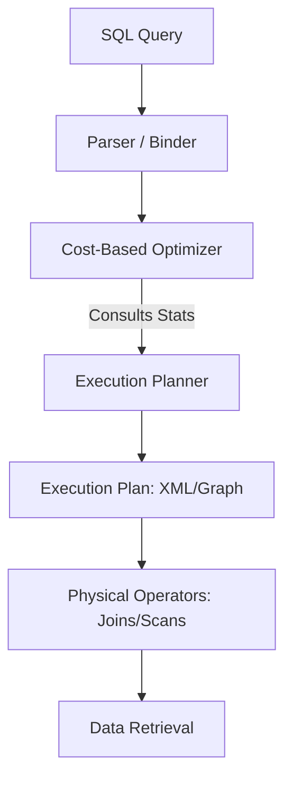

# Query Optimization & Execution Plans: The Science of High-Efficiency Retrieval

============================================================
0. Architectural Vision: The Brain of the Database
============================================================
- **SQL is Declarative, not Procedural.** You tell the database *what* you want; the **Query Optimizer** decides *how* to get it.
- **The Cost-Based Optimizer (CBO).** The engine evaluates thousands of possible "Execution Plans" and picks the one with the lowest "Cost" (CPU, Memory, and I/O).
- **Statistics are the Compass.** The optimizer relies on data distribution statistics (histograms) to make its decisions. Bad stats = Bad plan.
- **Physical Operators.** Transforming logical operations (`JOIN`) into physical ones (`Nested Loops`, `Hash Match`, `Merge Join`).
- **The "Sargable" query.** Ensuring your SQL can be optimized to use indexes rather than scanning the whole table.
- **Architect's View.** We don't just "write SQL"; we design **Query Patterns** that leverage the optimizer's strengths and avoid its "Blind Spots" to ensure sub-millisecond responses at scale.

============================================================
1. Foundational Problem: The "Implicit Conversion" & "Bad Plan"
============================================================
- **Real-World Impact:** You have a query that ran in 10ms for a year. Suddenly, it starts taking 5 seconds. Reindexing doesn't help. 
- **What breaks?** "The Optimization Cliff". The database has chosen a "Sub-optimal Plan" because its statistics are stale, or a small increase in data volume caused a "Flip" from an Index Seek to a Table Scan.
- **Scale Boundary:** In a system with 1,000 active connections, one "Bad Plan" that consumes 100% CPU can cascade, slowing down every other query and eventually triggering a system-wide "Timeout Storm".
- **Failure Story:** A major logistics provider's "Truck Dispatch" query slowed down by 100x during peak hours. The cause was an **Implicit Conversion**. The database column was a `VARCHAR`, but the C# `string` parameter was being passed as an `NVARCHAR`. The SQL engine had to convert every row in the index to `NVARCHAR` for the comparison, disabling the index seek and forcing a full table scan on 10 million rows.

============================================================
2. Internal System Mechanics: Joins and Operators
### The Physical Join Trinity
1. **Nested Loops Join:** O(M * N). Best for joining a small set (Outer) to an indexed large set (Inner).
2. **Merge Join:** O(M + N). Best for joining two very large, sorted sets. Extremely fast but requires sorting.
3. **Hash Join:** Most complex. Best for joining large, unsorted sets. Uses a "Hash Table" in RAM. CPU intensive.



### Performance & Memory Characteristics
- **Memory Grants:** Hash joins and Merge joins require a "Grant" of RAM. If multiple large queries run simultaneously, they may wait in a "Resource Semaphore" queue, causing latency.
- **Parallelism (MAXDOP):** Using multiple CPU cores for a single query. High parallelism is great for data warehousing but can cause "Contention" in high-speed OLTP systems.

============================================================
3. Production Engineering in .NET 8 (EF Core Warnings)
============================================================

### Anti-Pattern: N+1 Queries in EF Core
```csharp
// This generates 1 query for Orders + 100 queries for Items (N+1)
var orders = await _context.Orders.ToListAsync();
foreach(var o in orders) { 
    var items = o.Items; // Lazy Loading disaster
}
```

### Production-Ready Implementation: Explicit Joins and Projections
```csharp
// 1. Projection (Only fetches what is needed - SQL SELECT)
// This narrows the query and allows for better Index paths.
var result = await _context.Orders
    .Select(o => new { o.Id, o.CustomerName, ItemCount = o.Items.Count() })
    .ToListAsync();

// 2. Query Tagging (For easy identification in Execution Plans)
var orders = await _context.Orders
    .TagWith("FetchRecentOrders") 
    .Include(o => o.Items)
    .OrderByDescending(o => o.OrderDate)
    .Take(20)
    .ToListAsync();
```

**Architecture Strategy:** 
- Use **LINQPad** or **EF Core Logging** to inspect the generated SQL and its Execution Plan.
- Implement **Parameterized Queries** to prevent "SQL Injection" and allow for **Plan Re-use (Parameter Sniffing avoidance)**.

============================================================
4. System Interaction & Flow (ASCII Architecture)
============================================================

                ┌──────────────────┐
                │   The C# Code    │ (The Intent)
                └────────┬─────────┘
                         │ 1. EF Core / Dapper SQL
         ┌───────────────▼───────────────┐
         │     THE QUERY OPTIMIZER       │ (The Decision Maker)
         │  ┌─────────┐   ┌─────────┐    │
         │  │ Choose  │ → │ Check   │    │
         │  │ Join    │   │ Stats   │    │
         │  └────┬────┘   └────┬────┘    │
         └───────┼─────────────┼─────────┘
                 │             │ 2. Logical Execution
         ┌───────▼─────────────▼─────────┐
         │     The Storage Engine        │ (The Page Fetcher)
         └───────────────┬───────────────┘
                         │ 3. Return Rows
               ┌─────────▼─────────┐
               │    Result Set     │
               └───────────────────┘

============================================================
5. Strategic Scaling & System Evolution
============================================================
- **Parameter Sniffing.** The database optimizes a plan based on the first parameter it sees (e.g., "Small Customer"). If the next parameter is "Massive Customer", the cached plan may be horribly slow.
    - *Architect's Fix:* Use `OPTION (RECOMPILE)` for very spiky data distributions or use `RECOMPILE` in store procedures.
- **Horizontal Scaling.** Complex Joins across sharded databases are nearly impossible. A move to sharding often requires "Denormalization" to avoid Joins.
- **Read Replicas.** Offloading "Heavy Queries" (Analytics/Reports) to a secondary replica so they don't block the primary OLTP traffic.

============================================================
6. Reliability, Observability & Runtime Governance
============================================================
- **Key Metrics:**
    - `Query Duration (ms)`: P95 and P99 latency.
    - `Rows Examined vs Rows Returned`: Ideally 1:1. If it's 10,000:1, you have a missing index or scan.
- **Tools:** **SQL Server Query Store**, **Azure SQL Query Performance Insight**, **XEvents**.

============================================================
7. Compromises, Tradeoffs & Alternatives
============================================================
- **Normalized vs Denormalized.** Normalization saves space and ensures integrity but requires Joins (Slow). Denormalization is fast (No joins) but wastes space and risks data drift.
- **Computed Columns.** Storing the result of a calculation to avoid repeating it in every query.

============================================================
8. Security Posture & Risk Mitigation
============================================================
- **Query Timeouts.** ALWAYS set a timeout on your queries (e.g., 30 seconds). A "Malicious" or "Badly Optimized" query shouldn't be allowed to run forever and hog system resources.
- **Row-Level Security (RLS).** Ensuring that the query optimizer automatically injects filters so users can only see their own data.

============================================================
9. Technical Edge Cases & System Failure Modes
============================================================
- **Cartesian Product (Cross Join).** Joining two tables without an `ON` clause. (e.g., 1,000 x 1,000 = 1,000,000 rows). Can instantly OOM a server.
- **Sort Spills.** If a `SORT` or `HASH JOIN` doesn't fit in the granted RAM, it "Spills to Disk" (TempDB), making it 1,000x slower.

============================================================
10. Architectural Assessment & Career Progression
============================================================
- **Senior:** "We use execution plans to find missing indexes."
- **Principal:** "Execution optimization is the bridge between **Algebraic Logic** and **Physical Storage**. We design our data models and query patterns to minimize **Logical I/O** and **Memory Contention**. We treat the Execution Plan not just as a diagnostic tool, but as the governing contract of our system's performance. When a plan degrades, we don't just 'Add Index'; we analyze the **Data Distribution** and **Access Pattern** to address the root cause of the optimization failure."
- **Interview Strategy:** Explain the difference between a Hash Join and a Nested Loop Join and when the optimizer chooses one over the other.

============================================================
11. Real-World Case Study: Global Financial Reports
============================================================
**Scenario:** A bank's end-of-day report was taking 4 hours to run.
- **The Problem:** The query was performing a huge "Hash Join" on three 100-million-row tables. It was "Spilling to Disk" (TempDB) because the server didn't have enough RAM for the hash table.
- **The Design:** Added **Covering Indexes** on the join keys and forced a **Merge Join** (which uses less memory as it works on sorted data).
- **Result:** Report time dropped from 4 hours to 15 minutes. TempDB usage dropped by 95%, freeing up the server for other tasks.

============================================================
12. Structural Dependencies & Learning Path
============================================================
- **Foundations:** Relational Algebra, Set Theory, B-Trees.
- **Future Steps:** Columnar Storage (Columnstore indexes), Batch Mode Processing.
- **Integration Points:** Entity Framework Core, Dapper, SQL Server/Postgres Optimizers.
