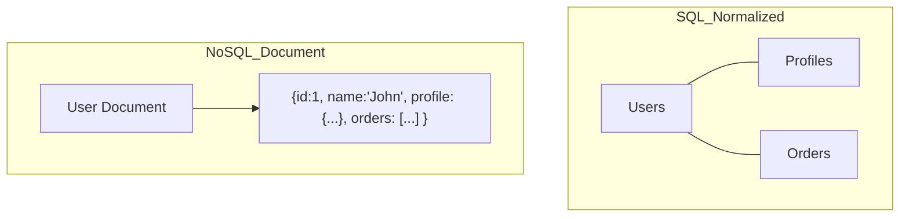

# SQL vs NoSQL Selection: The Architectural Divide of Data Persistence

**0. Architectural Vision: The Right Tool for the Right Shape**
- **SQL (Relational) is for Structure and Integrity.** It excels at complex relationships, strict schemas, and ACID transactions. (e.g., SQL Server, PostgreSQL).
- **NoSQL (Non-Relational) is for Scale and Flexibility.** It excels at massive volume, dynamic schemas, and high-velocity ingestion. (e.g., MongoDB, Cassandra, DynamoDB).
- **Schema-on-Write (SQL) vs Schema-on-Read (NoSQL).** SQL enforces the schema during the `INSERT`; NoSQL handles the data as a blob and the application interprets it later.
- **Scale-Up (Vertical) vs Scale-Out (Horizontal).** SQL is typically scaled by buying a bigger server; NoSQL is scaled by adding more inexpensive servers to a cluster.
- **The CAP Theorem.** You can only have two out of three: Consistency, Availability, and Partition Tolerance. SQL usually picks CP/CA; NoSQL usually picks AP.
- **Architect's View.** We don't believe in "one database for everything". We design **Polyglot Persistence** architectures where the paradigm matches the specific workload (e.g., SQL for Orders, NoSQL for User Activity Logs).

**1. Foundational Problem: The "Rigid Schema" and "Scaling Wall"**
- **Real-World Impact:** You have a social media app. Every time you add a new "Reaction" (Like, Heart, Laugh), a SQL database requires a `SCHEMA ALTER` which locks the table for minutes, taking the site offline. 
- **What breaks?** "The Deployment Deadlock". You can't evolve the product fast enough. Furthermore, when your site hits 1 million users, your "Mega SQL Server" hits its hardware limit, and adding another server doesn't help because SQL doesn't natively "Split" data easily.
- **Scale Boundary:** At 1,000,000 requests per second, a single-primary SQL database becomes a massive bottleneck and a single point of failure.
- **Failure Story:** A major gaming company launched a new RPG. They used SQL for the "Live Player Position" updates. Within 1 hour, the database was crushed by millions of updates per second. The WAL (Write Ahead Log) couldn't keep up with the disk I/O. They had to take the game down for 24 hours to migrate the "Live State" to a **NoSQL (Redis/Key-Value)** store that could handle 10x the write throughput on 1/10th of the hardware.

============================================================
2. Internal System Mechanics: Relational vs Aggregates
### Data Modeling Paradigms
- **SQL (Normalization):** Breaks data into small, linked tables to avoid redundancy. (Joins required).
- **NoSQL (Denormalization):** Groups data into "Aggregates" (Documents). All data for a "User" is in one JSON blob. (No Joins required).



### Scaling & Consistency
- **SQL:** ACID transactions across tables. High consistency.
- **NoSQL:** Base properties (Basically Available, Soft state, Eventual consistency). High availability.

**3. Production Engineering in .NET 8 (EF Core vs NoSQL SDKs)**

### Anti-Pattern: Using NoSQL exactly like SQL
```csharp
// TERRIBLE: Trying to perform a "Join" in the application code across NoSQL collections.
var user = await mongo.Get(id);
var orders = await mongo.GetOrders(user.Id); // 2 network hops, slow!
```

### Production-Ready Implementation: Choosing the Right Driver
```csharp
// 1. SQL for Relational Complexity (Entity Framework)
public async Task SaveTransaction(Transaction t) {
    using var tx = await _context.Database.BeginTransactionAsync();
    _context.Transactions.Add(t);
    _context.Ledger.Update(l); // Enforce ACID integrity
    await _context.SaveChangesAsync();
}

// 2. NoSQL for High-Velocity Documents (CosmosDB/Mongo)
public async Task SaveActivityLog(UserActivity log) {
    // High throughput, no transaction overhead, partition-aware
    await _container.CreateItemAsync(log, new PartitionKey(log.UserId));
}
```

**Architecture Strategy:** 
- Use **Outbox Pattern** to sync data between a SQL "System of Record" and a NoSQL "Read Model".
- Implement **Bounded Contexts** (from DDD) to decide where SQL ends and NoSQL begins.

**4. System Interaction & Flow (ASCII Architecture)**

                ┌──────────────────┐
                │   The Request    │ (The Data Shape)
                └────────┬─────────┘
                         │ 1. Decision Logic
         ┌───────────────▼───────────────┐
         │     THE ARCHITECT'S CHOICE    │ (The Persistence Guard)
         │  ┌─────────┐   ┌─────────┐    │
         │  │ SQL     │   │ NoSQL   │    │
         │  │ (Rel)   │   │ (Agg)   │    │
         │  └────┬────┘   └────┬────┘    │
         └───────┼─────────────┼─────────┘
                 │             │ 2. Storage Path
         ┌───────▼─────────────▼─────────┐
         │     Physical Data Storage     │ (Disk/RAM)
         └───────────────┬───────────────┘
                         │ 3. Consistency Level
               ┌─────────▼─────────┐
               │ Strict vs Eventual│
               └───────────────────┘

**5. Strategic Scaling & System Evolution**
- **Migration Path.** Moving from SQL to NoSQL is a "One-Way Door". It requires a complete rethink of how data is queried (no more arbitrary Joins).
- **Polyglot Persistence.** A single "Order" might start as a NoSQL "Draft", move to a SQL "System of Record" when paid, and then be archived into a **Cold Storage (AWS S3/Azure Blob)** after 7 years.
- **Global Distribution.** NoSQL databases (like DynamoDB Global Tables) are significantly better at cross-continent replication than traditional SQL.

**6. Reliability, Observability & Runtime Governance**
- **Key Metrics:**
    - `Query Latency`: P99 should be < 100ms.
    - `Staleness (NoSQL)`: How many seconds behind is the secondary replica?
- **Observability:** Use **OpenTelemetry** to trace requests that span across multiple database types.

**7. Compromises, Tradeoffs & Alternatives**
- **Hybrid Databases.** (e.g., PostgreSQL with JSONB). Allows you to have SQL structure and NoSQL flexibility in one engine. The "Best of Both Worlds" for many 80/20 use cases.
- **The Cost of Consistency.** High consistency (SQL) always costs more in latency and throughput.

**8. Security Posture & Risk Mitigation**
- **Injection Attacks.** Both SQL (SQL Injection) and NoSQL (NoSQL Injection/Command Injection) are vulnerable. Use parameterized queries and SDK-specific builders.
- **Data Sovereignty.** Ensure that your NoSQL "Cluster" stays within the correct geographic territory for legal compliance (GDPR).

**9. Technical Edge Cases & System Failure Modes**
- **The "Schema Drift" in NoSQL.** Because the DB doesn't enforce schema, your code might crash if it encounters a 5-year-old document with a missing field.
    - *Architect's Rule:* Use **Versioned Schema Handling** in your C# POCOs (Plain Old CLR Objects).
- **Large Document Problem.** If a single NoSQL document grows above 16MB (Mongo limit), it crashes the system.

**10. Architectural Assessment & Career Progression**
- **Senior:** "SQL is for tables; NoSQL is for JSON."
- **Principal:** "The choice between SQL and NoSQL is a decision about the **System's Consistency Boundary** and its **Scaling Philosophy**. We use SQL when the 'Integrity of Relation' is the primary value; we use NoSQL when 'Operational Availability' and 'Logarithmic Scale' are the primary requirements. A master architect designs 'Cooperative Data Ecosystems' where multiple persistence paradigms work in harmony to meet the P99 performance and reliability targets of the entire platform."
- **Interview Strategy:** Explain the trade-offs of the CAP theorem and justify why you would choose one database over another for a specific use case (e.g., a "Product Catalog" vs a "Financial Ledger").

**11. Real-World Case Study: Global Ride-Sharing**
**Scenario:** A competitor to Uber with 10M rides per day.
- **The Problem:** The "Driver Location" updates were killing their SQL database. The "User Receipt" search was slow because of fragmentation.
- **The Design:** Moved "Live Locations" to a **Geospatial NoSQL (Redis/Cassandra)**. Kept "Rider/Driver Profiles" and "Payments" in **SQL (PostgreSQL)** for ACID.
- **Result:** Latency for drivers dropped from 500ms to 20ms. The total hardware cost for the location service dropped by 60%.

**12. Structural Dependencies & Learning Path**
- **Foundations:** Relational Algebra, JSON Modeling, CAP Theorem.
- **Future Steps:** NewSQL (CockroachDB/Spanner), Distributed Systems.
- **Integration Points:** EF Core, CosmosDB SDK, MongoDB Driver, Redis.
