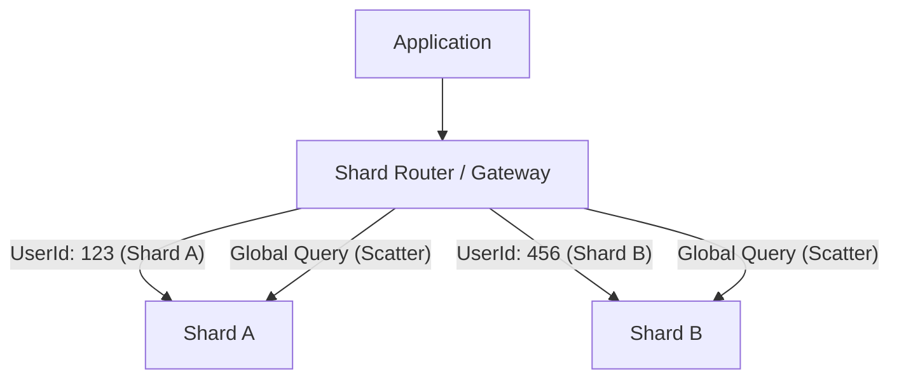

# Sharding & Partitioning: Engineering Infinite Database Scale

**0. Architectural Vision: Dividing the Data for Conquer**
- **Horizontal Scaling is the Final Frontier.** Sharding is the process of splitting a single logical database into multiple physical databases (Shards).
- **Partitioning (Logical) vs Sharding (Physical).** Partitioning organizes data *within* one server; Sharding spreads data *across* many servers.
- **The Shard Key.** The most critical design decision. It determines how data is distributed (e.g., `UserId`, `RegionId`, `TenantId`).
- **Scatter-Gather.** The architectural cost of sharding. A query that doesn't include the Shard Key must "Scatter" to every shard and "Gather" the results, which is extremely slow.
- **Data Locality.** Keeping related data on the same physical shard to allow for Joins and Transactions within that shard.
- **Architect's View.** We don't shard unless we have to. It is the "Last Resort" for databases that have outgrown the largest possible single-server hardware. We aim for "Shared-Nothing" architectures where each shard is completely autonomous.

**1. Foundational Problem: The "Big Table" Performance Wall**
- **Real-World Impact:** You have a `Transactions` table with 10 billion rows on one massive server. Even with perfect indexes, inserting one row takes 1 second because the index maintenance is too heavy. Backups take 3 days. 
- **What breaks?** "The Operational Gridlock". You can't patch the OS because the server takes too long to reboot. You can't run analytics because the disk I/O is 100% saturated.
- **Scale Boundary:** At 50TB of data, most traditional SQL databases become unmanageable as a single unit.
- **Failure Story:** A gaming company used one massive database for all user items. During a "Loot Drop" event, the write volume hit 100k/sec. The server's I/O wait spiked to 20 seconds, crashing the game. They had to take the game offline for 2 days to **Shard by UserID**. If they had sharded from day one (or at 1TB), they could have simply added 5 more shards during the event to handle the load.

============================================================
2. Internal System Mechanics: Sharding Logic
### Sharding Strategies
1. **Range-Based Sharding:** (e.g., A-M on Shard 1, N-Z on Shard 2). Simple but leads to "Hot Spots" (e.g., too many names starting with 'S').
2. **Hash-Based Sharding:** (e.g., `Hash(UserId) % ShardCount`). Good distribution, but makes range queries (Give me all users 1 to 100) impossible.
3. **Directory-Based Sharding:** A lookup table tracks which ID is on which Shard. Most flexible but adds a "Lookup Hop" to every query.



### Logical Partitioning (Partitioned Tables)
- In SQL Server/Postgres, you can split a table by `Year`. 
- **Benefit:** Dropping "Old Data" becomes a sub-second `TRUNCATE PARTITION` instead of a week-long `DELETE`.

**3. Production Engineering in .NET 8 (Application-Level Sharding)**

### Anti-Pattern: Hardcoded Shard Connection Strings
```csharp
// TERRIBLE: If a Shard moves, you have to re-deploy your app.
if(userId < 1000) return new SqlConnection("Shard1");
```

### Production-Ready Implementation: Shard Provider Pattern
```csharp
// 1. Shard Resolver Interface
public interface IShardResolver {
    string GetConnectionString(Guid tenantId);
}

// 2. Consistent Hashing Implementation
public class TenantShardResolver : IShardResolver {
    private readonly List<string> _shards = ...; // List of shard URIs
    public string GetConnectionString(Guid tenantId) {
        // Use a consistent hash so adding a shard doesn't move every tenant
        int shardIndex = (tenantId.GetHashCode() & 0x7FFFFFFF) % _shards.Count;
        return _shards[shardIndex];
    }
}

// 3. Transparent Sharding in EF Core
public class MyDbContext : DbContext {
    private readonly IShardResolver _resolver;
    private readonly Guid _currentTenant;

    protected override void OnConfiguring(DbContextOptionsBuilder builder) {
        builder.UseSqlServer(_resolver.GetConnectionString(_currentTenant));
    }
}
```

**Architecture Strategy:** 
- Implement **Consistent Hashing** so that when you add Shard #11, only 1/10th of your data needs to move (Re-sharding).
- Use **Global Sequence Generators** (like Snowflake IDs) to ensure unique IDs across all shards.

**4. System Interaction & Flow (ASCII Architecture)**

                ┌──────────────────┐
                │   The Request    │ (The Action)
                └────────┬─────────┘
                         │ 1. Extract Shard Key
         ┌───────────────▼───────────────┐
         │     THE SHARD ROUTER          │ (The Traffic Cop)
         │  ┌─────────┐   ┌─────────┐    │
         │  │ Key     │ → │ Lookup  │    │
         │  │ Logic   │   │ Registry│    │
         │  └────┬────┘   └────┬────┘    │
         └───────┼─────────────┼─────────┘
                 │             │ 2. Direct Connection
         ┌───────▼─────────────▼─────────┐
         │      Target Shard (ID: 5)     │ (The Physical Store)
         └───────────────┬───────────────┘
                         │ 3. Return Sub-Set
               ┌─────────▼─────────┐
               │    Shard Result   │
               └───────────────────┘

**5. Strategic Scaling & System Evolution**
- **Resharding (The Nightmare).** When Shard 1 is full, and you need to split it into 1A and 1B. This involves real-time data migration with zero downtime.
- **Cross-Shard Transactions.** (Avoid!). If you must, use a **Saga Pattern** or a **Distributed Transaction Coordinator (DTC)**.
- **Tenant Isolation.** In Multi-Tenant SAAS, high-value "Enterprise Tenants" often get their own dedicated Shard, while "Free Tier" tenants share a "Noise-Sensitive" shard.

**6. Reliability, Observability & Runtime Governance**
- **Key Metrics:**
    - `Shard Balance`: Are all shards roughly the same size/CPU?
    - `Cross-Shard Query Count`: High number indicates a poor Shard Key choice.
- **Observability:** Trace every database call with the `ShardID` so you can identify if a specific physical server is failing.

**7. Compromises, Tradeoffs & Alternatives**
- **Vertical Scaling (Buying RAM).** Always cheaper than Sharding in terms of developer time, until the hardware limit is reached.
- **Read Replicas.** If your problem is "Read Load", use replicas before Sharding. Sharding is for "Write Load" and "Capacity".

**8. Security Posture & Risk Mitigation**
- **Blast Radius.** Sharding *increases* reliability. If Shard 5 fails, only 10% of your users are affected. The other 90% are fine.
- **GDPR (Data Residency).** Use sharding to ensure that German users' data stays on a Shard located in Frankfurt.

**9. Technical Edge Cases & System Failure Modes**
- **The Hot Key Problem.** (e.g., Sharding by `Date`). All writes go to "Today's Shard". The other 364 shards are idle.
    - *Architect's Rule:* Never shard by a monotonic increasing value (Date, Identity ID) unless you also include another high-cardinality key (e.g., `UserId-Date`).
- **Join Complexity.** You cannot join `Users` on Shard A with `Addresses` on Shard B.

**10. Architectural Assessment & Career Progression**
- **Senior:** "We shard our database to handle more data across multiple servers."
- **Principal:** "Sharding is the ultimate decomposition of state. We treat it as an **Infrastructure Layer Abstraction**, ensuring that our Shard Routing logic is performant and deterministic. We design for **Elastic Resharding** and use **Consistent Hashing** to minimize data movement. For us, sharding is not just a fix for 'database full'; it is a strategic choice to maximize **Concurrency Boundaries** and provide **Geographic Sovereignty** to our global user base."
- **Interview Strategy:** Compare and contrast Range, Hash, and List sharding. Explain what a "Hot Shard" is and how to fix it.

**11. Real-World Case Study: Global Social Network**
**Scenario:** A platform with 500 million users. One SQL database was hitting 1 Petabyte.
- **The Problem:** One single schema change (e.g., adding a "BirthDate" column) was estimated to take 2 weeks of downtime.
- **The Design:** Sharded by `Hash(UserId) % 1024`. Used **Vitess** (CNCF project) as a proxy layer so the C# code thinks it's one database.
- **Result:** They can now add 1024 servers if needed. Schema changes now happen in parallel across shards, reducing the time to 1 hour (per shard set).

**12. Structural Dependencies & Learning Path**
- **Foundations:** Hashing, TCP/IP, Distributed Systems.
- **Future Steps:** NewSQL (Vitess, Citus), Autonomous Sharding (CosmosDB).
- **Integration Points:** ADO.NET, Dapper, SQL Partitioning, Azure SQL Elastic Pools.
