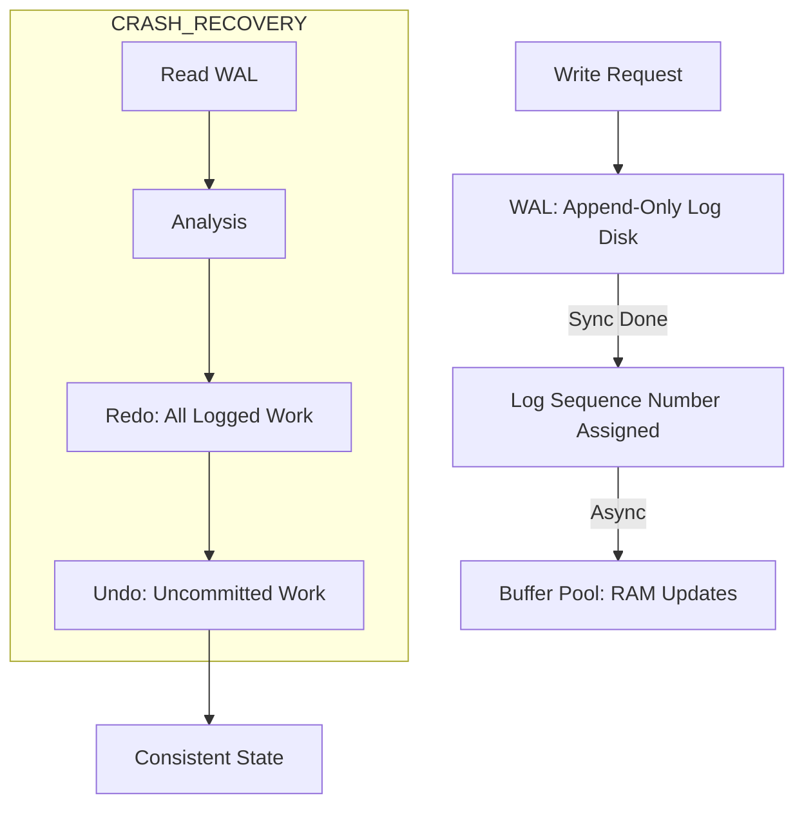

# WAL & Recovery: The Mechanics of Durability and Crash Survival

============================================================
0. Architectural Vision: The Unforgettable Memory
============================================================
- **WAL (Write-Ahead Logging) is the Durability Contract.** It ensures that any change is recorded to a persistent log *before* it is applied to the actual data pages.
- **Atomic Recovery.** The ability to restore a database to a consistent state after a power failure or system crash.
- **ARIES algorithm.** (Algorithms for Recovery and Isolation Exploiting Semantics). The industry standard for redo/undo recovery used in SQL Server and Postgres.
- **Checkpointing.** The periodic process of flushing all "Dirty Pages" from RAM to disk and marking the log, speeding up future recovery times.
- **The Recovery Boundary.** A database is only truly reliable if its **Mean Time to Recovery (MTTR)** is low enough to meet business SLAs.
- **Architect's View.** We don't just "save data"; we design **Crash-Resilient State Machines**. We understand that the disk is slow and the network is flaky, so we use sequential logging as our primary trust mechanism to guarantee durability without sacrificing P99 performance.

============================================================
1. Foundational Problem: The "In-Flight Crash"
============================================================
- **Real-World Impact:** You are writing 1,000,000 records. At record 500,000, the server loses power. The RAM (containing the other 500,000) is wiped clean. 
- **What breaks?** "The State Corruption". Some rows are on disk, some are missing, and some might be partially written (torn pages). Without a solid **WAL and Recovery** engine, you would have to delete the whole database and restore from a day-old backup, losing 24 hours of work.
- **Scale Boundary:** In high-volume systems (10k+ writes/sec), the WAL becomes the ultimate bottleneck. If the disk can't append to the log fast enough, the whole application stops.
- **Failure Story:** A major cloud provider's storage service experienced a cascading failure because their **Checkpointing** was too aggressive. During a surge, the "Disk Flushing" process consumed 100% of the I/O, preventing the WAL from writing new transactions. The system timed out, crashed, and because the log was so large (due to late checkpoints), it took 12 hours just to "Replay" the log. Proper **Incremental Checkpointing** would have kept recovery time under 5 minutes.

============================================================
2. Internal System Mechanics: Log Replay and ARIES
### The Recovery Phases (ARIES)
1. **Analysis:** Scan the log to identify which transactions were active at the time of the crash (dirty pages).
2. **Redo:** "Repeat History". Replay all operations in the log to bring the database to the state it was in exactly when it crashed.
3. **Undo:** "Clean Up". Roll back any transactions that were active (not committed) during the crash to ensure consistency.



### Key Components
- **LSN (Log Sequence Number):** The unique, monotonically increasing ID for every log record.
- **The Log Buffer:** A small area of memory that batches log records before they are forced (Fsync'd) to disk.

============================================================
3. Production Engineering in .NET 8 (Storage Tuning)
============================================================

### Anti-Pattern: Putting Data and Logs on the same Physical Disk
```text
C:\Database\MyData.mdf
C:\Database\MyLog.ldf
-- TERRIBLE: Sequential WAL writes are interrupted by Random Data reads, killing performance.
```

### Production-Ready Implementation: Optimized WAL Strategy
- **Physical Separation:** Place the `.ldf` (Log) file on an ultra-fast, sequential NVMe drive and the `.mdf` (Data) on slower, large capacity storage.
- **Configuring Autogrow:** Ensure the log file doesn't constantly grow in small increments (e.g., 1MB). This causes **Virtual Log File (VLF) Fragmentation**, which slows down recovery.
- **Transaction Log Backups:** In SQL Server (Full Recovery Model), the log will grow infinitely until you take a "Log Backup". This releases the completed parts of the log for reuse.

```csharp
// Architect's Tip: Use explicit 'Fsync' awareness in your app
// If you are building a custom storage engine, use FileOptions.WriteThrough
using var stream = new FileStream(path, FileMode.Append, FileAccess.Write, FileShare.None, 4096, FileOptions.WriteThrough);
```

============================================================
4. System Interaction & Flow (ASCII Architecture)
============================================================

                ┌──────────────────┐
                │   The OS Crash   │ (The Event)
                └────────┬─────────┘
                         │ 1. Start Database
         ┌───────────────▼───────────────┐
         │      THE RECOVERY MANAGER     │ (The Restorer)
         │  ┌─────────┐   ┌─────────┐    │
         │  │ Analysis│ → │ Redo    │    │
         │  │ Log Scan│   │ Phase   │    │
         │  └────┬────┘   └────┬────┘    │
         └───────┼─────────────┼─────────┘
                 │             │ 2. Undo Phase (Rollback)
         ┌───────▼─────────────▼─────────┐
         │     The Consistent Page Set   │ (Ready for Users)
         └───────────────┬───────────────┘
                         │ 3. Resume Operations
               ┌─────────▼─────────┐
               │   New Request     │
               └───────────────────┘

============================================================
5. Strategic Scaling & System Evolution
============================================================
- **Logical vs Physical Logs.** Logical logs store the SQL (`INSERT ...`), Physical logs store the byte changes. Physical is faster to replay but much larger.
- **Log Shiping.** Using the WAL to replicate data to a remote region for disaster recovery. If the primary site is destroyed by a fire, the remote site uses its copy of the log to recover the system.
- **Streaming Recovery.** Modern DBs let users start reading data while the Undo phase is still running in the background (Snapshot isolation during recovery).

============================================================
6. Reliability, Observability & Runtime Governance
============================================================
- **Key Metrics:**
    - `Log Flush Wait Time`: Indicates if your disk is too slow for your write volume.
    - `Checkpoint Duration`: How long is the system frozen during a sweep?
- **Observability:** Monitor `SQLServer:Databases -> Log Flush Wait Time`. If this spikes above 10ms, your users will feel it immediately.

============================================================
7. Compromises, Tradeoffs & Alternatives
============================================================
- **No-Logging (NOLOGGING/Bulk Insert).** Skipping the WAL for massive data imports to gain 10x speed. 
    - *Architect's Warning:* If you crash during a NOLOGGING operation, that table is unrecoverable. Only use it for temporary/staging data.
- **Deferred Durability.** Telling the DB to return "Success" before the log is Fsync'd. (AP over CP). Faster but risks losing the last 1 second of data in a crash.

============================================================
8. Security Posture & Risk Mitigation
============================================================
- **Log Forensics.** The WAL is a perfect record of everything that happened. Use it for auditing or to "Rewind" the database if an attacker deletes data (Point-in-Time Recovery).
- **Log Encryption.** If an attacker steals your `.ldf` file, they can see every piece of data written to the database. Always use **Transparent Data Encryption (TDE)**.

============================================================
9. Technical Edge Cases & System Failure Modes
============================================================
- **The "Torn Page".** A crash happens *while* the 8KB page is being written to disk, so 4KB is new and 4KB is old.
    - *Architect's Rule:* Use **Checksums** on every page to detect and fix torn pages using the WAL.
- **Log Corruption.** If the disk sector containing the WAL itself is physically damaged. (Use RAID/Mirroring).

============================================================
10. Architectural Assessment & Career Progression
============================================================
- **Senior:** "We have transaction logs to help us recover if the server crashes."
- **Principal:** "WAL and Recovery are the 'State Reconciliation' mechanisms that define our **Durability SLA**. We treat the log as the **Single Source of Truth**, recognizing that the physical data files are merely a cached optimization of the log's history. By optimizing our **VLF structures** and separating our **I/O Pathways**, we ensure that our persistence layer can handle high-intensity write workloads while maintaining a deterministic, sub-minute **RTO (Recovery Time Objective)**."
- **Interview Strategy:** Explain how the ARIES algorithm handles redo/undo and why checkpointing is necessary even if we have a perfect WAL.

============================================================
11. Real-World Case Study: Global Stock Exchange
============================================================
**Scenario:** An exchange processing 100k trades/sec.
- **The Problem:** During high volatility, the WAL disk latency spiked to 50ms, causing "Order Execution" timeouts.
- **The Design:** Implemented **Non-Volatile RAM (NVRAM)** for the log buffer, allowing log flushes at sub-100 microsecond latency. Separated Transaction logs from Audit logs.
- **Result:** Trade latency stayed rock-solid even during the 2020 crash. Their **MTTR (Mean Time to Recovery)** dropped from 20 minutes to 30 seconds.

============================================================
12. Structural Dependencies & Learning Path
============================================================
- **Foundations:** File I/O, OS Internals, Transaction Theory.
- **Future Steps:** Distributed Logging (Kafka), Event Sourcing.
- **Integration Points:** SQL Server Transaction Logs, Postgres WAL, Azure SQL geo-replication.
