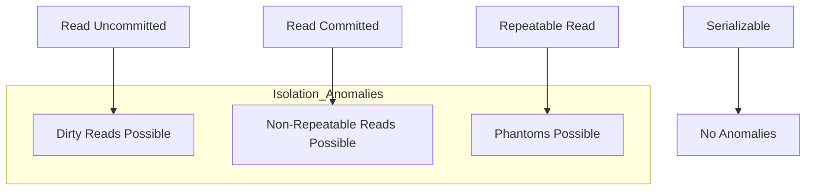

# Transaction Isolation Levels: Balancing Consistency and Concurrency

============================================================
0. Architectural Vision: The Walls Between Transactions
============================================================
- **Isolation is the "I" in ACID.** It determines how visible the changes made by one transaction are to other concurrent transactions.
- **The Spectrum of Isolation.** From "Total Chaos" (Read Uncommitted) to "Perfect Separation" (Serializable).
- **Read Anomalies.** The three classic problems: Dirty Reads, Non-repeatable Reads, and Phantoms.
- **MVCC (Multi-Version Concurrency Control).** The modern way to achieve high isolation without constant locking by keeping multiple "Versions" of a row (used in Postgres and SQL Server Snapshot).
- **Concurrency Trade-off.** Higher isolation = More locking/versioning = Lower throughput and higher latency.
- **Architect's View.** We don't just default to "Serializable"; we choose the **Lowest Safe Isolation Level** for each specific business operation to maximize performance without compromising the integrity of the "State Machine".

============================================================
1. Foundational Problem: The "Ghost Sale" and "Double Payment"
============================================================
- **Real-World Impact:** Two users try to buy the last concert ticket at the exact same millisecond. 
- **What breaks?** "The Race Condition". Transaction A reads 'Tickets=1'. Transaction B reads 'Tickets=1'. Both subtract 1 and set 'Tickets=0'. The system has sold 2 tickets but only decremented the count once.
- **Scale Boundary:** In a system with 1,000 parallel threads, without proper isolation, your "Aggregate Totals" (like total money in the bank) will slowly "Drift" away from the truth every day.
- **Failure Story:** A major betting platform used **Read Uncommitted** to maximize speed. During a major match, a user placed a bet. A background "Fraud Check" read that bet (Dirty Read) and marked it suspicious. The user's original transaction failed and rolled back. However, the fraud service didn't know the transaction was gone and blocked the user's account for a bet that technically never existed in the database.

============================================================
2. Internal System Mechanics: Anomalies and Levels
### The Four Standard Isolation Levels
1. **Read Uncommitted:** Can see uncommitted changes. (Speed: Fastest).
2. **Read Committed:** Guaranteed to see only committed data. (Industry Default).
3. **Repeatable Read:** If you read Row X twice, it won't change between reads. (Prevents Non-repeatable Read).
4. **Serializable:** Total isolation. Phantoms (new rows appearing) are prevented. (Speed: Slowest).



### Locking Mechanisms
- **Pessimistic:** "Block everyone else until I'm done". (Uses Shared/Exclusive Locks).
- **Optimistic (MVCC):** "Proceed and check for conflicts at the end". (Uses Row Versions).

============================================================
3. Production Engineering in .NET 8 (ADO.NET & EF Core)
============================================================

### Anti-Pattern: Using 'Serializable' for everything
```csharp
// TERRIBLE: This causes Deadlocks on almost every concurrent write.
using var tx = await context.Database.BeginTransactionAsync(IsolationLevel.Serializable);
```

### Production-Ready Implementation: Choosing the Level per Task
```csharp
// 1. Snapshot Isolation (SQL Server) - Best for long-running reports
// Allows reading a consistent 'Point in Time' version of data without blocking writes.
await _context.Database.ExecuteSqlRawAsync("SET TRANSACTION ISOLATION LEVEL SNAPSHOT");
using var tx = await _context.Database.BeginTransactionAsync();

// 2. Read Committed Snapshot (RCSI)
// The modern 'Sweet Spot' for ASP.NET apps. Reads don't block writes.
// (Configured at DB Level usually)

// 3. Optimistic Concurrency with EF Core
// Instead of DB Locks, use a [Timestamp] / RowVersion column.
try {
    await _context.SaveChangesAsync(); 
} catch (DbUpdateConcurrencyException ex) {
    // Handle the fact that someone else updated the row while we were thinking
}
```

**Architecture Strategy:** 
- Use **Read Committed Snapshot (RCSI)** as your global default for SQL Server.
- Use **Serializable** ONLY for critical financial logic where "Phantom Reads" would be catastrophic (e.g., Calculating Daily Interest).

============================================================
4. System Interaction & Flow (ASCII Architecture)
============================================================

                ┌──────────────────┐
                │   Transaction A  │ (The Reader)
                └────────┬─────────┘
                         │ 1. Start Read (Repeatable)
         ┌───────────────▼───────────────┐
         │     THE LOCK MANAGER / MVCC   │ (The Buffer Guard)
         │  ┌─────────┐   ┌─────────┐    │
         │  │ Shared  │ → │ Row     │    │
         │  │ Lock    │   │ Version │    │
         │  └────┬────┘   └────┬────┘    │
         └───────┼─────────────┼─────────┘
                 │             │ 2. Block Transaction B (Write)
         ┌───────▼─────────────▼─────────┐
         │      Data Row (ID: 99)        │ (The Protected Asset)
         └───────────────┬───────────────┘
                         │ 3. Unlock on Commit
               ┌─────────▼─────────┐
               │   Final Result    │
               └───────────────────┘

============================================================
5. Strategic Scaling & System Evolution
============================================================
- **Deadlock Handling.** When Transaction A waits for B, and B waits for A.
    - *Architect's Rule:* Always access tables in the same order. Use "Deadlock Priority" to kill the least important query.
- **Write-Write Conflicts.** In MVCC, if two people update the same row at once, one will fail. Your application MUST have a retry policy.
- **Reporting Offload.** Use Snapshot isolation on **Read Replicas** so that huge analytical queries don't slow down the main OLTP database.

============================================================
6. Reliability, Observability & Runtime Governance
============================================================
- **Key Metrics:**
    - `Lock Wait Time`: How many ms are queries waiting for locks?
    - `Deadlock rate`: Higher than 1 per hour indicates a design flaw.
- **Observability:** Use **SQL Profiler** or **Extended Events** to find "Blocked Queries".

============================================================
7. Compromises, Tradeoffs & Alternatives
============================================================
- **Locking vs Versioning.** Locking is memory-efficient but blocking; Versioning (TempDB) is non-blocking but uses more disk and CPU.
- **No-Lock hint (`WITH (NOLOCK)`).** The nuclear option. Great for performance on reports that don't need 100% accuracy, but dangerous for data integrity.

============================================================
8. Security Posture & Risk Mitigation
============================================================
- **Timing Attacks.** Monitoring how long a transaction takes to detect the presence or absence of a row (if the isolation level causes a lock).
- **Data Leakage.** Ensure that uncommitted data (Dirty Read) isn't accidentally shown to a user, as that data might be rolled back and might contain incorrect sensitive information.

============================================================
9. Technical Edge Cases & System Failure Modes
============================================================
- **Phantom Read.** You count `total_users=10`. While you are still in the transaction, someone adds a user. You check again, and `total_users=11`.
- **The "Lost Update".** Two people change the same row; the second update overwrites the first without knowing it. (Fixed by **Repeatable Read** or **Optimistic Concurrency**).

============================================================
10. Architectural Assessment & Career Progression
============================================================
- **Senior:** "We use isolation levels to prevent dirty reads and ensure data consistency."
- **Principal:** "Transaction Isolation is the knob that turns the **System Entanglement** up or down. We engineer for **High Concurrency** by minimizing the 'Time-under-Lock' and embracing **Multi-Version access patterns**. We understand that 'Safe' isn't just about the highest level, but about the **Formal Verification** of our data flows, ensuring that the chosen level prevents the specific anomalies that would break our business logic while maintaining the P99 performance of the global cluster."
- **Interview Strategy:** Explain how MVCC (Snapshot) works and why it is superior to traditional locking for high-read web applications.

============================================================
11. Real-World Case Study: International Stock Exchange
============================================================
**Scenario:** A secondary market for private equity.
- **The Problem:** The "Total Asset Value" calculation was taking 10 minutes and blocking all "Asset Buy/Sell" orders.
- **The Design:** Switched the "Value Calculation" to **Snapshot Isolation**. 
- **Result:** The calculation query now reads a "Consistent Point in Time" version from the version store (TempDB) without taking any shared locks. Orders continue to process instantly. Asset calculations are 100% accurate as of the start time of the query.

============================================================
12. Structural Dependencies & Learning Path
============================================================
- **Foundations:** ACID, Locking, MVCC.
- **Future Steps:** Linearizability, Strict Serializability, Clock Synchronization.
- **Integration Points:** ADO.NET `IsolationLevel`, EF Core Transactions, SQL Server `RCSI`.
