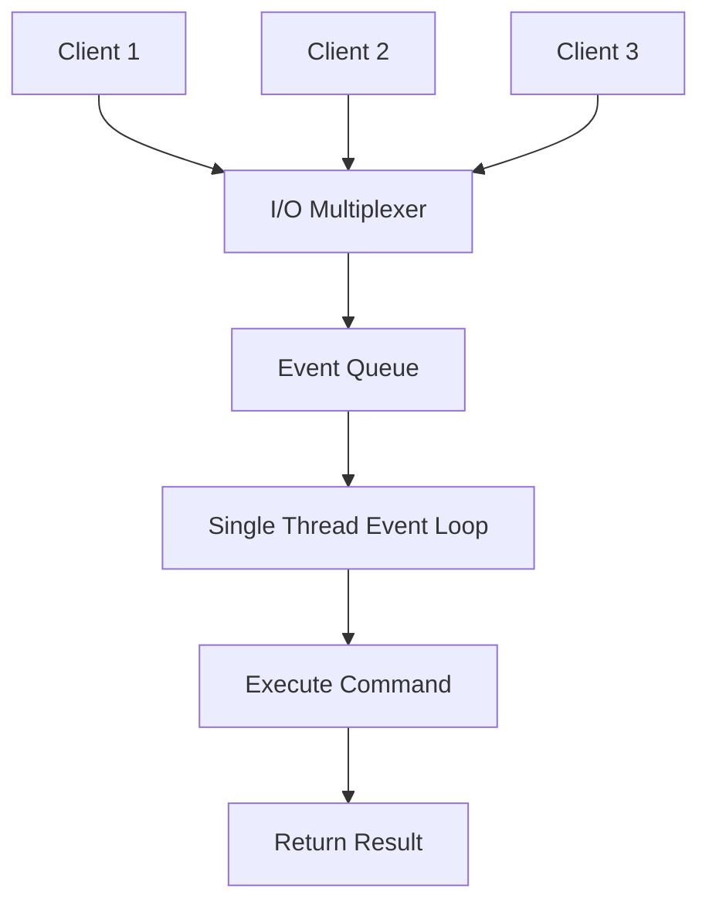

# Key-Value Stores: The Internals of Redis and High-Velocity Memory
============================================================
0. Architectural Vision: The Speed of RAM
============================================================
- **Redis is more than a Cache.** It is a specialized, in-memory data structure store used as a database, cache, and message broker.
- **The Single-Threaded Paradox.** Redis executes commands sequentially in a single thread, eliminating lock contention and context switching overhead.
- **Data Structure Diversity.** Beyond simple Strings; it provides Hashes, Lists, Sets, Sorted Sets, Bitmaps, HyperLogLogs, and Streams.
- **In-Memory Performance.** Sub-millisecond latency (100k+ RPS on a single core) due to zero disk I/O during request processing.
- **Persistence Trade-offs.** Balancing performance with durability using RDB (Snapshots) and AOF (Append-Only File).
- **Architect's View.** We use Redis to solve two specific problems: **Latency** (getting data fast) and **Throughput** (handling more users than a disk-based DB can support). We treat Redis as a "Performance Accelarator" that requires careful memory management and eviction strategy design.

============================================================
1. Foundational Problem: The "State Bottleneck"
============================================================
- **Real-World Impact:** You have a "Flash Sale" where 100,000 users try to "Claim a Coupon" at once. Your SQL database crashes because it can't handle the lock contention on the `CouponCount` row.
- **What breaks?** "The Database Lock wait". Every user thread waits for the DB row lock, exhausting the web server's thread pool. The whole system freezes.
- **Scale Boundary:** Disk-based systems (even with SSDs) are limited by I/O latency (ms). Memory-based systems are limited by memory bus speed (ns).
- **Failure Story:** A major gaming backend used SQL to store "Current Player session tokens". During a server reboot, 1 million players tried to reconnect simultaneously. The SQL DB hit 100% CPU and 100% Disk I/O, taking 30 minutes to process the logins. Moving the sessions to **Redis** reduced the login storm processing time to 45 seconds.

============================================================
2. Internal System Mechanics: Structures and Event Loops
============================================================

### The Redis Event Loop (ae)
Redis uses a non-blocking I/O multiplexing mechanism (like `epoll` or `kqueue`) to handle thousands of connections with a single execution thread.



### Specialized Data Structures
- **SDS (Simple Dynamic String):** Binary-safe strings with O(1) length calculation.
- **ZipList:** Compressed list for small collections (saves memory).
- **SkipList:** The magic behind "Sorted Sets" (ZSETs). Allows O(log N) search and insertion without the complexity of rebalancing trees.

============================================================
3. Production Engineering in .NET 8 (StackExchange.Redis)
============================================================

### Anti-Pattern: Creating a New Connection for every Request
```csharp
// TERRIBLE: Connecting to Redis takes 10-50ms. 
using var redis = ConnectionMultiplexer.Connect("localhost"); 
```

### Production-Ready Implementation: The Multiplexer Singleton
```csharp
// 1. Register as a Singleton (ConnectionMultiplexer is designed to be shared)
builder.Services.AddSingleton<IConnectionMultiplexer>(sp => 
    ConnectionMultiplexer.Connect("my-redis-host:6379,abortConnect=false,ssl=true"));

// 2. High-Performance Usage
public class CacheService {
    private readonly IDatabase _db;
    public CacheService(IConnectionMultiplexer redis) {
        _db = redis.GetDatabase();
    }

    public async Task<string> GetOrSetAsync(string key, Func<Task<string>> fetch) {
        var val = await _db.StringGetAsync(key);
        if (val.HasValue) return val;
        
        var newVal = await fetch();
        // Use 'When.NotExists' for atomic "Locking" logic
        await _db.StringSetAsync(key, newVal, TimeSpan.FromMinutes(10));
        return newVal;
    }
}
```

**Architecture Strategy:** 
- Use **Lua Scripting** for atomic multi-key operations (e.g., subtracting from one key and adding to another in one step).
- Configure **Client-Side Caching** (Redis 6+) to reduce network hops to Redis for ultra-hot keys.

============================================================
4. System Interaction & Flow (ASCII Architecture)
============================================================

                ┌──────────────────┐
                │   The Client     │ (dotnet app)
                └────────┬─────────┘
                         │ 1. SET key "value"
         ┌───────────────▼───────────────┐
         │     REDIS SERVER (Memory)     │ (The Core)
         │  ┌─────────┐   ┌─────────┐    │
         │  │ Key     │ → │ Expire  │    │
         │  │ Hash    │   │ Timer   │    │
         │  └────┬────┘   └────┬────┘    │
         └───────┼─────────────┼─────────┘
                 │             │ 2. Background Persistence
         ┌───────▼─────────────▼─────────┐
         │     AOF (Append Only File)    │ (The Durability)
         └───────────────┬───────────────┘
                         │ 3. Periodic Rewrite
               ┌─────────▼─────────┐
               │    RDB Snapshot   │
               └───────────────────┘

============================================================
5. Strategic Scaling & System Evolution
============================================================
- **Redis Cluster.** Sharding data across multiple Redis nodes. Each node owns a range of "Hash Slots" (Total 16,384).
- **Eviction Policies.** What happens when memory is full?
    - `volatile-lru`: Remove least recently used keys with an expiry.
    - `allkeys-lru`: Remove any LRU key (Standard for broad caches).
- **Pub/Sub vs Streams.** Use Pub/Sub for fire-and-forget; use **Redis Streams** for persistent, consumer-group-based messaging.

============================================================
6. Reliability, Observability & Runtime Governance
============================================================
- **Key Metrics:**
    - `used_memory_human`: Current RAM usage.
    - `instantaneous_ops_per_sec`: Throughput (RPS).
    - `evicted_keys`: Indicates if your cache is too small.
- **Observability:** Use `MONITOR` (carefully) or `SLOWLOG` to find commands that are blocking the single thread for too long (e.g., `KEYS *`).

============================================================
7. Compromises, Tradeoffs & Alternatives
============================================================
- **Memory Cost.** RAM is significantly more expensive per GB than SSD/HDD. Redis is not a "Big Data" archive.
- **Single Thread Bottleneck.** A single "Heavy" command (like sorting a 1M item list) blocks ALL other clients. **Architect's Rule:** Keep your collections small.

============================================================
8. Security Posture & Risk Mitigation
============================================================
- **No ACL by default (Legacy).** Older Redis versions had no security. Always use **Redis ACLs** (v6+) and require a password.
- **Rename Dangerous Commands.** Disable `FLUSHALL`, `CONFIG`, and `KEYS` in production to prevent accidental or malicious data loss.

============================================================
9. Technical Edge Cases & System Failure Modes
============================================================
- **The "Huge Value" Problem.** Storing a 50MB PDF in a Redis string. This causes network congestion and blocks the event loop during serialization.
- **Cache Stampede.** Multiple nodes trying to refresh the same expired key simultaneously.
    - *Architect's Rule:* Use **Distributed Locking (Redlock)** to ensure only one node refreshes the cache.

============================================================
10. Architectural Assessment & Career Progression
============================================================
- **Senior:** "We use Redis because it's fast and stores key-value pairs in memory."
- **Principal:** "Redis is our **Strategic Low-Latency Tier**. We leverage its single-threaded, non-blocking I/O model to eliminate concurrency bottlenecks. We design our data models using specialized internal structures like **SkipLists and ZipLists** to optimize for both performance and memory density. We treat Redis as a volatile yet highly available state machine, using **Sentinel** for automated failover and **Cluster Sharding** for horizontal scale, ensuring our application remains responsive under extreme burst loads."
- **Interview Strategy:** Explain why Redis is single-threaded and how it achieves higher throughput than multi-threaded databases in many use cases.

============================================================
11. Real-World Case Study: Real-Time Leaderboard
============================================================
**Scenario:** A mobile game with 10 million active players.
- **The Problem:** Showing the "Top 100" players globally. SQL `ORDER BY Score` was taking 2 seconds per query.
- **The Design:** Used Redis **Sorted Sets (ZSET)**. `ZADD` to update score (O(log N)), `ZREVRANGE` to get the top 100 (O(log N + M)).
- **Result:** Leaderboard retrieval time dropped from 2s to 1ms. The system can now handle 50,000 score updates per second on a single Redis core.

============================================================
12. Structural Dependencies & Learning Path
============================================================
- **Foundations:** RAM vs Disk physics, Big O notation.
- **Future Steps:** Redis modules (RediSearch, RedisJSON), Redlock algorithm.
- **Integration Points:** StackExchange.Redis, Microsoft.Extensions.Caching.StackExchangeRedis.
