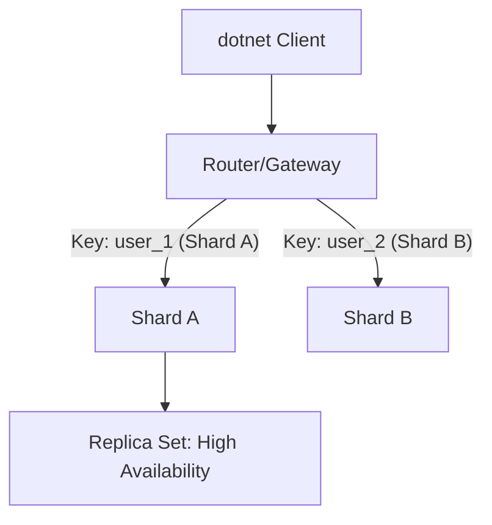

# Document Stores: Engineering Flexible Schemas with MongoDB and Cosmos DB
**0. Architectural Vision: The Evolution of Complexity**
- **Document Stores are "Self-Describing".** Data is stored in JSON-like formats (BSON in Mongo) where each record (document) can have its own unique structure.
- **Aggregates vs Relations.** Instead of spreading a "User" across 5 tables, you store the entire "User Object" as a single atomic document.
- **Horizontal Elasticity.** Designed from the ground up to be sharded (partitioned) across hundreds of servers without manual intervention.
- **Consistency vs Global Scale.** Offering tunable consistency levels—from "Strong" (like SQL) to "Eventual" (for maximum availability).
- **Schema Evolution.** Adding a field to a document doesn't require a table-lock; the database doesn't care if one document has more fields than another.
- **Architect's View.** We use Document Stores for **Semi-structured Data** (Catalogs, CMS, User Profiles) and when we need **Linear Scalability** for both reads and writes across global regions.

**1. Foundational Problem: The "Join Exhaustion" and "Locked Schema"**
- **Real-World Impact:** You have an E-commerce product catalog. Some items have "Color", some have "Engine Size", some have "Battery Life". In SQL, you either have a 500-column table (mostly null) or an EAV (Entity-Attribute-Value) table that requires 20 joins per search.
- **What breaks?** "Physical Data Modeling". The more your business grows, the more "Joined" and "Slow" your SQL queries become. Every product launch becomes a database schema nightmare.
- **Scale Boundary:** In a global system, a SQL secondary in London might be too slow for users in Sydney. Document stores (like Cosmos DB) allow you to replicate the same document to 50 regions with a single click.
- **Failure Story:** A major retail brand's "Holiday Sale" crashed because they tried to update their product catalog with "Black Friday Deals" while users were still browsing. The SQL `ALTER TABLE` to add a `DiscountCode` column locked the table for 15 minutes. In a **Document Store**, they could have simply started inserting documents with the new field while the old ones remained intact, with **Zero Downtime**.

**2. Internal System Mechanics: BSON and Partitioning**

### BSON (Binary JSON)
MongoDB uses BSON to store data. It's more efficient than JSON because it's binary, allowing for faster parsing and support for extra types like `Date` and `BinaryData`.

### The Partition Key (The Soul of Scale)
Everything in Cosmos DB and Mongo Sharding depends on the **Partition Key**.
- **Good Key:** High cardinality (many unique values), even distribution (e.g., `UserId`, `OrderId`).
- **Bad Key:** Monotonic (e.g., `Date`), low cardinality (e.g., `Gender`).



**3. Production Engineering in .NET 8 (Cosmos DB SDK)**

### Anti-Pattern: Cross-Partition Queries
```csharp
// TERRIBLE: This forces the DB to check EVERY shard (Fan-out).
var results = container.GetItemLinqQueryable<User>()
    .Where(u => u.City == "Seattle") // 'City' is NOT the partition key!
    .ToList();
```

### Production-Ready Implementation: Partition-Aware Operations
```csharp
// 1. Efficient Point Read (Sub-10ms)
// Requires BOTH ID and PartitionKey
ItemResponse<User> response = await _container.ReadItemAsync<User>(
    id: "user_123",
    partitionKey: new PartitionKey("user_123")
);

// 2. Transactional Batch (Acid logic within a single Partition)
var batch = _container.CreateTransactionalBatch(new PartitionKey("user_123"))
    .CreateItem(order)
    .PatchItem("user_123", patches);
await batch.ExecuteAsync();

// 3. Tuning RU (Request Units)
// Cosmos DB scales by "Buying" throughput capacity. 
// A single 1KB read = 1 RU.
```

**Architecture Strategy:** 
- Use the **Change Feed** to trigger background processes (Azure Functions) when a document is updated, implementing Event-Driven architectures seamlessly.
- Implement **Optimistic Concurrency** using the `ETag` property to handle race conditions during updates.

**4. System Interaction & Flow (ASCII Architecture)**

                ┌──────────────────┐
                │   The Client     │ (Application)
                └────────┬─────────┘
                         │ 1. UPSERT Document (JSON)
         ┌───────────────▼───────────────┐
         │     DOCUMENT STORE ENGINE     │ (The Schemaless Core)
         │  ┌─────────┐   ┌─────────┐    │
         │  │ BSON    │ → │ Index   │    │
         │  │ Encode  │   │ Manager │    │
         │  └────┬────┘   └────┬────┘    │
         └───────┼─────────────┼─────────┘
                 │             │ 2. Hash(PartitionKey)
         ┌───────▼─────────────▼─────────┐
         │     The Physical Disk (LSM)   │ (Sequential Write)
         └───────────────┬───────────────┘
                         │ 3. Global Replication
               ┌─────────▼─────────┐
               │ Multi-Region Sync │
               └───────────────────┘

**5. Strategic Scaling & System Evolution**
- **Multi-region Writes.** Cosmos DB allows "Write Anywhere", solving the "Latency of the US-only Primary" for global apps.
- **Time-to-Live (TTL).** Automatically deleting historical data (e.g., "Notifications") after 30 days without expensive manual cleanup scripts.
- **Request Units (RU) vs Provisioned Throughput.** Designing for "Serverless" (Pay-per-req) vs "Autoscale" (Pay-per-max-throughput) based on load predictability.

**6. Reliability, Observability & Runtime Governance**
- **Key Metrics:**
    - `429 Too Many Requests`: Indicates you've exceeded your provisioned RUs.
    - `Physical Partition Heatmap`: Is one shard doing all the work?
- **Observability:** Monitor `PartitionKeyRangeId` in logs to detect **Hot Partitions**.

**7. Compromises, Tradeoffs & Alternatives**
- **No Joins.** You must "Embed" your data (making it slightly redundant) or perform two separate queries.
- **Consistency Trade-off.** Choosing **"Session Consistency"** in Cosmos DB is the perfect middle ground for web apps: you always read your own writes, but other users might see it a few milliseconds later.

**8. Security Posture & Risk Mitigation**
- **Resource Tokens.** Generating temporary, restricted access tokens for mobile clients to talk *directly* to the DB, bypassing the API layer for high-scale media apps.
- **Data-at-Rest Encryption.** Always managed by the provider in Cosmos; must be configured manually in self-hosted MongoDB (TDE).

**9. Technical Edge Cases & System Failure Modes**
- **The "Large Document" Failure.** A document exceeds 16MB (Mongo) or 2MB (Cosmos). The system simply rejects the write. 
    - *Architect's Rule:* If you have large blobs, store them in **Blob Storage** and store the *Link* in the Document.
- **RU Exhaustion.** If your site gets featured on TV, your fixed RUs might be hit, and your site goes offline. **Always enable Autoscale** for public APIs.

**10. Architectural Assessment & Career Progression**
- **Senior:** "We use MongoDB because we don't want to deal with Migrations and SQL schemas."
- **Principal:** "Document Stores are our **Global Aggregation Strategy**. We utilize their schemaless nature to enable high-velocity product iterations and their built-in **Horizontal Partitioning** to ensure linear scalability. We design for **Read-Optimized Aggregates**, choosing our **Partition Keys** to minimize cross-shard traffic and tuning our **Consistency Levels** to match the business risk, ensuring the system provides a seamless, sub-10ms response time anywhere on earth."
- **Interview Strategy:** Discuss how to model a many-to-many relationship in a Document Store (Reference vs Embedding).

**11. Real-World Case Study: Global Gaming Platform**
**Scenario:** A game like Fortnite with 200M user profiles.
- **The Problem:** Adding a new "Skin" or "Achievement" required a SQL schema change that affected 200M rows.
- **The Design:** Migrated to **Cosmos DB**. New achievements are simply added to the `achievements` array in the JSON document.
- **Result:** Schema changes now take 0 seconds. The "Profile" read time is constant regardless of how many skins the user owns, and the data is replicated to US, EU, and ASIA regions for low-latency gaming.

**12. Structural Dependencies & Learning Path**
- **Foundations:** JSON/BSON, Hashing, CAP Theorem.
- **Future Steps:** Change Feed processing, MongoDB Aggregation Pipeline.
- **Integration Points:** Azure Cosmos DB SDK, MongoDB.Driver for .NET, ASP.NET Core Middleware.
