# Columnar Storage: Engineering Global Write-Scale with Cassandra and ScyllaDB
============================================================
0. Architectural Vision: The Mastery of High-Ingress
============================================================
- **Wide-Column Stores are "Row-Oriented" but "Sparse".** Unlike SQL, where every row must have every column, Cassandra only stores columns that have data.
- **Log-Structured Merge-Trees (LSM).** No disk seeks for writes. Data is appended to a log and flushed sequentially, enabling millions of writes per second.
- **Masterless Architecture.** Every node is equal. There is no single point of failure. The cluster uses the "Gossip Protocol" to share health and state.
- **The Partition Key + Clustering Key.** A two-tier indexing strategy: find the node (Partition), then find the sorted row (Clustering).
- **Tunable Consistency.** You decide for every single query: "Do I need 1 node to agree (Fast) or the majority of the cluster (Safe)?"
- **Architect's View.** We use Columnar stores for **High-Volume Time-Series**, **Event Logs**, and **IoT Data** where write throughput and 100% uptime are more important than complex relational joins.

============================================================
1. Foundational Problem: The "Write-Load" Wall and "Geo-Latency"
============================================================
- **Real-World Impact:** You have 10,000 smart meters sending electricity usage data every second. A SQL database's B-Tree index keeps "Rebalancing" every few seconds, causing write latency to spike and eventually timing out.
- **What breaks?** "The Primary-Secondary Bottleneck". If your primary SQL server is in New York, a smart meter in Tokyo has to wait 200ms for every acknowledgment. At 100k writes/sec, the "Network Speed of Light" becomes your biggest enemy.
- **Scale Boundary:** In a multi-region cluster, you need a database that can accept writes *locally* in every continent while syncing in the background.
- **Failure Story:** A major social network used a traditional SQL DB for "User Notifications". During a celebrity event, the notification write volume increased by 50x. The SQL Primary hit 100% I/O and couldn't process new writes, causing a total site blackout. They migrated to **Cassandra**, which allowed them to add 50 more nodes in minutes to absorb the surge, with **Zero Downtime**.

============================================================
2. Internal System Mechanics: Partitions and Gossip
============================================================

### Consistent Hashing (The Ring)
Cassandra uses a "Hash Ring" to distribute data. Each node is responsible for a range of tokens.

```mermaid
graph TD
    Write[Write Request] --> NodeA[Entry Node - Coordinator]
    NodeA -- "Hash(Key) --> Token" --> TargetNodes[Nodes owning Token Range]
    TargetNodes -- "Replication Factor: 3" --> R1[Node B]
    TargetNodes --> R2[Node C]
    TargetNodes --> R3[Node D]
    subgraph Gossip_Network
        NodeA <--> NodeB <--> NodeC <--> NodeD
    end
```



### The Storage Hierarchy
1. **CommitLog:** Immediate sequential disk append (Durability).
2. **MemTable:** In-memory sorted structure (Speed).
3. **SSTable:** Immutable disk files created when MemTable is flushed.
4. **Compaction:** Background process that merges SSTables and removes deleted data (Tombstones).

============================================================
3. Production Engineering in .NET 8 (Cassandra C# Driver)
============================================================

### Anti-Pattern: Using 'SELECT *' without a Partition Key
```csharp
// TERRIBLE: This triggers a "Full Cluster Scan". 
// Every node in the world must check its disks for your data.
var results = await session.ExecuteAsync("SELECT * FROM events WHERE event_type = 'click'");
```

### Production-Ready Implementation: Query-First Design
```csharp
// 1. Prepare Statement (Best for performance and security)
var ps = await session.PrepareAsync(
    "SELECT * FROM user_events WHERE user_id = ? AND event_time > ?");

// 2. Bound Statement with Partition Key (user_id)
// This goes DIRECTLY to the node holding this user's data (1 hop)
var statement = ps.Bind(userId, DateTimeOffset.UtcNow.AddHours(-1));
var rs = await session.ExecuteAsync(statement);

// 3. Tunable Consistency at Runtime
statement.SetConsistencyLevel(ConsistencyLevel.Quorum); 
```

**Architecture Strategy:** 
- **Model for your Queries, not your Entities.** If you need to search by `City`, you must create a separate table `events_by_city`. You trade Disk Space (redundancy) for Read Speed.
- Use **Lightweight Transactions (LWT)** (Paxos-based) only when absolutely necessary (e.g., creating a new user account) as they are 10x slower than standard writes.

============================================================
4. System Interaction & Flow (ASCII Architecture)
============================================================

                ┌──────────────────┐
                │   The Coordinator│ (Any Node)
                └────────┬─────────┘
                         │ 1. Write to N Replicas
         ┌───────────────▼───────────────┐
         │       CASSANDRA NODE          │ (The Storage Unit)
         │  ┌─────────┐   ┌─────────┐    │
         │  │ Commit  │ → │ Mem     │    │
         │  │ Log     │   │ Table   │    │
         │  └────┬────┘   └────┬────┘    │
         └───────┼─────────────┼─────────┘
                 │             │ 2. Flush to Disk (SSTable)
         ┌───────▼─────────────▼─────────┐
         │     Compaction Engine         │ (The Background Optimizer)
         └───────────────┬───────────────┘
                         │ 3. Row Merge & Delete
               ┌─────────▼─────────┐
               │   Final SSTable   │
               └───────────────────┘

============================================================
5. Strategic Scaling & System Evolution
============================================================
- **Adding Nodes.** You can add 10 nodes to a live cluster, and they will automatically start "Streaming" their portion of the data ring from existing nodes.
- **Multi-Data Center.** Defining replication strategies like `NetworkTopologyStrategy` to ensure that even if an entire AWS Region (e.g., `us-east-1`) goes down, your data is safe in `eu-west-1`.
- **Tombstones.** Deleting data in Cassandra is actually an *Insert* of a "Tombstone". If you delete too much data, your read performance will drop as the engine has to scan past millions of tombstones.

============================================================
6. Reliability, Observability & Runtime Governance
============================================================
- **Key Metrics:**
    - `Read/Write Latency`: P99 monitoring.
    - `Compaction Pending Tasks`: If this grows, your disks can't keep up.
    - `Gossip Status`: Are any nodes marked as "Down"?
- **Observability:** Use **Prometheus + Grafana** with the JMX Exporter to see cluster health in real-time.

============================================================
7. Compromises, Tradeoffs & Alternatives
============================================================
- **No Joins, No Transactions (mostly).** You must handle complex logic at the application layer.
- **Storage Overhead.** Because you duplicate data into multiple tables to support different queries, your storage costs are higher than SQL.

============================================================
8. Security Posture & Risk Mitigation
============================================================
- **Inter-node TLS.** Encrypting the "Gossip" and data sync traffic between servers.
- **Role-Based Access Control (RBAC).** Granting permissions at the KeySpace or Table level to the .NET service principal.

============================================================
9. Technical Edge Cases & System Failure Modes
============================================================
- **The "Clock Drift" Problem.** Cassandra uses client-side timestamps for "Last Write Wins". If a web server's clock is 5 minutes ahead, its writes will "Overwrite" more recent writes from other servers.
    - *Architect's Rule:* Use **NTP (Network Time Protocol)** on all servers and keep synchronization under 1ms.
- **Read Repair.** When a read finds the data on Node A is older than Node B, Cassandra automatically "Repairs" Node A in the background.

============================================================
10. Architectural Assessment & Career Progression
============================================================
- **Senior:** "Cassandra is a NoSQL database that is good for huge amounts of data and high availability."
- **Principal:** "Columnar Storage is our **Infinite Linear Ingress Layer**. We leverage its masterless, LSM-based architecture to achieve guaranteed sub-millisecond write latency at global scale. We design our data models around **Effective Partitioning** to eliminate multi-hop cross-cluster traffic. By utilizing **Tunable Consistency** and **Geo-Spatial Replication**, we ensure that our critical event streams remain available and durable even during catastrophic regional infrastructure failures."
- **Interview Strategy:** Explain how Cassandra handles writes and why it's faster than SQL for high-volume append-only workloads.

============================================================
11. Real-World Case Study: Global Messaging Metrics
============================================================
**Scenario:** A messaging app with 1 trillion "Message Delivered" events per year.
- **The Problem:** Aggregating "Messages per hour" per user was killing their SQL DB.
- **The Design:** Migrated to **Cassandra**. Table partitioned by `user_id` and clustering column `event_hour`. 
- **Result:** Data is written in milliseconds. Aggregation is a simple "Range Scan" within a single node's disk, taking less than 10ms even for the most active users.

============================================================
12. Structural Dependencies & Learning Path
============================================================
- **Foundations:** LSM Trees, Gossip Protocols, Consistent Hashing.
- **Future Steps:** ScyllaDB (C++ implementation of Cassandra), Apache Spark for analytics.
- **Integration Points:** DataStax C# Driver, Azure Managed Instance for Apache Cassandra.
