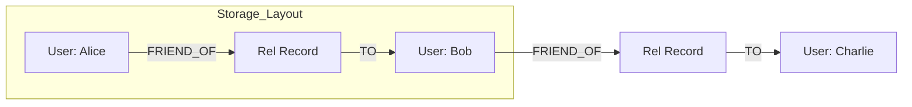

# Graph Databases: Engineering Relationships with Neo4j and Cypher
**0. Architectural Vision: The Power of Connection**
- **Graphs treat Relationships as First-Class Citizens.** Instead of computing a join at query time, the relationship is a physical pointer stored on disk.
- **Index-Free Adjacency.** Finding a related node is O(1) (following a memory pointer) rather than O(log N) (searching an index).
- **Nodes and Edges.** Nodes represent entities (People, Products); Edges (Relationships) represent how they are connected (Follows, Bought, Lives In).
- **Property Graph Model.** Both nodes and relationships can have properties (e.g., a "Friendship" relationship can have a "Since" date).
- **Pattern Matching.** Using symbolic languages (Cypher) to find complex paths, like "Friends of friends who also like the same band".
- **Architect's View.** We use Graph databases when the **Relationship is the Data**. They are essential for Social Networks, Fraud Detection, Recommendation Engines, and Knowledge Graphs.

**1. Foundational Problem: The "Recursive Join" Nightmare**
- **Real-World Impact:** You want to find "Potential Money Laundering" patterns. This requires following a chain of 10 people who have all transferred money to each other. In SQL, this is 10 JOINs on the same table, which is a performance disaster.
- **What breaks?** "Join Complexity". As the number of connections (hops) increases, the SQL execution plan becomes exponentially slow and eventually times out.
- **Scale Boundary:** In a massive network, SQL simply cannot calculate deeply nested relationships (5+ levels) in real-time.
- **Failure Story:** A major social network tried to use SQL for "People You May Know". The query to find "Mutual Friends" of 1,000 friends took 30 seconds. The site was sluggish and users hated it. Moving to **Neo4j** allowed them to calculate mutual friends in 10 milliseconds, enabling a much richer, real-time social experience.

**2. Internal System Mechanics: Pointers and Traversal**

### Index-Free Adjacency
In a relational DB, you use an index to find the ID. In Neo4j, each node record contains a list of pointers directly to its neighboring relationship records.



### The Traverse Engine
The database "Walks the Graph". It jumps from one memory address to the next. Performance is determined by the **number of nodes visited**, not the total size of the database.

**3. Production Engineering in .NET 8 (Neo4j.Driver)**

### Anti-Pattern: Modeling for SQL in a Graph
```csharp
// TERRIBLE: Creating "Link Tables" manually.
// CREATE (a:User {id: 1}), (b:User {id: 2}), (l:Link {from: 1, to: 2})
// Just use a relationship!
```

### Production-Ready Implementation: Pattern-Matching with Cypher
```csharp
// 1. Connection Management (Singleton Driver)
var driver = GraphDatabase.Driver("bolt://localhost:7687", AuthTokens.Basic("neo4j", "password"));

// 2. Complex Path Traversal in one Query
public async Task<List<string>> GetFriendRecommendations(string userId) {
    using var session = _driver.AsyncSession();
    var result = await session.ExecuteReadAsync(async tx => {
        var cursor = await tx.RunAsync(@"
            MATCH (u:User {id: $id})-[:FRIEND*2]-(fof)
            WHERE NOT (u)-[:FRIEND]-(fof) AND u <> fof
            RETURN DISTINCT fof.name AS name
            LIMIT 10", new { id = userId });
        
        return await cursor.ToListAsync(record => record["name"].As<string>());
    });
    return result;
}
```

**Architecture Strategy:** 
- Use **Directional Relationships**. In Neo4j, they have a direction, but you can query them in either direction at zero cost.
- Implement **Graph-Aware Caching** to avoid re-traversing the same deep paths for hot users.

**4. System Interaction & Flow (ASCII Architecture)**

                ┌──────────────────┐
                │   The Query      │ (The Pattern)
                └────────┬─────────┘
                         │ 1. MATCH (a)-[r]->(b)
         ┌───────────────▼───────────────┐
         │      NEO4J TRAVERSAL ENGINE   │ (The Walker)
         │  ┌─────────┐   ┌─────────┐    │
         │  │ Pointer │ → │ Filter  │    │
         │  │ Hop     │   │ Logic   │    │
         │  └────┬────┘   └────┬────┘    │
         └───────┼─────────────┼─────────┘
                 │             │ 2. Load Node/Rel Records
         ┌───────▼─────────────▼─────────┐
         │     The Page Cache (RAM)      │ (The Hot Store)
         └───────────────┬───────────────┘
                         │ 3. Return Sub-Graph
               ┌─────────▼─────────┐
               │    Result Paths   │
               └───────────────────┘

**5. Strategic Scaling & System Evolution**
- **Causal Clustering.** Using a cluster of Core Servers (for writes) and Read Replicas. Cassandra-style sharding for Graphs is very difficult because "The Graph is a whole".
- **Fabric (Neo4j 4+).** Distributed graph queries across multiple federated databases.
- **Importing Data.** Moving 100M rows from SQL to Neo4j. ALWAYS use the `neo4j-admin import` tool for bulk loading; doing it via the C# driver row-by-row is 1,000x slower.

**6. Reliability, Observability & Runtime Governance**
- **Key Metrics:**
    - `Page Cache Hit Ratio`: Critical! If your graph doesn't fit in the page cache (RAM), performance will drop significantly.
    - `GC Pause Time`: Neo4j is Java-based; monitor the JVM heap.
- **Observability:** Use `EXPLAIN` and `PROFILE` on your Cypher queries to see the number of "db hits" per hop.

**7. Compromises, Tradeoffs & Alternatives**
- **Memory vs Disk.** Graphs are RAM-heavy. Providing enough RAM for the "Hot Graph" is expensive.
- **Relational vs Graph.** If you just have simple Users and Orders, stay with SQL. If you have "Who bought what and what else did their friends buy?", use a Graph.

**8. Security Posture & Risk Mitigation**
- **Cypher Injection.** Never use string concatenation to build queries. Always use the `$parameter` syntax in the official driver.
- **Relationship-Level Security.** Complex to implement; usually handled at the application layer by filtering returned paths.

**9. Technical Edge Cases & System Failure Modes**
- **The "Supernode" Problem.** A node with 1,000,000 relationships (e.g., a Celebrity on Twitter). Traversing this node creates massive CPU spikes and memory consumption.
    - *Architect's Rule:* "Fan-out" supernodes or use relationship types to filter the traversal early.
- **Dense Graphs.** When everything is connected to everything, the traversal space explodes.

**10. Architectural Assessment & Career Progression**
- **Senior:** "Neo4j is a graph database that is great for social networks and complex queries."
- **Principal:** "Graph Databases represent the shift from **Set-Based Logic** to **Networked Intelligence**. We leverage **Index-Free Adjacency** to turn expensive join-heavy operations into sub-millisecond pointer traversals. We design for **High-Order Connectivity**, using pattern-matching to extract non-obvious business value from our relationship data. For us, a graph is not just a storage choice; it is the structural foundation for deep-learning recommendation engines and intelligent fraud detection."
- **Interview Strategy:** Explain how Graph databases differ physically from Relational databases ("Pointer following" vs "Index searching").

**11. Real-World Case Study: Global Bank Fraud Detection**
**Scenario:** A bank with 100M transactions per day.
- **The Problem:** Detecting "Circular Transfers" (User A -> B -> C -> A) to hide money. SQL queries were taking 10 minutes and missing patterns.
- **The Design:** Mirrored transaction data into **Neo4j**. Ran a Cypher query to find cycles of length 3-6.
- **Result:** Cycle detection now happens in 100ms. They catch 5x more fraud cases than before.

**12. Structural Dependencies & Learning Path**
- **Foundations:** Graph Theory, RAM Memory Pointers.
- **Future Steps:** Graph Algorithms (PageRank, Louvain), GQL (Standardized Graph Query Language).
- **Integration Points:** Neo4j .NET Driver, AWS Neptune, Azure Cosmos DB (Gremlin API).
