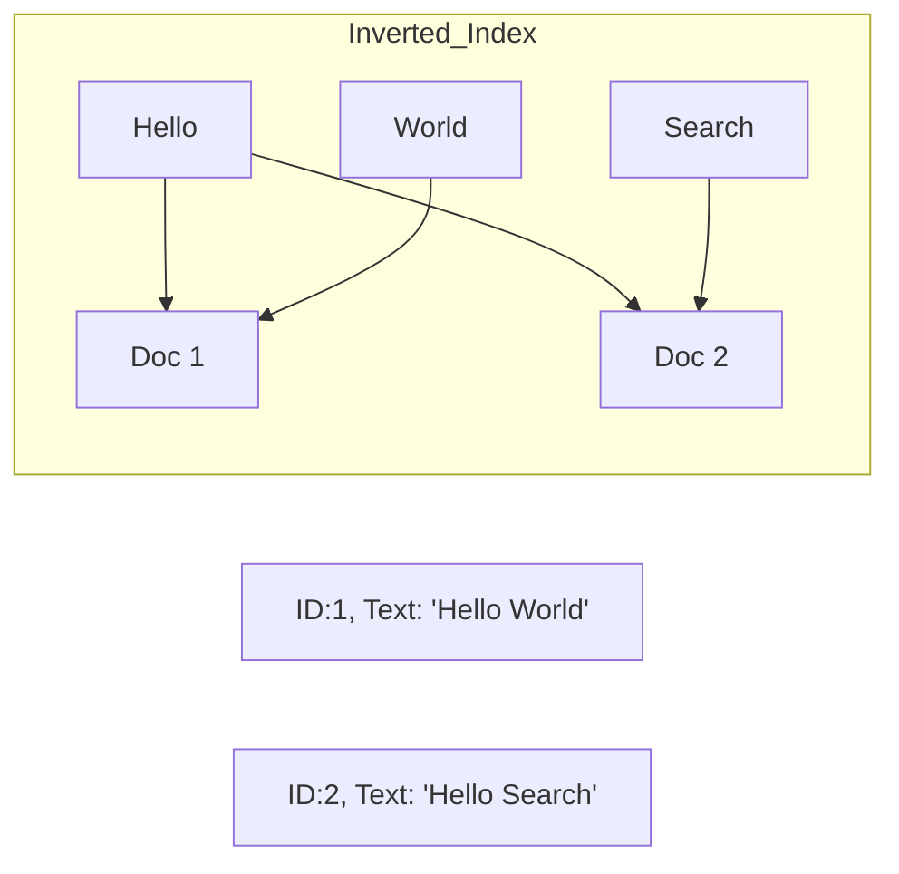

# Search Engines: Engineering Full-Text Discovery with Elasticsearch and Lucene
**0. Architectural Vision: The Art of Relevance**
- **Search Engines are "Inverted Indexes".** Instead of mapping a Document to a Topic, they map a Word (Token) to a list of Documents.
- **Lucene Core.** The battle-tested, high-performance engine beneath Elasticsearch, Solr, and OpenSearch.
- **Analysis Pipeline.** Turning raw text ("The quick brown fox") into normalized tokens ([quick, brown, fox]) through Tokenizers and Filters.
- **Distributed Discovery.** Sharding indexes across a cluster to allow searching billions of documents in milliseconds.
- **Relevance Scoring (BM25).** Not just finding a match, but calculating *how well* it matches based on term frequency and document length.
- **Architect's View.** We use Search Engines when "Exact Match" is not enough. They are essential for E-commerce Search, Log Analytics (ELK), and AI-powered Vector Search (RAG).

**1. Foundational Problem: The "Like-Clause" Performance Wall**
- **Real-World Impact:** You have a `Products` table in SQL. Users want to search by "Red Running Shoes". You write `WHERE title LIKE '%red%' AND title LIKE '%running%'`. 
- **What breaks?** "The Index Invalidation". Leading wildcards (`%text`) disable B-Tree indexes. The database must scan every row. As your product count hits 10 million, the search takes 10 seconds and crashes the DB.
- **Scale Boundary:** In a global catalog, searching across dozens of fields (Brand, Color, Size, Review text) requires a specialized data structure that doesn't exist in traditional SQL.
- **Failure Story:** A major fashion retailer's "Site Search" failed during a celebrity endorsement. Because they were using SQL text search, the sudden surge in string-matching queries locked the database connections. Moving to **Elasticsearch** (Inverted Index) reduced the search latency by 95% and lowered DB CPU from 100% to 5%, allowing the site to scale horizontally.

**2. Internal System Mechanics: Inverted Indexes and Shards**

### The Inverted Index
Basically a giant dictionary where each word points to the IDs of documents containing it.



### Distributed Architecture
- **Shards:** A horizontal split of the index. (Each shard is a separate Lucene index).
- **Replicas:** Copies of shards for high availability and read-scale.
- **Node Types:** Master (Cluster state), Data (Storage), Ingest (Pre-processing), Coord (Routing).

**3. Production Engineering in .NET 8 (NEST / Elastic.Clients.Elasticsearch)**

### Anti-Pattern: Treating Elasticsearch as a System of Record
```csharp
// TERRIBLE: Storing your primary 'Order' data only in ES. 
// ES is "Near-Real-Time" (NRT) and can lose data if not synced correctly.
// Use SQL for the Record, ES for the Search Index.
```

### Production-Ready Implementation: Full-Text and Filter Logic
```csharp
// 1. Singleton Client Configuration
var settings = new ElasticsearchClientSettings(new Uri("https://es-cluster:9200"))
    .DefaultIndex("products");
var client = new ElasticsearchClient(settings);

// 2. Complex Search with Multi-Match and Boosting
public async Task<SearchResponse<Product>> SearchProducts(string query) {
    return await _client.SearchAsync<Product>(s => s
        .Query(q => q
            .MultiMatch(mm => mm
                .Query(query)
                .Fields(f => f
                    .Field(p => p.Title, boost: 3.0) // Title matches are more important
                    .Field(p => p.Description, boost: 1.0)
                )
                .Operator(Operator.And)
            )
        )
        .From(0).Size(20)
    );
}
```

**Architecture Strategy:** 
- Use **Synonyms** to ensure "PC" matches "Personal Computer".
- Implement **Fuzzy Search** to handle "Typoes" (e.g., "Shose" -> "Shoes").

**4. System Interaction & Flow (ASCII Architecture)**

                ┌──────────────────┐
                │   The Search     │ (The User Text)
                └────────┬─────────┘
                         │ 1. Analyze (Tokenize/Stem)
         ┌───────────────▼───────────────┐
         │     ELASTICSEARCH CLUSTER     │ (The Distributed Brain)
         │  ┌─────────┐   ┌─────────┐    │
         │  │ Shard   │ → │ Scoring │    │
         │  │ Ranking │   │ (BM25)  │    │
         │  └────┬────┘   └────┬────┘    │
         └───────┼─────────────┼─────────┘
                 │             │ 2. Aggregate Results (Top N)
         ┌───────▼─────────────▼─────────┐
         │     The Coordination Node     │ (The Aggregator)
         └───────────────┬───────────────┘
                         │ 3. Return JSON DTOs
               ┌─────────▼─────────┐
               │    Ranked List    │
               └───────────────────┘

**5. Strategic Scaling & System Evolution**
- **Horizontal Sharding.** Start with a reasonable number of shards (e.g., 5). You cannot change shard count easily after creation without "Reindexing".
- **Index Lifecycle Management (ILM).** Automatically moving "Old Logs" from "Hot" (SSD) to "Cold" (HDD) nodes and eventually deleting them.
- **Reindexing.** Moving data from `v1` to `v2` index to apply new analyzer rules with zero downtime using **Index Aliases**.

**6. Reliability, Observability & Runtime Governance**
- **Key Metrics:**
    - `Query Latency`: Milliseconds per search.
    - `JVM Heap Usage`: ES is memory-hungry; if heap hits 75%, GC will slow down your searches.
    - `Circuit Breaker Tripping`: ES stops expensive queries to prevent node crashes.
- **Observability:** Use **Kibana** to monitor cluster health and perform "Search Profiling" to see why a query is slow.

**7. Compromises, Tradeoffs & Alternatives**
- **Near-Real-Time (NRT).** Data is typically searchable 1 second *after* it is written. Not suitable for "Must-read-now" data.
- **Storage Cost.** Inverted indexes use 2x-3x more disk space than the raw data.

**8. Security Posture & Risk Mitigation**
- **Field-Level Security.** Ensuring a "Support" user can see article text but not "Customer Internal Notes".
- **Encryption in Transit.** Always use TLS for the `bolt` or `https` protocol to prevent packet sniffing of sensitive search queries.

**9. Technical Edge Cases & System Failure Modes**
- **The "Mapping Explosion".** Too many unique fields (e.g., 10,000) will crash the cluster state.
    - *Architect's Rule:* Use **Flattened** or **Nested** types for dynamic key-value data.
- **Split Brain.** Multiple nodes thinking they are "Master". (Mostly fixed in ES 7+ with Zenith election).

**10. Architectural Assessment & Career Progression**
- **Senior:** "We use Elasticsearch to make our site search fast."
- **Principal:** "Search Engines are our **High-Dimensional Discovery Layer**. We leverage **Inverted Indexes** and **Analysis Pipelines** to provide a semantically rich, relevant interface to our users. We design for **Horizontal Shard Distribution** and use **Index Aliases** to enable zero-downtime schema evolution. For us, a search engine is not just an index; it is the intelligence that connects user intent with business value across petabytes of structural and non-structural data."
- **Interview Strategy:** Explain how an Inverted Index works and the difference between "Term" (Exact) and "Match" (Full-text) queries.

**11. Real-World Case Study: Global Log Analytics (ELK)**
**Scenario:** A platform generating 10TB of logs per day.
- **The Problem:** Developers couldn't find the source of errors because grepping text files was too slow.
- **The Design:** Built an **ELK Stack (Elastic, Logstash, Kibana)**. Logs are sharded by `@timestamp` into daily indexes.
- **Result:** Searching 100 billion log lines for a specific `CorrelationId` now takes 500ms. They have "Real-Time Dashboards" showing error rates across 5,000 servers.

**12. Structural Dependencies & Learning Path**
- **Foundations:** Information Retrieval, Data Structures (Tries, Hash Maps).
- **Future Steps:** Vector Search (k-NN), Learning to Rank (ML), Semantic Search.
- **Integration Points:** NEST (.NET), Elastic.Clients.Elasticsearch, Kibana, Logstash, Fluentd.
