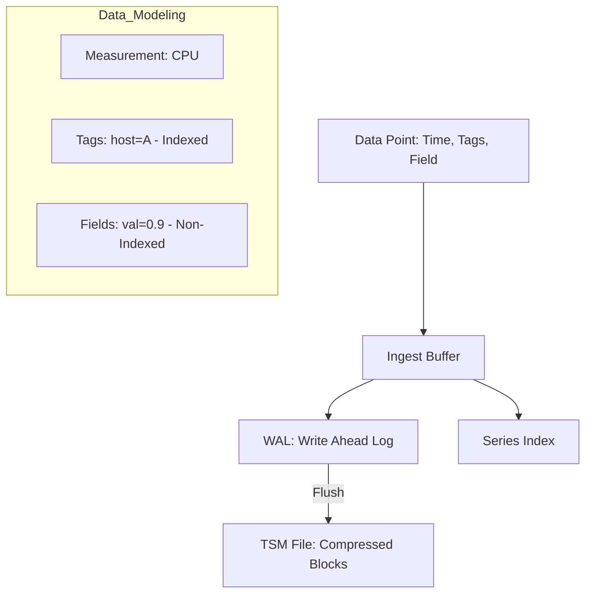

# Time-Series Databases: Engineering High-Volume Metrics with InfluxDB and Prometheus
**0. Architectural Vision: The Dimension of Time**
- **Time is the Primary Key.** In a TSDB, data is organized by timestamp. Every record represents a point in time (Price at 12:00, Temperature at 12:01).
- **Measurement, Tags, and Fields.** Measurements are like tables; Tags are indexed strings for filtering (e.g., `host_id`); Fields are the actual values (e.g., `cpu_temp`).
- **High Ingest Throughput.** Optimized to handle millions of data points per second from IoT devices, servers, and financial tickers.
- **Rollups and Retention.** Automatically "summarizing" 1-second data into 1-minute averages after a certain period to save space.
- **Downsampling.** The process of reducing the resolution of old data while keeping the trends.
- **Architect's View.** We use Time-Series databases for **Monitoring**, **Observability**, **Algorithmic Trading**, and **IoT Fleet Management** where the "Sequence of Events" is more important than the individual records.

**1. Foundational Problem: The "Aggregation Lag" and "Storage Bloat"**
- **Real-World Impact:** You are monitoring 1,000 servers, each sending 50 metrics every second. In a SQL database, your `Metrics` table hit 100 billion rows in one month. Calculating the "Average CPU for the last week" takes 20 minutes and crashes the database.
- **What breaks?** "The Indexing Weight". Each B-Tree insert in SQL becomes slower as the table grows. Furthermore, deleting old data (Retention) requires massive table locks.
- **Scale Boundary:** At 100k points/sec, traditional relational databases cannot keep up with the write load, and their storage format is highly inefficient for repetitive time-series data.
- **Failure Story:** A solar panel company used SQL to store "Voltage" readings every 5 seconds from 1 million panels. Within 3 months, the database was 50TB, and 90% of it was identical column names and overhead. Moving to **InfluxDB** (TSDB) reduced the storage size to 2TB (25x compression) and reduced query latency from minutes to milliseconds.

**2. Internal System Mechanics: TSM Trees and Series Cardinality**

### TSM (Time-Structured Merge) Tree
InfluxDB uses a specialized LSM-like tree. Data for the same "Series" (same tags) is stored together sequentially on disk, allowing for massive compression (Delta-Delta encoding).



### Series Cardinality (The Silent Killer)
Cardinality = number of unique combinations of tags. If you store `user_id` as a Tag and you have 1 million users, your index will explode and crash the RAM.

**3. Production Engineering in .NET 8 (InfluxDB.Client)**

### Anti-Pattern: Using Tags for Values that change frequently
```csharp
// TERRIBLE: Putting 'current_voltage' as a Tag.
// This creates a NEW Series for every single voltage change! RAM will explode.
// ALWAYS put values that change in 'Fields'.
```

### Production-Ready Implementation: Batch Writing and Flux
```csharp
// 1. Singleton Client with Batching Policy
var options = new WriteOptions { BatchSize = 1000, FlushInterval = 5000 };
using var client = InfluxDBClientFactory.Create("http://localhost:8086", "token");

// 2. High-Performance Batch Write
public async Task LogMetric(double value, string host) {
    var point = PointData.Measurement("temperature")
        .Tag("host", host)
        .Field("val", value)
        .Timestamp(DateTime.UtcNow, WritePrecision.Ns);
    
    await client.GetWriteApiAsync().WritePointAsync(point, "my-bucket", "my-org");
}

// 3. Querying with Flux (Functional Query Language)
public async Task<double> GetAvgTemp(TimeSpan range) {
    var query = $"from(bucket:\"my-bucket\") |> range(start: -{range.TotalMinutes}m) |> filter(fn: (r) => r._measurement == \"temperature\") |> mean()";
    var tables = await client.GetQueryApi().QueryAsync(query, "my-org");
    return (double)tables[0].Records[0].GetValue();
}
```

**Architecture Strategy:** 
- Use **Retention Policies** (e.g., "Keep 30 days") to auto-prune data.
- Implement **Continuous Queries** for background downsampling.

**4. System Interaction & Flow (ASCII Architecture)**

                ┌──────────────────┐
                │   The Metric     │ (Application Metric)
                └────────┬─────────┘
                         │ 1. Write Point (Batch)
         ┌───────────────▼───────────────┐
         │     INFLUXDB ENGINE           │ (The Chronos Core)
         │  ┌─────────┐   ┌─────────┐    │
         │  │ WAL     │ → │ Index   │    │
         │  │ Log     │   │ TSI     │    │
         │  └────┬────┘   └────┬────┘    │
         └───────┼─────────────┼─────────┘
                 │             │ 2. Compress and Sort (TSM)
         ┌───────▼─────────────▼─────────┐
         │     The Retention Manager     │ (The Janitor)
         └───────────────┬───────────────┘
                         │ 3. Prune / Rollup
               ┌─────────▼─────────┐
               │   Optimized Disk  │
               └───────────────────┘

**5. Strategic Scaling & System Evolution**
- **Horizontal Clustering.** InfluxDB Enterprise or Prometheus with **Thanos/Cortex** for massive scale across multiple nodes.
- **Push vs Pull.** InfluxDB (Push) is better for IoT; Prometheus (Pull) is better for Kubernetes/Infrastructure monitoring.
- **Edge Computing.** Deploying a small TSDB at the manufacturing plant to collect data locally and sync only the "Averages" to the cloud.

**6. Reliability, Observability & Runtime Governance**
- **Key Metrics:**
    - `Series Count`: The most dangerous metric. Keep an eye on it!
    - `Query Duration`: Are your range queries taking too long?
- **Observability:** Monitor `internal/_series` to detect cardinality leaks.

**7. Compromises, Tradeoffs & Alternatives**
- **High Precision vs Storage.** Nanosecond precision costs significantly more space than millisecond precision.
- **Analytical vs Transactional.** You can't do a "Money Transfer" in InfluxDB. It is for append-only observation, not state mutation.

**8. Security Posture & Risk Mitigation**
- **Bucket-Level Access.** Ensuring the "Mobile App" can write to its specific bucket but not read from the "Admin" bucket.
- **Rate Limiting Inbound Metrics.** Using a proxy (like Telegraf) to prevent a single faulty sensor from overwhelming your central DB.

**9. Technical Edge Cases & System Failure Modes**
- **The "High Cardinality" Crash.** If you accidentally tag a metric with a unique `RequestID`, you will create billions of series, exhausting node memory and causing a restart loop.
- **Time Gaps.** What happens if a sensor goes offline for 1 hour? The system must handle "Missing Data" during interpolation.

**10. Architectural Assessment & Career Progression**
- **Senior:** "We use InfluxDB to store our server metrics and show them in Grafana."
- **Principal:** "Time-Series Databases are the foundation of our **Real-Time Observability Stack**. We leverage specialized **TSM Storage Mechanics** to achieve 100x better compression than relational models. We design our **Series Schemas** with strict control over cardinality to prevent index bloat. By implementing **Tiered Retention** and **Predictive Downsampling**, we ensure that our historical data remains operationally useful while minimizing our long-term cloud storage costs."
- **Interview Strategy:** Discuss the difference between "Tags" and "Fields" and how "Series Cardinality" affects database stability.

**11. Real-World Case Study: Global E-Commerce Monitoring**
**Scenario:** A company like Amazon monitoring "Orders per second" and "Error rates".
- **The Problem:** They needed to know if a specific shard in Germany was failing in under 5 seconds. SQL based monitoring was taking 1 minute to refresh.
- **The Design:** Implemented **Prometheus + Telegraf + InfluxDB**. Every microservice exposes a `/metrics` endpoint.
- **Result:** Dashboard refresh time is now 2 seconds. They can detect a 1% dip in conversion rates in "Real-Time".

**12. Structural Dependencies & Learning Path**
- **Foundations:** Statistics (Mean, Percentiles), Compression Algorithms.
- **Future Steps:** Anomaly Detection (AI/ML over TSDB), VictoriaMetrics.
- **Integration Points:** Telegraf (Data Collection), Grafana (Visualization), Prometheus (.NET Exporter).
