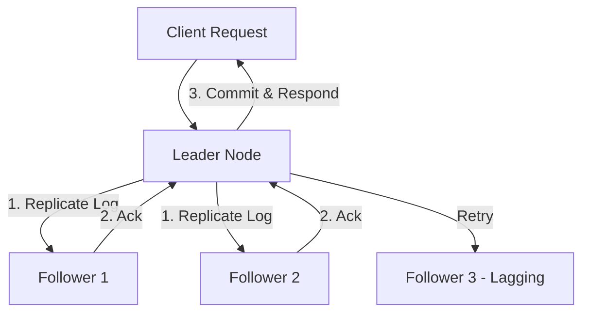

# Distributed Consensus: The Science of Agreement (Raft and Paxos)
============================================================
0. Architectural Vision: One Truth in a Fragmented World
============================================================
- **Consensus is the Core of Distributed Reliability.** It is the process by which a group of independent nodes agree on a single value or state.
- **The Split-Brain Problem.** Ensuring that even if the network is cut, the system doesn't have two leaders making conflicting decisions.
- **Paxos vs Raft.** Paxos is the mathematically rigorous "Academic" ancestor; Raft is the "Understandable" child used in almost all modern tools (etcd, Kubernetes, Consul).
- **Leader Election.** How a cluster chooses a "Boss" to coordinate all updates.
- **Log Replication.** Ensuring that every node has the exact same sequence of operations in the same order.
- **Architect's View.** We don't implement Consensus ourselves. We use tools built on it (etcd, ZooKeeper) to manage **Critical Global State** like service discovery, distributed locks, and configuration. We understand the performance cost: Consensus is slow because it requires a Quorum (majority) for every single write.

============================================================
1. Foundational Problem: The "Non-Deterministic Cluster"
============================================================
- **Real-World Impact:** You have 3 nodes managing a "Stock Inventory". Node A says 'Apples=10', Node B says 'Apples=5'. Who is correct? If you pick wrong, you sell products you don't have.
- **What breaks?** "State Divergence". Without consensus, every server becomes a "source of truth", leading to total data corruption in distributed systems.
- **Scale Boundary:** Consensus is the bottleneck for writes. A cluster of 5 nodes provides high safety but cannot handle 100k writes/sec because the "Network Round Trips" for voting are too many.
- **Failure Story:** A major cloud provider's DNS service went down for 12 hours. The reason: A network partition caused a "Voting Loop" where the consensus nodes couldn't agree on a leader. They kept electing and then immediately demoting leaders. Proper **Fencing Tokens** and **Term IDs** are required to prevent this "Election Storm".

============================================================
2. Internal System Mechanics: Raft Phases
============================================================

### The Raft Algorithm (Simplified)
1. **Leader Election:** If a node doesn't hear from a leader, it becomes a "Candidate" and asks for votes.
2. **Log Replication:** The Leader receives a command, writes to its local log, and sends "AppendEntries" to all followers.
3. **Commit:** Once a majority (Quorum) ack the log entry, the leader "Commits" it and tells followers to do the same.



### Safety Rules
- **Majority Wins:** You need `(N/2)+1` nodes voting for the same leader.
- **Log Matching:** A node cannot become a leader if its log is older than the majority.

============================================================
3. Production Engineering in .NET 8 (Using etcd/Consul)
============================================================

### Anti-Pattern: Building your own 'Consensus' logic with Loops
```csharp
// TERRIBLE: This is NOT a distributed lock. It has race conditions.
if (await _db.KeyExists("lock")) return; // Time-of-check to time-of-use bug
await _db.SetKey("lock", "me");
```

### Production-Ready Implementation: Distributed Lock with etcd
```csharp
// 1. Connection to the Consensus Store (etcd)
using var client = new EtcdClient("http://localhost:2379");

// 2. Atomic Compare-And-Swap (CAS)
// Only sets the value if it currently is null/empty.
var success = await client.CompareAndSwapAsync("config/active_node", "node_1", "");

// 3. Lease-based Locking
// If the node crashes, etcd will automatically delete the key after 10s.
var leaseId = await client.GrantLeaseAsync(10);
await client.PutAsync("locks/payment_processor", "node_A", leaseId);
```

**Architecture Strategy:** 
- Use **Watcher Patterns**. Don't poll for config changes; let the consensus store "Push" an event when a value changes.
- Implement **Fencing Tokens** (monotonically increasing IDs) to ensure late-arriving requests from "Old Leaders" are rejected.

============================================================
4. System Interaction & Flow (ASCII Architecture)
============================================================

                ┌──────────────────┐
                │   The Election   │ (The Trigger)
                └────────┬─────────┘
                         │ 1. Timeout -> Become Candidate
         ┌───────────────▼───────────────┐
         │       RAFT VOTING LOGIC       │ (The Democracy)
         │  ┌─────────┐   ┌─────────┐    │
         │  │ Request │ → │ Vote    │    │
         │  │ Vote    │   │ Granted │    │
         │  └────┬────┘   └────┬────┘    │
         └───────┼─────────────┼─────────┘
                 │             │ 2. Majority Achieved
         ┌───────▼─────────────▼─────────┐
         │       The New Leader          │ (The Order Giver)
         └───────────────┬───────────────┘
                         │ 3. Send Heartbeats
               ┌─────────▼─────────┐
               │  Stable Cluster   │
               └───────────────────┘

============================================================
5. Strategic Scaling & System Evolution
============================================================
- **Cluster Size.** Always use an ODD number (3, 5, 7). 5 nodes can survive 2 simultaneous failures.
- **Snapshotting.** The log grows infinitely. Periodically, the system saves the "Final State" and deletes the old log entries to save disk and memory.
- **Joint Consensus.** Changing cluster size (e.g., adding a node) the right way so there isn't a moment where two different majorities exist.

============================================================
6. Reliability, Observability & Runtime Governance
============================================================
- **Key Metrics:**
    - `Election Count`: High numbers mean network instability.
    - `Heartbeat Latency`: How fast the leader talks to followers.
- **Observability:** Monitor **Raft Term IDs**. If the Term keeps skipping, the cluster is unstable.

============================================================
7. Compromises, Tradeoffs & Alternatives
============================================================
- **Linearizability vs Eventual Consistency.** Consensus provides **Linearizability** (the appearance of a single copy of data) but at the cost of "Write Availability" if a majority dies.
- **Wait Time.** The "Election Timeout" must be high enough to avoid false positives (due to jitter) but low enough for fast recovery. 150ms-300ms is the "Sweet Spot".

============================================================
8. Security Posture & Risk Mitigation
============================================================
- **Authentication.** Ensure only "Known Nodes" can join the cluster. An attacker adding a node with an "Advanced Log" could force their data into your system.
- **Mutual TLS (mTLS).** All gossip and voting traffic must be encrypted.

============================================================
9. Technical Edge Cases & System Failure Modes
============================================================
- **The "Zombie Leader".** A leader is cut off from the network but doesn't know it. It keeps accepting writes locally.
    - *Architect's Rule:* The leader must have a "Pulse" from the majority to continue accepting writes.
- **Empty Logs.** A new node joining a huge cluster. It will be "Unavailable" while it replays 1GB of log data.

============================================================
10. Architectural Assessment & Career Progression
============================================================
- **Senior:** "We use ZooKeeper or etcd to manage our distributed locks and configuration."
- **Principal:** "Distributed Consensus is the **Operational Anchor** of our platform. We leverage the **Raft Protocol** to ensure strict data consistency for our primary coordination points. We design for **Partition Survival**, understanding the **Quorum Requirements** and the performance impact of **Network Round-Trips**. By implementing **Linearizable Reads** and **Deterministic Log Replay**, we provide a rock-solid foundation for our high-availability microservices."
- **Interview Strategy:** Compare Raft and Paxos. Explain how a Leader Election works and what a Quorum is.

============================================================
11. Real-World Case Study: Global Service Orchestrator
============================================================
**Scenario:** A company like Kubernetes managing 100,000 containers.
- **The Problem:** 10,000 servers need to know which container is where. If two servers disagree, they might both start the same database, leading to data corruption.
- **The Design:** Used **etcd (Raft-based)** to store the "Actual vs Desired State".
- **Result:** Even if 2 out of 5 control nodes die, the cluster continues to function correctly. No "Ghost Containers" or "Split State" ever occurs.

============================================================
12. Structural Dependencies & Learning Path
============================================================
- **Foundations:** Networking (UDP/TCP), State Machines.
- **Future Steps:** Byzantine Fault Tolerance (BFT) for Blockchain, Spanner (Multi-Paxos).
- **Integration Points:** etcd, Consul, ZooKeeper, Orleans (Clustering).
