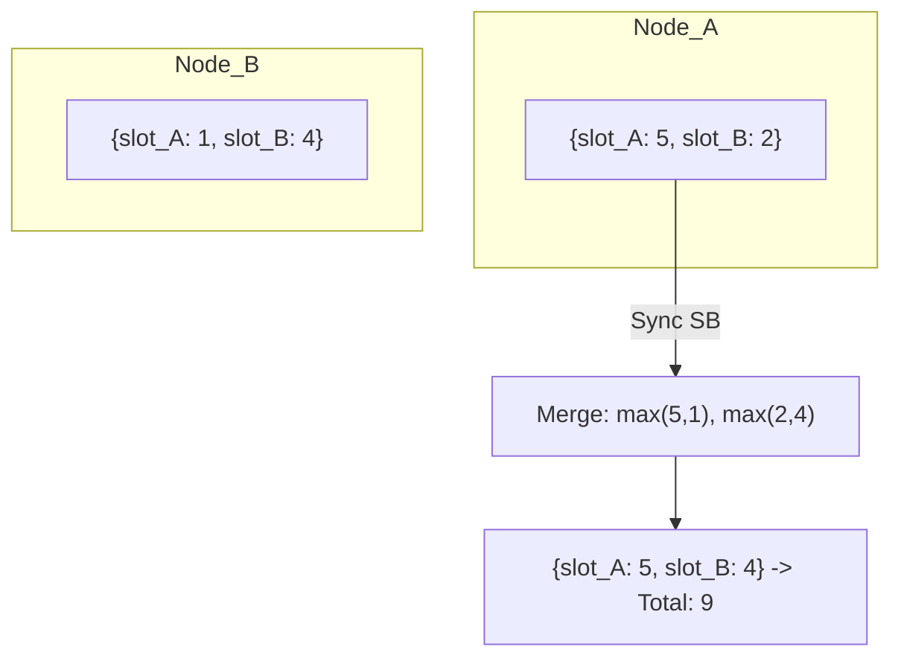

# Conflict-Resolution: The Magic of CRDTs (Conflict-Free Replicated Data Types)
============================================================
0. Architectural Vision: Eventual Consistency without the Pain
============================================================
- **CRDTs are the Solution to Offline-First and Multi-Leader Replication.** They are data structures that can be updated independently and concurrently, and then merged back together without any conflict.
- **Commutativity as a Core Principle.** The order of updates doesn't matter (A+B = B+A).
- **No Leader Needed.** Unlike Consensus (Raft/Paxos), CRDTs don't need a majority to agree; every node just keeps its own copy and they eventually reach the same state through background gossip.
- **CvRDTs (State-based) vs CmRDTs (Operation-based).** CvRDTs send the whole object state; CmRDTs only send the change operation.
- **Architect's View.** We use CRDTs when **High Availability (AP)** is more important than strict consistency. They are perfect for Shopping Carts, Chat Apps, Collaborative Editors, and Counters in distributed systems.

============================================================
1. Foundational Problem: The "Last-Write-Wins" Data Loss
============================================================
- **Real-World Impact:** Two users edit a "Shared Shopping Cart" while on a plane with shaky Wi-Fi. Alice adds 'Milk', Bob adds 'Eggs'. When they reconnect, the system has to "Resolve" the conflict. 
- **What breaks?** "The Data Loss". If you use "Last-Write-Wins" (LWW), whichever user's phone syncs last will overwrite the other. Alice's 'Milk' will be gone.
- **Scale Boundary:** In a global system with 1 million concurrent updates, a central "Conflict Resolver" would be a massive performance bottleneck.
- **Failure Story:** A major collaborative task app used a simple "Version Counter" for task lists. Two employees edited the same task list simultaneously. Due to the simple version logic, the database only kept the larger version number, deleting 5 new tasks that had been added in the other version. They migrated to **CRDTs (G-Set)**, which allows them to merge the lists by simply taking the **Union** of all unique tasks.

============================================================
2. Internal System Mechanics: Types and Merging
============================================================

### Common CRDT Types
1. **G-Counter (Grow-only):** A counter that only goes up. Every node has its own slot, and the total is the sum.
2. **PN-Counter (Positive-Negative):** A counter that can go up and down. (Two G-Counters: one for increments, one for decrements).
3. **G-Set (Grow-only Set):** A set where you can only add items. Merge = Union.
4. **OR-Set (Observed-Remove Set):** A more complex set that allows adding and removing items. Uses unique tags for every add/remove to handle duplicates.



### The Merge Property (Join-Semilattice)
A merge function must be **Idempotent** (A+A = A), **Commutative** (A+B = B+A), and **Associative** (A+(B+C) = (A+B)+C).

============================================================
3. Production Engineering in .NET 8 (Building a G-Counter)
============================================================

### Anti-Pattern: Using a single Shared Variable
```csharp
// TERRIBLE: This is a race condition in a distributed system.
long total = 0;
// node_1: total += 1;
// node_2: total += 1; // if both read 0, the final total is 1 instead of 2.
```

### Production-Ready Implementation: A Simple G-Counter Class
```csharp
// 1. Define the CRDT Structure
public class GCounter {
    // Dictionary mapping NodeID -> Value
    private Dictionary<string, long> _slots = new();
    private string _myNodeId;

    public GCounter(string nodeId) {
        _myNodeId = nodeId;
        _slots[nodeId] = 0;
    }

    // 2. Local Increment (Only update MY slot)
    public void Increment() {
        _slots[_myNodeId]++;
    }

    // 3. The Convergent Merge Function
    public void Merge(GCounter other) {
        foreach (var kvp in other._slots) {
            if (!_slots.ContainsKey(kvp.Key) || kvp.Value > _slots[kvp.Key]) {
                _slots[kvp.Key] = kvp.Value; // Always take the maximum
            }
        }
    }

    public long Total => _slots.Values.Sum();
}
```

**Architecture Strategy:** 
- Use **Redis Hash data structures** as a storage layer for the slots of your CRDT.
- Implement **Causal Ordering** (Vector Clocks) if you need to know which update "happened before" another.

============================================================
4. System Interaction & Flow (ASCII Architecture)
============================================================

                ┌──────────────────┐
                │   The Update     │ (Local User Action)
                └────────┬─────────┘
                         │ 1. Modify Local State (Slot)
         ┌───────────────▼───────────────┐
         │     THE CRDT GOSSIP ENGINE    │ (The Background Sync)
         │  ┌─────────┐   ┌─────────┐    │
         │  │ State   │ → │ Vector  │    │
         │  │ Export  │   │ Clocks  │    │
         │  └────┬────┘   └────┬────┘    │
         └───────┼─────────────┼─────────┘
                 │             │ 2. Async Push to Peers
         ┌───────▼─────────────▼─────────┐
         │       The Merge Logic         │ (Idempotent Join)
         └───────────────┬───────────────┘
                         │ 3. Final Consistent Result
               ┌─────────▼─────────┐
               │  Shared Reality   │
               └───────────────────┘

============================================================
5. Strategic Scaling & System Evolution
============================================================
- **State Compression.** As you add more slots (nodes), the CRDT metadata grows. Periodically "compacting" the metadata when a node leaves the cluster permanently.
- **Delta-CRDTs.** Instead of sending the entire state (`_slots` dictionary), you only send the entries that changed since the last sync.
- **Hybrid Architectures.** Using CRDTs for the "Draft/Edge" state and consensus (SQL/Raft) for the final "System of Record".

============================================================
6. Reliability, Observability & Runtime Governance
============================================================
- **Key Metrics:**
    - `Gossip Latency`: How long until every node is in sync?
    - `Metadata Overhead`: Is the CRDT structure bigger than the actual data?
- **Observability:** Monitor `Vector Clock Drift` between nodes to detect network partitions.

============================================================
7. Compromises, Tradeoffs & Alternatives
============================================================
- **Operational Complexity.** Writing a perfect OR-Set is extremely difficult. **Architect's Tip:** Use a library like `Akka.NET` or `DotNetty` which have built-in CRDT support.
- **Limited Operations.** You can't easily perform "If-Then" logic (e.g., "If balance > 10, then subtract"). CRDTs are "No-Brainer" mergers.

============================================================
8. Security Posture & Risk Mitigation
============================================================
- **Byzantine Faults.** A malicious node could send crazy high values in its slot, "Hijacking" the total. 
    - *Architect's Rule:* Use **Proof of Inclusion** or digital signatures to verify that an update is legitimate.
- **Data Privacy.** Because CRDTs store a history (or multiple slots), the "Old Data" might still be in the metadata even if you "Updated" it.

============================================================
9. Technical Edge Cases & System Failure Modes
============================================================
- **Duplicate Updates.** If a node sends the same update twice. (Fixed by the **Idempotent** property of the Merge function).
- **The "Add-Win" vs "Remove-Win" Paradox.** If one user adds an item and another removes it simultaneously. In an OR-Set, we typically pick **Add-Wins** as the default.

============================================================
10. Architectural Assessment & Career Progression
============================================================
- **Senior:** "CRDTs help us solve conflicts in distributed systems without locking."
- **Principal:** "Conflict Resolution is the engineering of **Convergent Reality**. We leverage **CRDTs (Conflict-Free Replicated Data Types)** to architect high-availability, low-latency systems that survive the 'Tyranny of the CAP Theorem'. We design for **Commutative State Merging**, ensuring that our distributed aggregates remain eventual and deterministic. By utilizing **Vector Clocks and Delta-Transfer patterns**, we build resilient platforms that prioritize user engagement over synchronous coordination."
- **Interview Strategy:** Explain how a G-Counter works and what "Commutativity" means in this context.

============================================================
11. Real-World Case Study: Collaborative Whiteboard
============================================================
**Scenario:** An app like Miro used by 10 users on the same page.
- **The Problem:** When two users moved the same sticky note, whoever saved last won. The other's move was undone.
- **The Design:** Implemented **LWW-Element-Set** (Last-Write-Wins Set). Every "Move" is an entry in a set with a timestamp.
- **Result:** The merge function automatically picks the move with the highest timestamp. No user intervention is ever required.

============================================================
12. Structural Dependencies & Learning Path
============================================================
- **Foundations:** Set Theory, Vector Clocks, Latice Math.
- **Future Steps:** Operational Transformation (OT - the alternative to CRDT), Causally Consistent Databases.
- **Integration Points:** Akka.NET Distributed Data, Redis CRDTs, Riak, Azure Cosmos DB (Conflict Resolution Policies).
