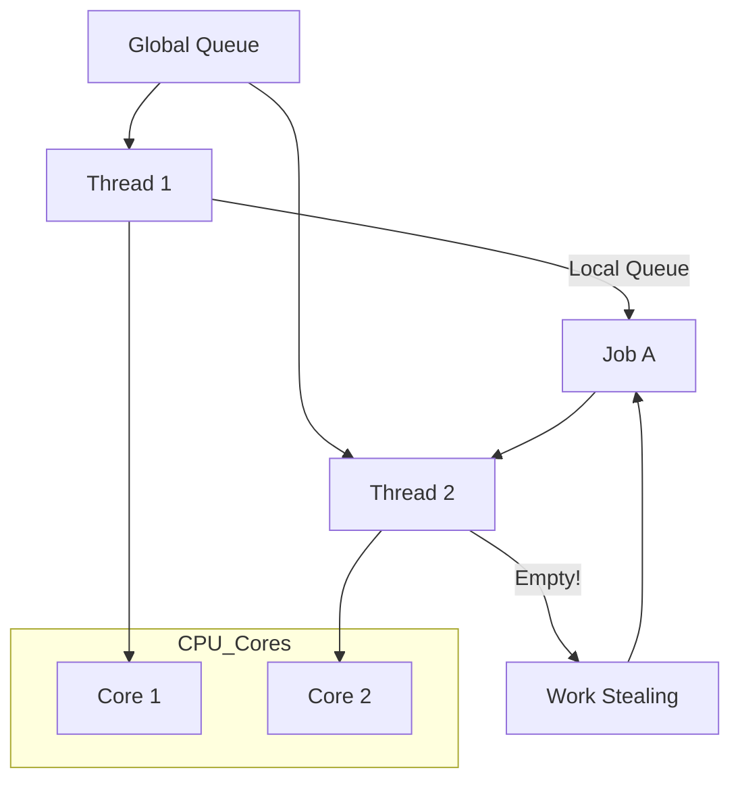

# Threading vs Tasks: The Internals of the Task Parallel Library (TPL)
============================================================
0. Architectural Vision: The Evolution of Concurrency
============================================================
- **Threads are an OS Abstraction; Tasks are a Framework Abstraction.** A Thread is a "Heavyweight" resource managed by the kernel; a Task is a "Lightweight" unit of work managed by the .NET Runtime.
- **The Cost of Context Switching.** Every time the OS switches between threads, it must save/load registers and flush CPU caches. This is the "Concurrency Tax".
- **ThreadPool Efficiency.** The .NET ThreadPool manages a pool of worker threads, reuse them to avoid the 1MB stack memory overhead of creating new threads.
- **TPL (Task Parallel Library).** Built on top of the ThreadPool, it provides high-level abstractions like `Task.Run`, `Parallel.ForEach`, and `Dataflow`.
- **Work-Stealing Queues.** The secret to TPL's efficiency. Idle threads "Steal" work from the local queues of busy threads to maximize CPU utilization.
- **Architect's View.** We don't manage `System.Threading.Thread` manually in 2024. We design around **Asynchronous Workflows** and **Task-based Parallelism**, focusing on minimizing blocking calls and preventing ThreadPool starvation in high-scale web applications.

============================================================
1. Foundational Problem: The "Thread-per-Request" Bottleneck
============================================================
- **Real-World Impact:** You have an ASP.NET app that makes a 5-second API call per request. If you use a new thread for every request, and you get 1,000 concurrent users, you have 1,000 threads. 
- **What breaks?** "The Memory and CPU Wall". Each thread takes 1MB of memory. 1,000 threads = 1GB just for stacks. Furthermore, the CPU spends more time "Context Switching" than actually doing work.
- **Scale Boundary:** Most Windows/Linux servers struggle when they hit 2,000+ active OS threads. .NET Tasks allow us to handle 1,000,000+ concurrent operations on the same hardware.
- **Failure Story:** A legacy financial app created a `new Thread()` for every incoming trade. During a market surge, the app created 5,000 threads. The OS scheduler became overwhelmed, and the "Tick latency" spiked from 10ms to 5,000ms. They migrated to the **TPL and Async/Await**, which allowed them to process the same load using only 50 "Hot" worker threads, reducing latency by 99%.

============================================================
2. Internal System Mechanics: The ThreadPool and Work-Stealing
============================================================

### The .NET ThreadPool Architecture
The ThreadPool maintains a global queue and a local queue for each worker thread. 



### OS Thread vs Task
- **OS Thread:** 1MB Stack, Kernel object, expensive context switch.
- **Task:** ~100 bytes, Managed object, scheduled by the .NET `TaskScheduler`.

============================================================
3. Production Engineering in .NET 8 (Task Management)
============================================================

### Anti-Pattern: Blocking with '.Result' or '.Wait()'
```csharp
// TERRIBLE: This holds a ThreadPool thread hostage while waiting.
// This is the #1 cause of ThreadPool Starvation.
var data = GetDataAsync().Result; 
```

### Production-Ready Implementation: Task-Parallelism and Cancellation
```csharp
// 1. Efficient Parallel Processing (I/O Bound)
public async Task ProcessInParallel(List<Guid> ids) {
    // Limits degrees of parallelism to avoid overwhelming downstream services
    var tasks = ids.Select(async id => {
        await DoWorkAsync(id);
    });
    await Task.WhenAll(tasks);
}

// 2. CPU Bound Work (Task.Run)
public async Task<long> CalculateAggregates() {
    // Offloads work to a ThreadPool thread (Non-blocking for the Caller)
    return await Task.Run(() => {
        long sum = 0;
        for(int i=0; i<1000000; i++) sum += i;
        return sum;
    });
}

// 3. Proper Cancellation Handling
public async Task LongOperation(CancellationToken ct) {
    while(!ct.IsCancellationRequested) {
        await Task.Delay(100, ct); // Cooperative cancellation
    }
}
```

**Architecture Strategy:** 
- Use **ValueTask** for operations that often complete synchronously, saving an allocation on the heap.
- Implement **Task-specific Schedulers** if you need to isolate specific workloads from the main ThreadPool.

============================================================
4. System Interaction & Flow (ASCII Architecture)
============================================================

                ┌──────────────────┐
                │   Task.Run()     │ (The User Request)
                └────────┬─────────┘
                         │ 1. Enqueue Task
         ┌───────────────▼───────────────┐
         │     .NET THREADPOOL           │ (The Workhorse)
         │  ┌─────────┐   ┌─────────┐    │
         │  │ Hill    │ → │ Local   │    │
         │  │ Climbing│   │ Queues  │    │
         │  └────┬────┘   └────┬────┘    │
         └───────┼─────────────┼─────────┘
                 │             │ 2. Thread Assignment
         ┌───────▼─────────────▼─────────┐
         │       Managed OS Thread       │ (The Executor)
         └───────────────┬───────────────┘
                         │ 3. Execute Delegate
               ┌─────────▼─────────┐
               │   Task Complete   │
               └───────────────────┘

============================================================
5. Strategic Scaling & System Evolution
============================================================
- **ThreadPool Sizing.** .NET 8 uses a "Hill-Climbing" algorithm to dynamically adjust the number of threads. You shouldn't manually set `MinThreads` unless you have a "Warm-up" requirement.
- **Task-Based Asynchronous Pattern (TAP).** The standard since .NET 4.5. It allows for effortless composition of async operations.
- **High-Throughput I/O.** Using **IO Completion Ports (IOCP)**. When an async I/O completes, the OS notifies the ThreadPool, which then schedules a task to process the result. No thread is blocked during the wait!

============================================================
6. Reliability, Observability & Runtime Governance
============================================================
- **Key Metrics:**
    - `ThreadPool Thread Count`: Monitor for spikes.
    - `ThreadPool Queue Length`: If this is high, your threads can't keep up with incoming tasks.
- **Observability:** Use `dotnet-counters` to monitor `System.Runtime -> thread-pool-queue-length`.

============================================================
7. Compromises, Tradeoffs & Alternatives
============================================================
- **Thread Local Storage (TLS).** `[ThreadStatic]` data is lost when moving between Tasks.
    - *Architect's Tip:* Use `AsyncLocal<T>` to flow data across async boundaries.
- **Foregound vs Background Threads.** Tasks always run on background threads. If the main process exits, the Tasks are killed instantly.

============================================================
8. Security Posture & Risk Mitigation
============================================================
- **ExecutionContext.** .NET ensures that Security Context (identity) flows from the caller thread to the Task thread. This is a "Safety First" design but adds a small overhead.
- **Impersonation.** Be careful when use Windows Impersonation with Tasks; the impersonated identity might not flow correctly across async boundaries if not configured.

============================================================
9. Technical Edge Cases & System Failure Modes
============================================================
- **ThreadPool Starvation.** All threads are blocked on `.Result`. The ThreadPool tries to inject new threads (1 per second), but if the request rate is 100/sec, the app crashes.
    - *Architect's Rule:* **"Async all the way"**. Never block.
- **Async Void.** The "Silent Killer". Exceptions in `async void` methods crash the entire process. **Use `async Task` always.**

============================================================
10. Architectural Assessment & Career Progression
============================================================
- **Senior:** "We use Tasks instead of Threads because they are more efficient and support async/await."
- **Principal:** "Concurrency is the management of **Execution Density**. We leverage the **Task Parallel Library (TPL)** to abstract away the heavy OS threading model, focusing on **Non-Blocking Orchestration**. We understand the **Work-Stealing semantics** and the overhead of the **ExecutionContext flow**, allowing us to design high-throughput systems that maximize CPU core saturation while minimizing latency spikes caused by ThreadPool starvation and context switch churn."
- **Interview Strategy:** Explain how the ThreadPool's Hill-Climbing algorithm works and why `ValueTask` is a performance optimization.

============================================================
11. Real-World Case Study: High-Frequency Messaging Gateway
============================================================
**Scenario:** A gateway processing 500,000 messages per second.
- **The Problem:** Using one Thread per connection caused the system to crash after 2,000 users.
- **The Design:** Migrated to **Channels** and **Tasks**. A pool of 20 worker tasks processes a queue of incoming messages.
- **Result:** CPU usage dropped from 80% to 20%. The system now handles 50,000 concurrent users on the same hardware with 5ms response times.

============================================================
12. Structural Dependencies & Learning Path
============================================================
- **Foundations:** CPU Architectures, OS Schedulers.
- **Future Steps:** Low-lock concurrency, Lock-free algorithms (Interlocked).
- **Integration Points:** ASP.NET Core Middleware, Entity Framework Core (Async APIs), HttpClient.
