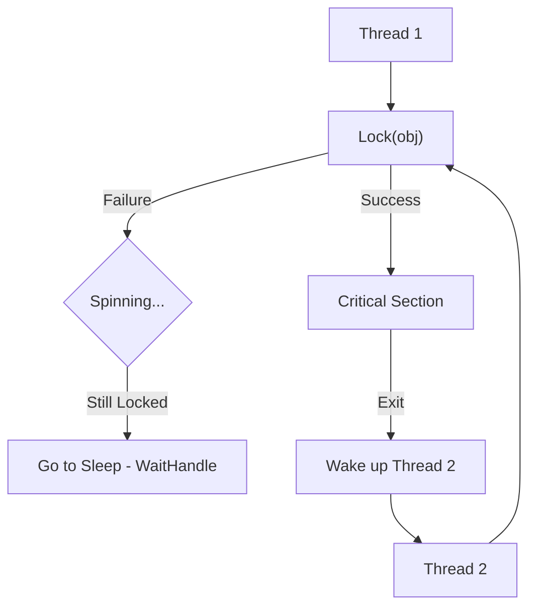

# Locks, Semaphores, and Mutexes: The Art of Synchronization
============================================================
0. Architectural Vision: The Gatekeepers of State
============================================================
- **Synchronization is the management of Resource Rivalry.** It ensures that multiple threads don't corrupt shared memory by accessing it simultaneously.
- **Lock (Monitor):** The most common primitive for Mutual Exclusion. Ensuring only one thread enters a code section.
- **Semaphore (Counting):** Managing a pool of resources (e.g., "Only 5 threads can talk to this API at once").
- **Mutex (OS-Wide):** A special lock that can span across different processes on the same machine.
- **User-Mode vs Kernel-Mode.** User-mode locks (Spinlocks) are fast but burn CPU; Kernel-mode locks (Mutex) are slow but allow the thread to sleep.
- **Hybrid Locks.** Modern .NET uses "Hybrid" locks (like `SemaphoreSlim`) that spin for a few nanoseconds (fast) before giving up and going to sleep (saving CPU).
- **Architect's View.** We minimize the use of locks. We prefer **Immutable Data** or **Concurrent Collections**. When we must lock, we keep the critical section as small as possible and use **Async-aware primitives** like `SemaphoreSlim.WaitAsync()`.

============================================================
1. Foundational Problem: The "Lost Update" and "Deadlock"
============================================================
- **Real-World Impact:** You have a shared "Counter" variable. Two threads both do `counter++` at once. 
- **What breaks?** "The Non-Atomic Operation". Both threads read '10', both increment, both write '11'. The result should have been '12'. Your data is now incorrect.
- **Scale Boundary:** In a system with 1,000 threads, if they all contend for the same lock, the throughput will drop to 1 thread's speed. This is **Lock Contention**.
- **Failure Story:** A major bank's "Daily Interest" service used a global `lock` on the Account table. During a peak hour, the service hit a **Deadlock**: Thread A locked Account 1 and wanted Account 2; Thread B locked Account 2 and wanted Account 1. The whole banking platform froze for 2 hours until the servers were manually rebooted. Proper **Lock Ordering** or **Timeouts** would have prevented this.

============================================================
2. Internal System Mechanics: Hybrid Locking
### The Monitor (lock Keyword)
Under the hood, `lock(obj)` is a wrapper around `Monitor.Enter`. It uses a "SyncBlock" (a small header on every object in .NET) to track which thread owns it.



### SemaphoreSlim vs Semaphore
- **SemaphoreSlim:** Optimized for local process use. Supports `WaitAsync()`. Uses a hybrid spin-then-wait strategy.
- **Semaphore:** A full Windows Kernel object. Slower but can be named and shared between two different EXE processes.

============================================================
3. Production Engineering in .NET 8 (Modern Primitives)
============================================================

### Anti-Pattern: Locking on 'this' or 'typeof(T)'
```csharp
// TERRIBLE: This allows other classes to lock your object, causing unexpected deadlocks.
lock(this) { ... }
```

### Production-Ready Implementation: Targeted Thread Safety
```csharp
// 1. Private Lock Object (Best Practice)
private readonly object _syncRoot = new();
public void UpdateState() {
    lock(_syncRoot) { // Only this class can access this lock
        _state++;
    }
}

// 2. Async-Aware Concurrency Control (SemaphoreSlim)
private readonly SemaphoreSlim _gate = new(10, 10); // Max 10 concurrent calls
public async Task CallExternalServiceAsync() {
    await _gate.WaitAsync(); // Non-blocking for the ThreadPool
    try {
        await _api.CallAsync();
    } finally {
        _gate.Release();
    }
}

// 3. High-Performance Read-Write (ReaderWriterLockSlim)
private readonly ReaderWriterLockSlim _rwLock = new();
public void Read() {
    _rwLock.EnterReadLock(); // Multiple readers allowed
    try { ... } finally { _rwLock.ExitReadLock(); }
}
```

**Architecture Strategy:** 
- Use **Interlocked** methods for simple Atomic operations (Increment, Exchange) as they are 10x-50x faster than a full lock.
- Implement **Lock Timeouts** using `Monitor.TryEnter` to avoid infinite hangs.

============================================================
4. System Interaction & Flow (ASCII Architecture)
============================================================

                ┌──────────────────┐
                │   Thread Queue   │ (The Contenders)
                └────────┬─────────┘
                         │ 1. Attempt Entry
         ┌───────────────▼───────────────┐
         │     THE SYNCBLOCK / HEADER    │ (The Guard)
         │  ┌─────────┐   ┌─────────┐    │
         │  │ OwnerID │ → │ Waiters │    │
         │  │ (TAS)   │   │ List    │    │
         │  └────┬────┘   └────┬────┘    │
         └───────┼─────────────┼─────────┘
                 │             │ 2. Context Switch (Sleep)
         ┌───────▼─────────────▼─────────┐
         │       Kernel WaitHandle       │ (The OS Scheduler)
         └───────────────┬───────────────┘
                         │ 3. Signal upon Exit
               ┌─────────▼─────────┐
               │  Next Thread In   │
               └───────────────────┘

============================================================
5. Strategic Scaling & System Evolution
============================================================
- **Distributed Locking.** Need a lock across 10 servers? Use **Redis Redlock** or **SQL Server `sp_getapplock`**.
- **Lock-Free Programming.** Designing algorithms that use hardware-level atomic operations (Compare-and-Swap) instead of mutual exclusion.
- **Memory Barriers.** Ensuring that the CPU doesn't "Reorder" your writes in a way that breaks your lock logic.

============================================================
6. Reliability, Observability & Runtime Governance
============================================================
- **Key Metrics:**
    - `Lock Contention Ratio`: Percentage of time threads spend waiting for locks.
    - `Blocked Threads Count`: Number of threads in a "Sleep" state due to synchronization.
- **Observability:** In Visual Studio, use the **Parallel Stacks** and **Tasks** windows to identify "Circular Waits" (Potential Deadlocks).

============================================================
7. Compromises, Tradeoffs & Alternatives
============================================================
- **Performance vs Safety.** Fine-grained locking (locking every small piece) is faster but complex; Coarse-grained (locking the whole DB) is safe but slow.
- **Reader-Writer Trade-off.** `ReaderWriterLockSlim` is faster if you have 90% reads and 10% writes, but it has more memory overhead than a simple `lock`.

============================================================
8. Security Posture & Risk Mitigation
============================================================
- **Denial of Service (DoS).** An attacker sending requests that cause "Long-held locks", effectively freezing the server.
    - *Architect's Rule:* Never let a lock duration depend on user input or a slow external network call.
- **Side-Channel attacks.** Timing variations caused by lock contention could potentially leak sensitive information about the internal state.

============================================================
9. Technical Edge Cases & System Failure Modes
============================================================
- **Abandoned Mutex.** A process crashes while holding a global Mutex. Windows will automatically signal it, but your data might be in an inconsistent state.
- **Thread Spawning in Lock.** Spawning a new thread *inside* a lock that needs the same lock (Recursive Deadlock).
    - *Architect's Rule:* `Monitor` is recursive (same thread can re-enter); `SemaphoreSlim` is NOT (it will deadlock itself).

============================================================
10. Architectural Assessment & Career Progression
============================================================
- **Senior:** "We use locks to prevent data corruption when multiple threads access the same resource."
- **Principal:** "Synchronization is the engineering of **Consistent Transitions**. We leverage **Hybrid Primitives** like `SemaphoreSlim` and `ReaderWriterLockSlim` to balance throughput and safety. We design for **Lock Minimization**, preferring **Atomic Intrinsics** and **Immutable Snapshot patterns**. By understanding the **Memory Model and Cache Line Padding**, we build high-concurrency kernels that maximize the parallel processing power of modern multi-core architectures without sacrificing operational stability."
- **Interview Strategy:** Explain the difference between `Semaphore` and `SemaphoreSlim`. Describe what "Lock Contention" is and how to use the "Lock Hierarchy" to prevent deadlocks.

============================================================
11. Real-World Case Study: Global Inventory System
============================================================
**Scenario:** A retailer managing stock across 500 warehouses.
- **The Problem:** Two warehouse managers updating the same "Item Count" at the same time caused "Ghost Stock".
- **The Design:** Used **Optimistic Concurrency** with a `RowVersion` for most tasks. Used a **Distributed Redis Lock** only for the final "Confirm Order" transaction.
- **Result:** System performance increased by 40% (because they removed 90% of the blocking locks). Errors dropped to practically zero.

============================================================
12. Structural Dependencies & Learning Path
============================================================
- **Foundations:** Kernel-mode vs User-mode, CPU Instructions (Compare-and-Swap).
- **Future Steps:** Lock-free data structures, Actors (Orleans/Akka).
- **Integration Points:** .NET Threading namespace, MedallionShell (Distributed Locks), StackExchange.Redis.
