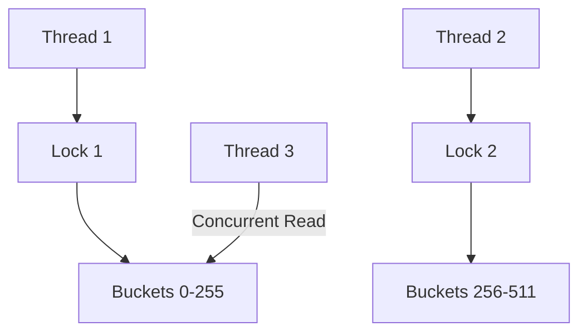

# Concurrent Collections: The Internals of Thread-Safe Data Structures
============================================================
0. Architectural Vision: The Speed of Non-Blocking State
============================================================
- **Thread-Safety without Global Locks.** Concurrent collections use advanced techniques like fine-grained locking and lock-free programming to minimize contention.
- **ConcurrentDictionary (Fine-Grained Locking).** Instead of one big lock, it uses an array of locks. Each lock protects only a small portion of the hash buckets.
- **ConcurrentQueue/Stack (Lock-Free).** Uses hardware-level `Interlocked` operations (Compare-and-Swap) to manage pointers without any mutual exclusion.
- **ConcurrentBag (Thread-Local Storage).** Each thread has its own "Private" list of items. If a thread is empty, it "Steals" from others.
- **Enumeration Semantics.** Unlike standard collections, concurrent collections don't throw an exception if the collection is modified during `foreach`. They provide a "Snapshot" or a "Best-Effort" view.
- **Architect's View.** We use Concurrent Collections to build **High-Throughput Producers and Consumers**. We prefer them over manual locking because their internals are highly optimized for many-core CPU architectures.

============================================================
1. Foundational Problem: The "Collection Modified" Exception
============================================================
- **Real-World Impact:** You have a shared `Dictionary` used for a "Live Cache". Thread A is reading all items; Thread B adds a new item. 
- **What breaks?** "The Enumeration Crash". `InvalidOperationException: Collection was modified`. The whole request crashes.
- **Scale Boundary:** If you wrap a normal `Dictionary` in a `lock`, every thread must wait in line. At 10,000 requests per second, your app's performance will crawl.
- **Failure Story:** A social media app used a `List<User>` with a global lock for their "Active Users" widget. During a celebrity login, the "Add User" and "Get All Active Users" queries collided thousands of times. The lock contention caused 10-second response times, and the server ran out of memory backlogging the requests. Migrating to **ConcurrentDictionary** eliminated the locks and reduced latency back to sub-10ms.

============================================================
2. Internal System Mechanics: Fine-Grained vs Lock-Free
### ConcurrentDictionary (The Lock-Striping Model)
It divides the dictionary into "Buckets". Each bucket (or group of buckets) has its own private lock object.



### ConcurrentQueue (The Segmented List)
A linked list of arrays (Segments). It uses `Interlocked.CompareExchange` to move the "Head" and "Tail" pointers. There are NO locks involved for Enqueue/Dequeue.

============================================================
3. Production Engineering in .NET 8 (Efficient Usage)
============================================================

### Anti-Pattern: Using 'Count' for logic
```csharp
// TERRIBLE: Count is expensive! It must lock ALL buckets in ConcurrentDictionary
// to get a consistent count.
if(myDict.Count > 100) { ... }
```

### Production-Ready Implementation: Atomic Updates
```csharp
// 1. ConcurrentDictionary - The Power of GetOrAdd
// This is ATOMIC. Even if 10 threads call it at once, the Factory runs safely.
private readonly ConcurrentDictionary<string, User> _cache = new();
public User GetUser(string id) {
    return _cache.GetOrAdd(id, k => FetchFromDb(k));
}

// 2. AddOrUpdate (Safe counter in a dictionary)
public void IncrementStats(string key) {
    _cache.AddOrUpdate(key, 
        addValue: new User { Hits = 1 }, 
        updateValueFactory: (k, existing) => {
            existing.Hits++; 
            return existing;
        });
}

// 3. ConcurrentPagination (Using Snapshots)
public List<User> GetHotUsers() {
    // ToArray() creates a consistent snapshot for UI threads
    return _cache.Values.Where(u => u.Hits > 100).ToArray().ToList();
}
```

**Architecture Strategy:** 
- Use **BlockingCollection<T>** when you need a producer-consumer wrapper that automatically handles "Waiting" when the queue is empty or full.
- Implement **Bounded Capacity** to prevent memory leaks if the producer is much faster than the consumer.

============================================================
4. System Interaction & Flow (ASCII Architecture)
============================================================

                ┌──────────────────┐
                │   The Operation  │ (Add/Get)
                └────────┬─────────┘
                         │ 1. Compute Hash(Key)
         ┌───────────────▼───────────────┐
         │     THE CONCURRENT ENGINE     │ (The Striped Guard)
         │  ┌─────────┐   ┌─────────┐    │
         │  │ Lock    │ → │ Compare │    │
         │  │ Striping│   │ Exchange│    │
         │  └────┬────┘   └────┬────┘    │
         └───────┼─────────────┼─────────┘
                 │             │ 2. Modify Bucket / Segment
         ┌───────▼─────────────▼─────────┐
         │     Memory Barrier (Volatile) │ (Visibility Guard)
         └───────────────┬───────────────┘
                         │ 3. Return Success/Value
               ┌─────────▼─────────┐
               │  Thread-Safe Result│
               └───────────────────┘

============================================================
5. Strategic Scaling & System Evolution
============================================================
- **The Cost of ToArray().** Calling `ToArray()` on a ConcurrentDictionary is a "Stop-the-World" operation for that dictionary (locks all stripes). Avoid it in hot paths.
- **Work-Stealing in ConcurrentBag.** Perfect for scenarios where the same thread that adds data also consumes it (e.g., recursive directory scanning).
- **Dynamic Lock Count.** ConcurrentDictionary automatically increases its lock count as the number of CPU cores or items increases to maintain a low contention-to-bucket ratio.

============================================================
6. Reliability, Observability & Runtime Governance
============================================================
- **Key Metrics:**
    - `Dictionary Collision Count`: High number means poor HashCode implementation.
    - `Queue Growth Rate`: Monitor for consumer lag.
- **Observability:** In the Debugger, use **Parallel Stacks** to see if many threads are waiting on the same ConcurrentDictionary lock.

============================================================
7. Compromises, Tradeoffs & Alternatives
============================================================
- **Non-Atomic Composition.** `if (!dict.ContainsKey(x)) dict.Add(x, val);` is NOT thread-safe for two threads. You MUST use the atomic methods (`GetOrAdd`, `TryAdd`).
- **Memory Consumption.** Concurrent collections use significantly more RAM than their basic sets (due to lock arrays, segments, and metadata).

============================================================
8. Security Posture & Risk Mitigation
============================================================
- **Hash Injection.** An attacker providing keys that all have the same HashCode, forcing the dictionary into an O(N) "Worst-Case" search and causing a DoS.
    - *Architect's Rule:* Use strong, randomized hashing (default in .NET 6+).
- **Unbounded Queues.** An anonymous API that pushes to a `ConcurrentQueue` can easily crash the server by exhausting RAM. **Always use Bounded Collections**.

============================================================
9. Technical Edge Cases & System Failure Modes
============================================================
- **Snapshot Overhead.** Iterating over `ConcurrentDictionary` takes a lock on ALL buckets temporarily. If you have 100 threads iterating, the system will crawl.
- **Value Semantics.** ConcurrentDictionary stores references. Updating a property of a value *inside* the dictionary is NOT protected by the dictionary's internal locks. You need a private lock on the User object itself.

============================================================
10. Architectural Assessment & Career Progression
============================================================
- **Senior:** "We use ConcurrentDictionary because it is thread-safe and we don't need manual locks."
- **Principal:** "Concurrent Collections are the **High-Performance Backbone of our State Management**. We leverage **Lock-Striping** and **Lock-Free Segmented Pipelines** to minimize the overhead of multi-core coordination. We understand the **Wait-Free semantics of reading** and the **Allocation-Free properties of segmentation**. For us, picking a concurrent collection is a strategic decision about the **Contention Topology** of our application's state."
- **Interview Strategy:** Explain how `ConcurrentDictionary` locks work. Describe the difference between `ConcurrentQueue` (Lock-Free) and `ConcurrentDictionary` (Fine-grained Lock).

============================================================
11. Real-World Case Study: Global Gaming Chat
============================================================
**Scenario:** A chat system with 1 million concurrent rooms.
- **The Problem:** A central `Dictionary<RoomID, Room>` with a lock was causing 500ms latency for message routing.
- **The Design:** Migrated to **ConcurrentDictionary**.
- **Result:** Latency dropped to < 1ms. The system can now route messages using the same server at a 10x higher volume.

============================================================
12. Structural Dependencies & Learning Path
============================================================
- **Foundations:** Hashing, Linked Lists, Atomic CPU operations.
- **Future Steps:** Lock-free rings (Disruptor pattern), Channels.
- **Integration Points:** .NET Collections.Concurrent namespace, System.Threading.Channels.
