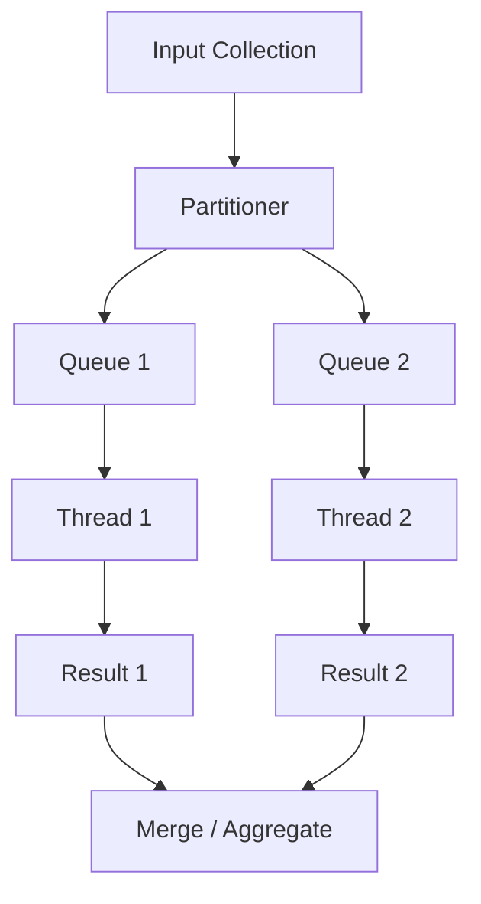

# Parallel Programming: The Mastery of PLINQ and TPL Dataflow
**0. Architectural Vision: Orchestrating the Multi-Core CPU**
- **Parallelism vs Concurrency.** Parallelism is about doing multiple pieces of work *simultaneously* (e.g., on 8 cores); Concurrency is about *managing* multiple tasks (e.g., responding to many requests).
- **PLINQ (Parallel LINQ).** An engine that automatically partitions your collection and processes it in parallel across multiple threads.
- **TPL Dataflow.** A library for building robust actor-like pipelines (Producers, Transformers, Consumers) with built-in buffering and backpressure.
- **Data Parallelism vs Task Parallelism.** Data Parallelism applies the same logic to many items (PLINQ); Task Parallelism executes different pieces of code in parallel (`Parallel.Invoke`).
- **Degree of Parallelism (DoP).** Controlling how many threads are allowed to work on a task at once to avoid CPU thrashing.
- **Architect's View.** We don't just "Parallelize everything". We use Parallelism for **CPU-Bound** heavy lifting and **TPL Dataflow** for **Asynchronous Pipelines**. We understand that the overhead of partitioning small collections exceeds the benefits of parallelism.

**1. Foundational Problem: The "Single-Core Bottleneck"**
- **Real-World Impact:** You have 1 million images to resize. On a single thread, it takes 10 hours. Your server has 16 cores, but only one is at 100% while the others are idle.
- **What breaks?** "The Scaling Opportunity". You are paying for expensive multi-core hardware but using it at 6% efficiency.
- **Scale Boundary:** For embarrassingly parallel tasks, your throughput should scale linearly with the number of cores (N). Without PLINQ, your throughput is fixed at 1.
- **Failure Story:** A data analysis engine used a simple `foreach` to process monthly reports. As the company grew, reports took 6 hours to generate, delaying business decisions. They added more CPUs, but nothing changed. After switching to **PLINQ (`.AsParallel()`)**, the report generation time dropped to 30 minutes, utilizing all 12 cores on the server.

============================================================
2. Internal System Mechanics: Partitioning and Pipelines
### PLINQ Partitioning
PLINQ divides your data using three strategies:
1. **Range Partitioning:** Splitting an array into equal chunks (Good for indexed data).
2. **Hash Partitioning:** Distributing based on keys (Used for Joins/GroupBy).
3. **Chunk Partitioning:** Grabbing items one-by-one (Best for uneven workloads).



### TPL Dataflow Blocks
- **BufferBlock:** A simple FIFO queue.
- **ActionBlock:** A consumer that performs an action on an item.
- **TransformBlock:** A transformer that maps Input -> Output.

**3. Production Engineering in .NET 8 (Pipeline Orchestration)**

### Anti-Pattern: Parallelizing I/O-Bound Work without a Limit
```csharp
// TERRIBLE: This will spawn 1,000 parallel web requests and crash the host CPU or network.
var results = ids.AsParallel().Select(id => Download(id)).ToList();
```

### Production-Ready Implementation: Bounded Dataflow Pipeline
```csharp
// 1. Defining the Processing Logic
var transformer = new TransformBlock<string, string>(async url => {
    return await _client.GetStringAsync(url);
}, new ExecutionDataflowBlockOptions {
    MaxDegreeOfParallelism = 10, // Control the load
    BoundedCapacity = 100 // Backpressure: the producer will wait if queue is full
});

// 2. Defining the Consumer
var consumer = new ActionBlock<string>(html => {
    Console.WriteLine($"Length: {html.Length}");
});

// 3. Linking the Pipeline
transformer.LinkTo(consumer, new DataflowLinkOptions { PropagateCompletion = true });

// 4. Executing
foreach(var url in urls) await transformer.SendAsync(url);
transformer.Complete();
await consumer.Completion;
```

**Architecture Strategy:** 
- Use **Parallel.ForEachAsync** (introduced in .NET 6) for modern, non-blocking parallel processing of async tasks.
- Control **Order preservation** with `AsOrdered()` in PLINQ only if necessary, as it adds a synchronization overhead.

**4. System Interaction & Flow (ASCII Architecture)**

                ┌──────────────────┐
                │   The Producer   │ (Data Source)
                └────────┬─────────┘
                         │ 1. Post(Data)
         ┌───────────────▼───────────────┐
         │     DATAFLOW BUFFER / MESH    │ (The Processing Engine)
         │  ┌─────────┐   ┌─────────┐    │
         │  │ Transform│ → │ Link /  │    │
         │  │ Block   │   │ Target  │    │
         │  └────┬────┘   └────┬────┘    │
         └───────┼─────────────┼─────────┘
                 │             │ 2. Pipeline Propagation
         ┌───────▼─────────────▼─────────┐
         │      Consumer / Terminal      │ (The Output)
         └───────────────┬───────────────┘
                         │ 3. Signal Completion
               ┌─────────▼─────────┐
               │    Pipeline Idle  │
               └───────────────────┘

**5. Strategic Scaling & System Evolution**
- **Stop-on-Error.** Configuring how a pipeline reacts to failure. Does the whole pipe crash, or do we use a "Dead Letter Queue"?
- **Partitioning for Latency.** In High-Frequency systems, you might choose the Partitioning strategy manually to ensure that "Hot Items" always get processed immediately by a dedicated core.
- **Auto-Scaling with TPL.** Setting `MaxDegreeOfParallelism = Environment.ProcessorCount` ensures that your app always uses the full capacity of whatever server it is running on.

**6. Reliability, Observability & Runtime Governance**
- **Key Metrics:**
    - `InputQueueLength (Dataflow)`: Are we building up a backlog?
    - `CPU Utilization %`: Is it peaking at 100% or is there a bottleneck?
- **Observability:** Use **Visual Studio Parallel Stacks** to see the distribution of tasks across the pipeline blocks.

**7. Compromises, Tradeoffs & Alternatives**
- **Ordering vs Speed.** PLINQ is faster if it doesn't have to keep items in order.
- **TPL vs Rx.** Rx (Reactive Extensions) is for "Push" events (Streams); TPL Dataflow is for "Active" processing of a data source.

**8. Security Posture & Risk Mitigation**
- **Resource Exhaustion (Memory).** Unbounded Dataflow pipelines can consume all RAM in seconds if the producer is fast and the consumer is slow. **Always set `BoundedCapacity`**.
- **Data Leaks.** Ensure that sensitive data in the pipeline is encrypted at rest if the pipeline uses "Disk-backed" buffers (rare in TPL, but common in larger orchestrators).

**9. Technical Edge Cases & System Failure Modes**
- **Exception Aggregation.** PLINQ and TPL wrap exceptions in an `AggregateException`. You must catch it properly and iterate over the `InnerExceptions`. 
- **Deadlocks in Linking.** Creating a circular link between Dataflow blocks (A -> B -> A) will cause an infinite loop or a deadlock.

**10. Architectural Assessment & Career Progression**
- **Senior:** "We use Parallel.ForEach and PLINQ to process large amounts of data on multiple threads."
- **Principal:** "Parallel Programming is the engineering of **Compute Efficiency**. We leverage **PLINQ's Partitioning Strategies** for bulk data processing and build reactive, self-throttling micro-pipelines with **TPL Dataflow**. We manage **Throughput via Backpressure** and **Degree of Parallelism via Runtime Metrics**, ensuring our workloads scale gracefully without overwhelming the host kernel or downstream resources."
- **Interview Strategy:** Describe the difference between `Parallel.ForEach` and PLINQ. Explain what "Backpressure" is and how to implement it in TPL Dataflow.

**11. Real-World Case Study: Global Log Ingestion Engine**
**Scenario:** A service receiving 1TB of logs per day from 10,000 apps.
- **The Problem:** Processing logs one-by-one was too slow. They needed to: 1. Unzip, 2. Parse, 3. Validate, 4. Send to Elastic.
- **The Design:** Created a 4-stage **TPL Dataflow Pipeline**. Stage 1 (Unzip) had DoP=2 (CPU intensive), Stage 4 (Send) had DoP=20 (I/O intensive).
- **Result:** Throughput increased by 800%. The same server now handles the entire company's logging traffic without lag.

**12. Structural Dependencies & Learning Path**
- **Foundations:** LINQ, Threading, Buffer Management.
- **Future Steps:** Cloud-scale pipelines (Azure Data Factory, Kafka Streams).
- **Integration Points:** System.Threading.Tasks.Dataflow, System.Linq.Parallel, Parallel.ForEachAsync.
