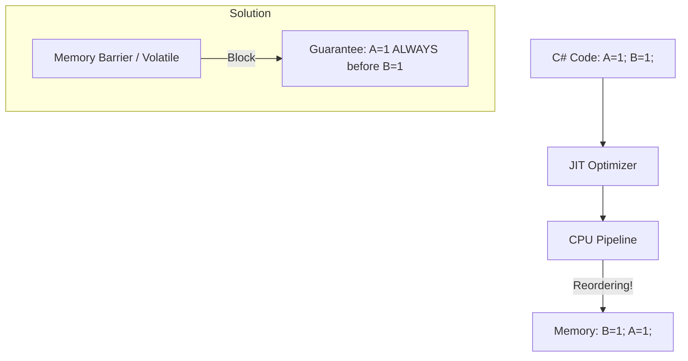

# Volatile, Interlocked, and Memory Barriers: The Low-Level Architecture of Concurrency
============================================================
0. Architectural Vision: The Physics of the Memory Model
============================================================
- **The CPU is a Master of Deception.** Modern CPUs (x86, ARM) may reorder your instructions to maximize efficiency. What you write in C# is NOT what the CPU executes.
- **Memory Barriers (Fences).** Instructions that force the CPU to "Catch up" and ensure all previous writes are visible to other cores before continuing.
- **Interlocked (Atomic Intrinsics).** Hardware-level instructions (like `lock xadd`) that perform an operation (Inc, Add, Exchange) as a single, atomic unit at the CPU level.
- **Volatile.** Telling the JIT compiler: "Do not cache this variable in a CPU register; always read it from main memory".
- **The .NET Memory Model.** A set of rules that defines what the runtime guarantees about the visibility of writes across different threads.
- **Architect's View.** We use **Interlocked** for high-performance counters and status flags. We avoid **Volatile** unless we are performance absoluteists. We understand that **Memory Barriers** are implicit in Locks and Tasks, so we only use them when building custom, lock-free kernels.

============================================================
1. Foundational Problem: The "Ghost Update" and "Stale Cache"
============================================================
- **Real-World Impact:** You have a shared `bool _stop = false`. Thread 1 runs `while(!_stop) { ... }`. Thread 2 sets `_stop = true`. 
- **What breaks?** "The Infinite Loop". The JIT compiler sees that `_stop` is never changed *inside* Thread 1's loop, so it caches the value in a CPU register. Even if Thread 2 updates the memory, Thread 1 never sees it.
- **Scale Boundary:** In a multi-socket server (e.g., 64 cores), the "L1 Cache" of Core 1 might have a different version of a variable than Core 64. Memory barriers are required to "Synchronize" the caches.
- **Failure Story:** A high-frequency trading platform used a simple `int _counter` without `Interlocked`. During a massive market event, two threads updated the counter simultaneously. Because the operation `counter++` is actually 3 steps (Read, Inc, Write), they lost 30% of their trades' logging data, leading to a regulatory audit. Migrating to **`Interlocked.Increment`** solved the data loss.

============================================================
2. Internal System Mechanics: Atomicity and Reordering
### Instruction Reordering
The JIT compiler, the CPU, and the Memory Controller can all swap instructions if they think it's faster.



### The Cost of Synchronization
- **Ordinary Write:** 1 CPU cycle.
- **Interlocked Operation:** ~50-100 CPU cycles (due to the LOCK signal on the memory bus).
- **Full Lock (Monitor):** ~1,000+ CPU cycles (if contention occurs).

============================================================
3. Production Engineering in .NET 8 (Atomic Intrinsics)
============================================================

### Anti-Pattern: Using 'Volatile' for complex logic
```csharp
// TERRIBLE: Volatile only ensures visibility, NOT atomicity.
// If two threads run this, you still have a race condition.
public volatile int _count; 
_count++; // Still NOT thread-safe!
```

### Production-Ready Implementation: Atomic Exchange and Counters
```csharp
// 1. Thread-Safe Atomic Counter
private int _activeConnections;
public void OnConnect() {
    // Hardware-level atomic increment
    Interlocked.Increment(ref _activeConnections);
}

// 2. Lock-Free Atomic Swap (Perfect for Caching)
private Config _currentConfig;
public void UpdateConfig(Config newConfig) {
    // Swaps the pointer atomically. 
    // Any thread reading _currentConfig after this will see the new one.
    Interlocked.Exchange(ref _currentConfig, newConfig);
}

// 3. Compare-and-Swap (The building block of lock-free data structures)
private int _state = 0; // 0=Idle, 1=Busy
public bool TryEnter() {
    // Only changes _state to 1 IF it was currently 0.
    return Interlocked.CompareExchange(ref _state, 1, 0) == 0;
}
```

**Architecture Strategy:** 
- Use **Interlocked** for 99% of low-level concurrency needs. 
- Use **LongAdd (Interlocked.Add)** if you need atomic 64-bit updates on 32-bit systems.

============================================================
4. System Interaction & Flow (ASCII Architecture)
============================================================

                ┌──────────────────┐
                │   The Thread     │ (Core A)
                └────────┬─────────┘
                         │ 1. Interlocked.Increment
         ┌───────────────▼───────────────┐
         │     THE MEMORY BUS CONTROLLER │ (The Arbiter)
         │  ┌─────────┐   ┌─────────┐    │
         │  │ LOCK    │ → │ Flush   │    │
         │  │ Signal  │   │ Caches  │    │
         │  └────┬────┘   └────┬────┘    │
         └───────┼─────────────┼─────────┘
                 │             │ 2. Primary Memory Update
         ┌───────▼─────────────▼─────────┐
         │      Main RAM (Global)        │ (Single Source of Truth)
         └───────────────┬───────────────┘
                         │ 3. Signal to Other Cores
               ┌─────────▼─────────┐
               │  Consistent State │
               └───────────────────┘

============================================================
5. Strategic Scaling & System Evolution
============================================================
- **False Sharing.** When two threads update two different `Interlocked` variables that happen to be on the same **L1 Cache Line** (usually 64 bytes). This causes the CPU to flush the cache repeatedly, killing performance.
    - *Architect's Tip:* Use `[StructLayout(LayoutKind.Explicit)]` and `[FieldOffset]` to space them out.
- **ARM vs x86.** x86 is "Strongly Ordered" (seldom reorders writes); ARM (Apple M1/M2) is "Weakly Ordered" and reorders everything. `Volatile` is much more important on ARM processors.

============================================================
6. Reliability, Observability & Runtime Governance
============================================================
- **Key Metrics:**
    - `Interlocked Contention Count`: Hard to measure directly, but visible via CPU "Stall" cycles.
- **Observability:** Use `perf` (Linux) or `Intel VTune` to identify cache-line ping-pongs.

============================================================
7. Compromises, Tradeoffs & Alternatives
============================================================
- **Complexity.** Writing lock-free code using `Interlocked` is extremely error-prone. **Architect's Tip:** Only use `Interlocked` for Counters or Flags. For everything else, use a `lock` or a `ConcurrentCollection`.

============================================================
8. Security Posture & Risk Mitigation
============================================================
- **Memory Safety.** Ensure that your `ref` pointers for Interlocked remain valid. C# 12 `ref` fields and `scoped ref` parameters help make this safer for high-performance structs.

============================================================
9. Technical Edge Cases & System Failure Modes
============================================================
- **The ABA Problem.** A thread reads 'A', another thread changes it to 'B' then back to 'A'. The first thread's `CompareExchange` succeeds even though the state changed in between.
    - *Architect's Rule:* Use **Versioned Pointers** or **Monotonically Increasing IDs** to prevent ABA.

============================================================
10. Architectural Assessment & Career Progression
============================================================
- **Senior:** "We use Interlocked to make thread-safe counters without using expensive locks."
- **Principal:** "Low-level Concurrency is the engineering of **Hardware Coherency**. We leverage **Memory Barriers and Atomic Intrinsics** to build zero-latency synchronization frameworks. We understand the **Processor Memory Model** and the impact of **Cache Line Contention**, allowing us to architect systems that scale to 128+ cores without the overhead of kernel-mode context switching or serializing the memory bus."
- **Interview Strategy:** Explain what happens when the `LOCK` prefix is sent to the memory bus. Describe what "Instruction Reordering" is and why it's dangerous.

============================================================
11. Real-World Case Study: High-Performance Counter Service
============================================================
**Scenario:** A real-time ad-bidding system processing 2 million events per second.
- **The Problem:** Using a `lock` around a counter caused the bidding engine to lag, losing thousands of dollars per second.
- **The Design:** Replaced all locks with `Interlocked.Increment` and used `volatile` for the "Switch" that enables/disables bidding.
- **Result:** Latency dropped from 100ms to <1ms. The system can now process the full traffic on half the number of servers.

============================================================
12. Structural Dependencies & Learning Path
============================================================
- **Foundations:** CPU Pipeline, L1/L2/L3 Caching.
- **Future Steps:** Lock-free rings, SIMD (Vectorization).
- **Integration Points:** System.Threading.Interlocked, Thread.MemoryBarrier(), volatile keyword.
