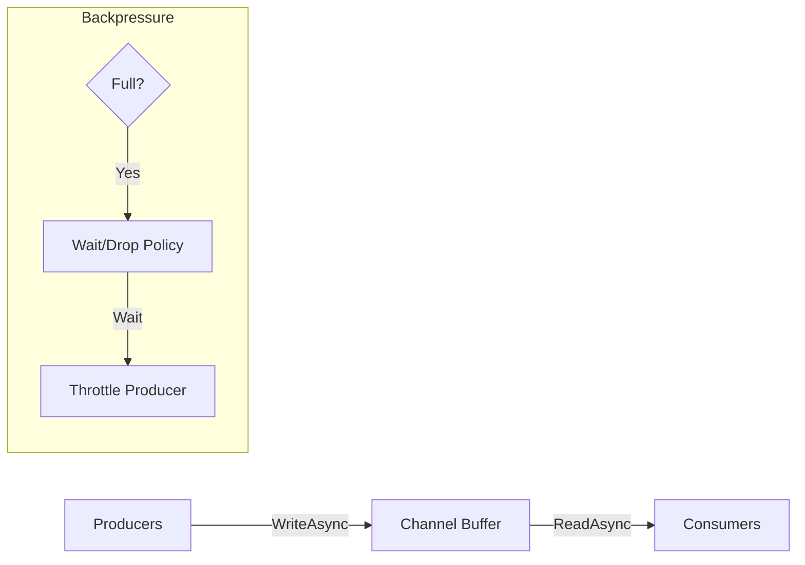

# Channels: Engineering High-Performance Producer-Consumer Pipelines
============================================================
0. Architectural Vision: The Flow of Data
============================================================
- **Channels are the Modern .NET Answer to 'BlockingCollection'.** They are high-performance, asynchronous, thread-safe queues designed for producer-consumer patterns.
- **Asynchronous by Default.** Unlike older collections, Channels provide `ReadAsync` and `WriteAsync`, preventing ThreadPool starvation.
- **Backpressure Management.** Bounded channels allow you to specify what happens when the queue is full (Wait, Drop Oldest, Drop Newest).
- **Multiple Producers/Consumers.** Native support for many-to-one, one-to-many, and many-to-many topologies.
- **Completion Signaling.** A robust way for producers to tell consumers: "I'm done; you can finish your work."
- **Architect's View.** We use Channels for **Log Ingestion**, **Background Task Processing**, and **Event Aggregation**. They are significantly faster and more memory-efficient than `TPL Dataflow` for simple linear pipelines.

============================================================
1. Foundational Problem: The "Producer-Consumer Deadlock"
============================================================
- **Real-World Impact:** You have a web scraper that finding 100 images per second (Producer), but your uploader only processes 5 images per second (Consumer).
- **What breaks?** "The Memory Explosion". Without a bounded queue, your producer will keep adding images to RAM until the server crashes with `OutOfMemoryException`.
- **Scale Boundary:** In a high-throughput system, you need a way to **Slow Down the Producer** (Backpressure) so the consumer can catch up.
- **Failure Story:** A fintech company used a `ConcurrentQueue` for their "Trade Signal" pipeline. During a market crash, the "Producer" (external ticker) sent 1 million signals per second. The "Consumer" (Risk engine) couldn't keep up. The `ConcurrentQueue` consumed 64GB of RAM in 2 minutes, the server crashed, and they lost critical trading data. Migrating to **Bounded Channels** ensured the producer was throttled, keeping the system stable.

============================================================
2. Internal System Mechanics: Synchronization and Waiters
### Bounded vs Unbounded
- **Unbounded:** Infinite growth (only use if you TRUST your producer).
- **Bounded:** Fixed size (e.g., 1,000 items). Handles backpressure.



### The Waiter Queue
Under the hood, Channels use a `ValueTask`-based waiting mechanism. If a consumer tries to read an empty channel, it is added to a linked list of "Waiters" and resumed instantly when a producer writes.

============================================================
3. Production Engineering in .NET 8 (Modern Pipelines)
============================================================

### Anti-Pattern: Using Unbounded Channels for External Input
```csharp
// TERRIBLE: This allows an external user to crash your server's memory.
var channel = Channel.CreateUnbounded<Request>(); 
```

### Production-Ready Implementation: Robust Async Worker
```csharp
// 1. Create a Bounded Channel
private readonly Channel<string> _logChannel = Channel.CreateBounded<string>(new BoundedChannelOptions(1000) {
    FullMode = BoundedChannelFullMode.Wait, // Backpressure: Producer waits
    SingleReader = true, // Optimization if only one consumer
    SingleWriter = false // Many publishers
});

// 2. The Producer (Non-blocking write)
public async ValueTask PublishLog(string msg) {
    await _logChannel.Writer.WriteAsync(msg);
}

// 3. The Consumer (Non-blocking read)
public async Task StartConsumer(CancellationToken ct) {
    // Efficiently waits for data without burning CPU
    await foreach (var msg in _logChannel.Reader.ReadAllAsync(ct)) {
        await ProcessLogAsync(msg);
    }
}
```

**Architecture Strategy:** 
- Use **TryWrite** if you prioritize performance and are okay with dropping data (e.g., non-critical logging).
- Implement **SingleReader/SingleWriter** options when possible to trigger internal lock-free optimizations.

============================================================
4. System Interaction & Flow (ASCII Architecture)
============================================================

                ┌──────────────────┐
                │   The Producer   │ (App Logic)
                └────────┬─────────┘
                         │ 1. Write Item
         ┌───────────────▼───────────────┐
         │     CHANNEL ORCHESTRATOR      │ (The Async Traffic Jam)
         │  ┌─────────┐   ┌─────────┐    │
         │  │ Buffer  │ → │ Wait    │    │
         │  │ Array   │   │ List    │    │
         │  └────┬────┘   └────┬────┘    │
         └───────┼─────────────┼─────────┘
                 │             │ 2. Notify Consumer
         ┌───────▼─────────────▼─────────┐
         │       Managed Consumer        │ (Worker Task)
         └───────────────┬───────────────┘
                         │ 3. Execute Async Work
               ┌─────────▼─────────┐
               │    Next Item...   │
               └───────────────────┘

============================================================
5. Strategic Scaling & System Evolution
============================================================
- **Batching.** Reading 100 items at once from a channel to reduce the overhead of async state machine transitions for every single item.
- **Priority Channels.** .NET doesn't have native priority channels, but you can build one by using two channels (High/Low) and having the consumer check the High channel first.
- **Interchangeable Backends.** Start with in-memory Channels. As you scale, move the logic to **Redis Streams** or **Azure Service Bus** using the same producer-consumer pattern.

============================================================
6. Reliability, Observability & Runtime Governance
============================================================
- **Key Metrics:**
    - `Channel Count`: How many items are waiting?
    - `Producer-Consumer Lag`: Delay between write and read.
- **Observability:** Monitor `Task status` in the debugger to see if your consumer is "WaitingToRun".

============================================================
7. Compromises, Tradeoffs & Alternatives
============================================================
- **Ordering.** Channels guarantee FIFO order. If you need priority, you have to manage it manually.
- **In-Memory Volatility.** If the process crashes, everything in the channel is lost. **Architect's Rule:** Only use Channels for data that can be replayed or that isn't mission-critical.

============================================================
8. Security Posture & Risk Mitigation
============================================================
- **Denial of Service.** An internal component loop-producing into an unbounded channel.
    - *Architect's Rule:* Set a hard limit (e.g., 50,000 items) for every single channel in the system.
- **Access Control.** Pass only the `ChannelReader` or `ChannelWriter` to components to ensure they can't do things they aren't supposed to (e.g., a producer shouldn't be able to "Close" the channel).

============================================================
9. Technical Edge Cases & System Failure Modes
============================================================
- **Double Completion.** Calling `Writer.Complete()` twice. (Actually safe, but throws an exception if you try to `Write` after completion).
- **The "Dead Letter" Problem.** If a consumer crashes while processing an item from a channel, that item is gone.
    - *Architect's Rule:* If you need "At-Least-Once" delivery, you need a custom acknowledgment mechanism on top of Channels.

============================================================
10. Architectural Assessment & Career Progression
============================================================
- **Senior:** "We use Channels for background workers because they are thread-safe and asynchronous."
- **Principal:** "Channels are the **High-Concurrency Nervous System of our Application**. We leverage **Bounded Buffers and Custom Full-Modes** to implement precise **Backpressure Control**. We optimize for **Allocation-Free Read Loops** using `ValueTask` and `SingleReader` semantics. By architecting our internal workflows as **Decoupled Producer-Consumer Nodes**, we build systems that are inherently resilient to load spikes and CPU contention."
- **Interview Strategy:** Explain the difference between `BlockingCollection` and `Channel`. Describe how you manage a scenario where the Consumer is slower than the Producer.

============================================================
11. Real-World Case Study: Real-Time Telemetry Processing
============================================================
**Scenario:** A connected car platform receiving 100k GPS pings per second.
- **The Problem:** Writing every ping to the database immediately crashed the DB.
- **The Design:** Implemented a **Channel** to buffer pings. A background consumer reads them in batches of 500 and performs a "Bulk Insert".
- **Result:** Database CPU usage dropped by 70%. The system now handles 5x the traffic with the same infrastructure.

============================================================
12. Structural Dependencies & Learning Path
============================================================
- **Foundations:** Queue Theory, Async/Await.
- **Future Steps:** Distributed queues (RabbitMQ), gRPC streaming.
- **Integration Points:** System.Threading.Channels, IAsyncEnumerable, Worker Services.
