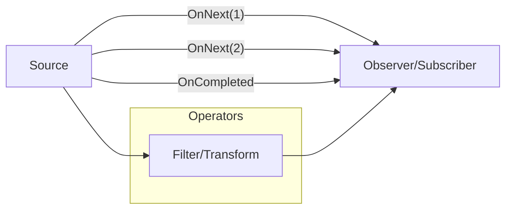

# Reactive Programming: The Power of System.Reactive (Rx.NET)
============================================================
0. Architectural Vision: Composing the Stream of Events
============================================================
- **Rx is LINQ for Events.** It treats an event stream (e.g., "Mouse Clicks" or "Stock Price Changes") like a collection that you can query, filter, and transform.
- **IObservable vs IEnumerable.** IEnumerable is "Pull" (the consumer asks for data); IObservable is "Push" (the producer sends data whenever it is ready).
- **The Duality of Data.** Rx allows you to use the same logic for a single future value (Task) and a sequence of values over time (Observable).
- **Schedulers.** The "Where" of Reactive Programming. They control which thread handles the event production and which thread handles the processing.
- **Backpressure vs Lossiness.** Rx provides advanced operators like `Sample`, `Debounce`, and `Throttle` to handle sources that produce data faster than consumers can process it.
- **Architect's View.** We use Rx when building **Complex UI Interactions**, **Real-Time Financial Dashboards**, and **Sensor Data Pipelines**. We prefer it over raw C# `event` handles because it is composable, testable, and thread-safe.

============================================================
1. Foundational Problem: The "Event Callback Hell"
============================================================
- **Real-World Impact:** You are building a "Search-as-you-type" box. If you fire an API call for EVERY keystroke, you will crash your server. You need to wait for the user to "Stop typing" for 300ms before searching.
- **What breaks?** "The Temporal Dependency". Managing a "Timer" manually for every keyboard event is extremely complex and bug-prone (State management, Thread-safety, cleanup).
- **Scale Boundary:** In a high-frequency trading app receiving 5,000 price updates per second, a standard `foreach` or manual `delegate` logic will overwhelm the UI thread and cause it to lock up.
- **Failure Story:** A flight tracking system used C# `events` for every GPS update. If the network flickered, the UI received 1,000 buffered updates at once, causing it to freeze for 10 seconds while it tried to process the list. Migrating to **Rx.NET** allowed them to `Sample(TimeSpan.FromSeconds(1))` the data, ensuring the UI stayed smooth regardless of the network burst.

============================================================
2. Internal System Mechanics: Subscriptions and Schedulers
### The Observer Pattern
- **OnNext:** The stream has a new value.
- **OnError:** Something went wrong (The stream is terminated).
- **OnCompleted:** The stream is finished successfully.



### Schedulers (The Concurrency Model)
- **CurrentThreadScheduler:** Runs where the producer is.
- **ThreadPoolScheduler:** Offloads to the background.
- **DispatcherScheduler:** For UI updates (WPF/WinUI).

============================================================
3. Production Engineering in .NET 8 (Rx Mastery)
============================================================

### Anti-Pattern: Forgetting to Dispose
```csharp
// TERRIBLE: This creates a memory leak. The subscription lives forever 
// until the process ends.
_service.Updates.Subscribe(x => Console.WriteLine(x)); 
```

### Production-Ready Implementation: Composable Streams
```csharp
// 1. Properly Disposing with CompositeDisposable
private readonly CompositeDisposable _disposables = new();

public void StartMonitoring(IObservable<Price> feed) {
    var subscription = feed
        .Buffer(TimeSpan.FromSeconds(1)) // 2. Batching for performance
        .Where(batch => batch.Count > 0)
        .Select(batch => batch.Average(p => p.Value))
        .SubscribeOn(NewThreadScheduler.Default) // Producer thread
        .ObserveOn(TaskPoolScheduler.Default) // Processing thread
        .Subscribe(avg => {
            _logger.Log($"1s Average: {avg}");
        });

    _disposables.Add(subscription);
}

// 3. Search Debounce Pattern
public void BindSearch(IObservable<string> input) {
    input.Throttle(TimeSpan.FromMilliseconds(300)) // Only fire if idle for 300ms
        .DistinctUntilChanged() // Only fire if the text actually changed
        .SelectMany(async query => await SearchApiAsync(query)) // Flatten async calls
        .Subscribe(results => UpdateUI(results));
}
```

**Architecture Strategy:** 
- Use **Subject<T>** sparingly. They are useful for bridges but often hide the true source of data.
- Implement **Cold vs Hot Observables** correctly. (Cold = starts over for every subscriber; Hot = shared event source).

============================================================
4. System Interaction & Flow (ASCII Architecture)
============================================================

                ┌──────────────────┐
                │   The Generator  │ (Event Source / Timer)
                └────────┬─────────┘
                         │ 1. Push(Data)
         ┌───────────────▼───────────────┐
         │     REACTIVE OPERATOR CHAIN   │ (The Processor)
         │  ┌─────────┐   ┌─────────┐    │
         │  │ Filter  │ → │ Switch  │    │
         │  │ Map     │   │ Latest  │    │
         │  └────┬────┘   └────┬────┘    │
         └───────┼─────────────┼─────────┘
                 │             │ 2. Thread Marshaling (ObserveOn)
         ┌───────▼─────────────▼─────────┐
         │       The Subscriber          │ (The Endpoint)
         └───────────────┬───────────────┘
                         │ 3. Execute Callback
               ┌─────────▼─────────┐
               │   State Updated   │
               └───────────────────┘

============================================================
5. Strategic Scaling & System Evolution
============================================================
- **Backpressure Operators.** `Window`, `Sample`, and `Buffer` allow you to reduce the resolution of a high-speed stream to something your consumer can handle.
- **Testability.** Rx provides the `TestScheduler`, which allows you to "Fast Forward" through 10 hours of virtual time in 1 millisecond, making it perfect for testing time-based logic.
- **Async Interop.** Effortlessly convert between `Task` and `IObservable` using `.ToObservable()` and `.ToTask()`.

============================================================
6. Reliability, Observability & Runtime Governance
============================================================
- **Key Metrics:**
    - `Subscription Count`: Monitor for leakages.
    - `OnNext Latency`: How long does it take an event to traverse the chain?
- **Observability:** Use the **Rx Spy** tool to visualize the flow of events through your operators.

============================================================
7. Compromises, Tradeoffs & Alternatives
============================================================
- **Complexity.** The "Magic" of Rx makes debugging difficult. A single operator in the middle of a 20-link chain can break the whole stream.
- **Synchronicity.** If your `OnNext` callback blocks, it blocks the producer. Rx is "Push-based" but still synchronous by default within the chain.

============================================================
8. Security Posture & Risk Mitigation
============================================================
- **Memory Exhaustion.** `Buffer(1000)` on a stream that only receives 1 item every hour will keep those 999 items in RAM forever.
    - *Architect's Rule:* Always use time-based OR count-based limits for buffers (e.g., `Buffer(TimeSpan.FromMinutes(1), 1000)`).
- **Error Propagation.** An unhandled error in a subscriber can kill the entire stream for all other subscribers.

============================================================
9. Technical Edge Cases & System Failure Modes
============================================================
- **Reentrancy.** An observer calling a method that triggers another event in the same source.
    - *Architect's Rule:* Use the `ObserveOn` operator to break the reentrancy loop.
- **The "Missing Signal".** Subscribing to a "Cold" observable after it has already finished. You get nothing.

============================================================
10. Architectural Assessment & Career Progression
============================================================
- **Senior:** "We use Rx.NET to handle UI events and debounce search queries."
- **Principal:** "Reactive Programming is the engineering of **Temporal Composition**. We leverage **Functional Streams** to decouple our event processing from our threading model. We architecture our systems as a series of **Declarative Transformations**, utilizing **Schedulers** for precise execution control and **Backpressure Operators** for load resilience. By treating 'Time' as a first-class citizen in our domain logic, we build fluid, responsive systems that remain stable under extreme data volatility."
- **Interview Strategy:** Compare `Subject` and `BehaviorSubject`. Explain how the `Switch` operator works and why you would use it for an autocomplete box.

============================================================
11. Real-World Case Study: Real-Time Trading Platform
============================================================
**Scenario:** A platform providing live stock prices to 100,000 mobile users.
- **The Problem:** Sending every tick to every phone drained the battery and killed the server bandwidth.
- **The Design:** Used Rx.NET on the backend to `Sample` the raw exchange feed per stock.
- **Result:** Bandwidth reduced by 90% while the users still saw "Real-Time" (1s) price updates.

============================================================
12. Structural Dependencies & Learning Path
============================================================
- **Foundations:** LINQ, Observer Pattern, Threading.
- **Future Steps:** ReactiveUI, Akka.NET Streams.
- **Integration Points:** System.Reactive namespace, SignalR (Integration with streams).
