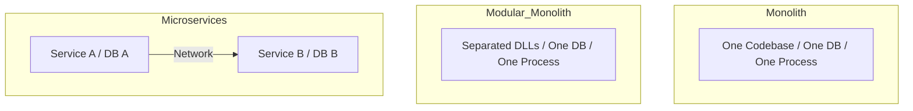

# Microservices vs Monoliths: Deciphering the Distributed Systems Tax
============================================================
0. Architectural Vision: Pragmatism over Hype
============================================================
- **Microservices are not a "Goal"; they are a "Solution" to Organizational Complexity.** If your team is small (under 10), a Monolith is almost always faster.
- **Conway's Law.** Your system architecture will eventually reflect the communication structure of your organization.
- **The Distributed Systems Tax.** Microservices introduce network latency, partial failures, eventual consistency, and operational overhead.
- **The "Modular Monolith".** A middle-ground where the code is logically separated into modules (Project References) but deployed as a single unit.
- **Deployment Independence.** The primary benefit of microservices: being able to update "Payments" without touching "Catalog".
- **.NET Aspire.** The modern .NET 8 way to manage the complexity of local microservices development (Service discovery, orchestration).
- **Architect's View.** We move to Microservices when the "Pain of the Monolith" (slow builds, deployment bottlenecks, ownership conflicts) exceeds the "Tax of Distributed Systems".

============================================================
1. Foundational Problem: The "Big Ball of Mud"
============================================================
- **Real-World Impact:** You have a 10-year-old Monolith. Every time you change the "Login" logic, the "PDF Reporting" feature breaks because they share the same Global Helper class.
- **What breaks?** "The Blast Radius". In a shared-process monolith, a memory leak or an unhandled exception in a minor feature can crash the entire multi-million dollar platform.
- **Scale Boundary:** When you have 50 developers working on the same codebase, Git merge conflicts become a full-time job, and the CI/CD pipeline takes 2 hours to run.
- **Failure Story:** A major e-commerce site couldn't scale their "Search" service independently during Black Friday. Because it was part of the Monolith, they had to scale the *entire* app (including the memory-heavy Admin panel), costing them 5x more in cloud bills and eventually hitting the limit of the SQL database connections. Migrating the **Search Service** to a dedicated microservice allowed them to scale it 50x on cheap hardware.

============================================================
2. Internal System Mechanics: Isolation Levels
============================================================

### Monolith vs Modular Monolith vs Microservices


### Key Differentiator: Data Ownership
In Microservices, a service **MUST** own its own database. If two services share a database table, you have a "Distributed Monolith" (the worst of both worlds).

============================================================
3. Production Engineering in .NET 8 (.NET Aspire)
============================================================

### Anti-Pattern: The Distributed Monolith
```csharp
// TERRIBLE: Reusing the same 'Shared.Data' project and Database 
// across all microservices. Changing a column breaks every service.
```

### Production-Ready Implementation: .NET Aspire Orchestration
```csharp
// 1. AppHost Project (The Orchestrator)
var builder = DistributedApplication.CreateBuilder(args);

var redis = builder.AddRedis("cache");
var postgres = builder.AddPostgres("db").AddDatabase("orders");

// 2. Defining Services with Dependencies
var ordersApi = builder.AddProject<Projects.Orders_API>("orders-api")
    .WithReference(postgres)
    .WithReference(redis);

var catalogApi = builder.AddProject<Projects.Catalog_API>("catalog-api")
    .WithReference(redis);

// 3. Service Discovery is Automatic via Environment Variables
builder.Build().Run();
```

**Architecture Strategy:** 
- Use **Dapr** or **.NET Aspire** to abstract away service-to-service communication, retries, and state management.
- Implement **Anti-Corruption Layers (ACL)** to prevent legacy "Monolith types" from leaking into your clean microservices.

============================================================
4. System Interaction & Flow (ASCII Architecture)
============================================================

                ┌──────────────────┐
                │   The Gateway    │ (YARP / Reverse Proxy)
                └────────┬─────────┘
                         │ 1. Route Request
         ┌───────────────▼───────────────┐
         │     MICROSERVICE MESH         │ (Distributed Nodes)
         │  ┌─────────┐   ┌─────────┐    │
         │  │ Order   │ → │ Payment │    │
         │  │ Service │   │ Service │    │
         │  └────┬────┘   └────┬────┘    │
         └───────┼─────────────┼─────────┘
                 │             │ 2. Async Event (RabbitMQ/Kafka)
         ┌───────▼─────────────▼─────────┐
         │     Independent Databases     │ (Polyglot Persistence)
         └───────────────┬───────────────┘
                         │ 3. Isolated Success
               ┌─────────▼─────────┐
               │   Global Reality  │
               └───────────────────┘

============================================================
5. Strategic Scaling & System Evolution
============================================================
- **Horizontal Pod Autoscaling (HPA).** Scaling only the "Processing" service when the queue is full, without touching the "Identity" service.
- **Strangler Fig Pattern.** The strategy for moving from Monolith to Microservices by slowly "wrapping" the monolith in a Gateway and moving routes one-by-one.
- **Vertical Pod Autoscaling.** Giving more RAM to the "Heavy Monolith" while keeping microservices on tiny containers.

============================================================
6. Reliability, Observability & Runtime Governance
============================================================
- **Key Metrics:**
    - `Network Latency`: The time added by hopping between services.
    - `Failure Rate per Service`: Identifying which service is the "Weak Link".
- **Observability:** **Distributed Tracing (OpenTelemetry)** is non-negotiable. You must see the "Span" of a request as it travels through 5 services.

============================================================
7. Compromises, Tradeoffs & Alternatives
============================================================
- **Complexity.** You now have 10 CI/CD pipelines instead of 1. You have 10 connection strings.
- **Testing.** Integration testing becomes significantly harder. You need **Contract Testing (Pact)** to ensure Service A doesn't break Service B's expectations.

============================================================
8. Security Posture & Risk Mitigation
============================================================
- **Zero Trust.** Don't trust a request just because it's "Internal". Every service should validate a JWT or use mTLS (Mutual TLS).
- **Attack Surface.** A monolith has 1 entry point; 10 microservices have 10 potential entry points if not properly protected behind a Gateway.

============================================================
9. Technical Edge Cases & System Failure Modes
============================================================
- **The "Cascading Failure".** Service A waits for Service B, which waits for Service C. If C is slow, all three services exhaust their thread pools and die.
    - *Architect's Rule:* Use **Circuit Breakers (Polly)** to fail fast if a dependency is down.
- **Zombie Services.** A service that is deprecated but still being called by one hidden background task, preventing you from ever turning off the old infrastructure.

============================================================
10. Architectural Assessment & Career Progression
============================================================
- **Senior:** "We build microservices to scale different parts of the app independently."
- **Principal:** "Architecture is the management of **Cognitive and Operational Boundaries**. We leverage **Microservices** to enable team autonomy and granular scalability, while strictly monitoring the **Distributed Transaction Cost**. We favor a **Modular Monolith** for early-stage products to minimize infrastructure friction, transitioning to a distributed mesh only when **Deployment Contention** and **Domain Coupling** warrant the complexity of the network boundary."
- **Interview Strategy:** Discuss the "Monolith First" approach. Explain how to decide when to split a service based on the **Bounded Context**.

============================================================
11. Real-World Case Study: Bank Migration
============================================================
**Scenario:** A bank with a 30-year-old COBOL/Java Monolith.
- **The Problem:** It took 6 months to change the "Interest Rate" calculation logic.
- **The Design:** Used the **Strangler Fig Pattern**. Built a .NET 8 API Gateway. Moved "Account Balance" to a microservice first, then "Interest Rates".
- **Result:** Deployment time for interest changes dropped from 6 months to 2 hours. The old monolith still exists for "Legacy Reporting", but the Core Banking is now distributed.

============================================================
12. Structural Dependencies & Learning Path
============================================================
- **Foundations:** Networking, Docker, CI/CD.
- **Future Steps:** Service Mesh (Istio), Serverless (Azure Functions).
- **Integration Points:** .NET Aspire, YARP (Reverse Proxy), Docker Compose.
