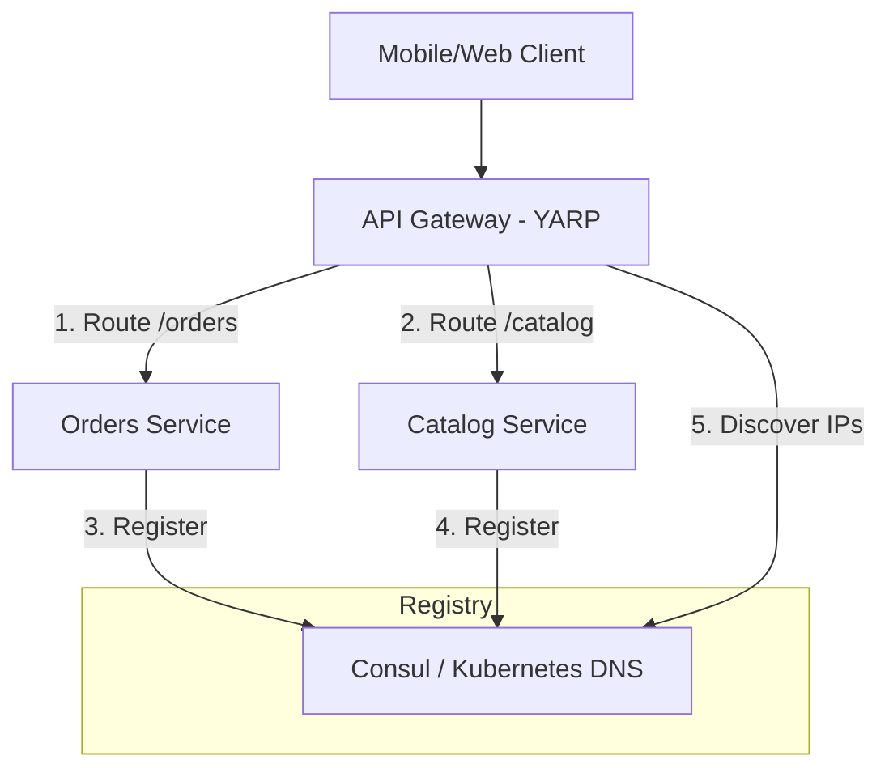

# Service Discovery and API Gateways: The Distributed Routing Core
**0. Architectural Vision: The Navigational Map**
- **Service Discovery is the DNS of Microservices.** It allows Service A to find the dynamic IP of Service B without hardcoding addresses.
- **Client-Side vs Server-Side Discovery.** Client-Side (Netflix Eureka) asks the Registry "Where is B?"; Server-Side (Kubernetes DNS) provides a single IP/Name that routes to B automatically.
- **The API Gateway (The Front Door).** A single entry point for all clients. It handles routing, security, monitoring, and protocol translation (e.g., HTTP to gRPC).
- **YARP (Yet Another Reverse Proxy).** The .NET-native engine for building high-performance gateways and strangler patterns.
- **Cross-Cutting Concerns.** Centralizing Auth, Rate Limiting, and SSL Termination so individual microservices don't have to reinvent them.
- **Architect's View.** We use API Gateways (YERP, Ocelot, Azure API Management) to decouple clients from our internal service mesh. We understand that the Gateway is a **Critical Failure Point** and must be architected for High Availability and low latency.

**1. Foundational Problem: The "Hardcoded IP" Nightmare**
- **Real-World Impact:** Your `Orders` service hits the `Payments` service at `http://10.0.0.5`. One night, the Payments server crashes and restarts on a new IP (`10.0.0.8`).
- **What breaks?** "The Static Dependency". Your Orders service is now sending data into a void. You have to manually update config files and reboot 50 servers just to change one IP address. This is **O(N) Operational Friction**.
- **Scale Boundary:** In a cloud-native environment (Kubernetes), pods are dying and being reborn every minute. Manual IP management is impossible. You need a **Dynamic Registry**.
- **Failure Story:** A fintech company hardcoded the IPs of their "Currency Ticker" in 200 different microservices. When they moved to a new cloud zone, it took their DevOps team 48 hours to find and update every single reference, manually editing production environment variables. Moving to **Consul (Service Discovery)** reduced this "Change propagation" time from 48 hours to 0 seconds.

**2. Internal System Mechanics: Registries and Proxies**

### The Service Discovery Flow
1. **Registration:** Service B starts up and tells the Registry: "I am 'Payment-Service' at 10.0.0.8".
2. **Lookup:** Service A asks the Registry: "Give me the address for 'Payment-Service'".
3. **Heartbeat:** Service B regularly tells the Registry "I am still alive". If B misses a heartbeat, the Registry deletes it.



**3. Production Engineering in .NET 8 (YARP)**

### Anti-Pattern: Building Business Logic in the Gateway
```csharp
// TERRIBLE: Putting 'CalculateTax()' logic in the YARP pipeline.
// The Gateway should be for ROUTING and INFRASTRUCTURE, not business code.
```

### Production-Ready Implementation: YARP Gateway Configuration
```csharp
// 1. Program.cs Setup
var builder = WebApplication.CreateBuilder(args);
builder.Services.AddReverseProxy()
    .LoadFromConfig(builder.Configuration.GetSection("ReverseProxy"));

// 2. appsettings.json (YARP Config)
/*
{
  "ReverseProxy": {
    "Routes": {
      "payment-route": {
        "ClusterId": "payment-cluster",
        "Match": { "Path": "/api/payments/{**catch-all}" },
        "Transforms": [ { "PathRemovePrefix": "/api" } ]
      }
    },
    "Clusters": {
      "payment-cluster": {
        "Destinations": {
          "d1": { "Address": "http://payment-service-svc/" } // K8s Internal DNS
        }
      }
    }
  }
}
*/

// 3. Centralized Rate Limiting in Gateway
builder.Services.AddRateLimiter(options => {
    options.AddFixedWindowLimiter("api-limit", opt => {
        opt.Window = TimeSpan.FromSeconds(1);
        opt.PermitLimit = 1000;
    });
});
```

**Architecture Strategy:** 
- Use **BFF (Backend for Frontend)** pattern: Have one gateway for Mobile and another for Web to optimize the JSON payloads.
- Implement **Health Checks** in YARP so it stops sending traffic to services that are 500-ing.

**4. System Interaction & Flow (ASCII Architecture)**

                ┌──────────────────┐
                │   The Client     │ (HTTP/HTTPS)
                └────────┬─────────┘
                         │ 1. Request URL: api.myapp.com/v1/auth
         ┌───────────────▼───────────────┐
         │     API GATEWAY (YARP)        │ (The Smart Router)
         │  ┌─────────┐   ┌─────────┐    │
         │  │ Auth    │ → │ Header  │    │
         │  │ Check   │   │ Transform│    │
         │  └────┬────┘   └────┬────┘    │
         └───────┼─────────────┼─────────┘
                 │             │ 2. Find Destination Service
         ┌───────▼─────────────▼─────────┐
         │     The Service Registry      │ (Consul/etcd/K8s)
         └───────────────┬───────────────┘
                         │ 3. Proxy Traffic (Forwarded-For)
               ┌─────────▼─────────┐
               │  Microservice Pod │
               └───────────────────┘

**5. Strategic Scaling & System Evolution**
- **Dynamic Reconfiguration.** YARP allows you to update routes in real-time *without* restarting the Gateway, using a DB or Redis-backed configuration provider.
- **Protocol Translation.** Having the Gateway listen on HTTP/2 but talk to internal services via gRPC or even old SOAP (using custom YARP middleware).
- **Sticky Sessions.** Ensuring a client always hits the same instance of a service (useful for legacy stateful apps).

**6. Reliability, Observability & Runtime Governance**
- **Key Metrics:**
    - `Gateway Latency`: The milliseconds added by the proxy itself.
    - `Active Connections`: Number of open sockets.
- **Observability:** Use **W3C Trace Context** headers. YARP automatically propagates the `traceparent` header to downstream services.

**7. Compromises, Tradeoffs & Alternatives**
- **Network Overhead.** Every request now takes 2 hops (Client -> GW -> Svc) instead of 1.
- **Complexity.** You now have a "God Component". If the Gateway goes down, everything goes down. **Architect's Tip:** Always deploy the Gateway as a multi-instance cluster behind a Cloud Load Balancer.

**8. Security Posture & Risk Mitigation**
- **IP Whitelisting.** Microservices should only accept traffic from the Gateway's IP address, blocking all other external requests.
- **SSL Termination.** Handle the heavy HTTPS decryption once at the Gateway, then talk HTTP (Internal/Safe network) to the microservices.

**9. Technical Edge Cases & System Failure Modes**
- **The "Stale Registry".** A pod dies but the Registry still thinks it's alive for 30 seconds.
    - *Architect's Rule:* Implement **Active Health Checks** in the Proxy so it double-checks the destination before sending traffic.
- **Request Headers Bloat.** Every service adds its own "Audit" header. By the time it hits the 5th service, the header size exceeds 8KB, and the server rejects the request.

**10. Architectural Assessment & Career Progression**
- **Senior:** "We use an API Gateway to route traffic to different microservices."
- **Principal:** "Routing is the **Orchestration Layer of Distributed Identity**. We leverage **YARP's Middleware Pipeline** to centralize infrastructure concerns like **SSL Termination, Rate Limiting, and Trace Propagation**. We architecturalize for **Dynamic Service Discovery**, ensuring our system remains decoupled from network topology. For us, a Gateway is not just a proxy; it is a **Strategic Perimeter** that enables blue-green deployments and fine-grained traffic governance."
- **Interview Strategy:** Compare YARP and Ocelot. Explain the difference between "Dynamic Config" and "Static Config" in a proxy.

**11. Real-World Case Study: Global Gaming Platform**
**Scenario:** A platform with 50 services (Matches, Chat, Inventory, Shop).
- **The Problem:** The mobile app's networking code was 50,000 lines long just to manage connections to 50 different IPs and ports.
- **The Design:** Implemented a **YARP Gateway**. Mobile app now talks only to `api.game.com`.
- **Result:** Mobile app network code reduced to 100 lines. The backend team can now move services between AWS and Azure without the mobile app ever knowing.

**12. Structural Dependencies & Learning Path**
- **Foundations:** HTTP Protocols (1.1, 2, 3), Proxy Servers (NGINX/Envoy).
- **Future Steps:** Service Mesh (Linkerd), Istio Gateway.
- **Integration Points:** YARP (.NET), Steeltoe (for Consul/Eureka), Kubernetes Ingress.
