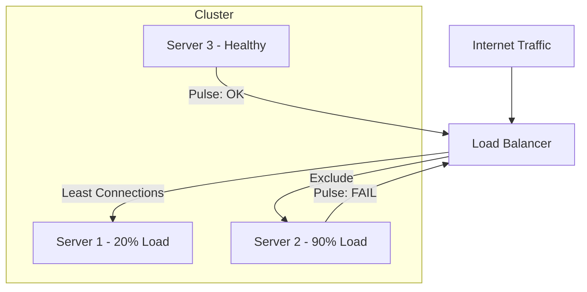

# Load Balancing and Health Checks: The Resilience Strategy
**0. Architectural Vision: Horizontal Reliability**
- **Load Balancing is the Art of Distribution.** It ensures that no single server is overwhelmed and that traffic is routed only to healthy nodes.
- **L4 (Transport) vs L7 (Application) Balancing.** L4 is fast but "Dumb" (IP/Port); L7 is smart and "Aware" (Headers, Cookies, Paths).
- **Algorithms of Choice.** Round Robin (Simple), Least Connections (Dynamic), and "Power of Two Choices" (Modern and Efficient).
- **Health Checks are the "Pulse" of the System.** A service is only "Up" if its dependencies (DB, Redis) are also working.
- **Liveness vs Readiness Probes.** Liveness (Is the process alive?); Readiness (Is the service ready to accept traffic?).
- **Architect's View.** We use Load Balancers (HAProxy, NGINX, Azure Load Balancer) to scale horizontally. We design **Deep Health Checks** to prevent "Gray Failures" where a service is alive but useless.

**1. Foundational Problem: The "Single Point of Failure" (SPOF)**
- **Real-World Impact:** You have a web app on one powerful server. The power supply fails. 
- **What breaks?** "The Availability". Your entire company is offline. You need 10 minutes to move to a new server.
- **Scale Boundary:** A single server can only handle so many connections. Even with 128 cores and 1TB of RAM, there is a limit. You need to spread the load across 10 smaller servers.
- **Failure Story:** A major airline's booking site crashed because their Load Balancer was using `Round Robin` for a service where some requests took 50ms and others took 5 seconds. The Balancer kept sending 5-second requests to servers that were already struggling, leads to **Queue Saturation** and a site-wide outage. Moving to **Least Connections** and implementing **Weighted Response Time** balancing fixed the issue immediately.

**2. Internal System Mechanics: Probes and Logic**

### Load Balancing Algorithms
1. **Round Robin:** Sequential delivery (A, B, C, A, B...).
2. **Weighted Round Robin:** Send more to a 64-core server than a 8-core server.
3. **Least Connections:** Send to whoever is currently doing the least amount of work.
4. **IP Hash:** Ensure a user with IP 'X' always hits Server 'Y' (Sticky Sessions).



**3. Production Engineering in .NET 8 (Health Checks)**

### Anti-Pattern: Simple 'return true' Health Checks
```csharp
// TERRIBLE: This only tells you if the process is running.
// It doesn't check if the database is reachable.
app.MapGet("/health", () => "Healthy");
```

### Production-Ready Implementation: Deep Health Checks
```csharp
// 1. Registering Health Checks with Dependencies
var builder = WebApplication.CreateBuilder(args);
builder.Services.AddHealthChecks()
    .AddNpgSql(builder.Configuration["DbConnection"], name: "PostgreSQL")
    .AddRedis(builder.Configuration["RedisConnection"], name: "Redis")
    .AddUrlGroup(new Uri("https://api.thirdparty.com/status"), name: "Third-Party API");

// 2. Mapping for Kubernetes Probes
// /health/live: Just ensure process is not stuck (Liveness)
app.MapHealthChecks("/health/live", new HealthCheckOptions { Predicate = _ => false });

// /health/ready: Check all deps before allowing traffic (Readiness)
app.MapHealthChecks("/health/ready", new HealthCheckOptions {
    ResponseWriter = UIResponseWriter.WriteHealthCheckUIResponse // Nice JSON output
});
```

**Architecture Strategy:** 
- Use **Circuit Breakers** on the Client side and **Rate Limiters** on the Server side to protect your Load Balancer from "Retry Storms".
- Implement **Graceful Shutdown**. When a service is told to stop, it should tell the Load Balancer "I am not ready" first, finish its active requests, and then exit.

**4. System Interaction & Flow (ASCII Architecture)**

                ┌──────────────────┐
                │   The Probe      │ (The Health Watcher)
                └────────┬─────────┘
                         │ 1. GET /health/ready
         ┌───────────────▼───────────────┐
         │     HEALTH CHECK ENGINE       │ (Dependency Audit)
         │  ┌─────────┐   ┌─────────┐    │
         │  │ SQL PING│ → │ Redis   │    │
         │  │ Request │   │ Ping    │    │
         │  └────┬────┘   └────┬────┘    │
         └───────┼─────────────┼─────────┘
                 │             │ 2. Return 200 OK or 503 FAIL
         ┌───────▼─────────────▼─────────┐
         │       The Load Balancer       │ (The Traffic Director)
         └───────────────┬───────────────┘
                         │ 3. Include/Exclude Node
               ┌─────────▼─────────┐
               │ Optimal Path Flow │
               └───────────────────┘

**5. Strategic Scaling & System Evolution**
- **Global Server Load Balancing (GSLB).** Routing a user in London to a UK data center and a user in New York to a US data center using DNS.
- **Sidecar Probes.** In a Service Mesh (Istio), the Sidecar handles health checking and load balancing, so your application code doesn't have to worry about IPs.
- **Canary Deployments.** Directing 5% of traffic to a "New Version" cluster to verify its health before fully rolling it out.

**6. Reliability, Observability & Runtime Governance**
- **Key Metrics:**
    - `Success Rate (SR)`: Ratio of successful responses to total requests.
    - `P99 Latency per Instance`: Identifying "Slow Nodes".
- **Observability:** Use the **AspNetCore.HealthChecks.UI** dashboard to see the health status of all your services in one place.

**7. Compromises, Tradeoffs & Alternatives**
- **Latency.** L7 proxies add a small overhead (0.5ms - 2ms). For high-frequency millisecond-sensitive apps, you might need an L4 hardware balancer.
- **Consistency.** "Sticky Sessions" can cause uneven distribution if one heavy user stays connected to one server for a long time.

**8. Security Posture & Risk Mitigation**
- **DDoS Mitigation.** The Load Balancer is the first line of defense. Use **IP Rate Limiting** and **Geo-blocking** at the balancer level.
- **Web Application Firewall (WAF).** Integrating an L7 firewall to inspect bodies for SQL injection and XSS before they ever hit the application.

**9. Technical Edge Cases & System Failure Modes**
- **Gray Failures.** A service is healthy (`200 OK`) but is returning incorrect or empty results.
    - *Architect's Rule:* Health checks should perform a "Smell Test" (e.g., query for a known record) if possible.
- **The "Zombie Node" Flapping.** A node goes up and down every 5 seconds.
    - *Architect's Rule:* Use **Hysteresis** (e.g., a node must pass 3 consecutive checks to be 'Healthy' and fail 1 check to be 'Unhealthy').

**10. Architectural Assessment & Career Progression**
- **Senior:** "We use health checks to tell Kubernetes when to restart our pods."
- **Principal:** "High Availability is the engineering of **Continuous Readiness**. We leverage **L7 Intelligent Probes** to ensure that our traffic is only routed to fully functional clusters. We design for **Stateless Scaling**, avoiding session affinity to maximize load distribution. By implementing **Deep Dependency Audits** and **Weighted Balancing Algorithms**, we build resilient platforms that self-heal and maintain operational excellence in the face of partial system failures."
- **Interview Strategy:** Compare L4 and L7 Load Balancing. Explain the difference between "Active" and "Passive" health checking.

**11. Real-World Case Study: Global Video Streaming**
**Scenario:** A company like Netflix streaming to 200 million users.
- **The Problem:** One server region in Asia failing could crash the whole site if not handled properly.
- **The Design:** Implemented **GSLB (Global Load Balancing)**. If the primary region fails, the LB automatically redirects traffic to the next closest healthy region.
- **Result:** 99.99% availability. Users don't even know when a major data center outage occurs because the traffic is re-routed in milliseconds.

**12. Structural Dependencies & Learning Path**
- **Foundations:** Networking (TCP/IP), DNS (A-Records, CNAMEs).
- **Future Steps:** Envoy Proxy, Service Meshes, Anycast IP.
- **Integration Points:** AspNetCore.Diagnostics.HealthChecks, Azure Front Door, AWS ELB/ALB.
