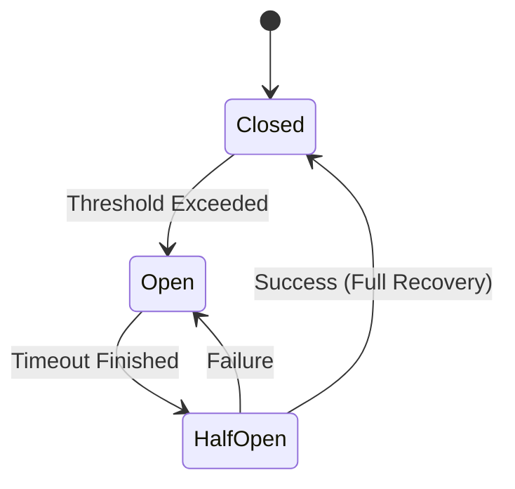

# Circuit Breakers and Retry Policies: The Resilience of Polly
============================================================
0. Architectural Vision: Surviving the Unreliable Network
============================================================
- **Network Failure is Inevitable.** In a distributed system, dependencies will fail. Resiliency is the architecture of surviving those failures.
- **Transient vs Permanent Failures.** Retries are for transient (Glitch) issues; Circuit Breakers are for permanent (Down) issues.
- **The Retry Pattern.** Automatically re-executing a failed request. Key requirement: **Exponential Backoff and Jitter** to avoid "Retry Storms".
- **The Circuit Breaker Pattern.** Prevents the system from "trying to call a dead service" repeatedly, saving resources and allowing the service to recover.
- **Polly v8 (The Resiliency Library).** The industry-standard library for .NET, now highly optimized with a new "Resilience Pipeline" API in .NET 8.
- **Architect's View.** We don't just "Retry everything". We design **Fault-Tolerant Pipelines** using Polly, prioritizing user experience through **Hedging** (starting a second request before the first one fails) and **Fallbacks** (returning cached or default data).

============================================================
1. Foundational Problem: The "Cascading Failure" and "Retry Storm"
============================================================
- **Real-World Impact:** Your `Orders` service calls a `Payment` service. The Payment service is slow. The Orders service retries 3 times *immediately*. 
- **What breaks?** "The Dependency Suicide". If 1,000 orders are being placed, and each retries immediately, your 1,000 requests become 4,000 requests per second. The Payment service, which was already struggling, is now completely crushed.
- **Scale Boundary:** Without a **Circuit Breaker**, your frontend threads will all hang waiting for the slow Payment service, eventually exhausting the server's thread pool and taking down the *Order* service too.
- **Failure Story:** A major retailer's checkout failed because their DB was at 100% CPU. Their app code kept retrying failing SQL queries every 50ms. The "Retry Storm" kept the DB CPU at 100% even after the initial traffic spike ended, preventing the system from ever recovering. Moving to **Polly (Retry with Jitter and Circuit Breaker)** allowed the DB to "Breathe" and recover in under 2 minutes.

============================================================
2. Internal System Mechanics: The Three States
============================================================

### The Circuit Breaker State Machine
1. **Closed:** Requests flow normally. Failures are counted.
2. **Open:** Threshold reached. All requests are rejected instantly (Fail Fast).
3. **Half-Open:** Periodically allow ONE request through. If it succeeds, Close the circuit. If it fails, keep it Open.



============================================================
3. Production Engineering in .NET 8 (Polly v8)
============================================================

### Anti-Pattern: Immediate Retries
```csharp
// TERRIBLE: This will create a 'Retry Storm' and overwhelm the server.
.AddRetry(new RetryStrategyOptions { MaxRetryAttempts = 3, Delay = TimeSpan.Zero });
```

### Production-Ready Implementation: Resilient HttpClient
```csharp
// 1. Defining a Resilient Pipeline (Singleton)
var pipeline = new ResiliencePipelineBuilder()
    .AddRetry(new RetryStrategyOptions {
        MaxRetryAttempts = 3,
        BackoffType = DelayBackoffType.Exponential, // Wait longer each time
        UseJitter = true, // Add random noise to avoid 'Thundering Herd'
        Delay = TimeSpan.FromSeconds(1)
    })
    .AddCircuitBreaker(new CircuitBreakerStrategyOptions {
        FailureRatio = 0.5, // Fail if 50% of requests in 30s fail
        SamplingDuration = TimeSpan.FromSeconds(30),
        MinimumThroughput = 10,
        BreakDuration = TimeSpan.FromMinutes(1)
    })
    .AddTimeout(TimeSpan.FromSeconds(5)) // Overall limit
    .Build();

// 2. Executing with the Pipeline
public async Task<string> GetDataAsync(string id) {
    return await _pipeline.ExecuteAsync(async ct => {
        return await _httpClient.GetStringAsync($"/data/{id}", ct);
    }, CancellationToken.None);
}

// 3. Resilience in HttpClient (Standard Pattern)
builder.Services.AddHttpClient("MyApi")
    .AddResilienceHandler("resilience-v8", builder => {
        builder.AddRetry(new RetryStrategyOptions { ... });
    });
```

**Architecture Strategy:** 
- Use **Hedging** for super-low latency (e.g., if a request takes > 500ms, start a second one and take whichever finishes first).
- Implement **Fallback** (e.g., return "Service Unavailable" or a cached response instead of a naked 500 error).

============================================================
4. System Interaction & Flow (ASCII Architecture)
============================================================

                ┌──────────────────┐
                │   The Request    │ (The User Action)
                └────────┬─────────┘
                         │ 1. Enter Pipeline
         ┌───────────────▼───────────────┐
         │     POLLY RESILIENCE MESH     │ (The Guard Mesh)
         │  ┌─────────┐   ┌─────────┐    │
         │  │ Retry   │ → │ Circuit │    │
         │  │ Logic   │   │ Breaker │    │
         │  └────┬────┘   └────┬────┘    │
         └───────┼─────────────┼─────────┘
                 │             │ 2. Check State (Closed/Open)
         ┌───────▼─────────────▼─────────┐
         │      External Dependency      │ (The Vulnerable Svc)
         └───────────────┬───────────────┘
                         │ 3. Return Result / Error
               ┌─────────▼─────────┐
               │  Resilient Result │
               └───────────────────┘

============================================================
5. Strategic Scaling & System Evolution
============================================================
- **Dynamic Policy Updates.** Using **Options/Configuration** to change timeout values or retry counts in production without a code change.
- **Bulkhead Isolation.** Limiting the number of concurrent requests to a specific service so that one bad dependency doesn't exhaust all your system's slots.
- **Observability Integration.** Every "Circuit Broken" or "Retried" event should be logged as a metric.

============================================================
6. Reliability, Observability & Runtime Governance
============================================================
- **Key Metrics:**
    - `Resilience Event Count`: Number of retries and circuit breaks.
    - `Success after Retry Rate`: Are our retries actually working?
- **Observability:** In .NET 8, use **OpenTelemetry** with Polly's built-in instrumentation to see how many requests are being shielded.

============================================================
7. Compromises, Tradeoffs & Alternatives
============================================================
- **Latency.** Retries obviously increase the total time a user waits for a result.
- **Idempotency.** You MUST NOT retry "Write" requests (like POST /pay) unless they are idempotent. **Architect's Tip:** Use `X-Request-ID` headers to ensure the server doesn't execute the same payment twice.

============================================================
8. Security Posture & Risk Mitigation
============================================================
- **Resource Exhaustion.** An attacker sending many requests to trigger your circuit breaker, effectively performing a DoS for legitimate users.
    - *Architect's Rule:* Use **Rate Limiting** BEFORE Polly to ensure only legitimate traffic can trigger resiliency events.

============================================================
9. Technical Edge Cases & System Failure Modes
============================================================
- **The "Permanent Retry" Loop.** A service that will NEVER fixed (e.g., 401 Unauthorized). Retrying this is a waste of CPU.
    - *Architect's Rule:* Configure Polly to ignore non-transient status codes (400, 401, 403, 404).
- **The "Large Break" problem.** Setting a break duration of 1 hour. Even if the service recovers in 5 minutes, you are still offline for the other 55 minutes.

============================================================
10. Architectural Assessment & Career Progression
============================================================
- **Senior:** "We use Polly for retries and circuit breakers so our microservices are more reliable."
- **Principal:** "Resiliency is the architecture of **Deterministic Failure Handling**. We leverage **Polly v8 Resilience Pipelines** to implement **Multi-Layered Defense (Retry, Circuit Breaker, Bulkhead)**. We optimize our **Backpressure Throttling** through Jittered Retries and Hedged Requests. For us, a transient error is not an exception to be caught, but a **Signal to be Orchestrated** our via the platform's self-healing infrastructure."
- **Interview Strategy:** Explain how a Circuit Breaker helps the "Upstream" service. Describe why "Jitter" is essential for large-scale systems.

============================================================
11. Real-World Case Study: Global Travel Booking Engine
============================================================
**Scenario:** A flight aggregator calling 100 different airline APIs.
- **The Problem:** One airline having a slow API was causing the entire checkout page to take 30 seconds to load for everyone.
- **The Design:** Implemented a **Circuit Breaker** and **Timeout** for every airline.
- **Result:** If an airline is slow, their specific results are skipped after 2 seconds, while the rest of the site remains fast. The site availability remained at 99.9% even when 5 airlines had total outages.

============================================================
12. Structural Dependencies & Learning Path
============================================================
- **Foundations:** HttpClient, Error Handling (Try-Catch).
- **Future Steps:** Sidecar Resilience (Istio), Chaos Engineering (Netflix Chaos Monkey).
- **Integration Points:** Microsoft.Extensions.Http.Resilience, Polly v8, OpenTelemetry.
