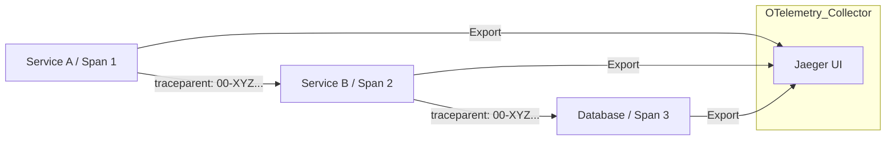

# Distributed Tracing: The Visibility of OpenTelemetry
============================================================
0. Architectural Vision: The Glass Box System
============================================================
- **Tracing is the "X-Ray" of a Distributed Request.** It follows a single transaction as it hops through 10 different microservices, 3 databases, and a message queue.
- **The Three Pillars.** Logs (What happened?); Metrics (How much/fast?); Traces (Where did it go?).
- **OpenTelemetry (OTel).** The vendor-neutral industry standard for all observability data.
- **Trace Context Propagation.** The magic of passing a `TraceId` in the HTTP header (`traceparent`) so every service knows it's part of the same "Story".
- **Spans and Traces.** A Trace is a collection of Spans. A Span represents a single unit of work (e.g., an HTTP call or a SQL query).
- **Architect's View.** We build **Observable Systems**. We don't just "Log errors"; we design for **Platform Transparency** where we can see exactly why a specific request was slow at 3 AM across the whole distributed mesh.

============================================================
1. Foundational Problem: The "Inter-Service Mystery"
============================================================
- **Real-World Impact:** A user reports "Checkout is slow". You check the `Orders` service logs—it looks fine. You check the `Payments` service—it looks fine. 
- **What breaks?** "The Visibility Gap". You have no way to know that the *delay* happened in the network between Service A and Service B, or that Service B was waiting for a Redis lock.
- **Scale Boundary:** In a system with 1,000 requests per second and 50 services, finding a "Single bad request" using only text logs is like finding a needle in a haystack.
- **Failure Story:** A flight booking site was losing 5% of its orders. The logs showed "Success" in all services, but the final confirmation was never sent. They added **OpenTelemetry Tracing** and found that the "Email Service" was silently timing out after 10 seconds, and the "Payment Service" didn't caught the exception. The Trace showed the exact 10,001ms gap that the logs missed.

============================================================
2. Internal System Mechanics: Propagation and Spans
### The Trace Pipeline
1. **Source:** Client makes a request. Gateway generates a `TraceId: XYZ`.
2. **Hop 1:** Service A receives `XYZ`, starts a "Child Span", and calls Service B.
3. **Hop 2:** Service B receives `XYZ` (via W3C header), starts its own "Child Span".
4. **Export:** All spans are sent to a collector (Jaeger, Zipkin, Honeycomb).



============================================================
3. Production Engineering in .NET 8 (OTel SDK)
============================================================

### Anti-Pattern: Manual String-based Trace Passing
```csharp
// TERRIBLE: Don't manually add headers for tracing.
// The OTel SDK handles this automatically for HttpClient.
_client.DefaultRequestHeaders.Add("my-trace-id", id);
```

### Production-Ready Implementation: OpenTelemetry Configuration
```csharp
// 1. Program.cs - Setting up the OTel Pipeline
builder.Services.AddOpenTelemetry()
    .WithTracing(tracing => {
        tracing.AddAspNetCoreInstrumentation() // Monitor Incoming requests
            .AddHttpClientInstrumentation()   // Monitor Outgoing requests
            .AddEntityFrameworkCoreInstrumentation() // Monitor SQL calls
            .AddOtlpExporter(opt => {
                opt.Endpoint = new Uri("http://jaeger-collector:4317");
            });
    });

// 2. Custom Business Spans (Using ActivitySource)
private static readonly ActivitySource _source = new("MyCompany.Orders");
public async Task PlaceOrder(Order order) {
    using var activity = _source.StartActivity("ProcessingPayment");
    activity?.SetTag("order.id", order.Id); // Add metadata
    // ... logic ...
}
```

**Architecture Strategy:** 
- Use **Baggage** to pass small pieces of information (like `UserID`) across all services in the trace without passing them in the function parameters.
- Implement **Sampling**. At high scale (10k+ RPS), tracing 100% of requests will overwhelm your network. Trace 1% of successes and 100% of errors.

============================================================
4. System Interaction & Flow (ASCII Architecture)
============================================================

                ┌──────────────────┐
                │   The Collector  │ (OTel Collector)
                └────────┬─────────┘
                         │ 1. Batch / Aggregate Spans
         ┌───────────────▼───────────────┐
         │     OBSERVABILITY BACKEND     │ (The Brain - Honeycomb/Jaeger)
         │  ┌─────────┐   ┌─────────┐    │
         │  │ Query   │ → │ Storage │    │
         │  │ Engine  │   │ (Tempo) │    │
         │  └────┬────┘   └────┬────┘    │
         └───────┼─────────────┼─────────┘
                 │             │ 2. Visualize Request Waterfall
         ┌───────▼─────────────▼─────────┐
         │       The Architect UI        │ (The Dashboard)
         └───────────────┬───────────────┘
                         │ 3. Identify Bottlenecks
               ┌─────────▼─────────┐
               │    System Health  │
               └───────────────────┘

============================================================
5. Strategic Scaling & System Evolution
============================================================
- **Trace Aggregation.** Building Dashboards that show "Average time spent in Database" across all services based on Span tags.
- **Service Graph.** Automatically drawing the map of your microservices based on the trace traffic.
- **Tail-Based Sampling.** Waiting until a trace finishes before deciding to keep it. If it was slow or had an error, save it. If it was fast, drop it. (Requires an OTel Collector).

============================================================
6. Reliability, Observability & Runtime Governance
============================================================
- **Key Metrics:**
    - `Span Count per Second`: How much data are we exporting?
    - `Trace Latency`: The overhead added by the OTel SDK (usually < 0.1ms).
- **Observability:** Use **Visual Studio 'Service Explorer'** or **Honeycomb** to see real-time trace waterfalls.

============================================================
7. Compromises, Tradeoffs & Alternatives
============================================================
- **Network Bandwidth.** Exporting traces can use significant bandwidth in high-traffic systems.
- **Storage Cost.** Storing billions of spans is expensive. **Architect's Tip:** Use a short retention policy (e.g., 7 days) for high-resolution traces and aggregate the rest into metrics.

============================================================
8. Security Posture & Risk Mitigation
============================================================
- **Sensitive Data Leakage.** Accidentally putting a "Credit Card Number" or "JWT" in a Span Tag.
    - *Architect's Rule:* Never log Personal Identifiable Information (PII) in traces. Use **Scrubbing** in the OTel collector to remove sensitive tags.
- **Trace Identification.** Ensure only authenticated requests can start a "New" root trace to prevent "Trace Spoofing".

============================================================
9. Technical Edge Cases & System Failure Modes
============================================================
- **Clock Drift.** Server A's time is 2 seconds ahead of Server B. The trace waterfall will look like the request finished before it started.
    - *Architect's Rule:* Synchronize all server clocks using **NTP**.
- **Orphan Spans.** A service finishes but crashes before it can send its span to the collector.

============================================================
10. Architectural Assessment & Career Progression
============================================================
- **Senior:** "We use OpenTelemetry to see why our API is slow."
- **Principal:** "Observability is the **Operational Intelligence of the Distributed Mesh**. We leverage **OpenTelemetry and W3C TraceContext** to bridge the visibility gap between disparate services. We architecture our systems for **Deep Contextual Awareness**, utilizing **Sampling Strategies and Baggage Propagation** to balance transparency with infra costs. For us, a trace is the definitive **System Narrative** that connects user experience to infrastructure performance."
- **Interview Strategy:** Describe the difference between a Trace and a Span. Explain how context is propagated across an HTTP call.

============================================================
11. Real-World Case Study: Global E-Commerce Outage
============================================================
**Scenario:** A company like Amazon on Prime Day.
- **The Problem:** 1% of users getting 500 errors during "Add to Cart". The error log only said "Database Connection Failed".
- **The Design:** Used **OTel Tracing**. The trace showed that the "Add to Cart" call was triggering 50 hidden SQL queries because of a bug in the discount service. The DB was refusing connections because it was at its limit.
- **Result:** Found the "N+1 query" bug in 5 minutes. Fixed it and throughput increased 10x.

============================================================
12. Structural Dependencies & Learning Path
============================================================
- **Foundations:** HTTP Headers, JSON/Protobuf.
- **Future Steps:** Service Graph visualization, AIOps (Predictive alerting).
- **Integration Points:** System.Diagnostics.DiagnosticSource, OpenTelemetry SDK, Azure Monitor, Grafana Tempo.
