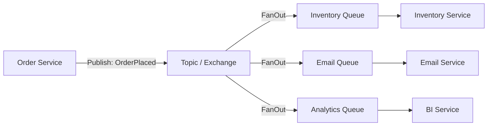

# Event-Driven Architecture: The Mastery of Pub/Sub and Decoupling
**0. Architectural Vision: The Reactive Enterprise**
- **EDA is the decoupling of Time, Space, and Identity.** The Producer doesn't know WHO the Consumer is, WHERE they are, or IF they are currently online.
- **Events vs Commands.** A Command is an "Order" (Do X - Expect Success); An Event is a "Fact" (X Happened - Do whatever you want with this info).
- **Pub/Sub (Publisher/Subscriber).** A pattern where multiple services can subscribe to the same "Topic" to react to changes.
- **Choreography vs Orchestration.** Choreography (Services react to each other); Orchestration (A central "Brain" tells everyone what to do).
- **Eventual Consistency.** Accepting that the "Whole World" won't be in sync for a few milliseconds (or seconds) in exchange for massive scalability.
- **Architect's View.** We move to EDA to eliminate **Synchronous Dependencies**. We build systems that are **Responsive**, **Resilient**, and **Elastic** by treating data as a "Stream of Facts" rather than a set of stateful tables.

**1. Foundational Problem: The "Brittle Chain"**
- **Real-World Impact:** An "Order Placement" logic needs to: 1. Charge Card, 2. Update Inventory, 3. Send Email, 4. Notify Warehouse.
- **What breaks?** "The Availability Wall". If the SQL database for Inventory is down, the User's "Place Order" button fails, even though the Payment was successful. Your system is as only as strong as its weakest link.
- **Scale Boundary:** In a synchronous system (REST calls), as you add more steps to the chain, the latency increases and the probability of failure approaches 100%.
- **Failure Story:** A major hotel booking site used synchronous calls for everything. When the "Email Confirmation" service was slow, the "Book Room" button took 20 seconds to load. Users kept clicking "Book" multiple times, leading to overbookings and a manual multi-million dollar refund process. Migrating to **EDA (Pub/Sub)** allowed them to return "Success" in 100ms and handle the email/warehouse logic in the background.

============================================================
2. Internal System Mechanics: Fan-Out and Topics
### The Pub/Sub Flow
1. **Publisher:** Sends `OrderPlaced` event to an "Exchange" or "Topic".
2. **Broker:** Duplicates the message (Fan-Out) and places it into multiple queues.
3. **Subscribers:** Each service reads its specific queue at its own pace.



### Choreography (The "Gossip" model)
No central boss. Each service knows what events to listen for and what events to publish. This is highly scalable but hard to visualize.

**3. Production Engineering in .NET 8 (MassTransit)**

### Anti-Pattern: Using Events for everything
```csharp
// TERRIBLE: Publishing an event when you actually NEED a synchronous result.
// If you need the 'PaymentStatus' NOW to show the user, use a Command or REST call.
```

### Production-Ready Implementation: MassTransit Event Handling
```csharp
// 1. Defining the Event (Immutability is key)
public record OrderPlaced(Guid OrderId, decimal Amount, DateTime Timestamp);

// 2. The Subscriber (Consumer) in .NET 8
public class EmailConsumer : IConsumer<OrderPlaced> {
    public async Task Consume(ConsumeContext<OrderPlaced> context) {
        var msg = context.Message;
        await _emailClient.SendAsync(msg.OrderId, "Your order is placed!");
    }
}

// 3. Registering with the Service Bus (RabbitMQ example)
builder.Services.AddMassTransit(x => {
    x.AddConsumer<EmailConsumer>();
    x.UsingRabbitMq((ctx, cfg) => {
        cfg.Host("localhost");
        cfg.ConfigureEndpoints(ctx); // Auto-generates queues
    });
});
```

**Architecture Strategy:** 
- Use **Correlation IDs** to tie events together across multiple services for debugging and tracing.
- Implement the **Outbox Pattern** to ensure that "Saving to DB" and "Publishing the Event" happen in a single transaction (preventing "Zombie Events").

**4. System Interaction & Flow (ASCII Architecture)**

                ┌──────────────────┐
                │   The Producer   │ (Business Fact)
                └────────┬─────────┘
                         │ 1. Event Published (Fire & Forget)
         ┌───────────────▼───────────────┐
         │     THE MESSAGE BROKER        │ (The Buffer - RabbitMQ/Kafka)
         │  ┌─────────┐   ┌─────────┐    │
         │  │ Exchange│ → │ Routing │    │
         │  │ Logic   │   │ Rules   │    │
         │  └────┬────┘   └────┬────┘    │
         └───────┼─────────────┼─────────┘
                 │             │ 2. Fan-Out to Multi-Queues
         ┌───────▼─────────────▼─────────┐
         │       The Consumers           │ (Independent Handlers)
         └───────────────┬───────────────┘
                         │ 3. Execute Async Logic
               ┌─────────▼─────────┐
               │    System Re-Sync │
               └───────────────────┘

**5. Strategic Scaling & System Evolution**
- **Horizontal Consumer Scaling.** Adding more instances of the "Analytics" service to process a backlog of messages without affecting the "Order" service.
- **Dead Letter Queues (DLQ).** If a message fails after 5 retries, move it to a "Manual Review" queue instead of losing it.
- **Event Versioning.** Using `OrderPlaced_v2` for new subscribers while keeping `v1` for legacy services.

**6. Reliability, Observability & Runtime Governance**
- **Key Metrics:**
    - `Consumer Lag`: How many minutes is the system "Behind" real-time?
    - `Message Throughput`: Million messages per second.
- **Observability:** Use **OpenTelemetry** to link the Publisher and Consumer in a single distributed trace.

**7. Compromises, Tradeoffs & Alternatives**
- **Complexity.** Debugging an "Event Loop" (A publishes to B, which publishes back to A) is a nightmare.
- **At-Least-Once Delivery.** The broker might send the same message twice. **Architect's Tip:** Every consumer must be **Idempotent**.

**8. Security Posture & Risk Mitigation**
- **Payload Encryption.** If the message contains sensitive PII, encrypt the body before publishing to the broker.
- **Access Control.** Ensure only the "Payment" service can publish "PaymentAuthorized" events; prevent others from impersonating it.

**9. Technical Edge Cases & System Failure Modes**
- **The "Poison Message".** A message that causes a consumer to crash every time it tries to process it. 
    - *Architect's Rule:* Implement a **MaxRetry** policy and move to DLQ.
- **Race Conditions.** Finding that the "OrderCancelled" event arrived before the "OrderPlaced" event.

**10. Architectural Assessment & Career Progression**
- **Senior:** "We use Pub/Sub to decouple our services so they don't depend on each other's uptime."
- **Principal:** "EDA is the engineering of **Distributed Flux**. We leverage **Immutability and Chronological Fact Streams** to build systems that scale across domain boundaries. We architect for **Temporal Independence**, utilizing **Outbox Patterns and Idempotent Consumers** to ensure data integrity in an eventually consistent world. For us, an event is the **Atomic Record of Reality** that enables complex choreography without the bottleneck of central orchestration."
- **Interview Strategy:** Explain the difference between Orchestration and Choreography. Describe the "Exactly-Once" delivery myth and how to solve it with "Idempotency".

**11. Real-World Case Study: Global Ride-Sharing**
**Scenario:** A company like Uber/Lyft.
- **The Problem:** 1,000 drivers moving every second. If every GPS update was a REST call to 20 services, the network would collapse.
- **The Design:** Used **EDA (Pub/Sub over Kafka)**. GPS coordinates are streamed into a "Location" topic.
- **Result:** The "Price engine", "Map UI", and "Driver matching" all subscribe to the same topic and react in real-time. The system processes millions of events per second with sub-100ms latency.

**12. Structural Dependencies & Learning Path**
- **Foundations:** Queueing Theory, AMQP / MQTT protocols.
- **Future Steps:** Event Sourcing, CQRS.
- **Integration Points:** MassTransit (.NET), RabbitMQ, Azure Service Bus, Kafka.
