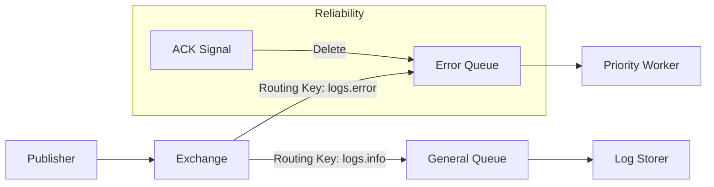

# Message Queues: The Backbone of Reliable Brokers (RabbitMQ and Service Bus)
============================================================
0. Architectural Vision: The Guarantee of Delivery
============================================================
- **Message Queues are the "Post Office" of Distributed Systems.** They ensure that a message is delivered even if the recipient is currently busy or offline.
- **Competing Consumers.** Distributing work across multiple workers automatically. If one worker dies, the broker re-delivers the message to another.
- **AMQP vs HTTP.** AMQP is a persistent, stateful, binary protocol designed specifically for high-throughput messaging.
- **Azure Service Bus.** An enterprise-grade cloud broker featuring **Sessions**, **Transactions**, and **Duplicate Detection**.
- **RabbitMQ.** The high-performance, open-source broker that excels in low-latency and flexible routing (Exchanges).
- **Architect's View.** We use Message Queues to handle **Burst Traffic**, **Background Jobs**, and **Data Synchronization**. We value **Message Durability** (Saving to disk) and **Acknowledgment (ACK)** to ensure zero data loss.

============================================================
1. Foundational Problem: The "Temporary Outage" Loss
============================================================
- **Real-World Impact:** Your "Newsletter" service sends emails to 1 million users. At user 500,000, your server crashes. 
- **What breaks?** "The Progress". Without a queue, you have no idea who got the email and who didn't. You have to start over and 500,000 users get a duplicate email.
- **Scale Boundary:** REST calls are "Point-to-Point". If you have 1,000 requests per second and your backend slows down, your frontend will wait, time out, and crash. You need a **Buffer**.
- **Failure Story:** A trucking logistics company used REST to send "Route Updates" to drivers. In areas with bad cell signal, half the updates were lost, leads to drivers wasting fuel on the wrong routes. Moving to **RabbitMQ (Message Persistence)** ensured that the moment the driver's phone regained signal, all the buffered route updates were delivered instantly and in order.

============================================================
2. Internal System Mechanics: Exchanges and Acks
### The Message Lifecycle
1. **Producer:** Sends message with a "Routing Key".
2. **Exchange:** Decides which "Queues" get the message based on the Routing Key.
3. **Queue:** Holds the message until a Consumer is ready.
4. **Consumer:** Processes message and sends an **ACK (Acknowledge)**. The broker then deletes it.



### Important Mechanism: Dead Lettering
If a consumer fails to process a message (NACK), or if it expires, it is moved to a **Dead Letter Queue (DLQ)** for inspection, rather than being deleted or retried forever.

============================================================
3. Production Engineering in .NET 8 (Broker Selection)
============================================================

### Anti-Pattern: Treating a Queue like a Database
```csharp
// TERRIBLE: Keeping 10 million messages in a RabbitMQ queue for months.
// Queues are for TEMPORARY storage. Long-term data belongs in a DB.
```

### Production-Ready Implementation: Azure Service Bus with MassTransit
```csharp
// 1. Defining the Message Contract
public record ProcessPayment(Guid TransactionId, decimal Amount);

// 2. The Consumer with Fault Handling
public class PaymentConsumer : IConsumer<ProcessPayment> {
    public async Task Consume(ConsumeContext<ProcessPayment> context) {
        // Business logic here
        await _gateway.Charge(context.Message.Amount);
    }
}

// 3. Configure MassTransit with Azure Service Bus
builder.Services.AddMassTransit(x => {
    x.AddConsumer<PaymentConsumer>();
    x.UsingAzureServiceBus((context, cfg) => {
        cfg.Host(builder.Configuration["ServiceBusConnection"]);
        
        // Use Sessions for Ordered Processing if needed
        cfg.ReceiveEndpoint("payment-queue", e => {
            e.ConfigureConsumer<PaymentConsumer>(context);
        });
    });
});
```

**Architecture Strategy:** 
- Use **Durable Queues** so messages survive a broker restart.
- Implement **Message TTL (Time To Live)** to ensure old, irrelevant data (like 2-hour-old GPS pings) is automatically removed.

============================================================
4. System Interaction & Flow (ASCII Architecture)
============================================================

                ┌──────────────────┐
                │   The Producer   │ (App Logic)
                └────────┬─────────┘
                         │ 1. Push(Message)
         ┌───────────────▼───────────────┐
         │     THE MESSAGE BROKER        │ (The Buffer - RabbitMQ/ASB)
         │  ┌─────────┐   ┌─────────┐    │
         │  │ Memory  │ → │ Disk    │    │
         │  │ Cache   │   │ Storage │    │
         │  └────┬────┘   └────┬────┘    │
         └───────┼─────────────┼─────────┘
                 │             │ 2. Distribute to Worker(s)
         ┌───────▼─────────────▼─────────┐
         │       The Worker Pool         │ (Managed Consumers)
         └───────────────┬───────────────┘
                         │ 3. Send ACK on Success
               ┌─────────▼─────────┐
               │ Message Finalized │
               └───────────────────┘

============================================================
5. Strategic Scaling & System Evolution
============================================================
- **Horizontal Scaling.** Spinning up 50 "Image Resizer" containers to empty a queue that suddenly received 10,000 files.
- **Prefetch Count.** Controlling how many messages a worker can pull at once. Too high = overloading the worker; Too low = idling the worker.
- **Broker Clustering.** Deploying RabbitMQ in a 3-node cluster to ensure the broker itself is highly available.

============================================================
6. Reliability, Observability & Runtime Governance
============================================================
- **Key Metrics:**
    - `Queue Depth`: How many messages are waiting?
    - `Consumer Unavailability`: Are our workers crashing?
- **Observability:** Monitor the **RabbitMQ Management UI** to see real-time message flow and find bottlenecks.

============================================================
7. Compromises, Tradeoffs & Alternatives
============================================================
- **Latency.** Queues add delay. If you need a response in < 50ms, use a synchronous call.
- **Resource Usage.** Durable queues write to disk, which is slower than memory-only queues. **Architect's Tip:** Only use durability for critical business data (Payments, Orders).

============================================================
8. Security Posture & Risk Mitigation
============================================================
- **Connection Security.** Use **SAS (Shared Access Signatures)** or **mTLS** to connect to the broker. Never put credentials in the appsettings.
- **Payload Sanitization.** Ensure consumers don't trust the message body blindly (e.g., check for malicious commands in a "Task Name" field).

============================================================
9. Technical Edge Cases & System Failure Modes
============================================================
- **The "Prefetch Deadlock".** A worker fetches 1,000 messages but can only process 1 per minute. The other 999 messages are "Locked" and invisible to other workers.
- **Broker Memory Pressure.** If the queue becomes too large, the broker will stop accepting new messages to save itself.

============================================================
10. Architectural Assessment & Career Progression
============================================================
- **Senior:** "We use RabbitMQ to avoid direct dependencies between our services."
- **Principal:** "Messaging is the **Infrastructure of Integrity**. We leverage **Enterprise-Grade Brokers** to implement **Persistence and Competing Consumer Patterns**. We architecturalize for **Operational Elasticity**, utilizing **Durable Subscriptions and Dead-Lettering Strategies** to ensure that no business fact is ever lost to transient infrastructure failure. For us, a broker is not just a pipe; it is a **Strategic Buffer** that protects our domain from the volatility of the distributed network."
- **Interview Strategy:** Compare RabbitMQ and Kafka. Explain why "ACK" is the most important part of the protocol.

============================================================
11. Real-World Case Study: Retail Inventory Sync
============================================================
**Scenario:** A retailer like Walmart or Target syncing 10,000 stores.
- **The Problem:** When a store sells an item, it needs to update the "Global Inventory". If the internet goes down, the sale record is lost.
- **The Design:** Stores use a **Local Queue (RabbitMQ Edge)**. It pushes to **Azure Service Bus** whenever it has a signal.
- **Result:** Zero lost sales. Even if a store is offline for 2 days, the moment it reconnects, its 50,000 sales facts are synced to HQ in minutes.

============================================================
12. Structural Dependencies & Learning Path
============================================================
- **Foundations:** TCP Sockets, Producer/Consumer theory.
- **Future Steps:** Kafka streaming, gRPC Streams.
- **Integration Points:** MassTransit, Rebus, NServiceBus, RabbitMQ.Client.
