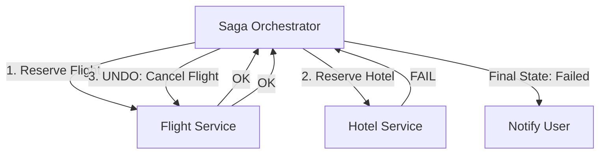

# Sagas and Distributed Transactions: Managing Consistency in Chaos
**0. Architectural Vision: The Guarantee of Harmony**
- **The End of 2PC (Two-Phase Commit).** In microservices, we cannot "Lock" databases across the network. It's too slow and prone to failure.
- **The Saga Pattern.** A sequence of local transactions. Each service updates its own data, and if one fails, everyone else executes a "Compensating Transaction" to undo their work.
- **Compensating Transactions.** The "Undo" button (e.g., if a payment fails, the "Inventory" service must "Un-reserve" the item).
- **Orchestration Sagas.** A central "Saga Manager" (State Machine) tells each service what to do.
- **Choreography Sagas.** Services listen for each other's success/failure events and react accordingly.
- **Architect's View.** We move to Sagas when a business process spans multiple domains (e.g., Booking a Trip: Flight -> Hotel -> Car). We accept **Eventual Consistency** and design our UI to handle the "In-Progress" state of a long-running transaction.

**1. Foundational Problem: The "Partial Success" Zombie**
- **Real-World Impact:** An "Order" logic: 1. Deduct Money (Success), 2. Ship Item (Fail out of stock).
- **What breaks?** "The Business Logic". The customer's money is gone, but the item is not coming. This is a **Customer Service Catastrophe**.
- **Scale Boundary:** You cannot use a "SQL Transaction" that covers different databases in different cloud zones. The network will time out before you can commit.
- **Failure Story:** A major airline had a bug where the "Payment" was successful but the "Seat Assignment" failed. Because they didn't have a **Saga (Compensating Transaction)**, the customer had a paid ticket but no seat, leading to an overbooked flight and a PR nightmare. Moving to **MassTransit Sagas** ensured that if a seat couldn't be assigned, the payment was automatically refunded within seconds.

============================================================
2. Internal System Mechanics: State Machines and Compensation
### The Orchestrated Saga Flow (Trip Booking)
1. **Saga Manager:** Starts "BookingSaga".
2. **Step 1:** Sends `BookFlight` command. (Success).
3. **Step 2:** Sends `BookHotel` command. (Fail).
4. **Compensation:** Saga Manager sends `CancelFlight` to the Flight service to undo Step 1.



**3. Production Engineering in .NET 8 (MassTransit Sagas)**

### Anti-Pattern: Manual "Undo" Queries
```csharp
// TERRIBLE: Manually writing 'UPDATE Inventory SET Qty = Qty + 1' 
// inside a catch block. This is fragile and doesn't handle retries or crashes.
```

### Production-Ready Implementation: MassTransit State Machine
```csharp
// 1. Defining the Saga State
public class OrderState : SagaStateMachineInstance {
    public Guid CorrelationId { get; set; }
    public string CurrentState { get; set; }
    public decimal OrderTotal { get; set; }
}

// 2. The State Machine Definition
public class OrderSaga : MassTransitStateMachine<OrderState> {
    public State Submitted { get; private set; }
    public State Accepted { get; private set; }
    public State FAILED { get; private set; }

    public OrderSaga() {
        InstanceState(x => x.CurrentState);

        // Define the Workflow
        During(Initial,
            When(OrderSubmitted)
                .Then(context => context.Saga.OrderTotal = context.Message.Amount)
                .TransitionTo(Submitted)
                .Publish(context => new ProcessPayment(context.Saga.CorrelationId)));

        During(Submitted,
            When(PaymentFailed)
                .Then(context => Console.WriteLine("Payment Failed! Undoing..."))
                .TransitionTo(FAILED)
                .Publish(context => new CancelOrder(context.Saga.CorrelationId)));
    }
}
```

**Architecture Strategy:** 
- Use **Correlation IDs** for every single message in the Saga so the orchestrator can find the correct state in the database.
- Store the Saga state in a **Persistent Store** (Redis or SQL) so the saga can survive a server restart during a long-running process (e.g., a process that takes 2 days).

**4. System Interaction & Flow (ASCII Architecture)**

                ┌──────────────────┐
                │   Saga Database  │ (SQL/Redis)
                └────────┬─────────┘
                         │ 1. Load State (ID: 123)
         ┌───────────────▼───────────────┐
         │     SAGA ORCHESTRATOR         │ (The Brain)
         │  ┌─────────┐   ┌─────────┐    │
         │  │ Event   │ → │ Transition│    │
         │  │ Handler │   │ Logic   │    │
         │  └────┬────┘   └────┬────┘    │
         └───────┼─────────────┼─────────┘
                 │             │ 2. Save New State (Transitioned)
         ┌───────▼─────────────▼─────────┐
         │      External Service A/B     │ (Stateless Workers)
         └───────────────┬───────────────┘
                         │ 3. Return Done / Failed
               ┌─────────▼─────────┐
               │  Global Consistency│
               └───────────────────┘

**5. Strategic Scaling & System Evolution**
- **Timeouts.** If a service doesn't respond in 1 hour, the Saga should "Auto-Compensate" (e.g., release the hotel room lock).
- **Backward Compatibility.** Handling old, currently-running sagas when you deploy a new version of the state machine.
- **Audit Trails.** Keeping a log of every state transition the saga made for debugging and legal compliance.

**6. Reliability, Observability & Runtime Governance**
- **Key Metrics:**
    - `Saga Completion Rate`: How many orders successfully finish vs fail?
    - `Average Saga Duration`: How long does a business process take?
- **Observability:** In the MassTransit dashboard, you can see the literal state machine diagram and where a specific order is stuck.

**7. Compromises, Tradeoffs & Alternatives**
- **Semantic Consistency.** Even with Sagas, the "Balance" might be wrong for a few seconds. If a user checks their balance during the Saga, they might see the old value.
- **Complexity Tax.** Designing and testing 10 compensating transactions for a 10-step process is a massive overhead.

**8. Security Posture & Risk Mitigation**
- **Message Integrity.** Ensure that a "PaymentSucceeded" event cannot be faked by a malicious user to move the Saga forward.
- **Concurrency.** What if two events for the same Saga arrive at the exact same millisecond? **Architect's Tip:** Use **Optimistic Concurrency (ETags/Versions)** in the Saga database.

**9. Technical Edge Cases & System Failure Modes**
- **The "Infinite Loop" Saga.** Service A fails, A-Compensation starts, A-Compensation fails, Triggering a retry of A-Compensation...
- **The "Forgotten Saga".** A process that gets stuck in an "In-Between" state because of a bug and stays there forever, locking database records.

**10. Architectural Assessment & Career Progression**
- **Senior:** "We use Sagas to coordinate multi-service transactions like booking a trip."
- **Principal:** "Consistency in a distributed world is the engineering of **Corrective Action**. We leverage **Stateful Orchestration and Compensating Transactions** to replace the impossible promise of Atomic Commits. We architect for **Auditability and Fault-Tolerance**, utilizing **Explicit State Machines and Idempotent Logic** to navigate the chaos of partial failures. For us, a Saga is the **Operational Blueprint** that guarantees business integrity across disparate domain boundaries."
- **Interview Strategy:** Compare 2PC and Saga. Explain why "Compensating" is different from "Rolling Back".

**11. Real-World Case Study: Global E-Commerce Logistics**
**Scenario:** A company like Amazon shipping from 5 different warehouses for 1 order.
- **The Problem:** If one warehouse is closed, the whole order shouldn't fail, but the user must be notified and the "Reserved" items in other warehouses must be handled.
- **The Design:** Implemented a **MassTransit Saga**. State: `AwaitingStock`, `PartiallyShipped`, `Fullfilled`.
- **Result:** $100M+ saved in unnecessary refunds and manually untangling stuck orders. The customer gets clear shipping updates for each sub-package automatically.

**12. Structural Dependencies & Learning Path**
- **Foundations:** Finite State Machines, Pub/Sub.
- **Future Steps:** Temporal.io, Step Functions.
- **Integration Points:** MassTransit State Machines, NServiceBus Sagas, Azure Logic Apps.
