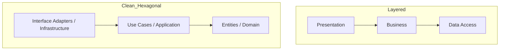

# Layered vs Hexagonal vs Clean Architecture: The Blueprints of Maintenance
**0. Architectural Vision: The Separation of Concerns**
- **Architecture is about Boundaries.** It's the decision of what goes where and how different parts of the system are allowed to talk to each other.
- **The Dependency Rule.** Source code dependencies always point inwards, toward higher-level policies (The Core).
- **Layered (3-Tier) Architecture.** The classic approach: UI -> BLL -> DAL. Simple, but business logic often leaks into the database layer.
- **Hexagonal Architecture (Ports & Adapters).** Decouples the application from external tools (DB, UI, APIs) using Interfaces (Ports) and Implementations (Adapters).
- **Clean Architecture.** Evolution of Hexagonal/Onion; places **Entities** and **Use Cases** at the center, ensuring the business logic doesn't depend on frameworks or databases.
- **Architect's View.** We choose an architecture based on the **Expected Lifetime** and **Complexity** of the system. For a 10-year enterprise app, **Clean Architecture** is an investment in future flexibility. For a 6-month prototype, a simple **Layered** approach is superior.

**1. Foundational Problem: The "Framework Trap"**
- **Real-World Impact:** You built your entire business logic inside `Entity Framework` models and `ASP.NET Core` controllers. 
- **What breaks?** "The Mobility". If you want to move from SQL Server to MongoDB, or from REST to gRPC, you have to rewrite 80% of your business code because it's "Glued" to the framework.
- **Scale Boundary:** In a large system, if the "Database code" is mixed with "Calculation code", you can't test the calculations without a real database connection. This makes unit tests slow and flakey.
- **Failure Story:** A fintech startup used "Transaction Script" (Logic inside SQL/DAL). When they needed to support multiple currencies and complex tax rules, the SQL stored procedures became 5,000 lines long and unmanaged. They couldn't hire new developers because no one understood the "Hidden logic" in the DB. Migrating to **Clean Architecture** moved the logic to pure C# classes, allowing them to test 100% of their tax rules in milliseconds.

**2. Internal System Mechanics: The Rings of Power**

### Comparing the Models


### The Key: Dependency Inversion
In Clean Architecture, the **Infrastructure** (DAL) depends on the **Domain** (BLL) interfaces. 
- **BLL:** `IUserRepository` (The Port)
- **DAL:** `SqlUserRepository : IUserRepository` (The Adapter)

**3. Production Engineering in .NET 8 (Clean Architecture)**

### Anti-Pattern: Fat Controllers
```csharp
// TERRIBLE: Business logic (Validation, DB calls, Mapping) 
// all inside the API Controller.
[HttpPost]
public IActionResult Create(OrderDto dto) {
    if (dto.Amount < 0) return BadRequest();
    _db.Orders.Add(new Order { ... });
    _db.SaveChanges();
    return Ok();
}
```

### Production-Ready Implementation: The Clean Approach
```csharp
// 1. Domain Project (No Dependencies)
public class Order { // Entity
    public Guid Id { get; set; }
    public decimal Amount { get; private set; }
    public void Place(decimal amount) { /* logic */ }
}

// 2. Application Project (Depends only on Domain)
public interface IOrderRepository { Task SaveAsync(Order order); }

public class CreateOrderUseCase { // Use Case / Command Handler
    private readonly IOrderRepository _repo;
    public CreateOrderUseCase(IOrderRepository repo) => _repo = repo;

    public async Task Execute(decimal amount) {
        var order = new Order();
        order.Place(amount);
        await _repo.SaveAsync(order);
    }
}

// 3. Infrastructure Project (Depends on Application Interfaces)
public class SqlOrderRepository : IOrderRepository {
    private readonly AppDbContext _db;
    public async Task SaveAsync(Order order) => await _db.Orders.AddAsync(order);
}
```

**Architecture Strategy:** 
- Use **MediatR** to implement the Use Case layer (Handlers) to keep Controllers thin and ensure the "Command" is the entry point.
- Keep the **Domain** project completely free of NuGet packages like `EntityFramework` or `Newtonsoft.Json`.

**4. System Interaction & Flow (ASCII Architecture)**

                ┌──────────────────┐
                │   The External   │ (UI, DB, External API)
                └────────┬─────────┘
                         │ 1. Triggers Use Case
         ┌───────────────▼───────────────┐
         │     THE INFRASTRUCTURE        │ (Adapters - Controllers, DBContext)
         │  ┌─────────┐   ┌─────────┐    │
         │  │ Web API │ → │ Db      │    │
         │  │ Adapter │   │ Adapter │    │
         │  └────┬────┘   └────┬────┘    │
         └───────┼─────────────┼─────────┘
                 │             │ 2. Implementation of Port
         ┌───────▼─────────────▼─────────┐
         │       THE APPLICATION         │ (Ports - Use Cases / Interfaces)
         └───────────────┬───────────────┘
                         │ 3. Orchestrate Entities
               ┌─────────▼─────────┐
               │    THE DOMAIN     │ (Core Logic / Entities)
               └───────────────────┘

**5. Strategic Scaling & System Evolution**
- **Evolving from Layered to Clean.** Don't rewrite everything. Start by extracting "Domain Logic" into a separate project and using interfaces for the DAL.
- **Microservices Deployment.** Each microservice can have its own internal architecture. A simple service might use Layered, while a complex one uses Clean.
- **Testing Pyramid.** Clean Architecture allows for **Broad Unit Testing** of the Application/Domain without any mocking of complex infrastructure frameworks.

**6. Reliability, Observability & Runtime Governance**
- **Key Metrics:**
    - `Domain Coverage`: What % of business logic is in the Domain project?
    - `Dependency Directions`: Using tools like **NetArchTest** to ensure UI doesn't talk to DAL directly.
- **Observability:** Custom "Domain Events" can be published from the Core to provide business-level tracing.

**7. Compromises, Tradeoffs & Alternatives**
- **Boilerplate.** Clean Architecture requires many more files (Interfaces, DTOs, Mappers).
- **Learning Curve.** Junior developers often find the "Indirection" of Ports and Adapters confusing. **Architect's Tip:** Only use Clean Architecture if the project is expected to grow significantly.

**8. Security Posture & Risk Mitigation**
- **Validation.** Always perform "Domain Validation" in the core entities, so your system is safe regardless of which "Adapter" (Web, CLI, Test) is calling it.
- **Authorization.** Move authorization logic into the **Application Layer** (Use Cases) so it's consistent across all entry points.

**9. Technical Edge Cases & System Failure Modes**
- **Leaky Abstractions.** An IRepository method that returns an `IQueryable` is a leak—you've just given the whole system access to the SQL implementation details.
- **Shared Entities.** Using the same "Database Class" as your "Domain Entity". This locks your domain to the database schema.

**10. Architectural Assessment & Career Progression**
- **Senior:** "We use Clean Architecture to separate our business logic from the database."
- **Principal:** "Architecture is the **Institutionalization of Change Management**. We leverage **Clean and Hexagonal Patterns** to isolate our **Core Domain Sovereignty** from the volatility of external technology stacks. We enforce the **Dependency Rule** to ensure our high-level policies are never corrupted by framework implementation details. For us, a 'Port' is a **Strategic Contract** that guarantees our system's longevity and testable integrity."
- **Interview Strategy:** Explain why the DAL depends on the BLL in Clean Architecture. Discuss the pros and cons of having separate models for DB and Domain.

**11. Real-World Case Study: SaaS Platform Pivot**
**Scenario:** A SaaS platform initially used SQL Server.
- **The Problem:** Scaling costs for multi-tenant SQL became too high. They needed to move to a mix of CosmosDB and PostgreSQL.
- **The Design:** Because they implemented **Hexagonal Architecture**, they only had to write new **Adapters** for CosmosDB. The Core domain logic (Subscriptions, Bills, Users) remained untouched.
- **Result:** The database migration took 3 months instead of a predicted 12 months. Zero bugs were introduced into the billing logic because it was never modified.

**12. Structural Dependencies & Learning Path**
- **Foundations:** SOLID Principles, Dependency Injection.
- **Future Steps:** DDD (Domain Driven Design), CQRS.
- **Integration Points:** .NET Solution Folders, MediatR, AutoMapper.
