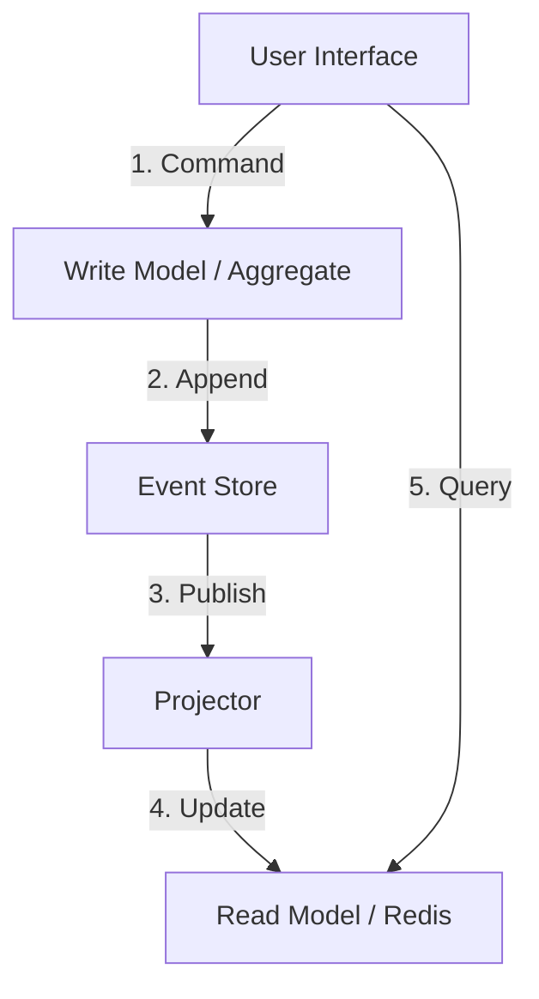

# CQRS and Event Sourcing: The Architecture of Performance and Time
**0. Architectural Vision: The Separation of Reality**
- **CQRS is the Law of Divergent Models.** In most systems, the way you "Insert" data (Write) is fundamentally different from the way you "Visualize" data (Read).
- **Commands vs Queries.** Commands change state (Write); Queries return state (Read). They never mix.
- **Event Sourcing (ES).** Storing the "Sequence of Changes" (Events) instead of the "Current State". To get the current state, you "Replay" the events.
- **The Read Model (Projections).** A highly optimized, flattened, and possibly denormalized view of the data stored in Redis, Elasticsearch, or a Read-Replica.
- **Immutability.** In Event Sourcing, facts never change. You don't update a row; you append a new event (e.g., `AddressChanged`).
- **Architect's View.** We use **CQRS** to handle high-performance read/write scaling. We use **Event Sourcing** for systems that require a perfect **Audit Trail** (Banking, Logistics, Healthcare).

**1. Foundational Problem: The "Joint Model" Bottleneck**
- **Real-World Impact:** You have a "Users" table with 100 columns. Your "Write" logic needs 3 columns, but your "Read" logic (A Dashboard) needs to JOIN 10 tables and calculate averages.
- **What breaks?** "The Performance". Every time you add a column for the Dashboard, the Write performance decreases because the DB indices grow. You are fighting an impossible war with **conflicting indexing requirements**.
- **Scale Boundary:** In a legacy CRUD app, 1,000 users reading the dashboard will lock the database, preventing anything from being written.
- **Failure Story:** A social media app used a single SQL table for "Posts". As traffic grew, the "Get Latest Posts" query became so complex that it took 5 seconds to load. They added indices to help the Read, but then "Create Post" started timing out because the indices were too heavy. Migrating to **CQRS** allowed them to write to SQL (Fast) and project posts into **Redis** (Instant) for reading.

**2. Internal System Mechanics: Command and Event Flows**

### The CQRS + ES Pipeline
1. **Command:** "Change User Address".
2. **Aggregate (Write Model):** Validates the business rule. If valid, Appends an `AddressChanged` event to the **Event Store**.
3. **Projector:** Listens for the event and updates the **Read Model** (View Table).
4. **Query:** User asks "Where does this user live?". The UI reads directly from the optimized View Table.



**3. Production Engineering in .NET 8 (Marten / MediatR)**

### Anti-Pattern: Using EF Core for Event Sourcing
```csharp
// TERRIBLE: Trying to manually manage an 'Events' table in EF Core.
// EF is designed for STATE, not STREAMS. 
```

### Production-Ready Implementation: Marten (Event Store for .NET)
```csharp
// 1. The Event (Fact)
public record OrderPlaced(Guid OrderId, decimal Total);

// 2. The Command Handler (Write Model)
public class PlaceOrderHandler : IRequestHandler<PlaceOrderCommand> {
    private readonly IDocumentSession _session;
    public async Task Handle(PlaceOrderCommand command, CancellationToken ct) {
        // Appending to the stream
        _session.Events.Append(command.OrderId, new OrderPlaced(command.OrderId, 100));
        await _session.SaveChangesAsync();
    }
}

// 3. The Read Model (Projection)
public class OrderSummary {
    public Guid Id { get; set; }
    public decimal Total { get; set; }
}

public class OrderSummaryProjection : SingleStreamProjection<OrderSummary> {
    public void Apply(OrderPlaced @event, OrderSummary summary) {
        summary.Id = @event.OrderId;
        summary.Total = @event.Total;
    }
}
```

**Architecture Strategy:** 
- Use **MediatR** to strictly separate Command handlers from Query handlers.
- Implement **Snapshots**. If an aggregate has 10,000 events, replaying them on every load is too slow. Save the state every 100 events.

**4. System Interaction & Flow (ASCII Architecture)**

                ┌──────────────────┐
                │   The Event Store│ (Source of Truth)
                └────────┬─────────┘
                         │ 1. Immutable Appends
         ┌───────────────▼───────────────┐
         │     ASYNCHRONOUS PROJECTION   │ (The Transformer)
         │  ┌─────────┐   ┌─────────┐    │
         │  │ Catchup │ → │ Denormal│    │
         │  │ Sub     │   │ izer    │    │
         │  └────┬────┘   └────┬────┘    │
         └───────┼─────────────┼─────────┘
                 │             │ 2. Update Optimized Views
         ┌───────▼─────────────▼─────────┐
         │       The Read Model          │ (Elastic / Redis / SQL)
         └───────────────┬───────────────┘
                         │ 3. Millisecond-Latency Queries
               ┌─────────▼─────────┐
               │   Happy UI User   │
               └───────────────────┘

**5. Strategic Scaling & System Evolution**
- **Polyglot Reading.** Creating a SQL read-model for "Accounting" and an Elasticsearch read-model for "Full-text Search" from the same stream of events.
- **Time Travel.** The ability to ask: "What did my system state look like exactly 2 months ago at 4:15 PM?". You just replay events up to that timestamp.
- **Corrective Actions.** If a bug causes wrong projections, you don't "Fix the data"; you fix the logic and **Rebuild the Read Model** from the raw events.

**6. Reliability, Observability & Runtime Governance**
- **Key Metrics:**
    - `Projection Lag`: How many events is the Read Model behind the Write Model?
    - `Event Write Latency`: Performance of the Event Store.
- **Observability:** Every event corresponds to a business fact. Use **Distributed Tracing** to see which Command triggered which series of Events.

**7. Compromises, Tradeoffs & Alternatives**
- **Eventual Consistency.** The Read Model might be 100ms behind the Write Model. The user might refresh the page and not see their update immediately.
- **Complexity.** You now have two database models and a projection pipeline to maintain.

**8. Security Posture & Risk Mitigation**
- **GDPR / Right to Forget.** If an event store is immutable, how do you delete a user's name?
    - *Architect's Rule:* Use **Crypto-Shredding**. Encrypt sensitive data in events. Delete the *key* when the user asks to be forgotten.
- **Event Poisoning.** Ensuring that malicious commands don't result in corrupted events that break the projection logic.

**9. Technical Edge Cases & System Failure Modes**
- **Concurrent Appending.** Two commands updating the same aggregate at once. 
    - *Architect's Rule:* Always use **Optimistic Versioning** on the event stream.
- **Version Mismatch.** A new version of the code receives an old event it doesn't understand.

**10. Architectural Assessment & Career Progression**
- **Senior:** "We use CQRS to speed up our queries by having a separate read model."
- **Principal:** "Architecture is the **Management of Intent and Perception**. We leverage **Event Sourcing** to capture the full **Causal History** of our business domain, while utilizing **CQRS** to decouple our **Transactional Integrity** from our **Interaction Latency**. We architect for **Temporal Resilience**, ensuring that our state is a derived product of facts rather than a fragile snapshot of the present. For us, cold data is just a query away, and the future is built on an immutable past."
- **Interview Strategy:** Explain why ES is perfect for auditing. Discuss how to handle "Eventual Consistency" in the UI (e.g., Pessimistic UI vs Optimistic UI).

**11. Real-World Case Study: Digital Banking**
**Scenario:** A bank like Revolut or Monzo.
- **The Problem:** A customer says "Why is my balance $100?". A standard DB only shows "$100". It doesn't show the mathematical proof of why.
- **The Design:** Implemented **Event Sourcing**. Every transaction is an event: `Deposited`, `Withdrawn`, `FeeCharged`.
- **Result:** Support can show the user the exact sequence of 50 events that led to that $100 balance. Better yet, the "Balance" is just a projection that can be recalculated instantly if a fee needs to be reversed.

**12. Structural Dependencies & Learning Path**
- **Foundations:** DDD Aggregates, ACID vs BASE.
- **Future Steps:** Actor Model (Akka.NET), Event Streams (Kafka).
- **Integration Points:** Marten, EventStoreDB, MediatR, MassTransit.
