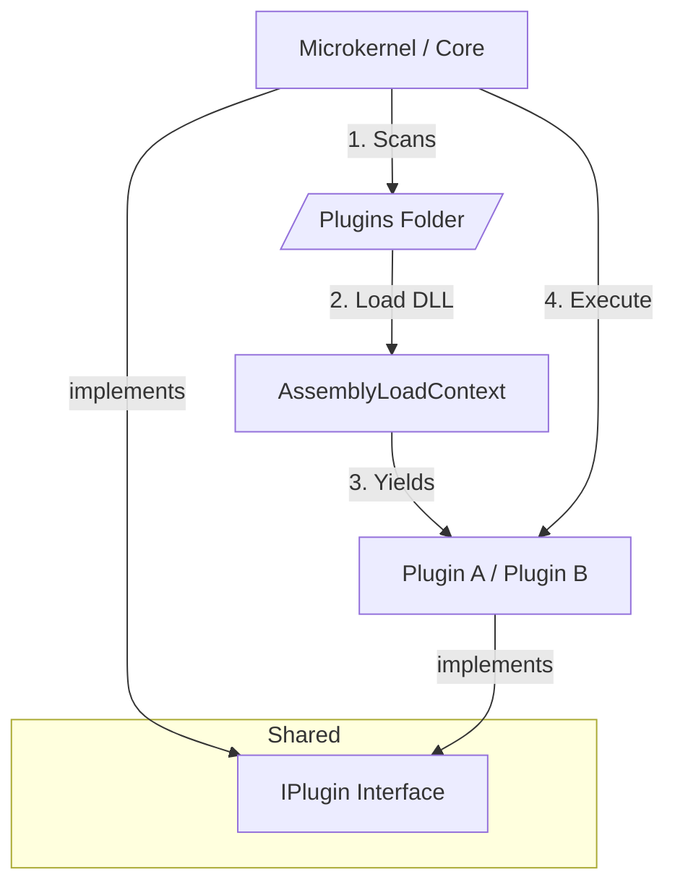

# Microkernel Architecture: The Art of Extensible Plugin Systems
============================================================
0. Architectural Vision: The Open-Closed Evolution
============================================================
- **The Microkernel (Core) is the Minimally Viable Foundation.** It provides only the essential infrastructure (Logging, Security, Lifecycle) and leaves everything else to plugins.
- **Plugins (Adapters) are Independent Modules.** They add specific business features or technical capabilities without modifying the core.
- **The Registry.** A mechanism for the Core to "Discover" and "Initialize" available plugins at runtime.
- **Isolation.** Ensuring a bug in one plugin doesn't crash the entire core or other plugins.
- **Architect's View.** We use **Microkernel Architecture** when building **IDEs (VS Code)**, **E-commerce Engines (NopCommerce)**, or **CMS Systems**. It is the ultimate implementation of the **Open-Closed Principle**: Open for extension, closed for modification.

============================================================
1. Foundational Problem: The "Monolithic Feature Bloat"
============================================================
- **Real-World Impact:** You have an e-commerce platform. One customer wants "FedEx Shipping", another wants "DHL", and another wants "Drone Delivery".
- **What breaks?** "The Complexity". If you hardcode every possible shipping method into your core `ShippingService.cs`, the file becomes 10,000 lines long, and you have to redeploy the *whole site* just to fix a bug in the "DHL" logic.
- **Scale Boundary:** When you have 100 different "Payment Gateways", your DLL size becomes massive and your startup time crawls.
- **Failure Story:** A major ERP vendor had everything in one project. To support a new "Local Tax Law" in Poland, they had to modify the core "Finances" module. This triggered a full regression test of the 100 other countries they supported, delaying the release by 4 months. Migrating to **Microkernel Architecture** allowed them to ship the "Poland Tax Plugin" as a separate DLL in 1 week.

============================================================
2. Internal System Mechanics: Contracts and Loading
============================================================

### The Plugin Interaction Model
1. **The Contract:** A shared DLL (Interface) that both the Core and Plugins understand.
2. **The Discovery:** The Core scans a `/plugins` folder for DLLs.
3. **The Loading:** Uses `AssemblyLoadContext` to load the code into memory.
4. **The Execution:** The Core calls the interface methods (e.g., `CalculateShipping()`).



============================================================
3. Production Engineering in .NET 8 (Assembly Loading)
============================================================

### Anti-Pattern: Using Assembly.LoadFile
```csharp
// TERRIBLE: Loads the plugin into the global context. 
// You can't UNLOAD it, and it can cause massive dependency version conflicts.
```

### Production-Ready Implementation: Isolated Assembly Loading
```csharp
// 1. Common Project (Shared Contract)
public interface IPaymentPlugin {
    string Name { get; }
    Task ProcessAsync(decimal amount);
}

// 2. The Core Loading Logic (.NET 8)
public class PluginLoader {
    public IEnumerable<IPaymentPlugin> LoadPlugins(string path) {
        var context = new AssemblyLoadContext("PluginContext", isCollectible: true);
        var assembly = context.LoadFromAssemblyPath(path);
        
        var pluginTypes = assembly.GetTypes()
            .Where(t => typeof(IPaymentPlugin).IsAssignableFrom(t) && !t.IsInterface);

        foreach (var type in pluginTypes) {
            yield return (IPaymentPlugin)Activator.CreateInstance(type);
        }
    }
}

// 3. Unloading (Memory Management)
// context.Unload(); // Completely removes the plugin from RAM
```

**Architecture Strategy:** 
- Use **IsCollectible: true** in your `AssemblyLoadContext` to allow for "Hot Swapping" of plugins without restarting the app.
- Define a **Lifecycle API** (OnInit, OnEnable, OnDisable, OnShutdown) so plugins can manage their own internal state.

============================================================
4. System Interaction & Flow (ASCII Architecture)
============================================================

                ┌──────────────────┐
                │    The Host      │ (The Executable)
                └────────┬─────────┘
                         │ 1. Boot / Register Services
         ┌───────────────▼───────────────┐
         │     THE MICROKERNEL           │ (The Orchestrator)
         │  ┌─────────┐   ┌─────────┐    │
         │  │ Plugin  │ → │ Shared  │    │
         │  │ Loader  │   │ Bus     │    │
         │  └────┬────┘   └────┬────┘    │
         └───────┼─────────────┼─────────┘
                 │             │ 2. Find Impls of IPlugin
         ┌───────▼─────────────▼─────────┐
         │       The Plugin DLLs         │ (External Files)
         └───────────────┬───────────────┘
                         │ 3. Execute Hook / Action
               ┌─────────▼─────────┐
               │    Feature Result │
               └───────────────────┘

============================================================
5. Strategic Scaling & System Evolution
============================================================
- **Marketplace Ecosystem.** Allowing 3rd-party developers to write plugins (like WordPress or Shopify) by providing a well-documented SDK.
- **Versioning.** Managing cases where Plugin v1 needs Core v2. Always use a **Version Check** during the "Discovery" phase.
- **Hot Reloading.** Detecting new files in the plugins folder and loading them instantly while the system is running.

============================================================
6. Reliability, Observability & Runtime Governance
============================================================
- **Key Metrics:**
    - `Plugin Startup Time`: Identifying heavy plugins that slow down boot.
    - `Plugin Error Rate`: Catching buggy plugins before they affect the core.
- **Observability:** Wrap every plugin call in a **Try-Catch** and a **Stopwatch** to identify the exact plugin responsible for a crash or a slow-down.

============================================================
7. Compromises, Tradeoffs & Alternatives
============================================================
- **Security.** Plugins run with the same permissions as your core. A malicious plugin can steal your database credentials.
- **Complexity.** You have to manage DLL dependencies carefully to avoid "DLL Hell".

============================================================
8. Security Posture & Risk Mitigation
============================================================
- **Sandboxing.** Using separate `AppDomains` (Legacy) or `Containers` (Modern) if you don't trust the plugin source.
- **Code Signing.** Only load DLLs that are cryptographically signed by your company or a trusted partner.

============================================================
9. Technical Edge Cases & System Failure Modes
============================================================
- **Type Casting Failure.** The plugin implements the interface, but because it was loaded in a different context, the `is IPaymentPlugin` check fails.
    - *Architect's Rule:* Always ensure the "Shared Contract" DLL is provided by the Host, not included in the plugin's own folder.
- **Memory Leaks.** A plugin creates static event handlers and doesn't clean them up, preventing the `AssemblyLoadContext` from ever being unloaded.

============================================================
10. Architectural Assessment & Career Progression
============================================================
- **Senior:** "We use a plugin system to add new payment methods without changing the main core."
- **Principal:** "Architecture is the **Orchestration of Extensibility**. We leverage **Dynamic Assembly Loading and Isolated Contexts** to build truly modular platforms. We architecturalize for **Operational Autonomy**, utilizing **Strict Interface Contracts and Collective Lifecycles** to ensure that the core remains lean and immutable. For us, a plugin is a **Dispensable Unit of Logic** that enables limitless ecosystem growth without compromising the stability of the foundation."
- **Interview Strategy:** Discuss the difference between a "Plugin" and a "Microservice". Explain how `AssemblyLoadContext` prevents dependency conflicts.

============================================================
11. Real-World Case Study: VS Code (The King of Microkernels)
============================================================
**Scenario:** A code editor that supports 100+ languages.
- **The Problem:** If VS Code included every language support in the core, the download would be 10GB and it would be slow.
- **The Design:** The core is just an Electron shell with an editor. Everything else (Java, Python, Git) is a plugin.
- **Result:** Thousands of plugins created by the community. The system is incredibly fast because only the plugins you *need* are loaded into memory.

============================================================
12. Structural Dependencies & Learning Path
============================================================
- **Foundations:** Reflection, Interfaces, Assembly loading.
- **Future Steps:** MEF (Managed Extensibility Framework), Orchard Core.
- **Integration Points:** System.Runtime.Loader.AssemblyLoadContext, Dependency Injection Scopes.
