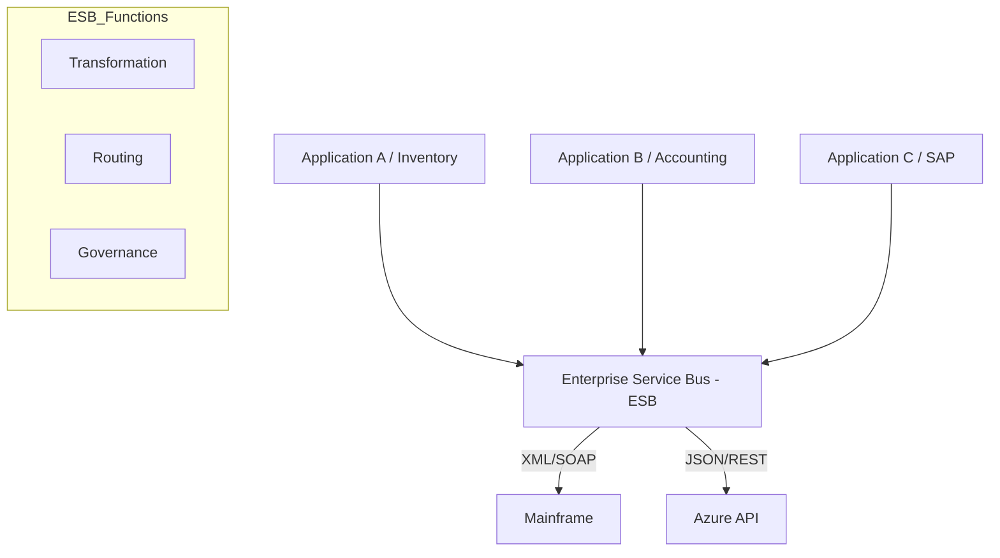

# SOA: Service-Oriented Architecture and the Enterprise Service Bus
============================================================
0. Architectural Vision: The Industrial Integration
============================================================
- **SOA is the Architecture of Heterogeneous Systems.** It aims to make different applications (Java, .NET, COBOL) talk to each other through well-defined service contracts.
- **The Service Contract.** A formal agreement (often WSDL or Swagger) that defines the functionality, inputs, and outputs of a service.
- **The ESB (Enterprise Service Bus).** A central "Hub" that handles message routing, protocol transformation (e.g., SOAP to REST), and business rules.
- **Reusability.** Designing services (like "Identity" or "Credit Check") so they can be reused by many different departments in a corporation.
- **Loose Coupling.** Services are independent units of logic; changing the internal code of Service A shouldn't break Service B as long as the contract is maintained.
- **Architect's View.** We use **SOA** in large-scale enterprises with legacy systems. We understand that while **Microservices** are popular, **SOA** provides the governance and integration patterns needed for complex, multi-lingual ecosystems.

============================================================
1. Foundational Problem: The "Point-to-Point Integration" Mess
============================================================
- **Real-World Impact:** You have 20 different apps in your company. If App 1 needs to talk to App 2, you write a custom connector. If App 1 also needs App 3, another connector.
- **What breaks?** "The Connectivity". With 20 apps, you potentially need 190 different point-to-point connections (`N*(N-1)/2`). It's impossible to maintain.
- **Scale Boundary:** Every time you update App 2, you have to verify every single connector from every other app.
- **Failure Story:** A large shipping company had 50 legacy apps all hard-linked. When they tried to decommission an old "Inventory" system, they found it was being called by 30 other apps they didn't know about. The system was "Frozen" in time because it was too risky to touch. Migrating to **SOA (via an ESB)** allowed them to put the services behind a "Bus", decoupled the apps, and finally retired the old hardware.

============================================================
2. Internal System Mechanics: Orchestration and Bus
============================================================

### The SOA Workflow
1. **Service Provider:** Publishes its contract to the registry.
2. **Service Requester:** Finds the service and sends a message.
3. **The ESB:** Receives the message, transforms it (e.g., XML to JSON), Routes it to the correct provider, and returns the result.



============================================================
3. Production Engineering in .NET 8 (WCF and CoreWCF)
============================================================

### Anti-Pattern: The "God ESB"
```csharp
// TERRIBLE: Putting 50% of your business logic inside the ESB code.
// The ESB becomes a "Monolith in the Middle" that no one can change.
```

### Production-Ready Implementation: Modern SOA with CoreWCF
```csharp
// 1. Defining the Service Contract (Interface)
[ServiceContract]
public interface IFinanceService {
    [OperationContract]
    Task<decimal> GetBalance(string accountNumber);
}

// 2. Implementation in .NET 8
public class FinanceService : IFinanceService {
    public Task<decimal> GetBalance(string accountNumber) {
        return Task.FromResult(1000.50m);
    }
}

// 3. Registering SOA Service in Program.cs
builder.Services.AddServiceModelServices();
builder.Services.AddServiceModelMetadata();

app.UseServiceModel(builder => {
    builder.AddService<FinanceService>();
    builder.AddServiceEndpoint<FinanceService, IFinanceService>(
        new BasicHttpBinding(), "/FinanceService.svc");
});
```

**Architecture Strategy:** 
- Use **CoreWCF** to bridge legacy .NET Framework WCF services to modern .NET 8 without rewriting the client code.
- Implement **Policy-Based Routing** to version your services (v1, v2) within the gateway.

============================================================
4. System Interaction & Flow (ASCII Architecture)
============================================================

                ┌──────────────────┐
                │   Governance UI  │ (Manage Contracts)
                └────────┬─────────┘
                         │ 1. Define Service Spec (WSDL)
         ┌───────────────▼───────────────┐
         │     THE INTEGRATION HUB       │ (ESB / API Manager)
         │  ┌─────────┐   ┌─────────┐    │
         │  │ Format  │ → │ Policy  │    │
         │  │ Mapper  │   │ Enforcer│    │
         │  └────┬────┘   └────┬────┘    │
         └───────┼─────────────┼─────────┘
                 │             │ 2. Canonical Data Model
         ┌───────▼─────────────▼─────────┐
         │       The Backend Services    │ (Heterogeneous Apps)
         └───────────────┬───────────────┘
                         │ 3. Execute Unit of Work
               ┌─────────▼─────────┐
               │ Shared Integration│
               └───────────────────┘

============================================================
5. Strategic Scaling & System Evolution
============================================================
- **SOA to Microservices.** The difference is scope. SOA is across an ENTIRE company; Microservices are within ONE product team.
- **Canonical Data Models.** Creating a shared "Customer" object that all 50 services use to talk to the ESB, preventing "Translation Bloat".
- **Dynamic Routing.** Changing the destination of a service call based on the content of the message (e.g., routes for "VIP" vs "Free" users).

============================================================
6. Reliability, Observability & Runtime Governance
============================================================
- **Key Metrics:**
    - `Endpoint Availability`: Which legacy system is 503-ing?
    - `Message Failure Rate`: Tracking transformation errors in the ESB.
- **Observability:** Use **Azure API Management (APIM)** to get a bird's eye view of your entire enterprise service catalog.

============================================================
7. Compromises, Tradeoffs & Alternatives
============================================================
- **Latency.** The ESB adds a significant overhead due to XML parsing and routing logic.
- **Centralized Failure.** If the ESB goes down, the entire company stops functioning.

============================================================
8. Security Posture & Risk Mitigation
============================================================
- **WS-Security.** Using standard XML-based security for authentication and encryption (SAML tokens).
- **Throttling.** Applying global rate limits at the Bus level to protect slow mainframes from being accidentally DDOSed by modern cloud apps.

============================================================
9. Technical Edge Cases & System Failure Modes
============================================================
- **Version Skew.** Client expects Version 1.2, but the Bus has upgraded to 1.3 with a breaking change in the XML namespace.
- **Payload Explosion.** A legacy service returns a 50MB XML file that crashes the ESB's memory during transformation.

============================================================
10. Architectural Assessment & Career Progression
============================================================
- **Senior:** "We use SOA to integrate our new .NET app with the old Java banking core."
- **Principal:** "Architecture is the **Standardization of Interoperability**. We leverage **Global Service Contracts and Centralized Governance** to manage the complexity of a heterogeneous enterprise. We architect for **Domain Encapsulation**, utilizing **ESB Transformation and Canonical Messaging** to bridge the gap between legacy reliability and modern agility. For us, a service is a **Formal Technical Asset** that enables organizational reuse across disparate technology silos."
- **Interview Strategy:** Compare SOA and Microservices. Explain the role of the ESB and why it's considered an anti-pattern in modern DevOps.

============================================================
11. Real-World Case Study: Global Insurance Merger
============================================================
**Scenario:** Two insurance giants merge. They have 200 different apps.
- **The Problem:** They need to create a single "Claims" portal that pulls data from 5 different database types and 10 different mainframes.
- **The Design:** Implemented a **Modern SOA layer**. All legacy systems were wrapped in **CoreWCF** or REST and plugged into an **Enterprise Bus**.
- **Result:** The "Claims" portal was launched in 4 months. The legacy apps were slowly migrated/retired behind the scenes without ever breaking the portal.

============================================================
12. Structural Dependencies & Learning Path
============================================================
- **Foundations:** XML/SOAP, WSDL, Enterprise Integration Patterns (EIP).
- **Future Steps:** API Management, GraphQL Federations.
- **Integration Points:** CoreWCF, Sentinel, Azure API Management, BizTalk.
