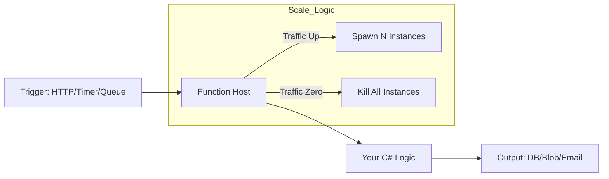

# Serverless and FaaS: The Architecture of Event-Driven Compute
============================================================
0. Architectural Vision: The Infinite Elasticity
============================================================
- **Serverless is a Mindset, not a Technology.** You focus only on the logic; the cloud provider handles all infrastructure, scaling, and maintenance.
- **FaaS (Function as a Service).** Scaling down to ZERO when not in use and up to THOUSANDS of instances instantly.
- **Pay-per-Execution.** You only pay for the exact milliseconds your code runs. Zero idle cost.
- **Statefulness.** Functions are stateless by default. For stateful workflows, we use patterns like **Durable Functions**.
- **Cold Starts.** The delay when the cloud provider has to start a fresh container because your code hasn't run in a while.
- **Architect's View.** We use **Serverless** for **Asynchronous Tasks**, **Scheduled Jobs**, **Webhooks**, and **Burst-heavy APIs**. We understand the trade-offs: massive developer velocity but less control over the underlying execution environment.

============================================================
1. Foundational Problem: The "Idle Infrastructure" Waste
============================================================
- **Real-World Impact:** You have a "Payroll" process that runs once a month for 1 hour. To handle it, you maintain a powerful $500/month server that sits at 1% CPU for the other 719 hours.
- **What breaks?** "The Efficiency". You are paying for wasted power and maintenance.
- **Scale Boundary:** If your app suddenly goes viral and traffic grows 100x in 5 minutes, your fixed servers will crash before you can manually spin up more.
- **Failure Story:** A marketing agency launched a "Spin to Win" campaign on TV. They expected 10 users but got 100,000 in 30 seconds. Their standard "Web Server" (VM) crashed instantly. Migrating to **Azure Functions (Serverless)** allowed the campaign to scale to 50,000 simultaneous users in seconds, and they only paid $5 for the entire 10-minute traffic peak.

============================================================
2. Internal System Mechanics: Triggers and Bindings
============================================================

### The FaaS Lifecycle
1. **The Trigger:** An external event (HTTP request, Timer, Queue Message) wakes up the platform.
2. **The Execution:** platform allocates a container/process and runs the `Function`.
3. **The Binding:** Automating the data input/output (e.g., automatically saving the return value to a Blob Storage without writing "Storage Client" code).



============================================================
3. Production Engineering in .NET 8 (Azure Functions Isolated)
============================================================

### Anti-Pattern: Long-Running Loops in Functions
```csharp
// TERRIBLE: A function that runs for 30 minutes in a 'while' loop.
// Most serverless platforms have a 5-10 minute timeout. 
// Use 'Durable Functions' for long-running workflows.
```

### Production-Ready Implementation: Isolated Worker Function
```csharp
// .NET 8 Isolated Worker allows full control over Middleware and DI
public class ImageProcessorFunc {
    private readonly ILogger _logger;
    public ImageProcessorFunc(ILoggerFactory loggerFactory) {
        _logger = loggerFactory.CreateLogger<ImageProcessorFunc>();
    }

    // Triggered by a Service Bus Message
    [Function("ProcessImage")]
    public async Task Run(
        [ServiceBusTrigger("images-queue", Connection = "SBus")] string myQueueItem,
        FunctionContext executionContext) {
        
        _logger.LogInformation($"Processing: {myQueueItem}");
        
        // Logic here...
    }
}
```

**Architecture Strategy:** 
- Use **Durable Functions (Orchestrators)** to manage complex stateful workflows (e.g., "Wait for Approval -> If OK -> Charge Card").
- Implement **AOT (Ahead-of-Time)** compilation for .NET functions to virtually eliminate **Cold Starts**.

============================================================
4. System Interaction & Flow (ASCII Architecture)
============================================================

                ┌──────────────────┐
                │   Event Producer │ (User / System)
                └────────┬─────────┘
                         │ 1. Event Happens
         ┌───────────────▼───────────────┐
         │     ORCHESTRATION LAYER       │ (Azure / AWS / GCP)
         │  ┌─────────┐   ┌─────────┐    │
         │  │ Scale   │ → │ Compute │    │
         │  │ Manager │   │ Pool    │    │
         │  └────┬────┘   └────┬────┘    │
         └───────┼─────────────┼─────────┘
                 │             │ 2. Just-In-Time Code Load
         ┌───────▼─────────────▼─────────┐
         │       The Function (C#)       │ (Pure Logic / .NET 8)
         └───────────────┬───────────────┘
                         │ 3. Dispose on Finish
               ┌─────────▼─────────┐
               │ Return / Side Effect│
               └───────────────────┘

============================================================
5. Strategic Scaling & System Evolution
============================================================
- **Scale to Zero.** The "Economic Miracle" of serverless. If no one uses your hobby project, it costs $0.00.
- **Serverless Microservices.** Breaking a large system into 50 tiny functions. Powerful, but creates "The Nano-service Anti-pattern" if too granular.
- **On-Premise Serverless.** Using **KEDA** (Kubernetes Event-driven Autoscaling) to bring serverless behavior to your own hardware.

============================================================
6. Reliability, Observability & Runtime Governance
============================================================
- **Key Metrics:**
    - `Execution Duration`: How much are we spending per call?
    - `Cold Start Frequency`: Are users waiting for the platform to spin up?
- **Observability:** Use **Application Insights** to see a "Live Metrics Stream" of your functions as they scale up and down in real-time.

============================================================
7. Compromises, Tradeoffs & Alternatives
============================================================
- **Control.** You can't install custom OS libraries or modify server registry keys.
- **"Serverless Wall".** If a function runs 24/7 at high load, it is often CHEAPER to move it back to a standard VM or Container.

============================================================
8. Security Posture & Risk Mitigation
============================================================
- **Identity Awareness.** Functions should use **Managed Identities** to talk to the DB, so you don't store passwords in environment variables.
- **Attack Surface.** 1,000 functions mean 1,000 potential entry points. Use an **API Gateway** to protect them.

============================================================
9. Technical Edge Cases & System Failure Modes
============================================================
- **The "Recursive Scale Out".** A function publishes an event to a queue that triggers the same function. It will scale to the maximum limit (and cost) in seconds.
- **Timeout Loss.** A function is killed halfway through because it exceeded the 5-minute limit, leaving the database in an inconsistent state.

============================================================
10. Architectural Assessment & Career Progression
============================================================
- **Senior:** "We use Azure Functions for our background tasks and email sending."
- **Principal:** "Architecture is the **Optimization of Execution Density**. We leverage **Serverless and FaaS Models** to eliminate infrastructure friction and align our costs with actual business value. We architect for **Granular Elasticity**, utilizing **Event-Driven Triggers and Managed Bindings** to decouple our logic from the underlying compute fabric. For us, a function is the **Atomic Unit of Utility** that enables rapid experimentation and massive scale without the burden of lifecycle management."
- **Interview Strategy:** Compare "Consumption Plan" vs "Premium Plan". Explain what "Cold Start" is and 3 ways to mitigate it (AOT, Warm-up triggers, Always-on).

============================================================
11. Real-World Case Study: IoT Sensor Forest
============================================================
**Scenario:** A company tracking 1 million moisture sensors in a forest.
- **The Problem:** The sensors only talk once every 24 hours. A fixed server for this would be 99% idle.
- **The Design:** Implemented **Azure Functions**. Each sensor ping triggers a function call.
- **Result:** Monthly cloud bill dropped from $1,200 to $15. The system scales effortlessly if the company adds another 10 million sensors.

============================================================
12. Structural Dependencies & Learning Path
============================================================
- **Foundations:** Event-Driven design, Cloud computing.
- **Future Steps:** Durable entities, Serverless databases (CosmosDB Serverless).
- **Integration Points:** Azure Functions, AWS Lambda, Knative, .NET Workload Isolated.
