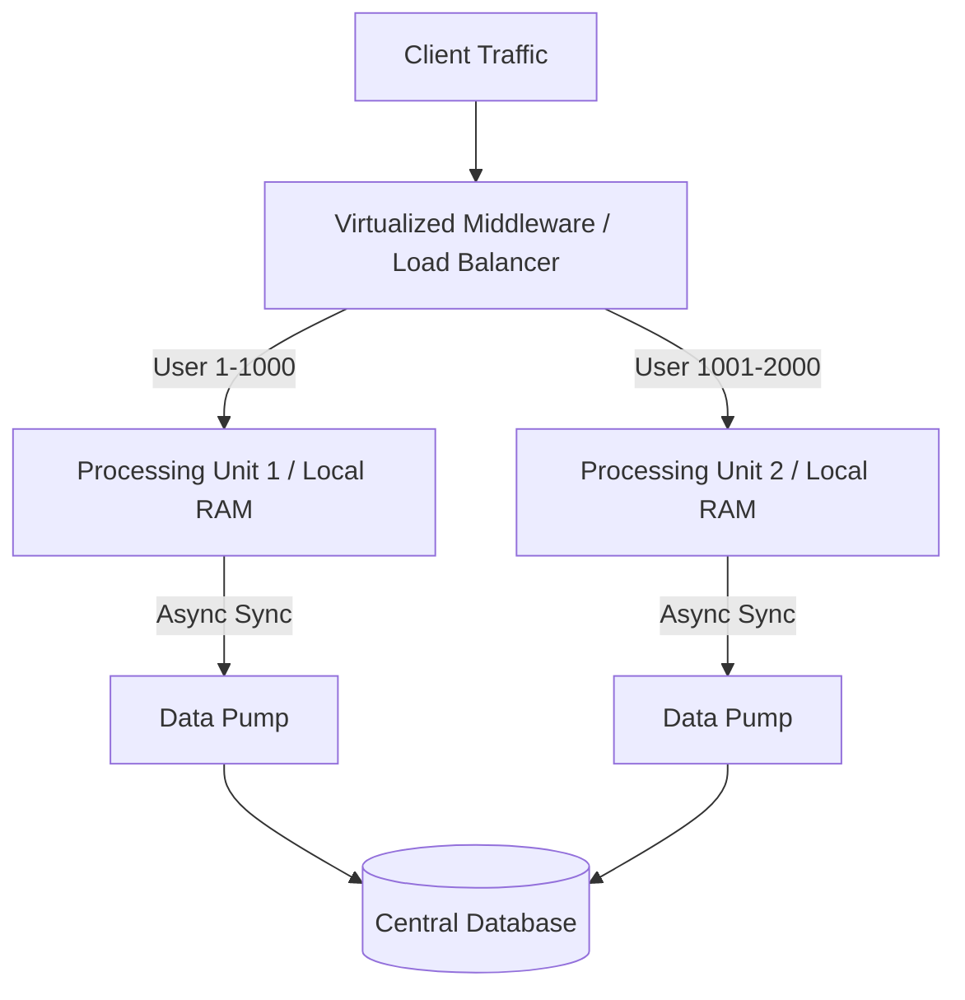

# Space-Based Architecture: Scaling to the Moon with In-Memory Grids
**0. Architectural Vision: Eliminating the Bottleneck**
- **The Database is the Enemy of Scalability.** In traditional systems, the DB is the single point of contention where all threads eventually wait.
- **Space-Based Architecture (SBA) is "Cloud-Sized Shared Memory".** It replicates data across multiple "Processing Units" in-memory, so you never wait for a disk.
- **The Tuple Space.** A shared, distributed memory space where data objects (Tuples) are stored and retrieved.
- **Processing Units (PU).** Self-contained nodes that hold both the logic AND the data partition they need to process.
- **Data Grids (IMDG).** Technologies like **NCache**, **Redis**, or **Hazelcast** that provide the distributed memory backbone.
- **Architect's View.** We use **SBA** for **High-Frequency Trading**, **Online Betting**, and **Massive Multi-player Games**. We accept the cost of complexity to gain **Linear Scalability** (add 10 nodes, get 10x performance).

**1. Foundational Problem: The "Database Locking" Freeze**
- **Real-World Impact:** You are building a "Flash Sale" site. 1,000,000 users try to "Buy" a Limited Edition sneaker at the same time.
- **What breaks?** "The Serializer". Your SQL database has to lock the `Stock` row for every single user. This creates a massive queue. The database CPU hits 100%, and 99.9% of your users see a "Timeout" error.
- **Scale Boundary:** No matter how big you scale your SQL server, the "Law of Diminishing Returns" says you can't go faster than the speed of a single disk lock.
- **Failure Story:** A major sports betting app crashed during the Super Bowl. Their "Odds" service was writing millions of updates to a central SQL cluster. The database went into "Emergency Vacuuming" mode because of the write load, and the entire app went offline for 2 hours. Migrating to **Space-Based Architecture (NCache)** allowed them to process 1,000,000 bets per second entirely in-ram, syncing to the database asynchronously only for long-term storage.

**2. Internal System Mechanics: Data Grids and Hubs**

### The SBA Components
1. **The Processing Unit:** The app code + In-Memory data partition.
2. **The Virtualized Middleware:** Acts as the "Traffic Cop", routing a request for User A to the node that has User A's data in its RAM.
3. **The Data Pump:** Periodically pushes changes from RAM to a persistent database (asynchronously).



**3. Production Engineering in .NET 8 (NCache / Redis)**

### Anti-Pattern: Treating the Space like a Cache
```csharp
// TERRIBLE: Checking if data exists in Cache, then loading from DB.
// In SBA, the 'Space' IS the source of truth. If it's not in the grid, 
// it doesn't exist for the current transaction.
```

### Production-Ready Implementation: Processing Unit logic
```csharp
// 1. Defining the Processing Unit (Partitioned Logic)
public class BetProcessingUnit {
    private readonly IDistributedCache _space; // NCache or Redis
    public BetProcessingUnit(IDistributedCache space) => _space = space;

    public async Task ProcessBet(Bet bet) {
        // 2. Perform transaction ENTIRELY in memory
        var account = await _space.GetAsync<Account>(bet.UserId);
        if (account.Balance >= bet.Amount) {
            account.Balance -= bet.Amount;
            await _space.SetAsync(bet.UserId, account); // Fast write
            
            // 3. Mark for Asynchronous Persistence (Data Pump)
            await _space.EnqueueForPersist(new AccountUpdate(bet.UserId, account));
        }
    }
}
```

**Architecture Strategy:** 
- Use **Partitioning (Sharding)**. Ensure that one specific node is the "Master" for one specific user's logic to avoid distributed locks.
- Implement **Replication**. Every node should have a "Secondary" backup node to prevent data loss if a server crashes.

**4. System Interaction & Flow (ASCII Architecture)**

                ┌──────────────────┐
                │   The Requester  │ (The User / Frontend)
                └────────┬─────────┘
                         │ 1. Business Command (e.g. Place Bet)
         ┌───────────────▼───────────────┐
         │     VIRTUALIZED SPACE HUB     │ (The Intelligent Router)
         │  ┌─────────┐   ┌─────────┐    │
         │  │ Partition│ → │ Consistency│    │
         │  │ Mapper  │   │ Manager │    │
         │  └────┬────┘   └────┬────┘    │
         └───────┼─────────────┼─────────┘
                 │             │ 2. Route to Processing Unit
         ┌───────▼─────────────▼─────────┐
         │       Processing Node         │ (Logic + RAM Data)
         └───────────────┬───────────────┘
                         │ 3. Return Success Instantly
               ┌─────────▼─────────┐
               │  Async DB Write   │
               └───────────────────┘

**5. Strategic Scaling & System Evolution**
- **Horizontal Scaling.** Adding 1,000 more Processing Units to handle a World Cup final. The database doesn't even feel the increased load.
- **Failover.** If Node A dies, the Middleware automatically promotes Node A-Backup to be the primary.
- **Partial Updates.** Using **Entry Processors** (running the code ON the data node) to avoid moving large objects over the network.

**6. Reliability, Observability & Runtime Governance**
- **Key Metrics:**
    - `Space Utilization`: How much RAM is left?
    - `Sync Latency`: How many seconds is the DB behind the RAM?
- **Observability:** Monitor your **NCache** or **Redis Cluster** dashboard for "Hot Spots" (One node doing all the work).

**7. Compromises, Tradeoffs & Alternatives**
- **Cost.** RAM is significantly more expensive than Disk. 
- **Consistency Risks.** If the entire cluster loses power before the "Data Pump" finishes, you lose the last 1-2 seconds of transactions. **Architect's Tip:** Use persistent NVM or Battery-backed RAM for critical financial grids.

**8. Security Posture & Risk Mitigation**
- **Data Encryption in Flight.** Ensure all nodes communicate over TLS, as the "Space" contains the entire company's live state.
- **Role-Based Access.** Preventing the "Reporting" service from modifying Tuples in the "Trading" space.

**9. Technical Edge Cases & System Failure Modes**
- **Split Brain.** Two nodes think they are the "Owner" of a data partition after a network flicker.
    - *Architect's Rule:* Use **Quorum-based Consensus** (Raft/Paxos) in the Middleware.
- **OOM (Out of Memory).** A spike in data volume fills the RAM, causing the processing unit to crash.

**10. Architectural Assessment & Career Progression**
- **Senior:** "We use an in-memory database to handle our high-speed transaction data."
- **Principal:** "Architecture is the **Elimination of Resource Contention**. We leverage **Space-Based Architecture and In-Memory Data Grids** to break the serial dependency of the relational database. We architect for **Computational Proximity**, utilizing **Partitioned Processing Units and Asynchronous Data Pumps** to achieve limitless linear scale with microsecond latencies. For us, state is a **Distributed Commodity** that lives in the fabric of the network, synchronized to persistence only as a chronological audit."
- **Interview Strategy:** Explain why SBA is better than a simple "Cache-Aside" pattern for high-write scenarios. Discuss how to handle a total cluster failure.

**11. Real-World Case Study: Global Air Traffic Control**
**Scenario:** A system tracking 100,000 planes across the globe.
- **The Problem:** Plane positions update every 100ms. If the database lags for even 1 second, it's a safety catastrophe.
- **The Design:** Implemented **SBA**. Each geographical region is a Processing Unit. Plane positions updated in RAM.
- **Result:** Sub-millisecond updates for all air traffic controllers. Even if the SQL database crashes, the planes keep flying because the "Space" is the live reality.

**12. Structural Dependencies & Learning Path**
- **Foundations:** Sharding/Partitioning, In-Memory Databases.
- **Future Steps:** High-Frequency Trading (HFT) patterns, LMAX Disruptor.
- **Integration Points:** NCache, Redis Stack, Hazelcast, GigaSpaces.
