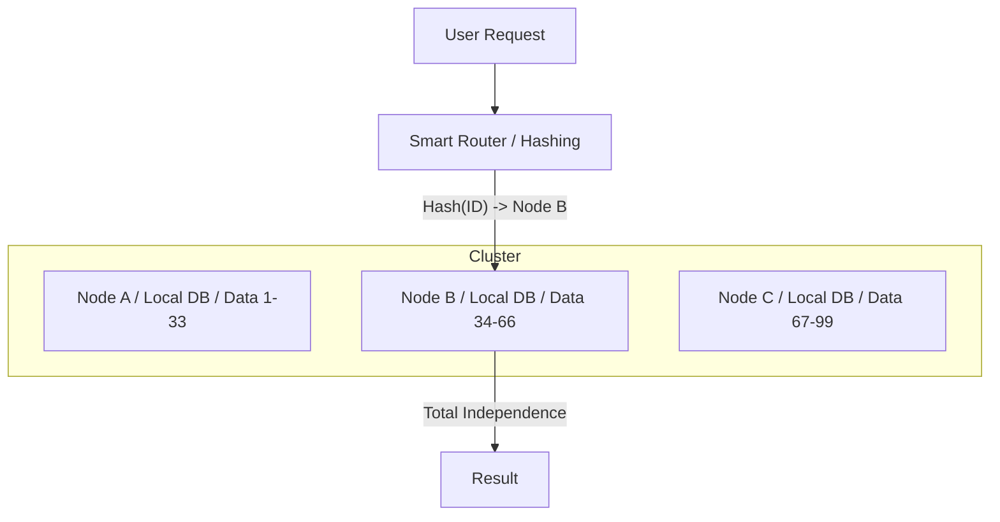

# Shared-Nothing Architecture: The Pursuit of Infinite Scaling
**0. Architectural Vision: Total Independence**
- **Shared-Nothing (SN) is the Architecture of Autonomy.** Every node is self-contained. No node shares a central database, SAN, or memory.
- **Data Partitioning (Sharding).** The state is split across nodes. Node A has User 1-1,000; Node B has User 1,001-2,000.
- **Elimination of Contention.** Since nodes don't share resources, there are no "Global Locks" or "Shared Bus bottlenecks".
- **Fault Isolation.** If Node A crashes, it only affects the data on Node A. The rest of the system (B, C, D) functions at 100% capacity.
- **Horizontal Elasticity.** Adding a new node is as simple as moving a partition of data to it.
- **Architect's View.** We use **Shared-Nothing** for **Internet-Scale Databases (Cassandra)**, **Web Server Farms**, and **Distributed Search Engines**. We understand that while it makes scaling easy, it makes "Global Queries" (e.g., "Sum all user balances") significantly more complex.

**1. Foundational Problem: The "Shared Everything" Serialization**
- **Real-World Impact:** You have 10 Web Servers talking to 1 SQL Server. 
- **What breaks?** "The Scaling Wall". Even if you add 1,000 web servers, they all eventually "Wait" at the SQL Server's door. The SQL Server becomes the **Sequential Bottleneck** for the entire platform.
- **Scale Boundary:** In a "Shared Disk" architecture, the storage network (SAN) eventually hits its maximum bandwidth, regardless of how many servers you have.
- **Failure Story:** A large social media site used a "Shared Memory Cache" (one giant Redis instance). As they grew to 1,000 nodes, the network interface on the Redis server became saturated. Every single web request was waiting for the Redis network pipe to clear. Migrating to a **Shared-Nothing Architecture** (where each node has its own local cache partition) allowed them to scale to 100 million users with 0ms network wait time.

**2. Internal System Mechanics: Sharding and Logic**

### The SN Distribution Model
1. **The Request:** Comes into a stateless Load Balancer.
2. **The Hash/Map:** The Balancer (or a client library) calculates `Hash(UserID) % TotalNodes`.
3. **The Target:** The request is sent to the specific node that OWNS that data.
4. **The Local Exec:** The node performs the logic using ONLY its local CPU, RAM, and Disk.



**3. Production Engineering in .NET 8 (Sharding Implementation)**

### Anti-Pattern: Cross-Node Joins
```csharp
// TERRIBLE: Trying to JOIN data that lives on Node A with data on Node B.
// This requires a 'Melt-and-Move' over the network which is 1,000x slower.
```

### Production-Ready Implementation: Localized Persistence
```csharp
// 1. Defining the Partitioned Storage
public class ShardedUserRepository {
    private readonly string _localConnectionString; // Points to Local SQLite or Volatile DB
    public ShardedUserRepository(string conn) => _localConnectionString = conn;

    public async Task UpdateProfile(User user) {
        // 2. Logic is ALWAYS local. 0% cross-node coordination.
        using var db = new UserDbContext(_localConnectionString);
        db.Users.Update(user);
        await db.SaveChangesAsync();
    }
}

// 3. Smart Routing in the API Gateway
app.MapGet("/user/{id}", (int id, IClusterRouter router) => {
    var node = router.GetTargetNode(id);
    return Results.Redirect($"http://{node.Ip}/api/user/{id}");
});
```

**Architecture Strategy:** 
- Use **Consistent Hashing**. This ensures that if you add a new node, you only have to move a small fraction of data (1/N), rather than re-shuffling everything.
- Implement **Virtual Nodes**. Map one physical server to 100 "Virtual" slots to ensure even data distribution.

**4. System Interaction & Flow (ASCII Architecture)**

                ┌──────────────────┐
                │   The Router     │ (The Discovery Layer)
                └────────┬─────────┘
                         │ 1. Key-Based Partition Check
         ┌───────────────▼───────────────┐
         │      SHARED-NOTHING CLUSTER   │ (The Island Mesh)
         │  ┌─────────┐   ┌─────────┐    │
         │  │ Node A  │   │ Node B  │    │
         │  │ (CPU/DB)│   │ (CPU/DB)│    │
         │  └────┬────┘   └────┬────┘    │
         └───────┼─────────────┼─────────┘
                 │             │ 2. Local-Only Context
         ┌───────▼─────────────▼─────────┐
         │      Persistent Storage       │ (Local SSD / NVMe)
         └───────────────┬───────────────┘
                         │ 3. Return Final Result
               ┌─────────▼─────────┐
               │    Scale Out OK   │
               └───────────────────┘

**5. Strategic Scaling & System Evolution**
- **Elastic Scale.** When traffic triples, you spin up Node D and Node E. The Smart Router starts sending new users to them instantly.
- **Independent Maintenance.** You can reboot Node A for an OS update while the rest of the 999 nodes keep serving the other 99.9% of users.
- **Global Deployment.** Deploying Node A in New York and Node B in Tokyo. They never need to talk to each other to process a user in their own region.

**6. Reliability, Observability & Runtime Governance**
- **Key Metrics:**
    - `Data Distribution Skew`: Is Node A holding 80% of the data while Node B is empty?
    - `Cross-Node Request Percentage`: (Should be 0%).
- **Observability:** Monitor the **IOPS and CPU** per node. In a Shared-Nothing system, these charts should look identical across the whole cluster.

**7. Compromises, Tradeoffs & Alternatives**
- **Global Queries.** If you need to know "The oldest user in the whole system", you have to query ALL nodes and aggregate the result (Scatter-Gather).
- **Data Integrity.** You can't have a "Foreign Key" from a table on Node A to a table on Node B.

**8. Security Posture & Risk Mitigation**
- **Blast Radius.** If Node A is compromised, the attacker only has access to 1/Nth of your users' data.
- **Internal Firewalling.** Even though the nodes are in a cluster, they should communicate over a private, encrypted network with strict IP whitelisting.

**9. Technical Edge Cases & System Failure Modes**
- **Hot Spots.** A celebrity user like "Cristiano Ronaldo" gets 1,000,000x more traffic than a normal user. The node holding his data will be crushed.
    - *Architect's Rule:* Use **Replication** or **Caching Bridges** for "Special" high-traffic partitions.
- **Resharding Pain.** Moving 10TB of data from Node A to a new Node D while the system is live.

**10. Architectural Assessment & Career Progression**
- **Senior:** "We shard our database so that each server only handles a portion of the users."
- **Principal:** "Architecture is the **Optimization of Independence**. We leverage **Shared-Nothing Patterns** to eliminate the **Coordination Tax** inherent in centralized systems. We architecturalize for **Unbounded Scalability**, utilizing **Consistent Hashing and Autonomous Local Persistence** to ensure that our performance is a linear function of our node count. For us, a shared resource is a **Hazard to be Avoided**, and true availability is built on the total isolation of state and compute."
- **Interview Strategy:** Explain how "Shared-Nothing" enables "Infinite Scalability". Discuss the challenges of "Scatter-Gather" queries.

**11. Real-World Case Study: Multi-Tenant SaaS**
**Scenario:** A company like Slack or Discord.
- **The Problem:** 10 million organizations. Putting them all in one SQL DB caused massive performance issues during "Login" peaks.
- **The Design:** Implemented **Shared-Nothing**. Each "Workspace / Server" has a dedicated database partition on a specific node.
- **Result:** Slack scales to millions of simultaneous users. Even if a major data center fails, only the users mapped to those specific nodes are affected; everyone else keeps chatting.

**12. Structural Dependencies & Learning Path**
- **Foundations:** Hashing, TCP/IP, Database Sharding.
- **Future Steps:** Consensus algorithms (for router state), Global Load Balancing (GSLB).
- **Integration Points:** Cassandra, MongoDB (Sharded), ElasticSearch cluster.
