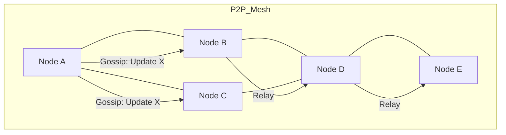

# Peer-to-Peer (P2P) Architecture: The Power of Decentralized Networks
============================================================
0. Architectural Vision: The End of the Center
============================================================
- **P2P is the Architecture of Equality.** Every node is both a client (Requester) and a server (Provider). There is no central point of failure or control.
- **Decentralization.** The network is formed by nodes connecting directly to each other (Mesh).
- **Gossip Protocols (Epidemic Algorithms).** A mechanism for nodes to spread information like a virus by telling a few neighbors, who tell their neighbors, and so on.
- **DHT (Distributed Hash Table).** A way to find data in a network without a central index (e.g., Kademlia).
- **Resilience.** If 50% of the nodes leave the network, the other 50% keep functioning perfectly.
- **Architect's View.** We use **P2P** for **Blockchain (Bitcoin/Ethereum)**, **File Sharing (BitTorrent)**, **Global CDNs**, and **Internal Cluster Discovery**. We choose P2P when the scale is too massive for any single server group to manage, or when censorship-resistance and total uptime are the primary goals.

============================================================
1. Foundational Problem: The "Central Hub" Vulnerability
============================================================
- **Real-World Impact:** You have a "Discovery Service" where all your 10,000 microservices register their IP addresses.
- **What breaks?** "The Single Point of Failure". If that discovery service goes down, your entire multi-billion dollar platform is dead. 10,000 services "Go Blind" and can't find each other.
- **Scale Boundary:** A central server eventually becomes a bottleneck for "Updates". If 1,000,000 IoT sensors try to ping a central server every second, the network cards will melt.
- **Failure Story:** A major VoIP provider used a central database to track which users were online. A hardware failure in that database took the entire global phone network offline for 24 hours. Migrating to **P2P (via DHT)** allowed users to find each other directly, ensuring that as long as two people are on the internet, they can call each other even if the company's main servers are on fire.

============================================================
2. Internal System Mechanics: Gossip and DHTs
============================================================

### The P2P Interaction Model
1. **Joining:** Node A connects to one "Seed" node to find the network.
2. **Gossip:** Node A tells its neighbors "I am Node A, and I have Data X".
3. **Discovery (DHT):** To find Data Y, Node A asks the nodes "Closest" to the hash of Y in the virtual address space.



============================================================
3. Production Engineering in .NET 8 (Gossip Implementation)
============================================================

### Anti-Pattern: Broadcasting to Everyone
```csharp
// TERRIBLE: Every update is sent to all 10,000 nodes.
// This causes a 'Network Storm' that crashes the switches. 
// Use 'Gossip' where you only talk to 3-5 random peers.
```

### Production-Ready Implementation: Simple Gossip Node
```csharp
// 1. Defining the Mesh Node
public class GossipNode {
    private readonly List<string> _peers = new();
    private readonly HashSet<Guid> _seenMessages = new();

    public async Task SpreadFact(Fact fact) {
        if (_seenMessages.Contains(fact.Id)) return;
        _seenMessages.Add(fact.Id);

        // 2. Select a small 'Fanout' (e.g. 3 random peers)
        var targets = _peers.OrderBy(x => Guid.NewGuid()).Take(3);

        foreach (var peer in targets) {
            await _client.PostToPeer(peer, fact); // Async fire and forget
        }
    }
}
```

**Architecture Strategy:** 
- Use **SWIM (Scalable Weakly-consistent Infection-style Process Group Membership)** protocol to manage node health and discovery in a cluster.
- Implement **Anti-Entropy** to periodically sync full state between two random nodes to ensure no data was missed during the gossip phase.

============================================================
4. System Interaction & Flow (ASCII Architecture)
============================================================

                ┌──────────────────┐
                │   Node Entry     │ (Bootstrap / Seed)
                └────────┬─────────┘
                         │ 1. Join Mesh
         ┌───────────────▼───────────────┐
         │       THE GOSSIP LAYER        │ (Infection Logic)
         │  ┌─────────┐   ┌─────────┐    │
         │  │ Peer    │ → │ Message │    │
         │  │ Manager │   │ Buffer  │    │
         │  └────┬────┘   └────┬────┘    │
         └───────┼─────────────┼─────────┘
                 │             │ 2. Fan-out to 3 Random Neighbors
         ┌───────▼─────────────▼─────────┐
         │       The Mesh Fabric         │ (Global P2P Network)
         └───────────────┬───────────────┘
                         │ 3. Logarithmically Converged State
               ┌─────────▼─────────┐
               │  Total Resilience │
               └───────────────────┘

============================================================
5. Strategic Scaling & System Evolution
============================================================
- **Scale with Usage.** Every time a user joins, the network gets MORE powerful, not more crowded (Unlike Client-Server).
- **NAT Traversal.** Using **STUN/TURN** to allow nodes behind home routers to talk to each other without port forwarding.
- **Overlay Networks.** Building a specialized P2P network (e.g., for Video Streaming) on top of the generic internet (IP).

============================================================
6. Reliability, Observability & Runtime Governance
============================================================
- **Key Metrics:**
    - `Convergence Time`: How many seconds for a "Fact" to reach 99.9% of nodes?
    - `Peer Count`: Is our mesh healthy?
- **Observability:** Use **Visual Mesh Graphers** to identify "Islands" where nodes are talking to each other but are disconnected from the main network.

============================================================
7. Compromises, Tradeoffs & Alternatives
============================================================
- **Eventual Consistency.** "News" takes a few seconds to travel. Two nodes might have different versions of the world for a short time.
- **Network Overhead.** Every node is constantly talking to neighbors just to say "I'm still here" (Heartbeats).

============================================================
8. Security Posture & Risk Mitigation
============================================================
- **Sybil Attacks.** An attacker creates 1,000 fake nodes to "Outvote" the real nodes or poison the gossip.
    - *Architect's Rule:* Use **Proof-of-Work** or **Stake/Reputation** to make joining the mesh "Expensive".
- **Eclipse Attacks.** Surrounding a specific node with malicious peers to isolate it from the real network.

============================================================
9. Technical Edge Cases & System Failure Modes
============================================================
- **Zombie Clusters.** A group of nodes that is disconnected from the internet but keeps gossiping internally, creating a "Parallel Reality".
- **Message Echo.** A message that never dies and keeps circulating the mesh forever because of a bug in the "Seen Message" logic.

============================================================
10. Architectural Assessment & Career Progression
============================================================
- **Senior:** "We use a gossip protocol so our cluster nodes can find each other automatically."
- **Principal:** "Architecture is the **Democratization of State**. We leverage **Peer-to-Peer Patterns and Gossip Protocols** to build systems that are immune to central authority and environmental failure. We architecturalize for **Logarithmic Dissemination**, utilizing **DHTs and Anti-Entropy Mechanisms** to ensure global data convergence without the bottleneck of a coordinator. For us, the center is a **Liability**, and the mesh is the **Final Frontier of Scalability and Sovereignty**."
- **Interview Strategy:** Explain how BitTorrent works. Discuss why Gossip is called an "Epidemic Algorithm".

============================================================
11. Real-World Case Study: Akka.NET Cluster Discovery
============================================================
**Scenario:** A massive online game with 1,000 servers.
- **The Problem:** When a server starts, it needs to know which other servers are currently "Up" to balance the player load.
- **The Design:** Implemented **P2P Gossip (SWIM protocol)**. Each server pings 3 random servers. If one is down, it tells others.
- **Result:** Convergence in < 2 seconds for a cluster of 1,000 nodes. No single "Master" node required; the cluster is self-healing and fully decentralized.

============================================================
12. Structural Dependencies & Learning Path
============================================================
- **Foundations:** Graph Theory, Networking (UDP/TCP).
- **Future Steps:** IPFS (InterPlanetary File System), Libp2p.
- **Integration Points:** Akka.NET Clustering, Microsoft.Orleans, Libp2p.Net.
