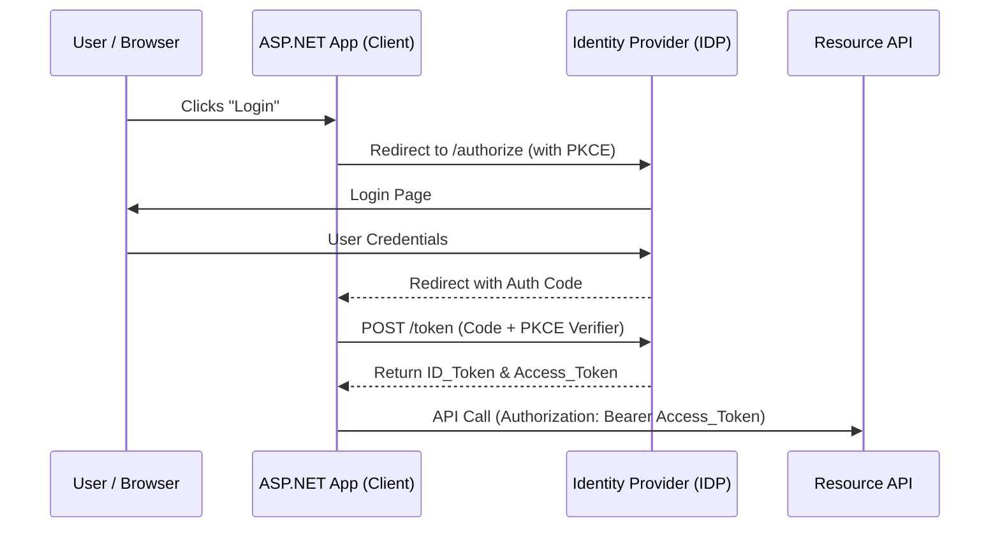

# OAuth2 and OpenID Connect (OIDC): The Foundation of Modern Identity
============================================================
0. Architectural Vision: The Delegation of Trust
============================================================
- **OAuth2 is about Authorization.** It's the "Valet Key" for the web. It allows an app to act on a user's behalf without knowing their password.
- **OIDC is about Authentication.** Built on top of OAuth2, it adds an **ID Token** to tell the app *who* the user is (Identity).
- **The 3-Party Dance.** The Client (App), the Resource Owner (User), and the Authorization Server (Identity Provider like Okta/Auth0/AAD).
- **Grant Types.** Different "Ways" to get a token based on the scenario:
    - **Authorization Code + PKCE:** For Web/Mobile apps (The Gold Standard).
    - **Client Credentials:** For Machine-to-Machine communication (No User).
- **Architect's View.** We move to OAuth2/OIDC to **De-centralize Identity**. We don't want every microservice to store passwords. We want a central, hardened "Authority" that issues signed claims.

============================================================
1. Foundational Problem: The "Password Anti-Pattern"
============================================================
- **Real-World Impact:** You are building a "Trip Planner" that needs to read the user's "Google Calendar".
- **What breaks?** "The Security". If you ask the user for their Google password, you now have the power to delete their emails, reset their drive, and lock them out. If *your* database is hacked, the user's *Google* account is compromised.
- **Scale Boundary:** In a microservices mesh, if every service has to check the "Users" table in the SQL DB for every request, the DB will become the bottleneck and the services are tightly coupled to the identity schema.
- **Failure Story:** A major fitness app asked for users' Facebook passwords to "Find Friends". When the Fitness app was breached, 10 million Facebook accounts were taken over because users reused passwords. Migrating to **OAuth2** allowed users to simply click "Yes, let this app see my friends", giving the app a limited-use token without ever sharing the password.

============================================================
2. Internal System Mechanics: Proving Identity
============================================================

### The OIDC Flow (Authorization Code + PKCE)
1. **Authorize:** App sends user to IDP. User logs in.
2. **Code:** IDP sends an "Authorization Code" back to the App.
3. **Exchange:** App sends the Code + a Secret (PKCE) to the IDP's `/token` endpoint.
4. **Tokens:** IDP returns an **Access Token** (for APIs) and an **ID Token** (for the App).



============================================================
3. Production Engineering in .NET 8 (IdentityModel / OpenIddict)
============================================================

### Anti-Pattern: Manual JWT Parsing
```csharp
// TERRIBLE: Manually reading the 'Authorization' header 
// and trying to decode the string yourself.
// You will miss critical validation steps like Signature, Audience, and Expiry.
```

### Production-Ready Implementation: OIDC Client Setup
```csharp
// 1. Configure OIDC in the Web Client
builder.Services.AddAuthentication(options => {
    options.DefaultScheme = "Cookies";
    options.DefaultChallengeScheme = "oidc";
})
.AddCookie("Cookies")
.AddOpenIdConnect("oidc", options => {
    options.Authority = "https://demo.duendesoftware.com";
    options.ClientId = "interactive.confidential";
    options.ClientSecret = "secret";
    options.ResponseType = "code"; // Authorization Code Flow
    
    options.Scope.Add("openid");
    options.Scope.Add("profile");
    options.SaveTokens = true; // Store AccessToken in the cookie
});

// 2. Protecting an endpoint
[Authorize]
public IActionResult Dashboard() => View();
```

**Architecture Strategy:** 
- Always use **PKCE (Proof Key for Code Exchange)** for all flows, even on the server, to prevent "Code Interception" attacks.
- Implement **Backchannel Logout** to ensure that when a user logs out of the IDP, all their active microservice sessions are invalidated.

============================================================
4. System Interaction & Flow (ASCII Architecture)
============================================================

                ┌──────────────────┐
                │   The Trust Root │ (Identity Provider)
                └────────┬─────────+
                         │ 1. Metadata (.well-known)
         ┌───────────────▼───────────────┐
         │      THE APPLICATION          │ (The Client)
         │  ┌─────────┐   ┌─────────┐    │
         │  │ Auth    │ → │ Token   │    │
         │  │ Handler │   │ Store   │    │
         │  └────┬────┘   └────┬────┘    │
         └───────┼─────────────┼─────────┘
                 │             │ 2. Bearer Token Push
         ┌───────▼─────────────▼─────────┐
         │       The Resource API        │ (The Guardian)
         └───────────────┬───────────────┘
                         │ 3. Locally Verify Signature
               ┌─────────▼─────────┐
               │    Secure Action  │
               └───────────────────┘

============================================================
5. Strategic Scaling & System Evolution
============================================================
- **Federated Identity.** Allowing users to log in with "Google" or "LinkedIn" while still using your internal system for permissions.
- **Microservice Auth. Each service is a "Resource Server" that validates the JWT locally using the Public Key from the IDP. Zero calls to the IDP during the request.
- **Scoped Access.** Defining granular scopes like `orders.read`, `orders.write`, and `admin.full` to follow the **Principle of Least Privilege**.

============================================================
6. Reliability, Observability & Runtime Governance
============================================================
- **Key Metrics:**
    - `Auth Failure Rate`: Are we being brute-forced?
    - `Token Refresh Latency`: Is the IDP slow?
- **Observability:** Log the `sub` (Subject ID) from the claims in every log entry (using Serilog) to correlate actions to specific users across the entire system.

============================================================
7. Compromises, Tradeoffs & Alternatives
============================================================
- **Complexity.** Setting up a full OIDC provider is significantly more work than a simple "Username/Password" table.
- **Vendor Lock-in.** Migrating from one IDP (e.g. Auth0) to another (e.g. Azure AD) can be painful due to custom claims and integrations.

============================================================
8. Security Posture & Risk Mitigation
============================================================
- **HTTPS ONLY.** OAuth2/OIDC is NOT secure over HTTP. Tokens will be stolen in plain text.
- **Redirect URI Whitelisting.** Ensuring that the "Code" can only be sent to your official, audited domain.

============================================================
9. Technical Edge Cases & System Failure Modes
============================================================
- **Clock Skew.** The IDP's clock is 5 minutes ahead of the API's clock. The API rejects the token because it's technically "from the future".
    - *Architect's Rule:* Implement a 5-minute `ClockSkew` tolerance in the JWT validation options.
- **The "Heavy JWT".** Putting 50KB of user data into a token. This header is sent on every single request, killing bandwidth and possibly exceeding header size limits on proxies like Nginx.

============================================================
10. Architectural Assessment & Career Progression
============================================================
- **Senior:** "We use OAuth2 for authorization and OIDC so users can log in once and access all our apps (SSO)."
- **Principal:** "Architecture is the **Standardization of Sovereign Trust**. We leverage **OIDC and Claims-Based Identities** to decouple our system's logic from the mechanics of credential management. We architecturalize for **Credential Agnostic Environments**, utilizing **Asymmetric Signatures and PKCE-Hardened Flows** to ensure that transit is secure and identity is immutable across the distributed mesh. For us, a token is not just a string; it is a **Cryptographically Verified Fact** that drives our entire authorization plane."
- **Interview Strategy:** Explain the difference between `id_token` and `access_token`. Describe why OAuth2 is "Authorization" and OIDC is "Authentication".

============================================================
11. Real-World Case Study: Global Banking Portal
============================================================
**Scenario:** A bank with 50 different "Legacy Portals" (Mortgages, Credit Cards, Savings).
- **The Problem:** The user has 5 different usernames. The bank wants a single "Login" for everything.
- **The Design:** Implemented an **OIDC Authority (IdentityServer / Duende)**. All 50 apps migrated to use OIDC.
- **Result:** Single Sign-On (SSO) for 10 million users. The bank increased security by enforcing MFA (Multi-Factor Auth) in one central place instead of 50 different apps.

============================================================
12. Structural Dependencies & Learning Path
============================================================
- **Foundations:** JWTs, HTTPS, Public/Private Key Encryption.
- **Future Steps:** CIBA (Client Initiated Backchannel Authentication), FAPI (Financial-grade API).
- **Integration Points:** Duende IdentityServer, OpenIddict, Auth0, Azure AD B2C.
