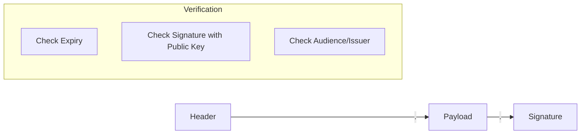

# JWT and Token Management: The Mechanics of Stateless Security
**0. Architectural Vision: The Portable Identity**
- **JWT (JSON Web Token) is a "Claim-Based Passport".** It's a self-contained, digitally signed object that carries the user's identity across the network.
- **Statelessness.** The API doesn't need to look up a session table. It just verifies the signature and trusts the "Claims" (e.g., `role: admin`).
- **Access Tokens (Short-lived).** Used to access resources. Usually expires in 15-60 minutes to minimize risk if stolen.
- **Refresh Tokens (Long-lived).** Used to get a new Access Token without the user logging in again. Stored securely (HttpOnly cookie).
- **Revocation.** The "Kill Switch". If a user logs out or a device is stolen, you must invalidate the tokens before they naturally expire.
- **Architect's View.** We use **JWTs** to enable **Massive Scalability** (no shared session state) and **Microservice Autonomy**. We focus on **Security Hygiene**: Rotate keys, use short lifetimes, and implement a robust revocation strategy.

**1. Foundational Problem: The "Session Database" Bottleneck**
- **Real-World Impact:** You have 1 million online users. Every single API request requires a call to a central "Sessions" table in Redis or SQL.
- **What breaks?** "The Scaling". As your traffic grows, the session database becomes the single point of contention and failure. If the session DB is slow, the *whole app* is slow.
- **Scale Boundary:** In a globally distributed system (e.g., users in NY and London), a central session DB adds 100ms+ latency to every single click because of the "Network Trip" across the ocean.
- **Failure Story:** A major e-commerce site used SQL sessions. During Black Friday, the SQL server locked up under the load of 500,000 simultaneous session lookups. No one could buy anything because no one could "Log in". Migrating to **JWTs (Stateless)** allowed them to verify users locally in micro-seconds, scaling to 5 million users with 0ms database overhead.

**2. Internal System Mechanics: Anatomy and Expiry**

### The JWT Structure
1. **Header:** Algorithm & Type (e.g., RS256).
2. **Payload:** The Claims (sub, exp, iat, roles).
3. **Signature:** `HMACSHA256(Base64(Header) + "." + Base64(Payload), Secret)`.



### The Refresh Flow: "Sliding Window"
1. **App Sends:** Access Token (Expired) + Refresh Token.
2. **IDP Verifies:** Is Refresh Token valid? Is it revoked?
3. **IDP Returns:** New Access Token (15m) + New Refresh Token (Optional - Token Rotation).

**3. Production Engineering in .NET 8 (JwtBearer)**

### Anti-Pattern: Sending JWTs in the URL
```csharp
// TERRIBLE: Passing tokens in Query Params like ?token=xyz.
// Tokens will stay in browser history, server logs, and proxy traces. 
// Always use the 'Authorization: Bearer' header.
```

### Production-Ready Implementation: JWT Validation
```csharp
// 1. Configure JWT Authentication in the API
builder.Services.AddAuthentication(JwtBearerDefaults.AuthenticationScheme)
    .AddJwtBearer(options => {
        options.Authority = "https://identity.company.com";
        options.Audience = "my-api";
        
        options.TokenValidationParameters = new TokenValidationParameters {
            ValidateIssuer = true,
            ValidateAudience = true,
            ValidateLifetime = true,
            ValidateIssuerSigningKey = true,
            ClockSkew = TimeSpan.Zero // Strict timing
        };
    });

// 2. Refresh Token Storage (Database schema)
public class RefreshToken {
    public string Token { get; set; }
    public DateTime Expiry { get; set; }
    public bool IsRevoked { get; set; }
    public Guid UserId { get; set; }
}
```

**Architecture Strategy:** 
- Implement **Token Rotation**. Every time a Refresh Token is used, invalidate it and issue a new one. This detects "Replay Attacks" if both a hacker and the real user try use the same stolen token.
- Use **Asymmetric Signing (RS256/ES256)**. The IDP holds the Private Key; the APIs only hold the Public Key.

**4. System Interaction & Flow (ASCII Architecture)**

                ┌──────────────────┐
                │   The Client     │ (Mobile / Web)
                └────────┬─────────┘
                         │ 1. API Request (Bearer Token)
         ┌───────────────▼───────────────┐
         │     THE RESOURCE SERVER       │ (The Guardian - ASP.NET Core)
         │  ┌─────────┐   ┌─────────┐    │
         │  │ RSA     │ → │ Claim   │    │
         │  │ Verify  │   │ Parser  │    │
         │  └────┬────┘   └────┬────┘    │
         └───────┼─────────────┼─────────┘
                 │             │ 2. Is Expired? (True -> 401)
         ┌───────▼─────────────▼─────────┐
         │       The Token Endpoint      │ (Refresher)
         └───────────────┬───────────────┘
                         │ 3. Check DB for Revocation
               ┌─────────▼─────────┐
               │  New Access Token │
               └───────────────────┘

**5. Strategic Scaling & System Evolution**
- **Global Token Validation.** Using **CDNs** (like Cloudflare Workers) to validate JWT signatures at the "Edge" before the request even reaches your infrastructure.
- **Reference Tokens.** Instead of a self-contained JWT, the IDP issues a random string (Handle). The API must call the IDP to "Introspect" (Validate) it. **Architect's Tip:** Use JWTs for scalability, use Reference Tokens for high-security internal apps that need instant revocation.

**6. Reliability, Observability & Runtime Governance**
- **Key Metrics:**
    - `Revocation Check Latency`: Time taken to check the blocked-token list.
    - `Token Reuse Alarms`: Detect if a Refresh Token was used twice.
- **Observability:** Track the `jti` (JWT ID) to ensure specific tokens aren't being "Replayed" across different regions.

**7. Compromises, Tradeoffs & Alternatives**
- **Instant Revocation.** Statelessness makes it hard to "Kick a user out" immediately. 
    - *Architect's Tip:* Keep access tokens very short (5m) or implement a **Distributed Blacklist** (Redis) that APIs check once a minute.
- **Payload Size.** Every claim added increases the size of every request.

**8. Security Posture & Risk Mitigation**
- **Algorithm Hardening.** Reject tokens that use `alg: none`. This is a classic "JWT Header Injection" attack.
- **Secret Management.** Never hardcode signing keys. Use **Azure Key Vault** or **AWS KMS**.

**9. Technical Edge Cases & System Failure Modes**
- **The "Infinite Refresh" Bug.** Logged-out users can still get new tokens because the Refresh Token wasn't invalidated in the DB.
- **Header Limits.** If a user has 500 roles/claims, the JWT might exceed the 8KB header limit of typical Load Balancers, causing random 400 errors.

**10. Architectural Assessment & Career Progression**
- **Senior:** "We use JWTs so our web servers don't need to share a session database."
- **Principal:** "Architecture is the **Balancing of State and Trust**. We leverage **JSON Web Tokens** to achieve **Horizontal Scalability**, while utilizing **Refresh Token Rotation and Distributed Revocation Lists** to mitigate the risks of statelessness. We architect for **Cryptographic Autonomy**, ensuring that our resource servers can verify identity at the edge without central coordination. For us, a token is a **Disposable Proof of Intent**, designed for high-velocity, secure interaction."
- **Interview Strategy:** Explain how you would implement "Instant Logout" in a JWT-based system. Compare "Self-Contained JWT" vs "Reference Token".

**11. Real-World Case Study: Global Gaming Platform**
**Scenario:** A game with 10 million mobile players.
- **The Problem:** Mobile devices lose signal constantly. Logins must be fast and shouldn't require a DB trip every time a player enters a new zone.
- **The Design:** Implemented **JWTs for Zones**. When a player moves, the new zone server validates the JWT locally in < 1ms.
- **Result:** $50,000/month saved in database scaling costs. Player latency dropped by 30% during zone transitions.

**12. Structural Dependencies & Learning Path**
- **Foundations:** Base64 encoding, Cryptographic hashes.
- **Future Steps:** PASETO (Platform-Agnostic Security Tokens), DPoP (Demonstrating Proof-of-Possession).
- **Integration Points:** Microsoft.AspNetCore.Authentication.JwtBearer, System.IdentityModel.Tokens.Jwt.
