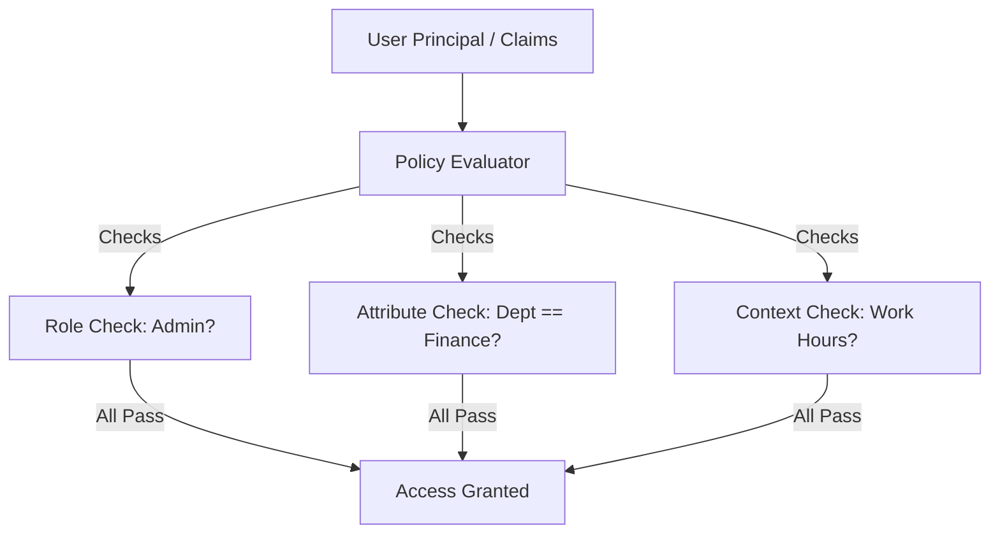

# RBAC and ABAC: The Evolution of Access Control
**0. Architectural Vision: The Granularity of Permission**
- **RBAC (Role-Based Access Control).** "What are you?" (Admin, Editor, Viewer). Simple, static, easy to understand.
- **ABAC (Attribute-Based Access Control).** "Who are you, Where are you, and What are you trying to touch?" Dynamic, context-aware permissions.
- **Policy-Based Authorization.** A modern .NET approach that combines Roles and Attributes into reusable, testable logic.
- **Claims-Based Identity.** The "Badge" you carry. `role: Admin` is a claim; `Level: 5` is a claim; `Department: Finance` is a claim.
- **Architect's View.** We move from **RBAC** to **ABAC** when the business logic becomes "Fine-grained" (e.g., "A Manager can only see reports from *their own* department during *business hours*"). We use **ASP.NET Core Authorization Policies** as the bridge to bridge both worlds.

**1. Foundational Problem: The "Role Explosion"**
- **Real-World Impact:** You start with `Admin` and `User`. Then you need `DepartmentManager`. Then `FinanceManager`. Then `US_FinanceManager`. 
- **What breaks?** "The Code". Your code ends up with `[Authorize(Roles = "Admin, FinanceManager, US_FinanceManager")]`. If a new role is added, you have to find and update 50 different controllers.
- **Scale Boundary:** In a global corporation, you cannot have 1,000 roles in one dropdown. It's unmanageable for the HR admins.
- **Failure Story:** A healthcare system used roles to control access to patient records. Eventually, they had 5,000 roles (one for every possible clinic combination). Doctors complained they couldn't see their own patients because they weren't in the specific "Clinic B-Tuesday" role. Migrating to **ABAC** (Policy: "Can see record IF DoctorID == RecordID") reduced the roles from 5,000 to 5, simplifying the entire system and eliminating security gaps.

**2. Internal System Mechanics: Policies and Requirements**

### The Authorization Pipeline
1. **The Request:** Comes into an endpoint with a `User` principal.
2. **The Evaluator:** Looks at the defined `Policy` for that endpoint.
3. **The Handler:** Runs logic to see if the User's `Claims` meet the `Requirement` (e.g., "Is the User > 18 years old?").



**3. Production Engineering in .NET 8 (Authorization Policies)**

### Anti-Pattern: Hardcoded Role Checks
```csharp
// TERRIBLE: Putting business rules inside 'if' statements 
// in every controller method.
if (!User.IsInRole("Admin") && user.Dept != "Finance") {
    return Forbid();
}
```

### Production-Ready Implementation: Policy-Based ABAC
```csharp
// 1. Define the Policy in Program.cs
builder.Services.AddAuthorization(options => {
    options.AddPolicy("ManagerOnly", policy => 
        policy.RequireRole("Manager")
              .RequireClaim("Department", "Engineering")
              .AddRequirements(new SeniorityRequirement(5)));
});

// 2. The Custom Handler (The Logic)
public class SeniorityHandler : AuthorizationHandler<SeniorityRequirement> {
    protected override Task HandleRequirementAsync(
        AuthorizationHandlerContext context, SeniorityRequirement requirement) {
        
        var level = int.Parse(context.User.FindFirst("Level")?.Value ?? "0");
        if (level >= requirement.MinYears) {
            context.Succeed(requirement);
        }
        return Task.CompletedTask;
    }
}

// 3. Applying the Policy
[Authorize(Policy = "ManagerOnly")]
public IActionResult SecurePortal() => View();
```

**Architecture Strategy:** 
- Use **IAuthorizationService** directly in your code for "Resource-Based Authorization" (e.g., "Can THIS user edit THIS specific Document ID?").
- Implement a **Permission Provider** that loads a user's granular permissions from a DB and adds them as Claims during the login process.

**4. System Interaction & Flow (ASCII Architecture)**

                 ┌──────────────────┐
                 │   The Identity   │ (JWT / Cookie)
                 └────────┬─────────┘
                          │ 1. Carry Claims (Sub, Dept, Rank)
          ┌───────────────▼───────────────┐
          │      AUTHORIZATION ENGINE     │ (The Judge)
          │  ┌─────────┐   ┌─────────┐    │
          │  │ Policy  │ → │ Logic   │    │
          │  │ Registry│   │ Handlers│    │
          │  └────┬────┘   └────┬────┘    │
          └───────┼─────────────┼─────────┘
                  │             │ 2. Combine Roles + Attributes
          ┌───────▼─────────────▼─────────┐
          │       The Controller / API    │ (The Guard)
          └───────────────┬───────────────┘
                          │ 3. Grant / Deny (403)
                ┌─────────▼─────────┐
                │   Safe Execution  │
                └───────────────────┘

**5. Strategic Scaling & System Evolution**
- **Dynamic Policy Reloading.** Storing policy rules in a database (JSON) and updating the handlers at runtime without a redeploy.
- **Microservice Authorization.** Passing the "Claims" in the JWT, so the microservice doesn't need to know the "Role" logic; it just checks if the `can_edit_orders` claim is present.
- **Externalized Auth (OPA).** Using **Open Policy Agent (OPA)** to centralize authorization logic across multiple languages (.NET, Java, Go).

**6. Reliability, Observability & Runtime Governance**
- **Key Metrics:**
    - `Auth Failure Frequency`: Identifying "Forbidden" spikes.
    - `Policy Execution Time`: Ensure complex logic handlers aren't slow.
- **Observability:** Log the *reason* for an authorization failure (e.g., "Failed SeniorityRequirement") to help debug customer support tickets.

**7. Compromises, Tradeoffs & Alternatives**
- **Complexity.** ABAC is much harder to test and audit than a simple "Admin" role list.
- **Payload Bloat.** If a user has 100 permissions, your JWT becomes massive. **Architect's Tip:** Use **Bitmaps** or **Permission Codes** (e.g., `perms: "10110"`) to save space.

**8. Security Posture & Risk Mitigation**
- **Fail-Closed.** Always ensure that the default state is "Access Denied". A bug in a handler should result in a 403, not a 200.
- **Side Effects.** Authorization handlers should be "Pure" (Read-only). Never modify data or send emails inside a permission check.

**9. Technical Edge Cases & System Failure Modes**
- **The "Missing Claim".** A user logs in, but their "Department" claim is missing. The policy fails, and the user is locked out.
- **Performance Leak.** A handler that calls a database inside the loop of 100 authorization checks, causing a "N+1" performance disaster in the security layer.

**10. Architectural Assessment & Career Progression**
- **Senior:** "We use Policy-based authorization to combine roles and custom logic."
- **Principal:** "Architecture is the **Formalization of Entitlement**. We leverage **ABAC and Policy-Based Evaluators** to decouple our business constraints from our identity provider. We architect for **Context-Aware Sovereignty**, utilizing **Immutable Claims and Stateless Fact-Checking** to ensure that every request is validated against dynamic, temporal, and spatial attributes. For us, a permission is not a static flag, but a **Computed Result of Enterprise Policy**."
- **Interview Strategy:** Compare RBAC and ABAC. Explain how you would implement "Multi-tenant Authorization" (e.g., "Access to Tenant A but not Tenant B").

**11. Real-World Case Study: Enterprise Document Management**
**Scenario:** A legal firm with 1 million documents.
- **The Problem:** Rules are insane: "A Junior Associate can read files from Case 123 IF they are in the London office AND the document isn't marked 'Private'".
- **The Design:** Implemented **ABAC (Policy-Based)**. Attributes: `UserLevel`, `OfficeLocation`, `CaseID`, `DocumentSensitivity`.
- **Result:** Instead of creating 10,000 roles, they have 5 policies. When a lawyer moves from London to NY, their access changes instantly based on their `Location` claim, with 0 manual admin work.

**12. Structural Dependencies & Learning Path**
- **Foundations:** Claims Identity in .NET, IAuthorizationHandler.
- **Future Steps:** OPA (Open Policy Agent), Zanzibar (Google's Auth model).
- **Integration Points:** Microsoft.AspNetCore.Authorization, Casbin.NET, AuthP.
