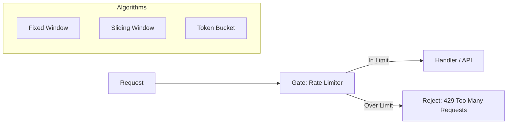

# API Security: Defending the Distributed Perimeter (OWASP & Rate Limiting)
**0. Architectural Vision: The Hardened Gate**
- **API Security is the Defense of the Contract.** It's about ensuring that only valid, intended interactions are allowed, and all malicious "Noise" is filtered out.
- **OWASP Top 10.** The industry-standard list of the most critical web application security risks (Injection, Broken Auth, Data Exposure).
- **Rate Limiting.** Protecting the API from "Resource Exhaustion" (intentional or accidental).
- **Hardening.** Disabling unnecessary features (Stack traces, weak headers, old TLS versions) to reduce the "Attack Surface".
- **Architect's View.** We move from "Functional API" to "Hardened API" by assuming the network is **Hostile**. We use **Built-in .NET 8 Rate Limiting**, **Security Headers**, and **Automated Scanners** to ensure our gateway is the strongest point in our system.

**1. Foundational Problem: The "Noisy Neighbor" and the "Bot"**
- **Real-World Impact:** An "Order Search" API takes 2 seconds to run. A developer writes a script that calls it 1,000 times a second to "Sync data".
- **What breaks?** "The Availability". The API's database CPU hits 100%. Real users trying to place a single order are blocked, and the site effectively "Crashes" from legitimate-looking traffic.
- **Scale Boundary:** No amount of "Auto-scaling" will save you from an un-rate-limited API. You will just pay 10x more for servers that are still overwhelmed.
- **Failure Story:** A major airline had an API for "Check Flight Status". Because it had no **Rate Limiting**, travel-scraping bots were calling it millions of times a day to steal prices. The airline's legitimate mobile app became unusable. Migrating to **.NET 8 Rate Limiting (Fixed Window)** allowed them to block the bots in 100ms, restoration service to 100% for real customers while cutting server costs by 50%.

**2. Internal System Mechanics: Windows and Buckets**

### Rate Limiting Algorithms
1. **Fixed Window:** "100 requests every 60 seconds". Simple, but can be "Burst" at the boundary.
2. **Sliding Window:** Smooths out the boundary transition.
3. **Token Bucket:** Allows for short bursts (e.g., "Login burst") but maintains a steady average.
4. **Concurrency:** "Maximum 5 requests in-progress at once".



**3. Production Engineering in .NET 8 (Rate Limiting & Hardening)**

### Anti-Pattern: Information Disclosure in Headers
```csharp
// TERRIBLE: Sending 'Server: IIS/10.0' or 'X-Powered-By: ASP.NET'.
// You are telling the attacker exactly which vulnerabilities to look for.
```

### Production-Ready Implementation: .NET 8 Rate Limiter
```csharp
// 1. Configure Rate Limiter in Program.cs
builder.Services.AddRateLimiter(options => {
    options.AddFixedWindowLimiter("MyPolicy", opt => {
        opt.Window = TimeSpan.FromSeconds(10);
        opt.PermitLimit = 100; // 100 req per 10s
        opt.QueueLimit = 0; // Don't queue, reject immediately
    });
    
    // Custom 429 Response
    options.RejectionStatusCode = StatusCodes.Status429TooManyRequests;
});

// 2. Applying to a Controller
[EnableRateLimiting("MyPolicy")]
public class OrderController : ControllerBase { /* ... */ }

// 3. Security Headers (Best practice)
app.Use(async (context, next) => {
    context.Response.Headers.Append("X-Content-Type-Options", "nosniff");
    context.Response.Headers.Append("X-Frame-Options", "DENY");
    context.Response.Headers.Append("Content-Security-Policy", "default-src 'self'");
    await next();
});
```

**Architecture Strategy:** 
- Implement **IP-based Rate Limiting** for public endpoints (to stop bots) and **User-based Rate Limiting** for private endpoints (to stop abusive accounts).
- Use **Serilog** to log every 429 event with the User's ID and IP, so your Security Team can look for attack patterns.

**4. System Interaction & Flow (ASCII Architecture)**

                 ┌──────────────────┐
                 │   The Attacker   │ (Or Mis-configured Dev)
                 └────────┬─────────┘
                          │ 1. Flood(Request)
          ┌───────────────▼───────────────┐
          │      THE FILTERING LAYER      │ (Middleware / WAF)
          │  ┌─────────┐   ┌─────────┐    │
          │  │ IP      │ → │ Payload │    │
          │  │ Limiter │   │ Sanitizer│    │
          │  └────┬────┘   └────┬────┘    │
          └───────┼─────────────┼─────────┘
                  │             │ 2. Is Malicious? (True -> 400/429)
          ┌───────▼─────────────▼─────────┐
          │       The Core API            │ (The Protected Logic)
          └───────────────┬───────────────┘
                          │ 3. Execute Sanitized logic
                ┌─────────▼─────────┐
                │   Zero Downtime   │
                └───────────────────┘

**5. Strategic Scaling & System Evolution**
- **Distributed Rate Limiting.** If you have 10 API nodes, how do you know a user hit the limit across ALL of them?
    - *Architect's Tip:* Use **Redis-based Rate Limiting** so all nodes share the same "Bucket" count.
- **WAF (Web Application Firewall).** Moving the defense to the "Edge" (Azure Front Door / Cloudflare) to block SQL injection and XSS before the traffic even enters your network.

**6. Reliability, Observability & Runtime Governance**
- **Key Metrics:**
    - `Rate Limit Rejection Count`: Who are we blocking?
    - `Payload Size average`: Detecting "Large JSON" attacks.
- **Observability:** Monitor the **OWASP Error Log** for "Broken Object Level Authorization" (BOLA) attempts where users try to access ID=123 when they only own ID=456.

**7. Compromises, Tradeoffs & Alternatives**
- **False Positives.** A legitimate user might get blocked if your rate limit is too aggressive. **Architect's Tip:** Implement a "Retry-After" header in the 429 response.
- **Complexity.** Managing rate limits for 1,000 different endpoints requires a centralized configuration system.

**8. Security Posture & Risk Mitigation**
- **BOLA Defense.** Never trust the ID passed in the URL. Always check `if (order.OwnerId == User.GetId())`.
- **Injection Defense.** Use **EF Core / Parameterized Queries**. Never, ever concatenate strings to build a SQL command.

**9. Technical Edge Cases & System Failure Modes**
- **The "Bypass" Attempt.** Attackers using 10,000 different proxy IPs to bypass your IP-based rate limiter.
- **Resource Exhaustion.** An API that creates a large image in memory. Even one request per second might crash a small server.

**10. Architectural Assessment & Career Progression**
- **Senior:** "We use Rate Limiting to stop our API from being overwhelmed by scripts."
- **Principal:** "Architecture is the **Institutionalization of Resistance**. We leverage **OWASP Hardening and Multi-Level Rate Limiting** to protect our system from the entropy of the open network. We architecturalize for **Operational Integrity**, utilizing **Token Buckets and Distributed State Stores** to ensure that our service availability is decoupled from the volatility of malicious actors. For us, security is a **Continuous Filter** that separates business value from systemic noise."
- **Interview Strategy:** Describe the "OWASP Top 10". Explain how you would implement "IP Throttling" vs "User Throttling".

**11. Real-World Case Study: Global Financial Data Feed**
**Scenario:** A company like Bloomberg or Reuters.
- **The Problem:** Customers pay for different "Tiers" of data access. A Tier 1 user gets 10req/sec, Tier 3 gets 10,000req/sec.
- **The Design:** Implemented **Custom .NET Rate Limiters** that look up the `Tier` claim in the user's JWT to decide the `PermitLimit`.
- **Result:** Perfect monetization of API usage. High-paying customers get the speed they need, while low-paying customers are prevented from "Stealing" bandwidth from the premium users.

**12. Structural Dependencies & Learning Path**
- **Foundations:** HTTP Status codes (429, 403), OWASP basics.
- **Future Steps:** Security as Code (Snyk, SonarQube), Zero Trust.
- **Integration Points:** Microsoft.AspNetCore.RateLimiting, FluentValidation, Azure Front Door.
