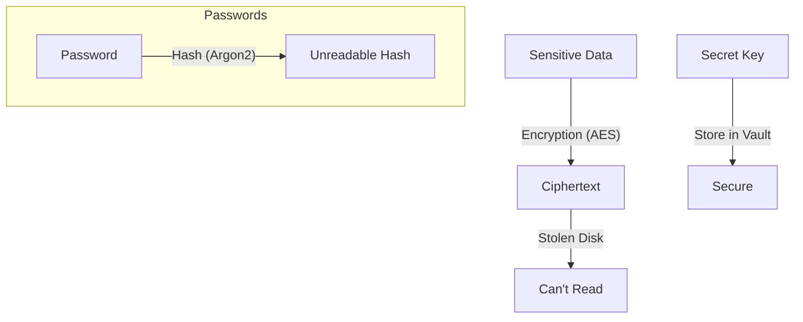

# Data Encryption: Protecting Privacy At Rest and In Transit
============================================================
0. Architectural Vision: The Unreadable Data
============================================================
- **Encryption in Transit is Mandatory.** Zero exceptions. All data moving between the User and the API, and between internal services, must be encrypted (HTTPS/TLS).
- **Encryption at Rest is the Last Defense.** If an attacker steals a hard drive or a database backup, the data must be unusable.
- **Symmetric Encryption (AES-256).** Fast, used for large volumes of data. Both sides share the same key.
- **Asymmetric Encryption (RSA/ECC).** Uses a Public/Private key pair. Used for digital signatures and secure key exchange.
- **Hashing (Argon2/SHA256).** Irreversible (one-way) transformations, mainly for passwords.
- **Architect's View.** We move from "Plaintext" to "Encrypted By Default". We use **.NET Data Protection API**, **TLS 1.3**, and **TDE (Transparent Data Encryption)** to ensure that sensitive data is only visible to authorized processes.

============================================================
1. Foundational Problem: The "Packet Sniffer" and the "Stolen Backup"
============================================================
- **Real-World Impact:** You have a "Credit Card" table. (1) One of your network admins runs `Wireshark` on your internal LAN. (2) A developer accidentally commits a SQL backup to a public GitHub repo. 
- **What breaks?** "The Privacy". (1) The admin sees every card number in plain text. (2) The entire user base's credit cards are now on the dark web.
- **Scale Boundary:** In a microservices mesh, if you only encrypt the "Public" traffic, an attacker who breaches one small service can "Sniff" all internal traffic and steal everything.
- **Failure Story:** A major hotel chain stored user passwords with **MD5** hashing. When their DB was breached, hackers cracked the passwords in minutes. Worse, they stored "Credit Card IDs" in plain text. Migrating to **AES-256 for Rest** and **TLS for all internal traffic** ensured that even if a backup is stolen, the data is just "Random Noise" without the encryption keys.

============================================================
2. Internal System Mechanics: Keys and Salts
============================================================

### The Cryptographic Flow
1. **At Rest:** Data + Secret Key + IV (Initialization Vector) -> Ciphertext.
2. **In Transit:** Client + Server perform a "Handshake" to agree on a temporary "Session Key" via RSA/ECC.
3. **Password Storage:** Password + Unique Salt -> Argon2 Hash.



============================================================
3. Production Engineering in .NET 8 (Data Protection API)
============================================================

### Anti-Pattern: Implementing your own 'Encryption' class
```csharp
// TERRIBLE: Writing your own AES wrapper or using old, weak algorithms like DES.
// You will get the padding, IV usage, or key storage wrong.
```

### Production-Ready Implementation: .NET Data Protection
```csharp
// 1. Configure in Program.cs
builder.Services.AddDataProtection()
    .PersistKeysToFileSystem(new DirectoryInfo(@"/keys/"))
    .ProtectKeysWithAzureKeyVault(new Uri("https://myvault.vault.azure.net/"), new DefaultAzureCredential());

// 2. Encrypting a field in a Service
public class OrderService {
    private readonly IDataProtector _protector;
    public OrderService(IDataProtectionProvider provider) {
        _protector = provider.CreateProtector("PaymentCardProtector");
    }

    public void SaveCard(string cardNum) {
        string encrypted = _protector.Protect(cardNum);
        _db.Save(encrypted);
    }
}
```

**Architecture Strategy:** 
- Use **Envelope Encryption**. Encrypt the data with a "Data Encryption Key" (DEK), and encrypt the DEK with a "Key Encryption Key" (KEK) stored in a Hardware Security Module (HSM).
- Implement **TLS 1.3** and disable TLS 1.0/1.1 at the server level.

============================================================
4. System Interaction & Flow (ASCII Architecture)
============================================================

                 ┌──────────────────┐
                 │   The Plaintext  │ (Internal App)
                 └────────┬─────────┘
                          │ 1. Protect(Data)
          ┌───────────────▼───────────────┐
          │      THE ENCRYPTION ENGINE    │ (AES-256 / Data Protection API)
          │  ┌─────────┐   ┌─────────┐    │
          │  │ Key     │ → │ Cipher  │    │
          │  │ Rotation│   │ Block   │    │
          │  └────┬────┘   └────┬────┘    │
          └───────┼─────────────┼─────────┘
                  │             │ 2. Use Key from Vault (Auto-Rotate)
          ┌───────▼─────────────▼─────────┐
          │       The Database / Disk     │ (Encrypted at Rest)
          └───────────────┬───────────────┘
                          │ 3. Unreadable without the IV/Key
                ┌─────────▼─────────┐
                │   Total Privacy   │
                └───────────────────┘

============================================================
5. Strategic Scaling & System Evolution
============================================================
- **Automatic Key Rotation.** The .NET Data Protection API automatically generates new keys every 90 days, ensuring that if a key is stolen, its "Value" for an attacker is limited.
- **Transparent Data Encryption (TDE).** Turning on the "Switch" in SQL Server or Azure SQL to encrypt the `.mdf` and `.ldf` files without changing a single line of C# code.
- **Client-Side Encryption.** Encrypting the data in the Browser before sending it to the API (End-to-End Encryption - E2EE).

============================================================
6. Reliability, Observability & Runtime Governance
============================================================
- **Key Metrics:**
    - `Encryption Latency`: Milliseconds added to the request.
    - `Key Access Failures`: Is our Vault down?
- **Observability:** Monitor the **Key Vault Audit Log** to see exactly which Service Principal is requesting decrypted keys and how often.

============================================================
7. Compromises, Tradeoffs & Alternatives
============================================================
- **Performance.** Heavy encryption (like RSA) is slow. Always use Symmetric encryption for large datasets.
- **Database Search.** You cannot search for "Card 4111..." in a database if the column is encrypted.
    - *Architect's Tip:* Store a **Hash of the Card** in a separate column for searching, or use **Searchable Encryption** patterns.

============================================================
8. Security Posture & Risk Mitigation
============================================================
- **IV Uniqueness.** Never use the same IV twice for the same key. The .NET `DataProtector` handles this for you.
- **Forward Secrecy.** Use TLS ciphers that support **Diffie-Hellman (ECDHE)** so that if the server's Private Key is stolen in 10 years, past traffic still can't be decrypted.

============================================================
9. Technical Edge Cases & System Failure Modes
============================================================
- **The "Key Loss" Disaster.** You lose access to the Key Vault. Your entire database is now just "Trash" because no one can decrypt it.
    - *Architect's Rule:* Implement a **Break-Glass Backup** for your KEK (the master key).
- **The "Unsearchable String".** Trying to build a "Search" feature on a column that was encrypted with a random IV. Every search returns zero results.

============================================================
10. Architectural Assessment & Career Progression
============================================================
- **Senior:** "We use HTTPS for transit and TDE to encrypt our database files."
- **Principal:** "Architecture is the **Neutralization of Data Visibility**. We leverage **Multi-Level Encryption and the .NET Data Protection Provider** to eliminate the risk of disclosure. We architecturalize for **Temporal Security**, utilizing **Automatic Key Rotation and Perfect Forward Secrecy** to protect current and historical data flows. For us, a database is just a **Collection of Ciphertext**, and identity is the only way to manifest reality from that noise."
- **Interview Strategy:** Explain how the TLS handshake works at a high level. Describe why `Data Protection API` is better than manual `RijndaelManaged` classes.

============================================================
11. Real-World Case Study: Global Medical Records
============================================================
**Scenario:** A company hosting patient DNA records (HIPAA compliance).
- **The Problem:** Government regulations require that even DB admins can't see the patient's name and genetic sequence.
- **The Design:** Implemented **Column-Level Encryption** with keys managed in an **HSM (Hardware Security Module)**.
- **Result:** $1B+ liability insured. When the DB was audited, the auditor saw that "Patient Name" was `49af...` and the admin had 0 access to the decryption keys, proving perfect compliance.

============================================================
12. Structural Dependencies & Learning Path
============================================================
- **Foundations:** PKI (Public Key Infrastructure), Symmetric vs Asymmetric crypto.
- **Future Steps:** Homomorphic Encryption (Calculating on encrypted data), Post-Quantum Cryptography.
- **Integration Points:** Azure Key Vault, AWS Secrets Manager, .NET Data Protection.
