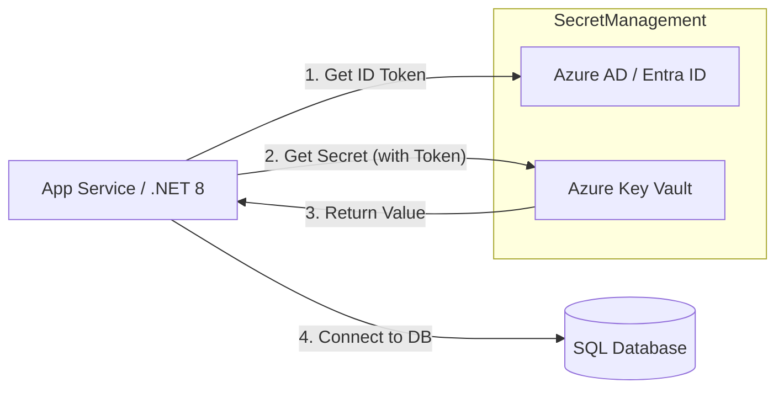

# Secret Management: The Zero-Knowledge Perimeter (Azure Key Vault)
============================================================
0. Architectural Vision: The Removal of the Password
============================================================
- **Secrets are Liability.** If you store a database password in your source code or `appsettings.json`, you are one "Hack" or "Mistake" away from a total system compromise.
- **Externalized Secrets.** Storing credentials in a hardened, audited, and encrypted location (Azure Key Vault, HashiCorp Vault).
- **Managed Identity (The Holy Grail).** The ability for your Azure App Service to talk to the SQL Database or Key Vault without *any* password. The identity is provided by the Azure fabric.
- **Role-Based Access for Secrets.** Granularly allowing the "Prod-App" to only `Get` secrets, while a "Security-Admin" can `Create` them.
- **Architect's View.** We move from "Hardcoded Secrets" to "Runtime Secret Injection". We leverage **Azure Key Vault** to ensure that human developers never see production passwords, and the system is **Secure by Identity, not by Secret**.

============================================================
1. Foundational Problem: The "GitHub Secret Leak" and the "Admin Sneak"
============================================================
- **Real-World Impact:** (1) A developer pushes a "Temp" script to a GitHub repo with the production SQL password. (2) A lead developer leaves the company but keeps the "Master DB password" because it's never been changed.
- **What breaks?** "The Trust". (1) Bot scanners find the password in 60 seconds and dump your database. (2) The ex-employee can log in and sabotage the system.
- **Scale Boundary:** In a microservices mesh of 100 services, managing "Configuration" strings and rotating their passwords manually is a full-time, error-prone job.
- **Failure Story:** A major ride-sharing app had their AWS S3 keys leaked in a public GitHub gist. Hackers stole names and license numbers of 50 million users. Migrating to **Azure Key Vault with Managed Identity** ensured that even if a developer leaks every single file in the project, there are **ZERO** passwords or keys to find; the code only has a "Vault URL" which is inaccessible without the app's internal machine identity.

============================================================
2. Internal System Mechanics: Vaulting and Injection
============================================================

### The Secret Retrieval Flow
1. **The App Starts:** It asks Azure for its "Managed Identity Token".
2. **The Request:** App sends the token to the **Key Vault**.
3. **The Response:** Key Vault verifies the identity and returns the encrypted "Secret String".
4. **The Usage:** The string is injected into the `.NET Configuration` system as if it were a local setting.



============================================================
3. Production Engineering in .NET 8 (Azure Key Vault Provider)
============================================================

### Anti-Pattern: Putting Secrets in Environment Variables
```csharp
// TERRIBLE: Putting passwords in 'Environment.GetEnvironmentVariable("DB_PASS")'.
// These are visible in the Azure Portal, in error logs, and to any local process.
```

### Production-Ready Implementation: Vault Integration
```csharp
// 1. Configure in Program.cs (Simplified .NET 8)
if (builder.Environment.IsProduction()) {
    var keyVaultUri = new Uri(builder.Configuration["KeyVault:Uri"]);
    // Uses Managed Identity (no password required)
    builder.Configuration.AddAzureKeyVault(keyVaultUri, new DefaultAzureCredential());
}

// 2. Reading a secret (Just like appsettings!)
var connectionString = builder.Configuration["Database--ConnectionString"];

// 3. User Secret (Local Dev Only)
// dotnet user-secrets set "ConnectionStrings:Default" "LocalHost..."
// These are NOT committed to Git.
```

**Architecture Strategy:** 
- Implement **Secret Rotation**. Use Azure Key Vault to automatically rotate your "Storage Account" or "Database" keys without redeploying the app.
- Use **Certificate-Based Authentication** for non-Azure resources that don't support Managed Identities.

============================================================
4. System Interaction & Flow (ASCII Architecture)
============================================================

                 ┌──────────────────┐
                 │    The Hacker    │ (Looking for Configs)
                 └────────┬─────────┘
                          │ 1. Scans .json / .env
          ┌───────────────▼───────────────┐
          │      THE SOURCE CODE          │ (The Empty Shell)
          │  ┌─────────┐   ┌─────────┐    │
          │  │ Placeholder│ →│ Vault   │    │
          │  │ (URI)      │  │ Client  │    │
          │  └────┬────┘   └────┬────┘    │
          └───────┼─────────────┼─────────┘
                  │             │ 2. Fetch value at STARTUP only
          ┌───────▼─────────────▼─────────┐
          │       THE KEY VAULT           │ (The Fortified Stronghold)
          └───────────────┬───────────────┘
                          │ 3. Enforce IAM / Audit
                ┌─────────▼─────────┐
                │   Zero-Password   │
                └───────────────────┘

============================================================
5. Strategic Scaling & System Evolution
============================================================
- **Multi-Environment Vaulting.** Having a "Dev-Vault", "Stage-Vault", and "Prod-Vault" to ensure that a dev-app can never accidentally read production secrets.
- **Dynamic Secret Injection.** Fetching the "Current" secret every 30 minutes in case of rotation (e.g., using `IOptionsSnapshot`).
- **Secret Versioning.** Allowing the system to handle both the "Old" and "New" database password during the 5-minute transition window of a rotation.

============================================================
6. Reliability, Observability & Runtime Governance
============================================================
- **Key Metrics:**
    - `Vault Latency`: How many seconds does the app take to start up?
    - `Secret Access Failures`: Identifying incorrect permissions (IAM).
- **Observability:** Enable **Key Vault Diagnostics** to see every time a secret is read. Alert on "Abnormal Reading" (e.g., 500 secrets read in 1 minute).

============================================================
7. Compromises, Tradeoffs & Alternatives
============================================================
- **Startup Delay.** Fetching 50 secrets from a vault adds 2-3 seconds to your application boot time.
- **Local Dev Friction.** Managing passwords for local development usually requires `User Secrets`, which can be confusing for new team members.

============================================================
8. Security Posture & Risk Mitigation
============================================================
- **Soft Delete.** Enable "Soft Delete" on the vault so a malicious admin can't permanently delete all production secrets instantly.
- **Networking.** Use **Private Endpoints (VNet)** for the vault so it's not even accessible on the public internet, even with the correct credentials.

============================================================
9. Technical Edge Cases & System Failure Modes
============================================================
- **Expired Certificates.** A server Certificate expires, and because it wasn't tracked in a vault, the system goes down for 4 hours while the admin frantically generates a new one.
    - *Architect's Rule:* Use **Auto-Renewal** features in Azure Key Vault for all certificates.
- **The "Missing Identity".** You deploy to a new server and forget to "Give" that server access to the vault. The app crashes at startup with a 403 error.

============================================================
10. Architectural Assessment & Career Progression
============================================================
- **Senior:** "We move all our passwords from appsettings.json into Azure Key Vault for security."
- **Principal:** "Architecture is the **Neutralization of Compromise**. We leverage **Key Vaults and Entra Managed Identities** to eliminate the existence of credentials from our execution environment. We architecturalize for **Credentialless Operations**, utilizing **IAM-Based Entitlement and Automated Secret Rotation** to minimize the blast radius of human error. For us, a secret is a **Systemic Vulnerability** that must be hidden behind an identity-based gate."
- **Interview Strategy:** Describe "Managed Identity" and why it's better than an "Admin Key". Explain how to handle local development without putting secrets in Git.

============================================================
11. Real-World Case Study: Global E-Commerce Rotation
============================================================
**Scenario:** A retailer with 1,000 internal services.
- **The Problem:** Changing the "Main Database Password" took a week of manual coordination across 50 teams. The password was never changed for 3 years.
- **The Design:** Implemented **Azure Key Vault** for all 1,000 services.
- **Result:** Now, they change the SQL password in one place (Key Vault). The 1,000 services "Detect" the new secret within minutes using the **Key Vault Config Provider**. Security is drastically improved with zero human downtime.

============================================================
12. Structural Dependencies & Learning Path
============================================================
- **Foundations:** IAM (Identity and Access Management), .NET Configuration model.
- **Future Steps:** HSM (Hardware Security Modules), Secret Zero problem.
- **Integration Points:** Azure.Extensions.AspNetCore.Configuration.Secrets, Azure.Identity.
