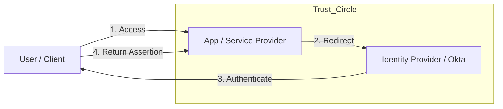

# Identity Providers (IdP) and Federation: Building an Interconnected Identity
============================================================
0. Architectural Vision: The Virtual Identity
============================================================
- **Identity Provider (IdP).** A service that stores and manages user identities (e.g., Okta, Auth0, Google, Azure AD).
- **Federation.** Allowing a user from one "Realm" (e.g., Company A) to log into an application in another "Realm" (e.g., Platform B) without creating a new password.
- **SSO (Single Sign-On).** The ability to log in once and access multiple independent applications within a federation.
- **SAML (Security Assertion Markup Language).** The legacy enterprise standard for federation (XML-based).
- **Social Login.** Using "Login with Google/Facebook" to reduce friction for consumers.
- **Architect's View.** We move from "Local Authentication" to "Identity Federation". We understand that **Identity is a Utility**. We don't want to manage passwords; we want to trust the **IDP** to provide us with a verified **Set of Claims** about the user.

============================================================
1. Foundational Problem: The "Siloed Identity" and the "Password Fatigue"
============================================================
- **Real-World Impact:** You are building a B2B SaaS platform. Every customer (Company A, Company B) wants their employees to use their existing corporate passwords to log in.
- **What breaks?** "The Friction". If you force 10,000 employees of Company A to create a *new* password for *your* platform, they will forget it, reuse a weak password, and your support team will spend 50% of their time on "Password Reset" tickets.
- **Scale Boundary:** In a global ecosystem, you cannot manually sync 100,000 users' statuses (Hired/Fired) between the customer's HR system and your database.
- **Failure Story:** A multinational retailer had 20 different employee portals. Each had its own login. When an employee was fired, it took 3 days for the IT team to manually disable all 20 accounts. During those 3 days, a disgruntled employee logged into 5 "forgotten" portals and deleted critical data. Migrating to **Federated Identity (Azure AD)** allowed them to disable the account in one place and have it instantly propagate to all 20 portals via **SSO**.

============================================================
2. Internal System Mechanics: Trust and Redirection
============================================================

### The Federation Workflow
1. **The App (SP - Service Provider):** Trusts the **IdP**.
2. **The Request:** App redirects user to the IdP's login page.
3. **The Proof:** IdP verifies the user and sends a "Signed Assertion" (JWT or SAML) back to the App.
4. **The Mapping:** App takes the IdP's claims (e.g., `email: bob@work.com`) and maps them to internal permissions (`can_view_reports`).



============================================================
3. Production Engineering in .NET 8 (External Authentication)
============================================================

### Anti-Pattern: Manual SAML Token Parsing
```csharp
// TERRIBLE: Trying to manually decrypt and parse XML SAML responses.
// SAML is notoriously difficult to get right and easy to exploit (e.g. Signature Wrapping).
// Use official libraries like 'Sustainsys.Saml2'.
```

### Production-Ready Implementation: Azure AD B2C Social Login
```csharp
// 1. Configure in Program.cs
builder.Services.AddAuthentication(OpenIdConnectDefaults.AuthenticationScheme)
    .AddMicrosoftIdentityWebApp(builder.Configuration.GetSection("AzureAdB2C"));

// 2. Configuration (appsettings.json)
/*
"AzureAdB2C": {
  "Instance": "https://company.b2clogin.com",
  "Domain": "company.onmicrosoft.com",
  "ClientId": "...",
  "SignUpSignInPolicyId": "B2C_1_susi"
}
*/

// 3. Mapping Claims
builder.Services.Configure<OpenIdConnectOptions>(OpenIdConnectDefaults.AuthenticationScheme, options => {
    options.Events.OnTokenValidated = context => {
        // Map the AAD 'extension_Role' to .NET Roles
        var role = context.Principal.FindFirst("extension_Role")?.Value;
        if (role != null) {
            // Add custom local claim
        }
        return Task.CompletedTask;
    };
});
```

**Architecture Strategy:** 
- Use **Azure AD B2C** for consumer apps (Scales to millions, handles password resets, MFA, and social providers automatically).
- Implement **Just-In-Time (JIT) Provisioning**. Create the "User Profile" in your local database the first time they log in via federation.

============================================================
4. System Interaction & Flow (ASCII Architecture)
============================================================

                 ┌──────────────────┐
                 │   The Trust Hub  │ (Azure AD / Okta)
                 └────────┬─────────┘
                          │ 1. Metadata / Discovery
          ┌───────────────▼───────────────┐
          │      THE APP (SP)             │ (The Reliance Party)
          │  ┌─────────┐   ┌─────────┐    │
          │  │ OIDC    │ → │ Claim   │    │
          │  │ Handler │   │ Mapper  │    │
          │  └────┬────┘   └────┬────┘    │
          └───────┼─────────────┼─────────┘
                  │             │ 2. Map 'Global ID' to 'Local ID'
          ┌───────▼─────────────▼─────────┐
          │       The Local DB            │ (User Preferences / Local Data)
          └───────────────┬───────────────┘
                          │ 3. Execute with Auth Context
                ┌─────────▼─────────┐
                │   Federated SSO   │
                └───────────────────┘

============================================================
5. Strategic Scaling & System Evolution
============================================================
- **Multi-Tenant Federation.** If you have 500 business customers, you can't manually configure 500 IdP connections.
    - *Architect's Tip:* Use **Home Realm Discovery (HRD)** based on the user's email domain (e.g., `@google.com` -> Google IdP).
- **Identity Cascading.** Calling Microservice B with the "Original" identity of the user that logged into Microservice A.

============================================================
6. Reliability, Observability & Runtime Governance
============================================================
- **Key Metrics:**
    - `IdP Redirect Latency`: Is the login page taking too long to load?
    - `Federation Failure Rate`: Are tokens being rejected due to clock skew or signature mismatch?
- **Observability:** Track the `IdpId` claim to see which identity providers are the most popular among your users.

============================================================
7. Compromises, Tradeoffs & Alternatives
============================================================
- **Dependency.** If the IdP (Azure AD / Auth0) goes down, NO ONE can log into your app.
- **Data Privacy.** Every time a user logs in via Facebook, Facebook knows they are using your app.

============================================================
8. Security Posture & Risk Mitigation
============================================================
- **Signature Validation.** NEVER trust a federated token without verifying the digital signature against the IdP's **Public Key** (JWKS).
- **State Parameter.** Always use the `state` parameter in OAuth2 redirects to prevent **CSRF (Cross-Site Request Forgery)** attacks in the auth flow.

============================================================
9. Technical Edge Cases & System Failure Modes
============================================================
- **The "Missing Email" Claim.** Some IdPs (like LinkedIn) might not return the user's email address by default, breaking your local "User Mapping" logic.
- **Token Size.** SAML assertions can be massive (10KB+), causing problems with cookie size limits (4KB) in standard browsers.

============================================================
10. Architectural Assessment & Career Progression
============================================================
- **Senior:** "We use Azure AD B2C so our users can log in with their corporate or social accounts."
- **Principal:** "Architecture is the **Global Interconnection of Identity Sovereignty**. We leverage **Federation Protocols and JIT Provisioning** to eliminate the friction of local credential management. We architecturalize for **Identity Pluralism**, utilizing **OIDC Bridges and Claims-Based Normalization** to ensure that our platform remains agnostic to the underlying authority. For us, a user is not a row in our database, but a **Contextual Fact manifested through Federated Trust**."
- **Interview Strategy:** Explain the difference between SP-Initiated and IdP-Initiated SSO. Describe "Home Realm Discovery".

============================================================
11. Real-World Case Study: Public Sector Portal
============================================================
**Scenario:** A national government portal for 50 different departments.
- **The Problem:** Citizens have a "Digital ID" issued by the government. Each department (Tax, Health, Driver License) has its own legacy portal.
- **The Design:** Implemented a **National IdP**. All 50 departments became **Service Providers (SPs)** in a massive federation.
- **Result:** One million citizens can access all 50 services with a single government-issued login. The system handles 100k logins an hour with perfect security and centralized auditing.

============================================================
12. Structural Dependencies & Learning Path
============================================================
- **Foundations:** OAuth2, SAML 2.0, Certificates.
- **Future Steps:** Decentralized Identity (DID), Verifiable Credentials.
- **Integration Points:** Microsoft.Identity.Web, Duende IdentityServer, SustainSys.Saml2.
