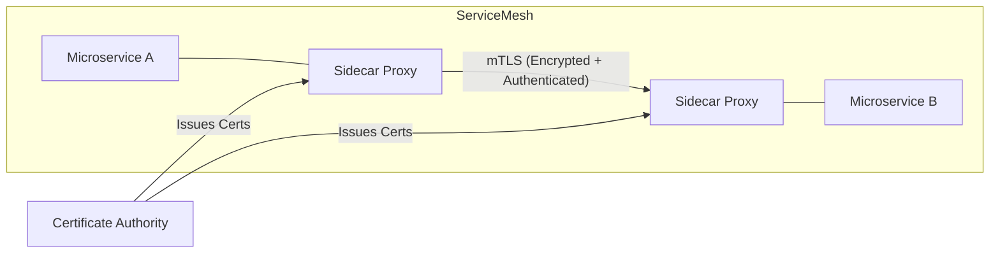

# Zero Trust Architecture and mTLS: Perimeterless Protection
============================================================
0. Architectural Vision: The End of the "Safe Network"
============================================================
- **Zero Trust is a Mindset.** "Never Trust, Always Verify." We assume that the internal network is just as dangerous as the public internet.
- **Identity-Based Security.** Access is granted based on *Who* (Identity) and *What* (Device Health), not *Where* (IP/Location).
- **Mutual TLS (mTLS).** Both sides (Client and Server) must present a valid certificate to each other. This ensures encrypted transit + verified identity for *both* ends of the connection.
- **Micro-Segmentation.** Breaking the network into tiny "Cells". If one microservice is hacked, the attacker cannot "Hop" to any other service because they have no authorized certificates.
- **Architect's View.** We move from "Hard Perimeter" to "Dynamic Security". We use **mTLS**, **Istio/Linkerd**, and **Managed Certificates** to ensure that every single packet in our system is encrypted and authenticated.

============================================================
1. Foundational Problem: The "M&M" Security (Hard Shell, Soft Center)
============================================================
- **Real-World Impact:** You have a firewall. Inside the firewall, all 50 microservices talk to each other over plain HTTP/TCP.
- **What breaks?** "The Lateral Movement". If a hacker exploits a bug in the "Customer Reviews" service (the weakest link), they can now sniff the "Payments" service traffic, steal the "Database" password from an internal config call, and take over the entire system.
- **Scale Boundary:** In a massive cloud environment, the "Perimeter" is blurry. You have servers in 5 different regions, 10 VPCs, and a dozen SaaS partners. A single firewall ruleset becomes 10,000 lines of unmanageable code.
- **Failure Story:** A major credit reporting agency had a breach because of an unpatched internal server. Once the hacker was "Inside" the network, they moved undetected for months, accessing 50 internal databases that had zero authentication because they "Trusted the internal IP". Migrating to **Zero Trust** ensured that even with an internal exploit, the hacker couldn't talk to the database because they didn't have the unique, short-lived **mTLS certificate** required to open a connection.

============================================================
2. Internal System Mechanics: Certificates and Sidecars
============================================================

### The mTLS Handshake
1. **The Handshake:** Client presents Cert A; Server presents Cert B.
2. **The Verify:** Both sides check the "Root CA" (Certificate Authority) to see if the other cert is valid.
3. **The Encrypt:** A session key is generated. Security is now guaranteed for both Identity and Privacy.



============================================================
3. Production Engineering in .NET 8 (Certificate Auth)
============================================================

### Anti-Pattern: Manual Certificate Rotation
```csharp
// TERRIBLE: Developers manually generating a .pfx file 
// and copying it to the production server. 
// It WILL expire on a Sunday at 2 AM, and no one will know how to fix it.
```

### Production-Ready Implementation: Client Certificate Auth
```csharp
// 1. Configure Kestrel for mTLS in Program.cs
builder.Services.Configure<KestrelServerOptions>(options => {
    options.ConfigureHttpsDefaults(httpOptions => {
        // Require the client to provide a certificate
        httpOptions.ClientCertificateMode = ClientCertificateMode.RequireCertificate;
    });
});

// 2. Add Certificate Authentication to the Middleware
builder.Services.AddAuthentication(CertificateAuthenticationDefaults.AuthenticationScheme)
    .AddCertificate(options => {
        options.AllowedCertificateTypes = CertificateTypes.All;
        options.Events = new CertificateAuthenticationEvents {
            OnCertificateValidated = context => {
                // Verify the Subject Name or Thumprint
                if (context.ClientCertificate.Subject != "CN=PaymentsService") {
                    context.Fail("Unauthorized Service");
                }
                return Task.CompletedTask;
            }
        };
    });

// 3. Making an mTLS call in the Client
var handler = new HttpClientHandler();
handler.ClientCertificates.Add(new X509Certificate2("mycert.pfx", "password"));
var client = new HttpClient(handler);
```

**Architecture Strategy:** 
- Use a **Service Mesh (Istio / Linkerd)** to handle mTLS automatically at the network layer. This removes the certificate logic from your C# code and moves it to the infrastructure.
- Implement **Short-Lived Certificates** (e.g., 24 hours) to reduce the risk of certificate theft.

============================================================
4. System Interaction & Flow (ASCII Architecture)
============================================================

                 ┌──────────────────┐
                 │   The Attacker   │ (Inside the VNet)
                 └────────┬─────────┘
                          │ 1. Tries to Connect (TCP)
          ┌───────────────▼───────────────┐
          │      THE mTLS GATEKEEPER      │ (Kestrel / Envoy Proxy)
          │  ┌─────────┐   ┌─────────┐    │
          │  │ Cert    │ → │ Revoke  │    │
          │  │ Verify  │   │ Check   │    │
          │  └────┬────┘   └────┬────┘    │
          └───────┼─────────────┼─────────┘
                  │             │ 2. No Valid Cert? (TCP Connection Closed)
          ┌───────▼─────────────▼─────────┐
          │       The Core API            │ (Safely Isolated)
          └───────────────┬───────────────┘
                          │ 3. Only Valid Service-to-Service Talk
                ┌─────────▼─────────┐
                │   Zero Trust OK   │
                └───────────────────┘

============================================================
5. Strategic Scaling & System Evolution
============================================================
- **Dynamic Access Policies.** Using **Istio AuthorizationPolicies** to define "Service A can talk to Service B on port 8080, but NOT on port 9090".
- **Spiffe/Spire.** Using an industry protocol for issuing identities to workloads (containers, VMs) regardless of whether they are in Azure, AWS, or On-Premise.

============================================================
6. Reliability, Observability & Runtime Governance
============================================================
- **Key Metrics:**
    - `Handshake Success Rate`: Are certs expiring?
    - `AuthZ Failure Count`: Which services are trying to talk to things they shouldn't?
- **Observability:** In a Service Mesh, you get a **Service Map** for free, showing exactly how traffic flows between all your pods with 100% certainty.

============================================================
7. Compromises, Tradeoffs & Alternatives
============================================================
- **Operational Complexity.** Managing a Certificate Authority (CA) and rotating 1,000 certs a day is a massive infrastructure task.
- **Latency.** The TLS handshake takes time (especially mTLS).
    - *Architect's Tip:* Use **Persistent Connections** (HTTP/2 or Keep-Alive) to perform the handshake once and reuse the connection for 1,000s of requests.

============================================================
8. Security Posture & Risk Mitigation
============================================================
- **Continuous Verification.** Don't just check at connection time. Periodically re-verify identity if a connection is open for a long time.
- **Hardware Separation.** Store the Root CA Private Key in a separate, offline location, or a specialized HSM cloud service.

============================================================
9. Technical Edge Cases & System Failure Modes
============================================================
- **Root CA Expiry.** If the "Global Root" expires, your entire data center's internal network goes silent.
- **Clock Drift.** If Node A is 5 minutes behind Node B, it might reject a certificate that Node B just generated because it's "not yet valid" in Node A's timeline.

============================================================
10. Architectural Assessment & Career Progression
============================================================
- **Senior:** "We use mTLS between our microservices to encrypt internal traffic."
- **Principal:** "Architecture is the **Elimination of Implicit Trust**. We leverage **Zero Trust Frameworks and mTLS-Driven Identities** to neutralize the threat of lateral movement in our distributed mesh. We architecturalize for **Credentialless Verifiability**, utilizing **Automated Certificate Rotation and Spiffe-Compatible Workload Identities** to ensure that every interaction is cryptographically proven. For us, the network is always **Untrusted**, and security is an **Immutable Attribute of the Connection**, not the environment."
- **Interview Strategy:** Explain how a Service Mesh provides "Observability, Security, and Reliability" through mTLS.

============================================================
11. Real-World Case Study: Digital Bank Mesh
============================================================
**Scenario:** A bank with 500 microservices handling money transfers.
- **The Problem:** Regulatory requirements (PCI-DSS) demand that all data in the VLAN is encrypted. Manually adding HTTPS to 500 services and managing 500 certs was impossible.
- **The Design:** Implemented **Linkerd Service Mesh**.
- **Result:** **100% mTLS Coverage** in 2 hours with ZERO changes to the C# code. All 500 services were instantly encrypted and authenticated. The bank passed the audit with a "Perfect" security score for internal networking.

============================================================
12. Structural Dependencies & Learning Path
============================================================
- **Foundations:** Certificates (.crt, .key), SSL Handshake logic.
- **Future Steps:** Spiffe/Spire, Istio, Linkerd.
- **Integration Points:** Microsoft.AspNetCore.Authentication.Certificate, YARP with mTLS.
