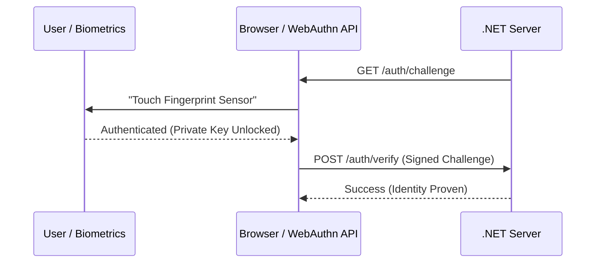

# MFA and Biometric Authentication: Beyond the Password (FIDO2 & Passkeys)
============================================================
0. Architectural Vision: The Multi-Factor Fortress
============================================================
- **MFA (Multi-Factor Authentication).** Requiring two or more proofs of identity: Something you *know* (password), something you *have* (phone/YubiKey), and something you *are* (fingerprint/face).
- **FIDO2 / WebAuthn.** The modern standard for passwordless and biometric auth. It uses public-key cryptography to eliminate the risk of phishing.
- **Passkeys.** A user-friendly implementation of FIDO2 where the private key is synced across the user's devices (Apple/Google/Microsoft).
- **TOTP (Time-based One-Time Password).** The 6-digit code generator (Google Authenticator). Reliable but vulnerable to phishing.
- **Architect's View.** We move from "Static Passwords" to "Cryptographic Possession". We prioritize **FIDO2/Passkeys** over SMS/Email codes to close the "Phishing Gap". We aim for **Zero-Friction Security** where the user's device provides the highest level of assurance.

============================================================
1. Foundational Problem: The "Phishing" and "Credential Stuffing" Pandemic
============================================================
- **Real-World Impact:** An attacker creates a fake "Office 365" login page. A user enters their password. The attacker now has the password. 
- **What breaks?** "The Security". Even if the user has a "Complex" password, it is useless if they give it to a hacker. SMS codes can be intercepted via **SIM Swapping**, and Email codes can be stolen if the email account itself is breached.
- **Scale Boundary:** In a system with 10,000 employees, one single phished password can give an attacker access to the internal network, leading to ransomware that shuts down the entire company.
- **Failure Story:** A major social media company was breached when a hacker phished an employee's password and then used a **SIM Swap** to intercept their 2FA code. The hacker gained access to the internal "God Mode" tool. Migrating to **FIDO2 (Security Keys)** ensured that the login would *only* work if the physical YubiKey was present, making phishing mathematically impossible because the key only signs for the legitimate domain.

============================================================
2. Internal System Mechanics: Public Keys and Attestation
============================================================

### The FIDO2 / WebAuthn Flow
1. **Registration:** The User's device generates a Public/Private key pair. It sends the **Public Key** and an **Attestation** (proof of hardware) to the Server.
2. **Authentication:**
   - Server sends a **Challenge**.
   - User's device (Phone/Key) asks for Biometrics (FaceID/Fingerprint).
   - Device signs the Challenge with the **Private Key** and sends it back.
   - Server verifies the signature with the stored Public Key.



============================================================
3. Production Engineering in .NET 8 (FIDO2-NetLib)
============================================================

### Anti-Pattern: SMS-Only 2FA
```csharp
// TERRIBLE: Relying solely on SMS for second-factor.
// SIM swapping is a low-cost, high-success attack.
// Always offer TOTP (App-based) or FIDO2 as the primary options.
```

### Production-Ready Implementation: FIDO2 Registration (Logic)
```csharp
// 1. Initiate Registration (Server side)
public IActionResult MakeCredentialOptions(string username) {
    var user = _userRepo.Get(username);
    var options = _fido2.RequestNewCredential(user, existingCredentials, AuthenticatorSelection.Default, AttestationConveyancePreference.None);
    
    // Store options in Session for the 'Complete' step
    HttpContext.Session.SetString("fido2.options", options.ToJson());
    return Json(options);
}

// 2. Verify Registration
[HttpPost]
public async Task<IActionResult> MakeCredential([FromBody] AuthenticatorAttestationRawResponse res) {
    var options = CredentialCreateOptions.FromJson(HttpContext.Session.GetString("fido2.options"));
    var success = await _fido2.MakeNewCredentialAsync(res, options, (args, token) => {
        // Callback to check if the credential ID is already used
        return Task.FromResult(true);
    });

    if (success.Status == "ok") {
        // Save success.Result.PublicKey and success.Result.CredentialId to DB
        return Ok();
    }
    return BadRequest();
}
```

**Architecture Strategy:** 
- Implement **Conditional UI (WebAuthn)**. This allows the browser to show a "Passkey" suggestion in the standard "Autofill" dropdown of the username field, making login a single-tap experience.
- Use **Step-up Authentication**. Only ask for MFA when the user performs a "High-Value" action like "Change Password" or "Transfer $10,000".

============================================================
4. System Interaction & Flow (ASCII Architecture)
============================================================

                 ┌──────────────────┐
                 │   The User Device│ (Trusted Hardware - TPM/Secure Enclave)
                 └────────┬─────────┘
                          │ 1. Sign(Challenge) + Biometric check
          ┌───────────────▼───────────────┐
          │      THE BROWSER (WebAuthn)   │ (The Bridge)
          │  ┌─────────┐   ┌─────────┐    │
          │  │ Client  │ → │ Attest  │    │
          │  │ Data    │   │ Statement│    │
          │  └────┬────┘   └────┬────┘    │
          └───────┼─────────────┼─────────┘
                  │             │ 2. Asymmetric Proof
          ┌───────▼─────────────▼─────────┐
          │       The .NET Backend        │ (The Verifier)
          └───────────────┬───────────────┘
                          │ 3. Match Public Key in DB
                ┌─────────▼─────────┐
                │   Passwordless OK │
                └───────────────────┘

============================================================
5. Strategic Scaling & System Evolution
============================================================
- **Passkey Synchronization.** Using the **Cloud Synced Credential** (Apple Keychain, Google Password Manager) so you don't lose account access when you upgrade your phone.
- **Enterprise FIDO Policies.** Restricting login to *only* company-issued YubiKeys for high-security environments (e.g., sysadmins).

============================================================
6. Reliability, Observability & Runtime Governance
============================================================
- **Key Metrics:**
    - `MFA Completion Rate`: Are users getting stuck?
    - `Recovery Code Usage`: How often are users losing their devices?
- **Observability:** Monitor **MFA Bypass attempts**. Log every time a user tries to "Skip" MFA or uses a "Recovery Code" for security auditing.

============================================================
7. Compromises, Tradeoffs & Alternatives
============================================================
- **Device Loss.** If a user loses their physical key and has no backup, they are locked out.
    - *Architect's Tip:* Always force the user to generate **Recovery Codes** during setup and store them in a safe place.
- **Implementation Effort.** FIDO2 is complex to implement correctly compared to a simple SMS API.

============================================================
8. Security Posture & Risk Mitigation
============================================================
- **Attestation Validation.** Verifying that the security key is from a trusted manufacturer (e.g., Yubico) and not a cheap, cloned device.
- **Origin Check.** WebAuthn explicitly ties the credential to the **Domain** (e.g. `myapp.com`). It will never even *show* the credential if the user is on `myapp.evil.com`, effectively killing phishing.

============================================================
9. Technical Edge Cases & System Failure Modes
============================================================
- **The "Legacy Browser" Wall.** Older browsers or embedded web views (like in some mobile apps) don't support WebAuthn, requiring an SMS/TOTP fallback.
- **TPM Lockout.** The user's device TPM (Trusted Platform Module) gets cleared, losing the private key.

============================================================
10. Architectural Assessment & Career Progression
============================================================
- **Senior:** "We added TOTP to our login flow so users are protected even if their password is stolen."
- **Principal:** "Architecture is the **Neutralization of Human Fallibility**. We leverage **FIDO2 and Passkey Protocols** to eliminate the concept of 'Secret Knowledge' from the authentication plane. We architecturalize for **Possession-Based Trust**, utilizing **Hardware-Backed Cryptography and Biometric Gating** to ensure that identity is a physical fact, not a phishable string. For us, a password is a **Legacy Liability** that we are deprecating in favor of cryptographically verified device provenance."
- **Interview Strategy:** Explain how FIDO2 prevents phishing. Describe the difference between a "Security Key" and a "Passkey".

============================================================
11. Real-World Case Study: Global Financial Institution
============================================================
**Scenario:** A bank with 1M users suffering from $10M/year in phishing losses.
- **The Problem:** 1% of users get phished every month. SMS 2FA was being bypassed by $5 "Phishing Kits".
- **The Design:** Rolled out **Passkeys (Passwordless)** as the primary login method.
- **Result:** Phishing losses dropped to **ZERO** for users who migrated to Passkeys. Login speed increased as users no longer had to type passwords or wait for SMS codes.

============================================================
12. Structural Dependencies & Learning Path
============================================================
- **Foundations:** Public Key Cryptography, TPM/Secure Enclave.
- **Future Steps:** CTAP2 (Client to Authenticator Protocol), FIDO3 discussions.
- **Integration Points:** Fido2-NetLib, SimpleWebAuthn (Frontend), Microsoft.Identity.Web.
