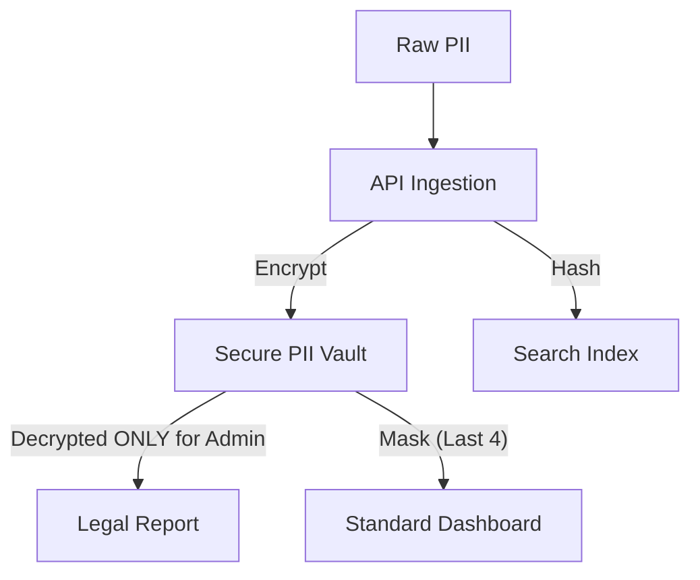

# API Scopes, Claims, and PII Protection: Privacy by Design
**0. Architectural Vision: The Least Exposure**
- **Scopes (What the App can do).** Defining granular permissions like `contacts.read` vs `contacts.write`. The user grants these to the app.
- **Claims (What the App knows).** Small pieces of signed information about the user (e.g., `email_verified: true`, `legacy_id: 123`).
- **PII (Personally Identifiable Information).** Any data that can identify a specific person (Name, SSN, Phone). Protecting this is a legal requirement (GDPR/CCPA).
- **Data Minimization.** Only requesting and storing the *absolute minimum* amount of data needed for the feature to function.
- **Architect's View.** We move from "Shared Database Access" to "Identity-Bound Scopes". We ensure that a compromised App only has access to the specific data the user authorized, and we treat **PII** as a "Radioactive Substance" that must be isolated and masked.

**1. Foundational Problem: The "Over-Privileged App" and the "Data Leak"**
- **Real-World Impact:** An app asks for "Full Profile Access" just to show the user's first name. 3 months later, the app's servers are breached.
- **What breaks?** "The Privacy". Because the app had "Full Access", the hacker stole the users' full addresses, phone numbers, and birth dates, which were never even used by the app's features.
- **Scale Boundary:** In a large ecosystem, if every internal service can see the "Plaintext SSN" for every user, you have 100 different points of failure for a massive data breach.
- **Failure Story:** A major social network allowed apps to request the `user_friends` scope. Malicious apps used this to scrape the data of 80 million unsuspecting friends of the users. Migrating to **Granular Scopes** and **Attribute Masking** ensured that apps can only see exactly what is required for their specific business function, with 0 access to "Friend" data without direct consent.

**2. Internal System Mechanics: Claims Transformation and Masking**

### The PII Handling Lifecycle
1. **Ingest:** Encrypt PII immediately upon arrival.
2. **Store:** Save hashed/masked versions for search, full encrypted versions in a Vault.
3. **Display:** Mask data in the UI (e.g., `***-**-6789`) unless "Sudo" access is verified.
4. **Purge:** Automatically delete PII after the user deletes their account (Right to be Forgotten).



**3. Production Engineering in .NET 8 (Claims and Masking)**

### Anti-Pattern: Primitive Claims in JWTs
```csharp
// TERRIBLE: Storing the user's Full Name and Address in the JWT.
// JWTs are Base64 encoded; ANYONE who sees the network traffic can read the PII.
```

### Production-Ready Implementation: Scoped API & Data Masking
```csharp
// 1. Requirement: Must have 'profile.pii' scope for full data
[Authorize(Policy = "RequirePiiScope")]
public async Task<UserDto> GetUserDetails(string id) {
    var user = await _repo.GetAsync(id);
    
    // Check if user has context for FULL access
    if (User.HasClaim("scope", "profile.pii")) {
        return user; // Return all fields
    }

    // Default: Return Masked Data
    return new UserDto {
        FirstName = user.FirstName,
        LastName = user.LastName.Substring(0, 1) + "***",
        Email = MaskEmail(user.Email)
    };
}

// 2. Policy Definition
builder.Services.AddAuthorization(options => {
    options.AddPolicy("RequirePiiScope", policy => 
        policy.RequireClaim("scope", "profile.pii", "admin.all"));
});
```

**Architecture Strategy:** 
- Use **Claims Transformation**. When a user logs in, call a separate "PII Service" to load their sensitive attributes and add them to the internal identity *without* putting them in the persistent JWT.
- Implement **Dynamic Data Masking** at the database level (Azure SQL) so that even a developer running a query in the portal can't see the real data.

**4. System Interaction & Flow (ASCII Architecture)**

                 ┌──────────────────┐
                 │   OAuth2 Client  │ (External App)
                 └────────┬─────────┘
                          │ 1. Request(Scope: 'orders.read')
          ┌───────────────▼───────────────┐
          │      IDENTITY SERVER          │ (The Consent Gate)
          │  ┌─────────┐   ┌─────────┐    │
          │  │ Consent │ → │ Token   │    │
          │  │ Manager │   │ Mint    │    │
          │  └────┬────┘   └────┬────┘    │
          └───────┼─────────────┼─────────┘
                  │             │ 2. Issue JWT with 'orders.read'
          ┌───────▼─────────────▼─────────┐
          │       THE RESOURCE API        │ (The Context Enforcer)
          └───────────────┬───────────────┘
                          │ 3. Filter data by Scopes/Claims
                ┌─────────▼─────────┐
                │   Scoped Privacy  │
                └───────────────────┘

**5. Strategic Scaling & System Evolution**
- **Differential Privacy.** Adding "Noise" to analytical data so you can calculate "Average Salary" without revealing any individual's real salary.
- **Token Exchange (RFC 8693).** Allowing a "Front-end Service" to trade its user-session token for a narrowed "Back-end Service" token with fewer scopes.

**6. Reliability, Observability & Runtime Governance**
- **Key Metrics:**
    - `PII Access Frequency`: Who is looking at sensitive data?
    - `Scope Violation Rate`: Is an app trying to access unauthorized endpoints?
- **Observability:** Implement **Data Access Auditing**. Log every time a "Full PII" record is decrypted, including the "Why" (Support Ticket ID, Admin Action).

**7. Compromises, Tradeoffs & Alternatives**
- **Developer Productivity.** Hiding all data from developers makes it hard to debug production issues.
    - *Architect's Tip:* Use **Synthesized Production Data** in your Staging environment.
- **Performance.** Decrypting/Masking every row in a result set adds CPU overhead.

**8. Security Posture & Risk Mitigation**
- **Right to Erasure (GDPR).** Ensure that you have a "Parent-Child" deletion strategy. When the `User` is deleted, all their `Comments`, `Orders`, and `Logs` containing PII must be scrubbed.
- **Encryption at Rest (Application Level).** Encrypting the `Email` column so even if someone has `db_owner` access to the SQL server, they only see `0x89...`.

**9. Technical Edge Cases & System Failure Modes**
- **The "Aggregate leak".** Querying "Total users in ZIP 90210 who have Disease X". If the count is 1, you have just identified a specific person's medical status.
- **Cache Poisoning.** Caching the "Full" version of a user's record and accidentally serving it to a user who only has "Masked" access.

**10. Architectural Assessment & Career Progression**
- **Senior:** "We use scopes to limit what our internal apps can do and mask our emails in the logs."
- **Principal:** "Architecture is the **Quantification of Disclosure**. We leverage **Scopes, Managed Claims, and Anonymization Engines** to neutralize the risk of data exposure. We architecturalize for **Privacy by Design**, utilizing **Identity-Bound Filter Sets and Cryptographic Tunnels** to ensure that PII is never handled in the clear. For us, a user's privacy is an **Structural Invariant** that we enforce through automated data-flow constraints."
- **Interview Strategy:** Explain how you handle GDPR's "Right to be Forgotten" in a distributed system. Describe the difference between "Anonymization" and "Pseudonymization".

**11. Real-World Case Study: Global HR System**
**Scenario:** A company like Workday, managing payroll for 10M people.
- **The Problem:** Managers need to see "Teams", but only Payroll Admins should see "Bank Accounts".
- **The Design:** Implemented **Attribute-Based Access Control (ABAC)** combined with **Encryption-at-Rest for Bank Details**.
- **Result:** $100M+ in potential fines avoided. Even when a "Manager Portal" was compromised, the hacker only saw "Names and Titles"—zero bank information was reachable because the portal's identity didn't have the `finance.read` scope.

**12. Structural Dependencies & Learning Path**
- **Foundations:** GDPR/CCPA regulations, OAuth2 scopes.
- **Future Steps:** Zero-Knowledge Proofs (ZKP), Homomorphic Encryption.
- **Integration Points:** Duende IdentityServer (for scopes), Azure Purview (for data classification).
