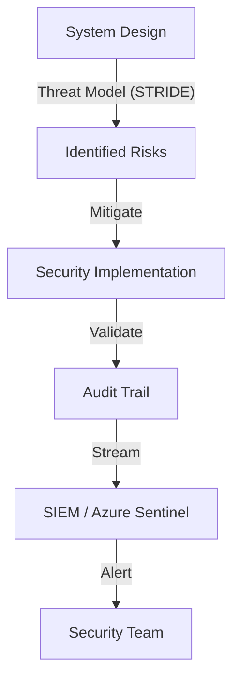

# Security Auditing and Threat Modeling: The Architecture of Verification
============================================================
0. Architectural Vision: The Unblinking Eye
============================================================
- **Threat Modeling (Design Time).** Identifying potential security flaws *before* writing a single line of code (e.g., using **STRIDE**).
- **Security Auditing (Run Time).** Recording every "Security-Significant" event (Login, Permission Change, Data Access) in an immutable log.
- **SIEM (Security Information and Event Management).** Centralizing logs from all servers and using AI (like **Azure Sentinel**) to find attack patterns (e.g., "Why is one user trying to log in from 10 different countries in 5 minutes?").
- **STRIDE.** A framework to categorize threats: **S**poofing, **T**ampering, **R**epudiation, **I**nformation Disclosure, **D**enial of Service, **E**levation of Privilege.
- **Architect's View.** We move from "Hoping we are safe" to "Knowing what happened". We use **Structured Logging**, **Automated Scanners**, and **Threat Workshops** to ensure that our system is not just secure, but **Deterministically Verifiable**.

============================================================
1. Foundational Problem: The "Silent Intruder" and the "Audit Gap"
============================================================
- **Real-World Impact:** An attacker gains access to a low-privilege account. Over 6 months, they slowly trial-and-error their way into the "Finance" database.
- **What breaks?** "The Detection". Because there is no "Audit Log", the company doesn't even know they were hacked until the attacker deletes the database and leaves a ransom note.
- **Scale Boundary:** In a microservices mesh generating 1TB of logs per day, you cannot "Find" the attacker by manually looking at text files. You need an automated SIEM to "Connect the Dots".
- **Failure Story:** A major bank's "Swift" payment system was breached. Hackers transferred $81M. The bank only noticed because of a typo in a transfer request. If they had **Real-time SIEM Auditing**, the "Elevated Privilege" actions used to authorize the transfers would have triggered an automatic lockdown of the system in minutes, saving the funds.

============================================================
2. Internal System Mechanics: STRIDE and Audit Trails
============================================================

### The STRIDE Framework
1. **Spoofing:** "I am the CEO." -> *Defense: MFA/mTLS.*
2. **Tampering:** "I changed the price to $0.01." -> *Defense: Digital Signatures.*
3. **Repudiation:** "I didn't send that $1M." -> *Defense: Immutable Audit Logs.*
4. **Information Disclosure:** "I see everyone's SSN." -> *Defense: Encryption.*
5. **Denial of Service:** "I crashed the server." -> *Defense: Rate Limiting.*
6. **Elevation of Privilege:** "I am now an Admin." -> *Defense: RBAC/ABAC.*



============================================================
3. Production Engineering in .NET 8 (Audit Logging & SIEM)
============================================================

### Anti-Pattern: Mixed Logging
```csharp
// TERRIBLE: Putting 'Security Audit' logs into the same file as 
// 'Debug/Error' logs without a clear schema.
// Security teams cannot filter these efficiently.
```

### Production-Ready Implementation: Structured Audit Logging
```csharp
// 1. Audit Event Model
public record SecurityAuditEvent(
    string Action, 
    string UserId, 
    string IPAddress, 
    string ResourceId,
    bool IsSuccess,
    string Reason = ""
);

// 2. Logging with Serilog & Azure Sentinel
public async Task UpdatePayroll(decimal amount) {
    // Business Logic...
    
    // Audit Logging
    _logger.LogInformation("SECURITY_AUDIT: {Action} by {User} on {Resource}. Success: {Success}", 
        "UpdatePayroll", User.GetId(), "Employee_123", true);
    
    // This structured log is automatically picked up by Azure Sentinel 
    // for real-time alerting.
}
```

**Architecture Strategy:** 
- Implement **Log Immutability**. Ensure that logs are written to "Write-Once Read-Many" (WORM) storage (like Azure Blob Storage with immutability policy) so an attacker can't "Delete the evidence" after a breach.
- Conduct **Monthly Threat Modeling Workshops**. Every time a new "Feature" is designed, walk through it with the STRIDE framework to find gaps.

============================================================
4. System Interaction & Flow (ASCII Architecture)
============================================================

                 ┌──────────────────┐
                 │    The Event     │ (Login / Data Edit)
                 └────────┬─────────┘
                          │ 1. Capture Context (IP, Device, User)
          ┌───────────────▼───────────────┐
          │      AUDIT MIDDLEWARE         │ (The Recorder)
          │  ┌─────────┐   ┌─────────┐    │
          │  │ Schema  │ → │ Secure  │    │
          │  │ Enforcer│   │ Sink    │    │
          │  └────┬────┘   └────┬────┘    │
          └───────┼─────────────┼─────────┘
                  │             │ 2. Async Push to SIEM
          ┌───────▼─────────────▼─────────┐
          │       THE SIEM (Sentinel)     │ (The Intelligent Watcher)
          └───────────────┬───────────────┘
                          │ 3. Pattern Match -> Alert
                ┌─────────▼─────────┐
                │   Actionable Intel│
                └───────────────────┘

============================================================
5. Strategic Scaling & System Evolution
============================================================
- **User Entity Behavior Analytics (UEBA).** Using Machine Learning to build a "Normal Profile" for every user. If a user who normally logs in from "Seattle" at "9 AM" suddenly logs in from "Japan" at "2 AM", the SIEM triggers a 2FA challenge automatically.
- **SOAR (Security Orchestration, Automation and Response).** Automatically running a script to "Block the IP" in the Firewall if the SIEM detects a Brute Force attack.

============================================================
6. Reliability, Observability & Runtime Governance
============================================================
- **Key Metrics:**
    - `Security Alert MTTD (Mean Time to Detect)`: How fast do we find logs?
    - `Logging Pipeline Health`: Are we losing logs?
- **Observability:** Monitor **Audit Log Integrity**. Periodically check that the hashes of your log files haven't been tampered with.

============================================================
7. Compromises, Tradeoffs & Alternatives
============================================================
- **Storage Cost.** Storing "Every single data read" for 7 years (compliance) can cost millions of dollars in storage fees.
    - *Architect's Tip:* Use **Tiered Storage**. Keep the last 30 days in "Hot" storage (fast search) and move the rest to "Cold" (cheap) storage.
- **Performance.** Heavy logging can cause disk I/O bottlenecks. Always use **Asynchronous Logging**.

============================================================
8. Security Posture & Risk Mitigation
============================================================
- **No PII in Logs.** Never, ever log the User's Password, Credit Card Number, or SSN. Even the "Audit Log" must be safe for the Security Team to read.
- **Audit the Admins.** The most important people to audit are the people with "Full Access". Every time an Admin clicks "View User Profile", it must be logged.

============================================================
9. Technical Edge Cases & System Failure Modes
============================================================
- **The "Log Flood".** A loop in your code generates 1 million audit logs a minute, filling up the disk and crashing the entire server.
- **The "Broken Sink".** Your logging service is down, but your app keeps running. If a hack happens *now*, there will be no evidence.
    - *Architect's Rule:* For high-security systems, implement a **Fail-Stop** policy: "If logging fails, the transaction must fail".

============================================================
10. Architectural Assessment & Career Progression
============================================================
- **Senior:** "We use structured logging and STRIDE to find security risks early."
- **Principal:** "Architecture is the **Institutionalization of Accountability**. We leverage **Immutable Audit Trails and SIEM Intelligence** to neutralize the risk of the 'Invisible Breach'. We architecturalize for **Operational Forensics**, utilizing **Behavioral UEBA and SOAR Automation** to ensure that our response is decoupled from human reaction time. For us, security is a **Deterministic Verification Loop** where every action is a provable, audited fact."
- **Interview Strategy:** Describe the STRIDE framework. Explain how a SIEM helps in a microservices environment.

============================================================
11. Real-World Case Study: Fortune 500 Compliance
============================================================
**Scenario:** A company like GE or Boeing under strict government audit.
- **The Problem:** The government needs to know "Who touched the Airplane Design Files in the last 2 years".
- **The Design:** Implemented **Azure Sentinel** with a 7-year retention policy on **WORM storage**.
- **Result:** During an audit, they generated the "User History Report" for 10,000 files in 5 minutes. The auditor was so impressed by the "Immutable Proof" that the company was granted a "Top Tier" security certification.

============================================================
12. Structural Dependencies & Learning Path
============================================================
- **Foundations:** STRIDE, Structured Logging (Serilog/NLog).
- **Future Steps:** AI-driven SIEM, Automated Threat Modeling (ThreatDragon).
- **Integration Points:** Azure Sentinel, Splunk, Elastic Security, Serilog.Sinks.AzureAnalytics.
