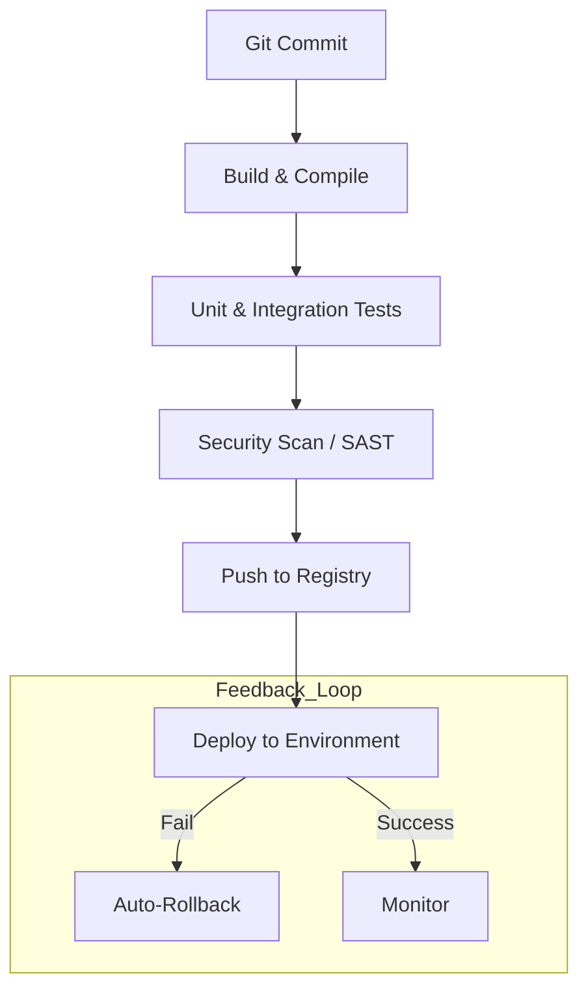

# CI/CD Pipelines: The Engine of Continuous Delivery
**0. Architectural Vision: The Automated Assembly Line**
- **CI (Continuous Integration).** Automatically building and testing every code change. Goal: Find bugs in 10 minutes, not 10 days.
- **CD (Continuous Delivery/Deployment).** Automatically preparing (or performing) the release to production. Goal: Deployment is a "Non-Event".
- **The Pipeline is Code.** Defining your build and release logic in YAML (GitHub Actions, Azure Pipelines).
- **Artifacts.** The immutable output of a build (Docker image, .zip, NuGet package). Build once, deploy many times.
- **Architect's View.** We move from "Manual Deploys" to "Automated Pipelines". We focus on **Cycle Time**, **Lead Time for Changes**, and **Deployment Frequency** (DORA metrics). The pipeline is the "Guard" that ensures only high-quality, secure code reaches the customer.

**1. Foundational Problem: The "Works on My Machine" Syndrome**
- **Real-World Impact:** A developer is ready to release. They manually run `dotnet publish`, zip the folder, and FTP it to the server.
- **What breaks?** "The Consistency". The developer forgot to run the tests. Their machine has a specific DLL that the server doesn't have. They accidentally uploaded a `secrets.json` file.
- **Scale Boundary:** In a team of 50 developers making 100 changes a day, you cannot manually deploy. The "Deployment Window" becomes a week-long nightmare of manual checks.
- **Failure Story:** A major trading firm lost $400 million in 45 minutes because of a manual deployment error. An engineer forgot to copy a specific configuration file to 1 out of 8 servers. Migrating to **Automated CI/CD** ensured that every server is updated identical to the last bit, with automated rollbacks if a failure is detected.

**2. Internal System Mechanics: Triggers and Runners**

### The Pipeline Lifecycle
1. **Trigger:** A developer pushes code (Git Push / PR).
2. **Build:** A "Runner" (Container/VM) pulls the code, restores NuGet packages, and compiles.
3. **Test:** Unit, Integration, and Security tests (SAST) are executed.
4. **Publish:** The app is packaged into an Artifact.
5. **Deploy:** The Artifact is pushed to Stage/Prod.



**3. Production Engineering in .NET 8 (GitHub Actions)**

### Anti-Pattern: Building for Every Environment
```yaml
# TERRIBLE: Creating a pipeline that compiles code with 'DEBUG' for Stage 
# and 'RELEASE' for Production. 
# This violates the 'Build Once' principle. You might be testing code 
# that is different from what goes to Prod.
```

### Production-Ready Implementation: GitHub Actions Workflow
```yaml
# 1. Build and Test Workflow (.github/workflows/main.yml)
name: .NET 8 CI/CD

on:
  push:
    branches: [ "main" ]

jobs:
  build:
    runs-on: ubuntu-latest
    steps:
    - uses: actions/checkout@v4
    - name: Setup .NET
      uses: actions/setup-dotnet@v4
      with:
        dotnet-version: 8.0.x
    
    - name: Restore
      run: dotnet restore
    
    - name: Build
      run: dotnet build --no-restore --configuration Release
    
    - name: Test
      run: dotnet test --no-build --configuration Release --verbosity normal

    - name: Publish
      run: dotnet publish -c Release -o ./publish
      
    - name: Upload Artifact
      uses: actions/upload-artifact@v4
      with:
        name: my-app
        path: ./publish
```

**Architecture Strategy:** 
- Use **Environment Variables** for configuration. Your code should read `Settings:DbConn` from the environment, and the CI/CD pipeline should inject the correct value for each environment.
- Implement **Build Caching**. Cache the `~/.nuget/packages` folder to speed up builds from 5 minutes to 1 minute.

**4. System Interaction & Flow (ASCII Architecture)**

                 ┌──────────────────┐
                 │   Developer      │ (Git Push)
                 └────────┬─────────┘
                          │ 1. Code Commit
          ┌───────────────▼───────────────┐
          │      THE CI SERVER            │ (GitHub Actions / Azure DevOps)
          │  ┌─────────┐   ┌─────────┐    │
          │  │ Compile │ → │ Test    │    │
          │  │ Runner  │   │ Runner  │    │
          │  └────┬────┘   └────┬────┘    │
          └───────┼─────────────┼─────────┘
                  │             │ 2. Scan & Sign Artifact
          ┌───────▼─────────────▼─────────┐
          │       The Registry            │ (Docker Hub / Azure ACR)
          └───────────────┬───────────────┘
                          │ 3. Automated Release to Prod
                ┌─────────▼─────────┐
                │   Zero-Touch Ops  │
                └───────────────────┘

**5. Strategic Scaling & System Evolution**
- **Parallel Testing.** Splitting your 1,000 unit tests across 10 different runners to reduce test time from 20 minutes to 2 minutes.
- **GitOps.** The idea that the "Desired State" of your production environment (Infrastructure) is stored in Git, and a controller (like ArgoCD) ensures the live environment matches Git perfectly.

**6. Reliability, Observability & Runtime Governance**
- **Key Metrics:**
    - `Build Duration`: Are builds getting slower?
    - `Change Failure Rate`: How often does a deploy break production?
- **Observability:** Monitor your **Pipeline Logs**. Use **DORA Metrics** dashboards to measure the engineering health of your team.

**7. Compromises, Tradeoffs & Alternatives**
- **Complex YAML.** Large pipelines can become thousands of lines of YAML that are hard to debug.
    - *Architect's Tip:* Use **Templates** or **Reusable Workflows** to keep your logic DRY (Don't Repeat Yourself).
- **Security.** The CI/CD server is a high-value target. If an attacker gets access to your GitHub Actions secrets, they can deploy a backdoor directly into your production servers.

**8. Security Posture & Risk Mitigation**
- **Branch Protection.** Ensure that no one can push directly to `main`. All changes must go through a PR (Pull Request) and pass all CI checks.
- **Secret Scanning.** Use tools like `GitHub Advanced Security` to ensure no one commits a password to Git.

**9. Technical Edge Cases & System Failure Modes**
- **The "Flaky Test".** A test that passes 90% of the time and fails 10% for no reason. This destroys trust in the pipeline.
    - *Architect's Rule:* Quarentine flaky tests immediately. A green pipeline must mean "It works".
- **The "Dependency Hell".** A NuGet package is deleted from the public registry (Un-published), causing every build in the world to break.
    - *Architect's Rule:* Use a **Private NuGet Mirror** (Azure Artifacts) to store all your dependencies.

**10. Architectural Assessment & Career Progression**
- **Senior:** "We have a pipeline that builds, tests, and deploys our code automatically whenever we push to the main branch."
- **Principal:** "Architecture is the **Mechanization of Quality**. We leverage **CI/CD Pipelines and Declarative Workflows** to eliminate the cognitive load of delivery. We architecturalize for **High-Velocity Safety**, utilizing **Ephemeral Runners and Immutable Artifacts** to ensure that our production state is a reproducible, audited result of our version control. For us, every commit is a **Hypothesis**, and the pipeline is the **Scientific Method** that proves its readiness for the world."
- **Interview Strategy:** Describe the "DORA Metrics". Explain the difference between "Continuous Delivery" and "Continuous Deployment".

**11. Real-World Case Study: Retail Giant's 100 Deploys a Day**
**Scenario:** A large retailer with 500 microservices.
- **The Problem:** They could only deploy once a month because manual testing took 3 weeks.
- **The Design:** Implemented **GitHub Actions with Reusable Workflows**. Added automated load tests and "Canary Deploys" to the pipeline.
- **Result:** They now deploy 100+ times a day. If a bug is found, a fix is in production in < 30 minutes, compared to the previous 1-month wait.

**12. Structural Dependencies & Learning Path**
- **Foundations:** Git, YAML, Shell Scripting.
- **Future Steps:** GitOps, Infrastructure as Code (IaC), Chaos Engineering in Pipelines.
- **Integration Points:** GitHub Actions, Azure Pipelines, Jenkins, GitLab CI.
