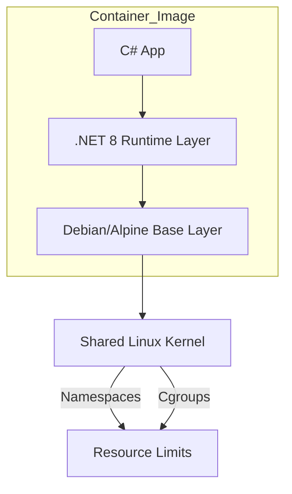

# Containerization and Docker Internals: The Atomic Unit of Deployment
**0. Architectural Vision: The Immutable Ship**
- **Containers are NOT Virtual Machines.** A VM virtualizes the *Hardware*; a Container virtualizes the *Operating System*.
- **The Atomic Unit.** A container contains everything the app needs to run (Code, Runtime, Libraries). It works exactly the same in Dev and Prod.
- **Layers (UnionFS).** Docker images are made of read-only layers. Each line in a Dockerfile adds a layer. This allows for massive caching and storage savings.
- **Isolation (Namespaces & Cgroups).** Linux primitives that ensure Process A in Container 1 cannot see Process B in Container 2 (Security) and cannot steal all the CPU (Resource Control).
- **Architect's View.** We use **Docker** to achieve **Hermetic Reproducability**. We focus on **Image Size**, **Security (Distroless)**, and **Architecture Agnostic builds** (Multi-arch).

**1. Foundational Problem: The "Dependency Hell" and the "Giant VM"**
- **Real-World Impact:** You have 10 apps on one server. 5 need Python 3.8, and 5 need Python 3.11. 
- **What breaks?** "The Stability". Installing 3.11 breaks the global variables for the 3.8 apps. You end up spending days managing `PATH` variables and `apt-get` conflicts.
- **Scale Boundary:** Spinning up a full Linux VM takes 2 minutes and costs 2GB of RAM just for the OS. You can't scale to 1,000 instances of a microservice this way; you'd need a supercomputer just for the "Idle" OS overhead.
- **Failure Story:** A major media platform used full VMs for their worker nodes. During a viral surge, they couldn't spin up new nodes fast enough (5-minute boot time). The site crashed. Migrating to **Docker Containers** allowed them to spin up 1,000 workers in < 5 seconds each, using 90% less RAM per worker because they share the host's Linux Kernel.

**2. Internal System Mechanics: The Engine Room **

### How it Works (Under the Hood)
1. **Namespaces:** Provide the "Virtual View". (PID: Isolated process tree; NET: Isolated IP/Port stack; MNT: Isolated Filesystem).
2. **Control Groups (Cgroups):** Provide the "Limit". (Max 512MB RAM, Max 0.5 CPU cores).
3. **Layered FS:** When you run a container, Docker adds a "Thin Read/Write Layer" on top of the immutable read-only image layers.



**3. Production Engineering in .NET 8 (Optimized Dockerfile)**

### Anti-Pattern: Using the SDK Image for Runtime
```dockerfile
# TERRIBLE: Putting the 800MB .NET SDK image into production.
# It contains compilers and tools that an attacker can use once they breach your app.
# It makes your production image needlessly slow to pull and deploy.
```

### Production-Ready Implementation: Multi-Stage Build
```dockerfile
# 1. Build Stage (Fat image with tools)
FROM mcr.microsoft.com/dotnet/sdk:8.0 AS build-env
WORKDIR /App
COPY . ./
RUN dotnet restore
RUN dotnet publish -c Release -o out

# 2. Runtime Stage (Tiny image with only the bits needed to RUN)
FROM mcr.microsoft.com/dotnet/aspnet:8.0
WORKDIR /App
COPY --from=build-env /App/out .
ENTRYPOINT ["dotnet", "MyWebApp.dll"]

# 3. .dockerignore is CRITICAL
# bin/
# obj/
# .git/
```

**Architecture Strategy:** 
- Use **Alpine Linux** or **Chiseled Ubuntu** images. These reduce the attack surface by removing shells (sh/bash) and non-essential binaries. A chiseled image for .NET 8 can be as small as 50MB.
- Implement **Non-Root Users**. Never run your `ENTRYPOINT` as the `root` user. Use `USER app` in your Dockerfile.

**4. System Interaction & Flow (ASCII Architecture)**

                 ┌──────────────────┐
                 │    OCI Image     │ (The Blueprint)
                 └────────┬─────────┘
                          │ 1. Pull from Registry
          ┌───────────────▼───────────────┐
          │      THE DOCKER RUNTIME       │ (The Orchestrator)
          │  ┌─────────┐   ┌─────────┐    │
          │  │ Namesp. │ → │ Layers  │    │
          │  │ Setup   │   │ Mount   │    │
          │  └────┬────┘   └────┬────┘    │
          └───────┼─────────────┼─────────┘
                  │             │ 2. Request Shared Kernel resources
          ┌───────▼─────────────▼─────────┐
          │       The Host OS Kernel      │ (The Physical Reality)
          └───────────────┬───────────────┘
                          │ 3. Execute isolated process
                ┌─────────▼─────────┐
                │   Ship Anywhere   │
                └───────────────────┘

**5. Strategic Scaling & System Evolution**
- **Container Registries (ACR/ECR).** Storing your private "Golden Images" and scanning them automatically for vulnerabilities (Qualys/Snyk).
- **Sidecar Pattern.** Running a second container in the same pod (e.g., a logging agent or an auth proxy) that shares the network stack with your main app.
- **WASM (WebAssembly) in Containers.** Running tiny, cross-platform WASM modules inside the container runtime for even faster startup and better isolation.

**6. Reliability, Observability & Runtime Governance**
- **Key Metrics:**
    - `Image Size`: Smaller is faster and safer.
    - `Cold Start Time`: How fast does the container reach "Healthy" status?
- **Observability:** Monitor **Container Vertical Scaling**. Are you giving your container 4 CPUs but it only ever uses 0.1? You are wasting money. Use **VPA (Vertical Pod Autoscaler)** logic.

**7. Compromises, Tradeoffs & Alternatives**
- **Kernel Dependency.** You cannot run a Linux Container on a Windows Kernel without a "Linux VM layer" (Hyper-V).
- **Storage Persistence.** Containers are "Ephemeral". If you save a file inside a container and restart it, the file is GONE.
    - *Architect's Tip:* Always use **Volumes** or **External Storage** (S3/Azure Files) for state.

**8. Security Posture & Risk Mitigation**
- **Limit Capabilities.** Use `--cap-drop=ALL` and then add back only what you need (e.g., `NET_BIND_SERVICE`). This prevents a breached app from calling "Admin" kernel functions.
- **Read-Only Root Filesystem.** Mounting the image as read-only. An attacker cannot download a script or binary and "Save" it to the disk.

**9. Technical Edge Cases & System Failure Modes**
- **The "Zombie Process" Reap.** If your C# app (PID 1) doesn't handle children properly, you end up with hundreds of "Zombie" processes that eat the host's PID limit.
    - *Architect's Rule:* Use an init process like `tini` as your ENTRYPOINT.
- **The "Layers Limit".** Docker has a maximum of 127 layers. A badly written Dockerfile with 200 lines of `RUN apt-get...` will fail to build.

**10. Architectural Assessment & Career Progression**
- **Senior:** "We use Docker so we can package our code once and run it anywhere without dependency issues."
- **Principal:** "Architecture is the **Encapsulation of Environment**. We leverage **OCI-Compliant Containers and Layered File Systems** to eliminate the entropy of host-specific configuration. We architecturalize for **Immutable Portability**, utilizing **Namespaced Isolation and Resource Constraints** to ensure that our application behaves as a deterministic, atomic unit regardless of the underlying cloud fabric. For us, a container is not an lightweight VM, but a **Sandboxed Application Context**."
- **Interview Strategy:** Explain the difference between "Image" and "Container". Describe "Namespaces" and "Cgroups".

**11. Real-World Case Study: 1,000 Apps on 10 Nodes**
**Scenario:** A cloud provider hosting 1,000 small C# websites.
- **The Problem:** Hosting 1,000 Windows VMs would cost $100,000/month.
- **The Design:** Migrated to **Linux Containers** on .NET Core.
- **Result:** $10,000/month cost. They can pack 100 containers onto one server because they are so lightweight. Each customer is isolated, but they share the same powerful server hardware efficiently.

**12. Structural Dependencies & Learning Path**
- **Foundations:** Linux Basics, CLI, Networking (Ports/Bridges).
- **Future Steps:** Kubernetes (the scale-up), Helm.
- **Integration Points:** Docker Desktop, Podman, containerd.
